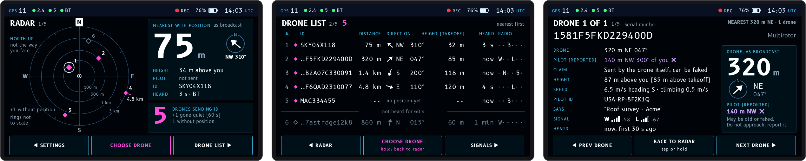
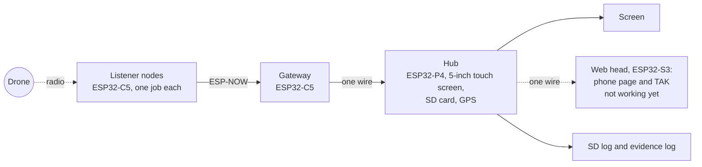

<h1 align="center">
  <br>
  Rotorscope
</h1>

<p align="center">
  <b>An open-source drone detector that only listens.</b><br>
  Built from a handful of small ESP32 boards, with firmware written in Rust.
</p>

<p align="center">
  <a href="https://holdthedoorhoid.github.io/rotorscope/"><b>Read the documentation</b></a>
  &nbsp;·&nbsp;
  <a href="https://holdthedoorhoid.github.io/rotorscope/get-going/step-1-demo.html">Try the demo</a>
  &nbsp;·&nbsp;
  <a href="https://holdthedoorhoid.github.io/rotorscope/project/status.html">Status</a>
  &nbsp;·&nbsp;
  <a href="https://holdthedoorhoid.github.io/rotorscope/project/faq.html">FAQ</a>
</p>



## What it is

Most drones announce themselves by radio. The law in many countries makes them broadcast
**Remote ID**, a kind of digital licence plate that says who they are, where they are and
where their pilot is standing. Many also give themselves away through their maker's own
identification signal, their video link or their control link.

Rotorscope listens for those signals. Small **listener nodes** each watch one kind of signal,
a **gateway** collects what they hear, and a **hub** with a touch screen works out which
drones are nearby, where they are, where their pilots are, and whether anything about their
story looks faked. It can also show crewed aircraft, flag flights that *possibly* break an FAA
rule, warn about jamming and radio attacks, and keep a tamper-evident log.

It never transmits at a drone, never jams, and never interferes with an aircraft. The only
radio it sends is its own boards, and your phone, talking to each other.



## Where it stands

> [!IMPORTANT]
> Rotorscope is a work in progress, and this is the honest summary as of 2026-11-18.
> A great deal is built and tested, on computers and on a bench of real boards. **It has never
> heard a real drone, and there is no kit on sale.**

| How far it is proven | What |
|---|---|
| **Heard for real** | Crewed aircraft (ADS-B), through an ADSBee 1090 receiver read from a laptop, with the project's own decoder agreeing on live traffic |
| **Proven on the air** with real boards and the project's own test transmitter | Remote ID in all seven of its forms over Wi-Fi (2.4 and 5 GHz) and Bluetooth (legacy, Bluetooth 5 and Long Range); open FPV video links; the whole chain from listener node to gateway to the hub's touch screen and SD log; the signed link between boards |
| **Proven on recordings** | DJI DroneID (including spotting newer encrypted O4 drones) and DJI radio-link fingerprints, on public recordings of real DJI drones |
| **Simulated only** | Spoofed-drone checks, Wi-Fi and Bluetooth attack alarms, jamming alarms, attacks on drones, GPS-spoofing checks, FAA rule flags, analog FPV video, the control-link and extra aircraft-signal decoders, GPS and ADSBee wired to the P4 hub, nodes wired to the hub on one cable |
| **Built, not yet tried** | The phone page and TAK output from the kit. They need a second board (the "web head") whose firmware does not currently link (it is over its memory budget); TAK output works today from the laptop viewer. The LR2021 radio node for control links and extra aircraft signals (no board in hand) |
| **Planned** | Kit hardware, range measurements, a hardware-held evidence key and secure boot, long-range links between units |

The full, piece-by-piece table is on the
[Status page](https://holdthedoorhoid.github.io/rotorscope/project/status.html), and
[What it can and cannot do today](https://holdthedoorhoid.github.io/rotorscope/start/capabilities.html)
says the same thing in plain words.

## Try it now, with no hardware

You need a Linux computer with [Rust](https://rustup.rs) installed (macOS is untried, and the viewer does not build on Windows). The first build takes a few minutes.

```bash
git clone https://github.com/holdTheDoorHoid/rotorscope
```

```bash
cd rotorscope
```

```bash
cargo run --release -p rid-view -- --demo
```

That runs the laptop viewer with made-up drones, using the same tracking code as the hub.
[Step 1 of the guide](https://holdthedoorhoid.github.io/rotorscope/get-going/step-1-demo.html)
walks through it and explains what you are looking at.

## Documentation

The documentation is a website, **<https://holdthedoorhoid.github.io/rotorscope/>**, and the
same pages are readable here in [`docs/`](docs/README.md). Every page is marked 🟢 Beginner,
🟡 Intermediate or 🔴 Expert.

| If you are... | Start with |
|---|---|
| New to all of this | [What is Rotorscope?](docs/start/what-is-rotorscope.md) and [How drones give themselves away](docs/start/drone-signals-101.md) |
| Wanting to try or build it | [Choose your path](docs/get-going/README.md): the demo, then one board, then the full kit |
| Using one | [The screen](docs/use/screen.md), [Reading a detection](docs/use/reading-detections.md), [Alarms and warnings](docs/use/alarms.md) |
| Deciding whether to trust it | [What it can and cannot do today](docs/start/capabilities.md), [Status](docs/project/status.md), [FAQ](docs/project/faq.md) |
| A radio or security person | [Signal catalogue](docs/SIGNALS.md), [Attacks and interference](docs/detect/threats.md) |
| A developer | [A tour of the repository](docs/dev/repo-tour.md), [Crate reference](docs/dev/crates.md), [Wire protocol](docs/dev/protocol.md) |
| Lost in the jargon | [Glossary](docs/project/glossary.md) |

The engineering plan and the survey behind it are in [PLAN.md](PLAN.md) and
[RESEARCH.md](RESEARCH.md).

## What is in this repository

| Folder | What it holds |
|---|---|
| [`crates/`](crates) | The shared logic: decoders, the tracker, the checks. Hardware-free Rust that is tested on a computer and reused unchanged in the firmware. |
| [`firmware/`](firmware) | One project per board role: listener nodes, gateway, hubs, and the bench test transmitter. |
| [`tools/`](tools) | Laptop programs and scripts: the `rid-view` viewer, flashing helpers, the evidence verifier, the bench test runner. |
| [`web/`](web) | The page a phone sees on the hub's hotspot. |
| [`docs/`](docs/README.md) | The documentation. |

## Building

```bash
cargo test
```

runs the tests for the shared crates and the laptop tools. Each folder in `firmware/` is its
own project; [Set up your machine](docs/dev/setup.md) and
[Build, test and flash](docs/dev/build-test-flash.md) cover the toolchains, the kit's link
key and flashing boards.

## Conduct

This project only listens. `rid-beacon` exists purely to test the receivers on the bench. It
uses an obviously fake identity and the lowest transmit power, and must not be used to
impersonate an aircraft. See [Law, safety and ethics](docs/start/law-and-ethics.md).

## Contributing and security

Bug reports, recordings of signals the project has not yet heard, documentation fixes and code
are all welcome: see [Contributing](docs/dev/contributing.md). Please report security problems
privately, as [SECURITY.md](SECURITY.md) describes.

## Acknowledgements

The C5 raw-radio work builds on findings from C5VRX by Twotoz and the C5VRX contributors
(https://github.com/Twotoz/C5VRX, https://twotoz.github.io/C5VRX/), ESPARGOS/esp-sdr,
cyber-murmel/esp-sdr-zephyr and CapnBry/widscan58. The DJI DroneID work builds on RUB-SysSec's
DroneSecurity research, proto17/dji_droneid and anarkiwi/samples2djidroneid, and on the O4 record
and PHY description in EdwardBlair/dji-droneid-spec. `crates/droneid` uses these for protocol
facts only (layouts, constants, the published scrambler example); it contains no code from any
of them. The two test recordings come from RUB-SysSec/DroneSecurity (AGPL-3.0) and are
downloaded on demand, never committed.

The full list of projects and papers this work stands on is in
[Credits and licences](docs/project/credits.md).

## License

GPL-3.0-or-later (see [`LICENSE`](LICENSE)). Anyone may use, modify and sell Rotorscope,
including as kits, but whoever ships a changed version must publish their changes under the
same license.

`third_party/opendroneid-core-c` keeps its own Apache-2.0 license and is used only by host-side
tests. Every copy of someone else's code, fonts or libraries in the repository, with its licence,
version and origin, is listed in [Credits and licences](docs/project/credits.md).
