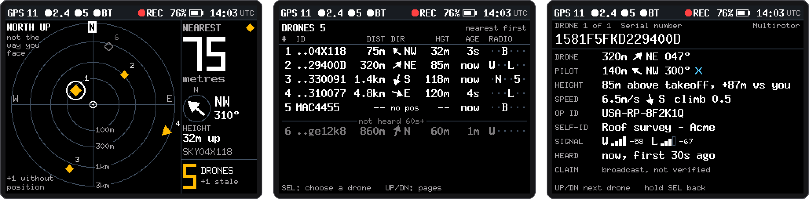
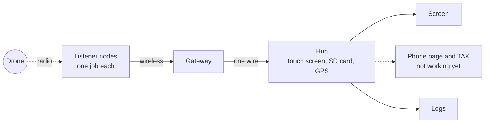

# Rotorscope documentation

**Level: 🟢 Beginner** · Start here. This page helps you find the part of the documentation
written for you.

**Rotorscope is an open-source drone detector that only listens.** It is built from a handful
of small, cheap ESP32 boards. Each board listens for one kind of radio signal that drones
send, and a central hub with a screen puts everything together: which drones are nearby, where
they are, where their pilots are, and whether anything about them looks wrong.

It never transmits at a drone, never jams, and never interferes with an aircraft. The only
radio it sends is its own boards, and your phone, talking to each other.

> [!IMPORTANT]
> Rotorscope is a work in progress. A great deal is built and tested on the bench, but as of
> 2026-11-18 it has never heard a real drone, and there is no kit on sale. Every page says how far each feature has been proven. The plain summary is on
> [What it can and cannot do today](start/capabilities.md).

## Find your way

| If you are... | Start with | Then |
|---|---|---|
| **Curious**, and new to all of this | [What is Rotorscope?](start/what-is-rotorscope.md) | [How drones give themselves away](start/drone-signals-101.md) |
| **Wanting to try it** today, with no hardware | [Step 1: The demo](get-going/step-1-demo.md) | [Choose your path](get-going/README.md) |
| **Building one** | [Step 2: One board](get-going/step-2-one-board.md) | [Step 3: The full kit](get-going/step-3-full-kit.md) |
| **Using one** at an event or a site | [The screen](use/screen.md) | [Alarms and warnings](use/alarms.md) |
| **Wondering whether to trust it** | [What it can and cannot do today](start/capabilities.md) | [Status](project/status.md) and the [FAQ](project/faq.md) |
| **A radio or security person** | [Signal catalogue](SIGNALS.md) | [Attacks and interference](detect/threats.md) |
| **A developer** | [A tour of the repository](dev/repo-tour.md) | [Crate reference](dev/crates.md) |
| **Lost in the jargon** | [Glossary](project/glossary.md) | [FAQ](project/faq.md) |

## How the documentation is organised

Every page opens with a level, so you always know whether it was written for you.

| Marker | Level | Written for |
|---|---|---|
| 🟢 | Beginner | Anyone. No electronics or programming background needed. |
| 🟡 | Intermediate | Someone comfortable with a terminal and a USB cable. |
| 🔴 | Expert | Someone who reads code, datasheets or radio standards. |

The sections run from gentle to deep:

1. **Start here** explains what Rotorscope is, what drones broadcast, and where the limits
   are. No hardware, no commands.
2. **Get going** is a three-step ladder: a demo on your laptop, then one real board, then the
   full kit.
3. **Using Rotorscope** is the operator's manual: the screen, the alarms, the logs.
4. **How it works** follows a signal from the air to the screen.
5. **What it detects** covers each family of signal and each kind of attack, with a gentle
   overview leading into the detailed write-ups.
6. **Hardware** lists the boards and every pin.
7. **Developer guide** is for people changing the code.
8. **Project** holds the status, the roadmap, the FAQ and the glossary.

## The system at a glance

Small **listener nodes** each watch one kind of signal. A **gateway** collects what they hear
and passes it down a wire to the **hub**, which tracks every drone, checks its story for signs
of fakery, and shows the result. [The big picture](how/architecture.md) explains each part.

## Three promises these pages make

- **Plain words first.** Every term is explained where it first appears or in the
  [glossary](project/glossary.md).
- **Honest about proof.** "Works" always comes with how it was shown to work: heard for real,
  proven on the air with our own test transmitter, proven on recordings, simulated only,
  built, not yet tried, or planned.
- **Checked against the code.** Commands, pins and numbers come from the repository, not from
  memory. If you find one that is wrong, that is a bug:
  [please report it](https://github.com/holdTheDoorHoid/rotorscope/issues).

**Next:** [What is Rotorscope?](start/what-is-rotorscope.md)
