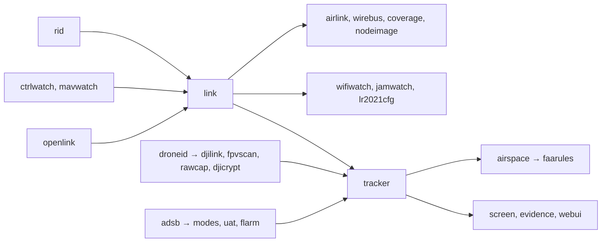

# Crate reference

**Level: 🔴 Expert** · All 34 library crates under `crates/`: what each does, its main types,
features, limits, tests, licences and how far it has been proven, as of commit `6651ecd`
(2026-11-18).

A **crate** is one Rust library (see the [glossary](../project/glossary.md)). The crates hold
nearly all of Rotorscope's logic as pure code with no hardware access, so it can be tested on a
laptop with `cargo test`. The firmware under `firmware/` and the tools under `tools/` are thin
layers that move bytes between these crates and the radios, screens and files. The
[Firmware reference](firmware.md) and [Tools reference](tools.md) cover those layers; the
[Wire protocol reference](protocol.md) covers the bytes that travel between boards.

> [!IMPORTANT]
> Rotorscope has not yet heard a real drone. The proof level given for each crate below uses the
> six phrases from [Writing these docs](docs-style.md#say-what-is-proven-every-time). Where a crate
> is plumbing rather than a detector, the line says what has run where.

## Overview

"`no_std`" means the crate builds without Rust's standard library, so it can run on the ESP32
chips. The "Used by" column comes from each `firmware/*/Cargo.toml` and `tools/*/Cargo.toml`;
"nodes" means node-wifi, node-ble, node-sdr and node-lr (through `firmware/node-common` where
noted).

| Crate | Purpose | `no_std` | Used by |
|---|---|---|---|
| `adsb` | Parser for the ADSBee 1090's CSBee text lines; the shared aircraft record | yes | hub-p4, hub (S3), rid-view, modes-live; `modes`, `uat`, `flarm`, `faarules`, `tracker` |
| `aerohop` | FLARM / OGN frequency-hop plans and a hub-synced UTC clock | yes | node-lr; `lr2021cfg` |
| `airlink` | ESP-NOW packets: batches, beacons, commands; version 3 sealing and checking with per-node keys; the gateway's keyless relay | yes | gateway, hub-p4, nodes via node-common; `coverage`, `hublink`, `nodeimage` |
| `airspace` | Offline airspace and terrain pack: format, lookups, sun elevation, line of sight | yes (writer needs `alloc`) | hub-p4; airspace-pack; `faarules` |
| `coverage` | Coverage coordinator: which node listens to what | yes | hub-p4, node-wifi |
| `ctrlwatch` | Drone and RC control-link recognition (ExpressLRS, mLRS, SiK, OpenLRSng, energy) | yes | node-lr, hub-p4; `link`, `tracker`, `coverage`, `lr2021cfg`, `screen` |
| `djicrypt` | DJI O4 DroneID decryption with an owner-supplied key | yes | hub-p4 |
| `djilink` | Fingerprints of DJI video, controller and FPV air-unit links from raw captures | yes | node-sdr; rfuav-check |
| `droneid` | DJI OcuSync DroneID burst receiver, fixed point | yes, without its default feature `std` | node-sdr, hub-p4; droneid-file, droneid-hil, rawcap-pull, rfuav-check; `tracker`, `djilink`, `fpvscan`, `rawcap`, `djicrypt` |
| `evidence` | Tamper-evident, hash-chained, signed evidence log | yes (`verify` needs `std`) | hub-p4; evidence-verify, evidence-server |
| `faarules` | Possible FAA rule violation flags over tracks and an airspace pack | yes | hub-p4, hub (S3); airspace-pack |
| `flarm` | Receive-only OGN tracker and (feature `legacy`) FLARM legacy decoders | yes | hub-p4; flarm-keys |
| `fpvscan` | Analog FPV and RF scanner DSP for the raw-capture C5 | yes | node-sdr; rfuav-check; `jamwatch`, `djilink` tests |
| `gnss` | GNSS driver core (u-blox MAX-M10S, Quectel LC29H) and receiver integrity monitor | yes | hub-p4, hub (S3) |
| `hublink` | The P4 hub's side of the keyed ESP-NOW link: kit records, boot counter, the gateway wire | yes | hub-p4 |
| `jamwatch` | Jamming detection for the raw-capture C5 | yes | node-sdr |
| `kitkeys` | Kit master, per-node keys, key records, roster and boot counter for the ESP-NOW link | yes | hub-p4, nodes via node-common; link-key; `airlink`, `hublink`, `nodeimage` |
| `link` | Node-to-hub wire protocol: postcard + COBS frames | yes | every firmware except rid-beacon; rid-view, evidence-server; most crates |
| `lr2021cfg` | The Semtech LR2021 as a receive-only radio, described as data | yes | node-lr |
| `mavwatch` | Hostile MAVLink detection and the MAVLink frame scanner | yes | node-lr; `ctrlwatch`, `wifiwatch` |
| `modes` | Mode S / ADS-B (1090 MHz) decoder | yes | hub-p4; modes-live; `lr2021cfg` |
| `nodeimage` | Which firmware images a node holds, and the job carried across an image switch | yes | node-wifi, node-ble, nodes via node-common |
| `odid-ref` | Host-only build of the official opendroneid-core-c, for differential tests | no (host only) | `rid` tests only |
| `openlink` | Recognition of open digital FPV links (wfb-ng, OpenHD, RubyFPV, DroneBridge) | yes | node-wifi, rid-beacon, hub (S3), rid-view; `link`, `tracker` |
| `rawcap` | Host-testable logic of the C5 raw-radio capture layer | yes, without its default feature `std` | node-sdr; rawcap-pull, droneid-hil, rfuav-check |
| `rid` | Remote ID (ASTM F3411 / ASD-STAN EN 4709-002) extraction, decoding and encoding | yes | node-wifi, node-ble, rid-beacon, hub-p4, hub (S3); rid-view, rid-ble-beacon, airspace-pack, evidence-server; `link`, `tracker`, `faarules`, `evidence`, `screen` |
| `screen` | On-device screen: view-model, button state machine, renderer | yes | hub-p4, hub (S3) |
| `sdnative` | SD card native 1-bit bus, bit-banged over three GPIOs | yes | hub-p4 |
| `tracker` | Hub logic: merge detections into tracks, range and bearing, JSON / CoT / CSV | yes | hub-p4, hub (S3); rid-view, airspace-pack; `faarules`, `screen` |
| `uat` | UAT (978 MHz) ADS-B decoder with Reed-Solomon correction | yes | hub-p4 |
| `webui` | The phone web page, gzipped, plus the rules for serving it | yes | hub (S3, also the P4's web head); rid-view |
| `wifidrone` | Maker table for Wi-Fi drones: address prefixes and network names | yes | node-wifi; rid-view; `tracker`, `wifiwatch` |
| `wifiwatch` | Wi-Fi and Bluetooth attack detection from raw frames | yes | node-wifi, node-ble |
| `wirebus` | Many radio nodes on one hub UART: poll scheduler, join slots, addresses | yes | hub-p4; nodes via node-common (feature `wirebus`) |

## How the main crates depend on each other

Boxes group crates; an arrow means "is used by". Only the main paths are drawn.

The exact edges, from the `[dependencies]` of each `Cargo.toml`: `link` uses `rid`, `openlink` and
`ctrlwatch` (which uses `mavwatch`); `tracker` uses `rid`, `link`, `ctrlwatch`, `openlink`, `adsb`,
`wifidrone` and `droneid`; `wifiwatch` uses `link`, `wifidrone` and `mavwatch`; `jamwatch` uses
`fpvscan` and `link`; `djilink`, `fpvscan`, `rawcap` and `djicrypt` use `droneid`; `coverage` uses
`link`, `ctrlwatch` and `airlink` (for `GATEWAY_CHANNEL`); `lr2021cfg` uses `link`, `modes`, `aerohop` and `ctrlwatch`; `faarules`
uses `airspace`, `tracker`, `rid` and `adsb`; `screen` (feature `tracker`) and `evidence` (feature
`decode`) use `link` and `rid`. `airlink` uses `kitkeys`, which depends only on `sha2`; `hublink`
uses `airlink`, `kitkeys`, `link` and `evidence`.

## Keys and secrets

Four crates touch key material. **No key is committed to the repository**, except one test key
that is published on purpose and labelled as such.

| Crate | Key | Where it comes from | When |
|---|---|---|---|
| `kitkeys` (used by `airlink`, `hublink`, link-key) | The kit master and each ESP-NOW node's own key | `tools/kit.key` (git-ignored, made by `cargo run -p link-key -- kit new`); link-key writes each node's key to its `rskey` partition and the master and roster to the hub's `rskit` partition | **Run time**: each board reads its key record from flash at boot. No firmware build reads a key file or variable, and every image is the same for every kit ([ESP-NOW in depth](../ESPNOW.md#securing-the-link)) |
| `djicrypt` | The receiver's SM2 private scalar for DJI O4 DroneID | `ROTORSCP/O4KEY.TXT` on the hub's SD card, provided by the owner | **Run time**; without it O4 stays detect-only |
| `flarm` (feature `legacy`) | The FLARM legacy key constants | `ROTORSCP/FLARMKEY.TXT` on the hub's SD card; `tools/flarm.keys` on a laptop (both in `.gitignore`) | **Run time** |
| `evidence` | The ECDSA P-256 signing key for checkpoints | `ROTORSCOPE_DEV_KEY` at hub-p4 build time (64 hex digits, checked by `crates/evidence/src/devkey.rs`); unset = the published test key, which the screen and every checkpoint say | **Build time** (a hardware key in eFuse is planned, not built) |

The crates never print a key: `kitkeys`' `MasterKey`, `NodeKey` and `LinkKey` print as `..` in
`Debug`, have no `Display` and overwrite themselves when dropped; `djicrypt`'s
`PrivateKey` and `SessionKey` have no `Debug` or `Display` and are wiped on drop; `flarm::Keys`
has no `Display` and its `Debug` prints nothing of the values; the build scripts never echo a key
file's contents, even a malformed one.

---

## Remote ID and decoding

### rid

**What it does.** Finds Remote ID inside raw 802.11 frames and BLE advertisements, splits a
payload (one message or a Message Pack) into 25-byte raw messages, and decodes each into a typed
message. Nodes forward raw messages; every board decodes with this one crate "so every chip agrees
on what a byte means" (crate doc). Two non-ASTM formats live alongside: `rid::dji` (DJI's legacy
Wi-Fi DroneID beacons) and `rid::cn` (China's GB 46750-2025 broadcast packet).

**Main API.** `wifi::extract`, `ble::extract` (AD type 0x16, UUID `0xFFFA`, app code `0x0D`),
`message::raw_messages`, `message::decode` → `message::Message` (`BasicId`, `Location`, `Auth`,
`SelfId`, `System`, `OperatorId`), `encode` (feature), `dji`, `cn`. Types: `Transport` (five
variants, see the [protocol page](protocol.md#ridtransport)), `RawMessage = [u8; 25]`, `Error`
(`Truncated`, `UnknownType`, `BadPack`, `Invalid`, `BufferTooSmall`). Code enums carry a
`Reserved(u8)` escape for values the standard does not assign.

**Features.** `serde`: `Serialize` on the message types (and `Deserialize` on `Transport` and
`Error`); used by every firmware that prints JSON and by `link`. `encode`: message, Message Pack
and frame builders, for the test transmitters (`rid-beacon`, `rid-ble-beacon`).

**Limits.** `MESSAGE_SIZE = 25`, `MAX_PACK = 9`.

**Tests.** 35 `#[test]` functions, most under `crates/rid/tests/`:
`differential.rs` encodes 50,000 random valid inputs per message type with opendroneid-core-c and
checks both decoders agree field by field and both encoders give the same bytes; `frames.rs`
compares whole beacon and NAN frames with core-c's; `cn.rs` checks the GB 46750 decoder against
core-c's `libopendroneidcn`; `dji.rs` uses hand-built frames; `robustness.rs` throws random bytes
and mutated frames at every entry point (`RID_FUZZ_ITERS`, default 2,000,000 per test).

**Licences.** Rotorscope's GPL-3.0-or-later. Tests link the vendored
`third_party/opendroneid-core-c` (Apache-2.0) through `odid-ref`; no core-c code is in the crate.

**Proof level.** ASTM Remote ID: **proven on the air** from the project's own test transmitter
(`rid-beacon`: Wi-Fi beacon and NAN at 2.4 and 5 GHz, BT4, BT5 extended and Long Range) and from a
laptop's Bluetooth 4 test advert. Not yet **heard for real** from a drone. DJI legacy Wi-Fi and GB
46750: **simulated only**.

### odid-ref

**What it does.** Builds the official opendroneid-core-c (including its GB 46750 variant) with the
`cc` build dependency and exposes it through hand-written FFI mirrors of the C structs, so `rid`'s
tests can compare against it. Host only, `publish = false`, never a dependency of firmware.

**Main API.** The `ODID_*` struct mirrors and constants, `uas_data()`, `check_layout()` and
`check_cn_layout()` (compare every mirror against the C compiler's `sizeof`, so a drift fails
loudly), `DroneRIDData_t` and the `CN46750_RID_Decode` binding.

**Tests.** 1 `#[test]` (the layout check). **Licence.** The C library keeps its Apache-2.0 licence
(`third_party/opendroneid-core-c`). **Proof level.** Test support, not a detector.

### wifidrone

**What it does.** Says whether a Wi-Fi network belongs to a drone or drone controller from two
clues: the address prefix (OUI, or a 28-bit MA-M block) registered to the maker, and the default
network name. `classify` returns an index into `MAKERS`. That index travels on the wire
(`WifiDroneSighting::maker`, and bits 24-31 of the drone-attack threats' `detail`), so **entries
are only appended, never reordered or removed**.

**Main API.** `MAKERS` (13 entries at `6651ecd`: DJI, DJI Tello, Parrot, Autel, Skydio, Yuneec,
Holy Stone, Potensic, Hubsan, Snaptain, Syma, Toy drone, SkyViper), `classify(mac, ssid)`,
`name_maker`, `has_prefix`, `maker_name`; types `Prefix`, `Pattern`, `Tail`, `Maker`.

**False-positive rules.** A prefix with `alone: false` counts only with one of that maker's names,
and a name with `alone: false` only with one of its prefixes; a locally administered (randomised)
address never matches a prefix. Prefixes were checked against the IEEE registry as mirrored by
maclookup.app (2026-11-14); community-sourced names are marked.

**Features.** None. **Tests.** 9. **Proof level.** **Simulated only** (made-up frames, including
node-wifi's on-chip `floodtest` injection described in [Bench tests](../BENCH.md)).

---

## DJI

### droneid

**What it does.** A `no_std`, fixed-point receiver for DJI's OcuSync DroneID burst (LTE-like
OFDM: 600 QPSK carriers at 15 kHz, 1024-point FFT at 15.36 MS/s, two Zadoff-Chu reference symbols,
LTE turbo code). Raw complex baseband in, the serial number and the positions of aircraft, home
point and pilot out. Handles capture rates 15.36, 20, 30.72, 40 and 50 MS/s, both burst layouts
(9 symbols, and the 8-symbol layout of Mavic Pro / Mavic 2 and O4), and two decode paths: hard
decisions on the systematic bits plus CRC-24A, then a max-log-MAP turbo decoder when that fails.
Recognises O4's encrypted `CRYP` / `INFP` records after every structural check of the spec, but
**never decrypts and holds no keys**. `follow` predicts the next channel of each followed O4
session.

**Main API.** `rx::Receiver` (`new(capture_rate)`, `decode_all`), `payload::FlightInfo`,
`payload::Record`, `payload::O4Checks`, `payload::Encrypted::core`, `o4plain` (the plug-in point
for a decryption layer), `follow`, and the DSP modules `fft`, `resample`, `turbo`, `ratematch`,
`scramble`, `zc`, `crc`, `math`. Constants `K = 1408`, `D = K + 4`, `E = 7200`.

**Features.** `std` (**on by default**): host conveniences only (reading IQ files, chunked decoding
of long recordings, float resampling for experiments; module `host`, example `quant`). Firmware
uses `default-features = false`; the decode path never allocates.

**Limits.** `rx::Receiver` owns about 125 KiB of working memory (52 KiB burst buffer, 37 KiB
turbo, 9 KiB filter taps) and the deepest call adds about 30 KiB of stack (crate doc). FFT is an
in-house 1024-point radix-2 on `i16` with block floating point; resampling is a polyphase FIR with
24 Q14 taps per branch.

**Tests.** 70. `tests/recordings.rs` decodes the two public RUB-SysSec/DroneSecurity recordings
(50 MS/s), fetched on demand by `tools/fetch-droneid-samples.sh` and skipped with a message when
absent; it checks format and CRC only and never prints the real serial. `vectors.rs` rebuilds the
published O4 transmit chain (`src/vectors.rs`): the five bit-level stages reproduce the spec's SHA-256 digests
exactly, the two floating-point stages do not, for a reason not yet known
([O4 DroneID in depth](../DRONEID-O4.md)). `src/synth.rs` makes synthetic bursts.

**Sources and licences.** Protocol facts from the NDSS 2023 paper and receiver
(RUB-SysSec/DroneSecurity), proto17/dji_droneid, anarkiwi/samples2djidroneid and
EdwardBlair/dji-droneid-spec, read for facts only; coding facts from 3GPP TS 36.211/36.212. No
third-party code is included. The recordings are AGPL-3.0 and never committed.

**Proof level.** OcuSync plaintext records: **proven on recordings** (every burst in both public
recordings). O4 records: **proven on recordings** (the spec's vectors, and CRC-valid records from
public RFUAV recordings of a DJI Mini 4 Pro and an Avata 2, on a computer); O4 session tracking and
the channel follower: **simulated only**. Not yet **heard for real** on a C5 from a DJI drone.

### djilink

**What it does.** Receive-only fingerprints of DJI's radio links from one 20 MS/s raw capture of
the C5: DJI video downlink (OcuSync 2/3, O3, O4; 15 kHz OFDM with a 4.7 µs prefix), DJI controller
uplink (about 1.1 or 2.2 MHz bursts hopping on a 2 MHz raster, confirmed by `hop::HopTracker` when
bursts appear on different centres) and DJI FPV (V1 / Vista) air units on integer-MHz channels.
**Presence only**: nothing here demodulates a payload, touches a key or transmits. Per capture it
measures bursts (1.6 µs envelope), the spectrum (sixteen 1024-point FFTs in 256 groups of 78 kHz)
and the cyclic prefix folded at the symbol period; `classify::classify` turns them into a
`classify::Verdict`, which node-sdr reports as the protocol-7 `RfKind`s.

**Main API.** `features(x, &mut Scratch) -> Features`, `classify`, `Context`, `Verdict`,
`HopTracker`, `Timeline`, `TimelineStats`, `plan::O4_BAND_KHZ`. Constants `FS = 20_000_000`,
`MAX_IN = 16_384`.

**Limits.** All working memory in `Scratch` (12.6 KiB) plus about 2 KiB of stack; `Timeline`
1.5 KiB; `HopTracker` under 100 bytes. Integer per-sample work.

**Features.** None. **Tests.** 22, against synthetic signals through `rawcap`'s 4-bit model.
`tools/rfuav-check` runs it over RFUAV recordings ([DJI radio links in depth](../DJI-LINKS.md)).

**Proof level.** **Proven on recordings** (RFUAV: DJI Mini 4 Pro, Avata 2, FPV Combo, and Autel
EVO Nano, through a model of the C5's capture path). Not yet run on the chip against a live
transmitter.

### djicrypt

**What it does.** Decrypts DJI O4 DroneID with an owner-supplied key (owner decision 2026-11-16):
unwraps the 16-byte AES session key from a `CRYP` record with the receiver's SM2 private scalar
(`unwrap_cryp`), keeps recent session keys by key ID (`Decryptor`), and decrypts `INFP` records
(AES-128-CTR) into `droneid::o4plain` types. **It ships no key**; see [Keys and
secrets](#keys-and-secrets).

**Main API.** `PrivateKey`, `SessionKey`, `core_of`, `key_id_of`, `unwrap_cryp`, `decrypt_core`,
`Plain`, `Decryptor<N>`, `Stats`, `Error` (including `Replay` and `TooFarAhead`), `KeyError`.

**Limits and constants.** `CRYP_LEN = 163`, `INFP10_LEN = 128`, `INFP11_LEN = 160`;
`SESSION_TTL_MS` 30 minutes; unwraps rate-limited to `UNWRAP_PER_S = 2` with `UNWRAP_BURST = 4`;
`GPS_AHEAD_SLACK_MS = 10_000`, `SEQ_PER_S = 50` (how far an INFP-10 record may jump ahead).

> [!WARNING]
> Decrypted is not authenticated (crate doc): anyone with the receiver's public key can mint a
> session, a recording can be replayed and AES-CTR is malleable. The tracker treats every decrypted
> position as a claim, not a fact ([Spoofed drones](../SPOOFING.md)).

**Dependencies.** RustCrypto `sm2` 0.13, `sm3`, `sha2`, `aes`, `ctr`, `subtle`, `zeroize`, all
without default features. **Tests.** 13, with a key made up in the tests. **Proof level.**
**Simulated only**; not tested on a real aircraft.

---

## FPV and other links

### openlink

**What it does.** Recognises open-source digital FPV and telemetry links (wfb-ng and OpenIPC,
OpenHD, RubyFPV, DroneBridge for Linux) from one raw 802.11 frame, by their home-made headers. It
reads only the 802.11 header and, for two systems, a few cleartext bytes; it never decodes video or
MAVLink. The crate doc explains why ordinary Wi-Fi cannot match (for example `57:42:..` is a group
address and can never be a transmitter's address).

**Main API.** `classify(frame)` (FCS slot included) and `classify_mpdu`, returning `OpenLink`
(`system`, `id`, `port`, `direction`, `tx`); `System`, `Direction`, `WfbStream`; `Sightings` /
`Sighting` (per-link counts and a report rate limit). Constants `FCS_LEN = 4`,
`WFB_PREFIX = [0x57, 0x42]`, `WFB_DEFAULT_LINK_ID = 0x7505D6`, `RUBY_MAC`, `RUBY_BROADCAST_ID`.

**Features.** `serde` (the wire format). `build`: fake frames for the bench beacon, transmit side
only (`rid-beacon` enables it; their identifiers are made up on purpose, such as
`FAKE_WFB_LINK_ID = 0x7E57ED`).

**Tests.** 25. **Proof level.** **Proven on the air** (2026-11-14): the test beacon's fake frames
for all four systems heard on channels 6, 149, 161 and 165, C5 to C5. Not yet heard from real FPV
hardware, and wfb-ng's default LDPC / STBC coding is untested (`firmware/rid-beacon/README.md`).

### rawcap

**What it does.** The pure-logic half of the ESP32-C5 raw-radio capture layer (node-sdr supplies
the registers). Two sample paths: **path B**, continuous, a 4-bit window of I and Q per byte at
40 MS/s through PARL_IO into a DMA ring (`iq`, `ring`, `trigger`, `dsp`); and **path A**, a
snapshot of 16,380 words of full 10-bit I/Q at 20 MS/s, 822 µs (`word`). `dump` streams captures
over USB as checksummed text lines and decodes them on the laptop (`tools/rawcap-pull`); `cmd`
parses the USB console; `budget` limits how much of the capture loop the DroneID decoder may take.

**Features.** `std` (**on by default**): host-side decoding of dumps (`dump::Collector`).
node-sdr uses `default-features = false`.

**Limits.** `dump::MAX_DUMP_BYTES = 4 x 16_384`, `MAX_DUMPS = 64`, `CHUNK = 48`; ring
`NODE_BYTES = 3584` x `NODES = 16`.

**Tests.** 49, including `tests/pipeline.rs` and `tests/follow_forge.rs`. **Proof level.** **Proven
on the air** as plumbing: runs in node-sdr on bench C5 boards (`firmware/node-sdr/BRINGUP-RESULTS.md`); no real drone signal has been
captured yet.

### fpvscan

**What it does.** Analog FPV and RF scanner DSP for the raw-capture C5: detection only, never video.
On each channel it measures every trigger probe's level against the noise floor (`meter`), and on a
loud channel analyses one 20 MS/s capture (`analyse`): FM-demodulates it and looks for the
15.6/15.7 kHz line rate of analog video, measures the cyclic-prefix autocorrelation at the Wi-Fi and
LTE-style symbol lengths, and the occupied width and flatness. `classify` turns that into a `Kind`.
Wi-Fi can only become analog video by showing a line rate, which OFDM does not have. At 2.4 GHz
(`channels24`, `band`, `dsss`) it adds its own noise floor and an 802.11b DSSS recogniser.

**Main API.** `analyse`, `Analysis`, `Scratch`, `classify`, `Dwell`, `Kind`, `FloorTracker`,
`Meter`, `band::Band`, `channels`, `channels24`. `FS = 20_000_000`; `channels::DWELL_MS = 60`; 5.8
GHz LO range 5180-5800 MHz, 2.4 GHz LO range 2200-2650 MHz.

**Limits.** `Scratch` about 26 KiB (put it in a `static` or PSRAM). **Features.** None.

**Tests.** 21, on synthetic signals through the real 4-bit path (`tests.rs`, `tests24.rs`; the
2.4 GHz file says nothing there has been checked against a real 2.4 GHz video transmitter).

**Proof level.** Analog video: **simulated only**. On the bench the FPV job ran 200 s on a C5 with
no analog transmitter present and reported no false analog video
(`firmware/node-sdr/BRINGUP-RESULTS.md`). Its OFDM checks also run over RFUAV recordings through
`tools/rfuav-check`.

### ctrlwatch

**What it does.** Recognises drone and RC **control links** for the LR2021 node, receive-only.
`scan` holds scan plans as data (per system and region, the receive configurations and dwells);
`recognise` turns one received packet into a `Recognised` (system, rate, `Confidence`, and only
when opted in the identifier and decoded content); `energy` builds an energy map and classifies
hop patterns (how closed systems such as Crossfire, Tracer, Ghost, FrSky and FlySky are seen:
energy and timing only); `Sightings` rate-limits reports; `elrs::Follower` follows one ExpressLRS
link's hops once its UID is known or recovered (`elrs::UidRecovery`); `contested` spots a link heard
from more transmitters than it can have (the `ControlContested` threat).

| System | Packet recognition | Without any key |
|---|---|---|
| ExpressLRS 900 / 2.4 GHz, LoRa rates | yes | Confirmed from a sync packet; Likely from other packets on the sync channel |
| ExpressLRS FLRC / FSK rates | no | energy and timing only |
| mLRS LoRa modes | yes | Confirmed (91-byte frame with its own CRC) |
| mLRS FLRC / FSK modes | no | energy only |
| SiK / RFD900 | yes | Confirmed |
| OpenLRSng | yes | Likely, Confirmed over several packets |
| Crossfire, Tracer, Ghost, FrSky R9 / ACCESS, FlySky AFHDS 2A, FrSky D16 | no | energy and timing candidates only |

**The opt-ins.** `Config { read_ids, decode_content }`, both off by default. Identifiers (ELRS UID
bytes, SiK NET ID, mLRS sync word, OpenLRSng rf_magic) are only copied out with `read_ids`; RC
channels, CRSF telemetry, MAVLink and the raw packet only with `decode_content` (enabled by the
owner on their stated permission, 2026-11-17). No encryption is broken: SiK AES and encrypted mLRS
are reported as `ControlContent::Opaque`. The crate doc cites the 2020 DOJ/FAA/FCC/DHS advisory on
monitoring control links; see [Law, safety and ethics](../start/law-and-ethics.md).

**Main API.** `recognise`, `serial_bytes` (bytes for `mavwatch`), `System` (10), `Region` (10),
`Confidence`, `LinkId`, `Direction`, `ControlSighting`, `Recognised`, `Config`, modules `scan`,
`rx` (`RxConfig`, `Probe`, `Modulation`, `ScanStep`), `energy`, `sightings`, `contested`, `elrs`,
`mlrs`, `sik`, `openlrs`, `crsf`, `content`, `signatures`, `md5`, `crc`.

**Limits.** `MAX_CONTENT = 6`, `MAX_RAW = 96`; `content::MAX_CHANNELS = 16` (RC channels per item); `contested` keeps a
`RING` of 12 observations and needs `MIN_EACH = 3` per transmitter and `MIN_SWITCHES = 3`; it
counts a forced re-sync when a new transmitter starts within `HANDOVER_GAP_US` (30 s) of the old
one's last packet with mean signal strengths at least `HANDOVER_RSSI_DB` (15 dB) apart.

**Features.** `serde` (used by `link`, `tracker`). **Dependencies.** `heapless`, `mavwatch`.

**Tests.** 65 (the ELRS UID-recovery test rebuilds 65,536 candidate hop tables, which is why the
workspace builds this crate's tests with `opt-level = 2`). **Proof level.** **Simulated only**:
written, host-tested and built, never run with an LR2021 ([Control links](../CONTROL-LINKS.md)).

---

## Aircraft

### adsb

**What it does.** Parses **CSBee**, the text output of the ADSBee 1090 (Pants for Birds,
GPL-3.0): `#A:` aircraft heard on 1090 MHz, `#U:` on 978 MHz UAT (ADSBee 1090U), `#S:` statistics,
plus Rotorscope's own `#O:` (OGN) and `#F:` (FLARM) lines between its own boards, with the `#U:`
layout. The layout follows the `snprintf` calls in the ADSBee's `csbee_utils.hh` at tag
`adsbee_1090-0.9.0` (CSBee protocol version 2), not the comment above them. Its `Aircraft` record
is the one `modes`, `uat` and `flarm` also produce, so the hub's tracker, screen, logs and web head
take any of them unchanged.

**Checksum.** CRC-16/CCITT-FALSE with its two bytes swapped, as the ADSBee's `CalculateCRC16`
returns it, printed as 1-4 upper-case hex digits; a line whose CRC does not match is refused.
`LineSplitter` resynchronises on `#`, so one lost byte costs one line.

**Main API.** `parse(line) -> Result<Report, Error>`, `Report`, `Aircraft`, `Stats`, `Source`,
`Kind`, `Callsign`, `flag`, `nicnac`, `crc16`, `LineSplitter`. Constants `PROTOCOL_VERSION = 2`,
`MAX_LINE = 200`, `DEFAULT_BAUD = 115_200`.

**Features.** `encode`: a CSBee line builder for test fixtures, rid-view's `--demo` and the hub's
demo (hub-p4, rid-view and the S3 hub's `demo` build enable it). **Tests.** 26. **Licence.** No ADSBee code is copied; only the
format is followed.

**Proof level.** **Heard for real**: run against a real ADSBee hearing real aircraft, from the
laptop (`tools/rid-view --adsbee`, [ADSBee 1090](../ADSBEE.md)). On the P4 hub the ADSBee input is
tested only by the chip feeding its own pins.

### modes

**What it does.** Mode S / ADS-B decoder for raw 1090 MHz frames (Beast or RAW input), so the hub's
aircraft picture does not rest on someone else's decoder: CRC-24 parity and conservative 1- and
2-bit repair of DF17/18 (`crc`, `frame`), per-format decoding including TIS-B, ADS-R and DF19
(`decode`), altitude and squawk (`alt`), extended squitter type codes (`es`), CPR global and local
decoding (`cpr`), Comm-B register inference for BDS 1,0 / 2,0 / 4,0 / 5,0 / 6,0 (`commb`), and a
per-aircraft `Table` with trust rules and a once-a-second `adsb::Aircraft` report.

**Main API.** `decode`, `Message`, `Body`, `Reject`, `AddressCheck`, `EsSource`, `Frame`, `Fix`,
`BeastReader`, `Received`, `Table`, `Config`.

**Constants worth knowing** (`table.rs`): `ESTABLISH_POSITIONS = 3` within
`ESTABLISH_SPAN_MS = 2_000`, `MAX_SPEED_KT = 1_200`, `PAIR_MS = 10_000` (even/odd pairing),
`VALID_MS` and `REMOVE_MS` 60 s.

**Sources.** ICAO Annex 10 Vol IV, ICAO Doc 9871, RTCA DO-260B as summarised in Junzi Sun's *The
1090 Megahertz Riddle*; test frames from that book and the pyModeS test suite. No code copied. GNSS
height (TC 20-22) is read in 25 ft units as dump1090-fa and readsb do (pyModeS reads metres);
flagged in the crate doc.

**Tests.** 50. **Proof level.** **Heard for real**: `tools/modes-live` agreed with the ADSBee's own
decode on 98-100% of checks over 15 minutes of live traffic ([ADSBee 1090](../ADSBEE.md)). Off by default on the P4 until
the ADSBee is wired to it.

### uat

**What it does.** UAT (978 MHz) ADS-B decoder: Reed-Solomon over GF(256), RS(30,18) for basic
frames (up to 6 bad bytes corrected) and RS(48,34) for long frames (up to 7); header, state vector,
mode status and the auxiliary state vector's second altitude, into an `adsb::Aircraft` with
`Source::Uat`. A receiver should capture 48 bytes every time; `decode` tries long first, then basic,
as dump978 does. Ground uplink (FIS-B) is out of scope.

**Main API.** `decode`, `correct_adsb_frame`, `Decoded`, `FrameKind`, `Error`, `Payload`,
`StateVector`, `ModeStatus`, `AirGround`, `AltKind`, `TrackKind`. Constants `BASIC_BYTES = 30`,
`LONG_BYTES = 48`.

**Licence.** Field layout and frame-type logic follow dump978 by Oliver Jowett (GPL-2.0-or-later,
as carried in SoftRF), ported under GPL-3.0-or-later; the Reed-Solomon decoder is written fresh (it
does not port Phil Karn's LGPL `fec`). **Tests.** 23. **Proof level.** **Simulated only**: no real
radio frame has been through it ([Beyond 1090 MHz](../AIRCRAFT-SIGNALS.md)).

### flarm

**What it does.** Receive-only decoders for the FLARM family on 868 MHz and 902-928 MHz. `ogn`: OGN
tracker packets (LDPC parity check, de-whitening, position, altitudes, climb, speed, heading,
aircraft and address type) into `adsb::Source::Ogn`. `legacy` (feature): FLARM legacy versions 6
and 7 as SoftRF decodes them (XXTEA decryption with keys derived from time and address, relative
position against the receiver's own fix) into `adsb::Source::Flarm`. Input is the packet after
Manchester decoding: 26 bytes for OGN (20 data + 6 parity), 24 or 26 for FLARM.

**Features.** `legacy` (off by default; hub-p4 and `tools/flarm-keys` enable it). Its key
constants come from a `Keys` value parsed at run time from a small text file; **no key is in this
source code** ([Keys and secrets](#keys-and-secrets)).

**Main API.** `ogn`, `legacy`, `Keys`, `KeyError`, `Decoded`, `AddressType`, `AircraftType`.

**Licence.** Ported under GPL-3.0-or-later from SoftRF by Linar Yusupov (GPL-3.0-or-later):
`OGNTP.cpp`, `Legacy.cpp` (decoder by Stanislaw Pusep) and the OGN tracker library (Pawel Jalocha,
GPL-3.0). The tests carry encoders ported from SoftRF, `#[cfg(test)]` only; there is no transmit
path in the crate. **Tests.** 28. **Proof level.** **Simulated only**.

### aerohop

**What it does.** Lets a receive-only node follow FLARM and OGN-tracker frequency hops. `plan`: the
frequency plans and `FreqHopHash`, ported bit for bit from the OGN tracker's `freqplan.h` (as in
SoftRF) so the channels match on air; `slots`: which transmit slot a UTC instant is in and where to
listen (400-800 ms and 800-1200 ms after the second); `clock`: `UtcClock`, a UTC estimate from the
hub's once-a-second `TimeSync`, with drift tracking and a "time unknown" state. It only says where to
listen; it never decides to transmit.

**Constants** (`clock.rs`): time is unknown after `STALE_US` (10 s) without a sync; `CONFIRM = 3`
agreeing syncs (within `AGREE_MS = 50`) to move the clock; rate measured over 20-600 s baselines;
`MAX_RATE_PPB = 500_000`.

**Licence.** Hop hash and plans are the OGN tracker project's work (Pawel Jalocha et al., GPLv3), as
redistributed in SoftRF (Linar Yusupov, GPLv3). **Tests.** 17. **Proof level.** **Simulated only**
([The aero node](../AERO-NODE.md)).

---

## Threats and attack watching

### wifiwatch

**What it does.** Turns raw Wi-Fi and Bluetooth frames into `link::ThreatSighting`s:

- `floods::Floods`: deauthentication, disassociation, authentication / association and
  probe-request floods from the frame header alone, so it can run in the radio's receive callback
  and a flood of thousands of deauths a second cannot crowd Remote ID out of the queue;
  `Floods::poll` decides and reports from a task.
- `beacons::Beacons`: beacon floods, Karma / Pineapple, evil twins, channel-switch abuse and known
  tools' signatures (`tools::TOOLS`, 7 entries, index on the wire); it holds `drones::Clones`.
- `drones::DroneLinks`: someone kicking a pilot off a recognised drone network, or joining it in
  the pilot's place (`DroneDeauth`, `DroneTakeover`, `DroneNetClone`).
- `mavwifi`: runs `mavwatch` on UDP / TCP MAVLink in unprotected data frames, only while the hub's
  `control content` opt-in is on.
- `ble::BleWatch`: Bluetooth pairing pop-up spam.
- `shed`: what a Wi-Fi node sends the hub when it cannot send everything (a short hub queue, forged
  cheap frames); `contentlimit`: a report limiter keyed on (address, content), so a spoofer sending
  from a drone's own address cannot crowd out the drone's real element.

`Watch` bundles the Wi-Fi halves. The `detail` encodings per threat kind are in the
[protocol page](protocol.md#threatkind) and the crate doc.

**Limits.** Every table is fixed size; all of it about 6.5 KB (`Watch`; `DroneLinks` about 820
bytes of it), plus about 360 bytes for `BleWatch`. Each kind reports at most about once a second per
target. `CHANNEL_KHZ = 20_000`.

**Features.** None. **Dependencies.** `link`, `heapless`, `wifidrone`, `mavwatch`.

**Tests.** 133. **Proof level.** **Simulated only** (host tests, and synthetic frames injected into
node-wifi's receive path by the bench `floodtest` build); [Wi-Fi and Bluetooth
attacks](../WIFI-ATTACKS.md) lists what still needs checking on hardware.

### jamwatch

**What it does.** Jamming detection for node-sdr, pure logic. At the end of each dwell it takes
every trigger probe's power (`probes::ProbeStats`; the 10th percentile is the dwell's floor) and the
newest ~1.4 ms of the ring (`spectrum::analyse`: 128 64-point FFTs measuring occupancy, persistent
tones, monotonic sweeps with their rate, loud-frame shape and samples on the 4-bit rails).
`watch::Watch` learns a noise floor per hop (refusing a floor far above the receiver's expected one,
so booting into a jammed band does not teach it the jammer) and reports **Broadband**, **Tone**,
**Sweep**, **Pulsed** and **Blinded** (`detail` = estimated percent of free-space detection range
left, `range_left_pct`). A drone link raising one or two hops is told apart by its OFDM cyclic
prefix (`link_from_analysis`, via `fpvscan`).

**Units.** Frequencies in 100 kHz (as `link`), levels in tenths of a dB, time in ms.
`spectrum::FS = 40_000_000`, `NFFT = 64`.

**Features.** None. **Tests.** 29, pushing millions of synthetic samples (built with `opt-level =
2` for that reason). **Proof level.** **Simulated only**: built and host-tested, not yet run on a
chip as of [Jamming](../JAMMING.md) (2026-11-17).

### mavwatch

**What it does.** Detects hostile MAVLink on a drone's telemetry link, passively: ground-station
exploit payloads, known autopilot holes and link-integrity attacks. Only frames whose checksum
verifies with their message's CRC_EXTRA are looked at, so radio noise never becomes a finding;
frames heard twice within `analyse::RESEND_MS` count once. It also provides the MAVLink v1/v2 frame
scanner `ctrlwatch` shares.

| Code | `Kind` | Fires on |
|---|---|---|
| 1 | `UriTraversal` | one frame |
| 2 | `UriScheme` | one frame |
| 3 | `CameraName` | one frame |
| 4 | `VideoPipeline` | one frame |
| 5 | `StatusLink` | one frame (or two, when the markup is split) |
| 6 | `StatusControl` | 2 messages in 60 s |
| 7 | `FtpTraversal` | one frame |
| 8 | `FtpOffset` | one frame |
| 9 | `FtpMalformed` | one frame |
| 10 | `ParamTotal` | one frame |
| 11 | `ParamFlood` | about 3,100 distinct names from one system in 10 min |
| 12 | `ParamSetNonFinite` | one frame |
| 13 | `SerialControl` | one frame |
| 14 | `SerialControlMalformed` | one frame |
| 15 | `SetupSigning` | one frame |
| 16 | `SigningDowngrade` | 2 unsigned commands in 30 s, signed frames in the last 10 s |
| 17 | `SeqInterleave` | 10 switches between two live sequence tracks in 10 s, 5+ frames each |
| 18 | `SignedReplay` | 2 stale signed timestamps in 60 s |
| 19 | `OddLength` | one frame with a payload length no conforming sender uses |

Codes are the `detail` of a `MavlinkAttack` threat; "never renumber, only append". A one-frame kind
is first reported as a suspicion (bit 24, `link::MAVLINK_SUSPECT`) until backed.

**What it cannot see.** Signatures are not verified (that needs the link's key); encrypted links
carry no readable MAVLink; it sees the bait, not whether a ground station took it; it does not fetch
files over IP.

**Main API.** `Analyser`, `Finding`, `Kind`, `Link`, `Pressure`, `Frame`, `Parse`, `Signature`,
`frames`, `parse_at`, `Stream`, `StreamKey`, `Watch` (about 8.6 KB). `stream::MAX_STREAMS = 4`.

**Features.** `encode`: a MAVLink frame builder for this crate's, `ctrlwatch`'s and `wifiwatch`'s
tests; nothing in firmware enables it. **Tests.** 44. **Proof level.** **Simulated only**
([Attacks on drones](../DRONE-ATTACKS.md)).

---

## Tracking and rules

### tracker

**What it does.** The hub's brain, shared with rid-view so the laptop and the hub merge and expire
tracks identically. It merges Remote ID detections from every node into one track per drone, keyed
by Basic ID UAS ID (two per track at most, one per ID type, `MAX_IDS = 2`), falling back to the
transmitter MAC until an ID arrives; works out range and bearing (Vincenty); and formats tracks as
JSON lines, TAK Cursor-on-Target and CSV into caller buffers. Beside drones it keeps open FPV links
(`openlinks`), crewed aircraft (`aircraft`, never alerted on), DJI DroneID tracks (`dji`), RF
emitters and Wi-Fi drones (`signals`), node status, control links (`ctrllinks::ControlTable`, kept
outside the `Tracker` value), threats (`threats`) and drone-near-aircraft conflicts (`conflict`).

**Trust.** None of the input is authenticated, so a frame is evidence about a transmitter, not a
command to the track: `claims` holds a position off a track's path as a rival claim (a dispute when
both continue), adopts changed text or IDs only when they persist, and merges two ID-keyed tracks
only after repeated agreement; `probation` keeps a new identity unconfirmed until it is heard again
at least a second later and raises `IdFlood` on floods of forged identities; `spoof` runs 23
consistency checks with confidence scores ([Spoofed drones](../SPOOFING.md)); `continuity` links a
drone across an ID or address change; `area_gnss` raises `AreaGnss` when aircraft integrity drops
or several drones' positions jump together; `site` reads the site file
([SITE.TXT](../SITE.md)).

**Main API.** `Tracker<const N: usize = 64, const A: usize = 32>` (drone and aircraft capacities),
`Config` (defaults: `stale_after_ms` 60 000, `remove_after_ms` 600 000, `announce_grace_ms` 1 000,
`own_fix_max_age_ms` 10 000, `show_link_ids` and `hide_droneid_ids`), `Observation`,
`Track`, `TrackId`, `Context`, `Ingested`; ingest methods `ingest`, `ingest_messages`,
`ingest_open_link`, `ingest_aircraft`, `ingest_droneid`, `ingest_dji_wifi`, `ingest_rf`,
`ingest_wifi_drone`, `ingest_frame`; formatters `json`, `cot`, `csv`; `SLOTS` (seven
transport-and-band slots; 2.4 and 5 GHz Wi-Fi are kept apart); `TRANSPORTS`.

**Constants worth knowing.** Aircraft table `MAX_AIRCRAFT = 32`, stale 15 s, removed 60 s; RF
emitters and Wi-Fi drones 16 each; control links 8; threats `MAX_THREATS = 16`; operator mutes 2
hours (`OPERATOR_MUTE_MS`), up to 24; probation `CONFIRM_MIN_FRAMES = 2` over
`CONFIRM_SPAN_MS = 1_000`; flood thresholds `FLOOD_NEW_PER_S = 20` over 5 s, `FLOOD_NEW_PER_MIN =
60`, `FLOOD_ACTIVE_IDS = 32`, aircraft 5 a second, control links 2 a second; conflict ranges 300 m
(warn), 1 000 m (caution), 3 000 m (advisory), lookahead 60 s. `json::MAX_LINE = 3008`,
`cot::MAX_EVENT = 2048`, `csv::MAX_ROW = 512` (README).

**Features.** None. **Dependencies.** `rid` (`serde`), `link`, `ctrlwatch` (`serde`), `openlink`
(`serde`), `adsb`, `wifidrone`, `droneid`, `heapless`, `serde`, `libm`, `serde-json-core`.

**Tests.** 230, most in `tests.rs` and eleven `tests_*.rs` modules: merging across transports, Wi-Fi band split, BLE
address rotation, expiry, golden output for all three formatters, geometry against GeographicLib and
Vincenty's published example, impersonation (a forged twin alternating with a real drone for 60 s),
floods (a real drone through 60 s of 200 fake IDs a second), signals, aircraft, conflicts, mutes and
deaf nodes. The JSON schema is in
[`crates/tracker/README.md`](https://github.com/holdTheDoorHoid/rotorscope/blob/main/crates/tracker/README.md).

**Proof level.** Merging Remote ID: **proven on the air**, end to end from `rid-beacon` through a
C5 node and gateway into the P4 hub's track table ([Bench tests](../BENCH.md)); ADS-B aircraft
table: **heard for real** from the laptop through rid-view. Spoofing, flood, threat and conflict
logic: **simulated only**.

### airspace

**What it does.** An offline airspace and terrain **pack**: `tools/airspace-pack` downloads public
FAA and USGS data, cuts a region and writes one file; the hub copies it from the SD card into RAM
and answers, with no parsing and no allocation: which areas contain a position (Class B/C/D and E
surface, prohibited and restricted, national-security UAS restrictions, stadiums, TFRs; with floor,
ceiling and validity), the UAS Facility Map ceiling, ground height (bilinear; `ground_hae_m` adds
the geoid to compare with Remote ID's WGS-84 altitude), census urban areas, the nearest airport,
and terrain line of sight. `sun` computes the sun's elevation (`CIVIL_TWILIGHT_DEG = -6.0`).

**Format** (version 1, little-endian): a 64-byte header (magic `RSAP`, CRC-32 of the body),
48-byte source records, 12-byte section records, 4-byte-aligned sections. Section kinds 1-6
(`format::Section`: areas, UAS facility map grid, terrain, geoid, urban, airports); every kind of
area, from Class B to TFRs and FRIAs, is an `AreaKind` inside the areas section. Unknown sections
are skipped; a new version is refused.

**Main API.** `Pack` (`areas_at`, `uasfm_ceiling_ft`, `ground_msl_m`, `ground_hae_m`, `urban`,
`nearest_airport`, `line_of_sight`), `Area`, `AreaKind`, `Grid`, `Airport`, `Los`, `PackError`,
`crc32`, `distance_m`, `point_in_rings`.

**Features.** `alloc`: the pack writer (`write`), used by `tools/airspace-pack` and tests; the hub
only reads. **Tests.** 10. **Proof level.** **Proven on the air** as plumbing: running on the P4
with a real 100 km Philadelphia pack (662 KB, PLAN.md); the questions it answers have only been asked about **simulated** drones.

### faarules

**What it does.** Flags flights that **may** be breaking FAA rules, never "illegal": the hub cannot
see waivers, LAANC authorisations or public-safety operations. Every flag names its evidence and the
data source and date it used.

| `Rule` | What |
|---|---|
| `Height` | More than 400 ft above ground |
| `FacilityMap` | Above the UAS Facility Map ceiling |
| `Controlled` | Inside Class B/C/D/E surface airspace (a note: often authorised) |
| `Area` | Prohibited, restricted, national-security, stadium, TFR or national-defence areas |
| `NoRemoteId` | DJI DroneID heard, no Remote ID, outside FRIAs |
| `NoOperator` | Remote ID without the operator position |
| `SerialChanged` | Remote ID serial changed mid-flight |
| `LowAircraft` | A crewed aircraft below 91.119 minimums away from airports |
| `Vlos` | Far from the operator (inferred) |
| `VlosTerrain` | Terrain blocks the operator's view |
| `Night` | Night or civil twilight (a note; raises distance flags) |

Levels 0 Note, 1 Watch, 2 Warning, 3 Alert, with an instant and a sustained level per rule
(`settings`); the crate doc lists what raises and lowers confidence.

**Main API.** `Engine<N>`, `Rule`, `Flag`, `Summary`, `Key`, `Entry`, `Settings`, `Inputs`,
`Cond`, `HeightSource`, `drone_conditions`, `aircraft_conditions`, `text` (wording).
`IDLE_EVICT_MS = 5_000`.

**Features.** None. **Tests.** 14. **Proof level.** **Simulated only**: built and running on the P4,
never yet applied to a real drone ([FAA rule flags](../use/faa-flags.md)).

---

## Link and transport

### link

**What it does.** The node-to-hub wire protocol: `Frame` (node to hub, and hub to web head) and
`Command` (hub to node), serialised with postcard and COBS-delimited. `PROTOCOL_VERSION = 14`,
`MAX_FRAME = 320`. Modules: `origin` (who may originate each frame, `Sorter`, `node_batch`,
`RefusalLog`), `gw` (the ESP-NOW gateway's UART messages, protocol 14), `forward` (the web-head forwarder), `printable` (cleaning over-the-air text).
`benchfence.rs` is not part of the library: every `firmware/*/build.rs` except `rid-beacon`'s
includes it by path. Full
detail: [Wire protocol reference](protocol.md).

**Features.** None. **Dependencies.** `rid` (`serde`), `openlink` (`serde`), `ctrlwatch` (`serde`,
re-exported as `link::ctrlwatch`), `serde`, `heapless`, `postcard`.

**Tests.** 49: round trips, the largest frame of each kind fits `MAX_FRAME`, streaming split and
resync, overflow recovery, random garbage never panics, one append-only test per protocol change,
origin rules (including a forged `HubFix` behind a `Via`), the forwarder and the bench fence.

**Proof level.** Carries everything that is **proven on the air**: from the test transmitter through
C5 nodes and the gateway into the P4 hub with 0 corrupt frames ([ESP-NOW in depth](../ESPNOW.md),
[Bench tests](../BENCH.md)).

### airlink

**What it does.** The ESP-NOW packets between radio nodes and a gateway (protocol "RS"). Version 1
(the crate root) is the unauthenticated packet an open kit uses: node batches of whole link frames,
beacons and commands. Version 3 (`v3`, since the 2026-11-18 cut-over) is the sealed packet: every
packet but the unprovisioned announcement ends in a 16-byte freshness stamp and an HMAC-SHA256 tag
truncated to 12 bytes (8 per node in a beacon) under that node's own key, with the hub's 10 ms tick
clock, ordered epochs and per-boot node sessions. The retired version 2 (one kit key) is recognised
by its header only and refused as `old_firmware`; nothing here can make or check one. `relay` is
the gateway's logic, which holds and names no key: roster filter, per-address and total budgets,
duplicate drop, round-robin lanes, and the transmit queue for what the hub sealed. Full detail:
[Wire protocol reference](protocol.md#esp-now-air-packet) and [ESP-NOW in depth](../ESPNOW.md).

**Main API.** `parse` (version 1 only), `Packet`, `Kind`, `Batch` (`sealed_v3` for a sealed
batch), `beacon`, `command`, `frames`, `SeqTracker`; `v3::{Hub, Node, inspect, Stamp, Reject,
Verdict, Shape, Unprovisioned}`; `relay::{Uplink, TxQueue, BeaconSlot, Refusals}`. Constants
`HEADER = 6`, `MAX_PACKET = 1024`, `MAX_PAYLOAD = 990`, `GATEWAY_CHANNEL = 6`, `v3::TRAILER = 28`,
`v3::TAG_LEN = 12`, `v3::SYNC_LEN = 35`, `v3::DOWN_SLACK = 300`, `v3::UPLINK_MAX_AGE = 200` (ticks).

**Keys.** None in the crate and none in any build: it has no build script, and boards read their
keys from flash at run time through `kitkeys` ([Keys and secrets](#keys-and-secrets)).
**Dependencies.** `kitkeys` only.

**Tests.** 66. **Proof level.** **Proven on the air** before the cut-over: the version 1 and version
2 link carried Remote ID from the test transmitter on the bench (2026-11-14), and the version 2
keyed link ran on 2026-11-18 ([Bench tests](../BENCH.md)). Version 3 is **simulated only**
(tested on a computer, built for the boards); its bench pass is the "Link keys: bench checklist" in
[Bench tests](../BENCH.md).

### kitkeys

**What it does.** The kit's keys for the version 3 ESP-NOW link (docs/LINK-KEYS-DESIGN.md
section 4). One random **kit master** per kit; per node a key derived from the master and the
node's roster slot, generation and MAC address, and from it separate up and down keys. The **kit
id** and each node's **key check** (eight hex digits each) name them without giving them away.
Modules: `record` (a node's `rskey` partition), `hub` (the hub's `rskit` partition: master and
roster), `roster` (slots 0-15, generations, revocation; no secrets), `bootlog` (the hub's `rsboot`
boot counter: the link's epoch and the evidence log's boot number). The HMAC is `src/hmac.rs`, over
`sha2`, with the key's pads absorbed once.

**Main API.** `KeySource` (the only thing that can use the master; `SoftKeySource` in software, a
secure element can implement it later), `MasterKey`, `NodeKey`, `LinkKey`, `KitId`, `KeyCheck`,
`ct_eq`. Constants `KEY_LEN = 32`, `SLOTS = 16`.

**Dependencies.** `sha2` 0.11 only. **Tests.** 38. **Proof level.** **Simulated only** (tested on a computer).

### hublink

**What it does.** The P4 hub's side of the keyed ESP-NOW link, as host-testable logic; the firmware
(`firmware/hub-p4/src/linkauth.rs`, `links.rs`) only moves bytes. Modules: `flash` and `parttable`
(finding and writing `rskit` and `rsboot`), `kit` (reading the kit records, deriving each slot's
keys once, appending this boot's counter value), `link` (the gateway wire, protocol 14: verify each
node packet, seal beacons, syncs, commands and time syncs, push the roster, turn refusals into
`forged_link` threats, counts for the screen), `continuity` (the boot counter as the evidence
log's).

**Dependencies.** `airlink`, `kitkeys`, `link`, `evidence` (no signer, no decode), `heapless`,
`postcard`. **Tests.** 35. **Proof level.** **Simulated only** (tested on a computer; built in hub-p4).

### wirebus

**What it does.** Many radio nodes on one hub UART: the hub (bus `master`) polls each node in turn;
a polled node answers with its queued link frames (whole frames, up to a byte budget) and a
`BusDone` carrying a CRC-16 of the answer; nodes without an address join in random slots and get an
address bound to their MAC. Both ends are pure state machines driven by explicit time and received
bytes. `Attributor` names the sender of every bus frame with a `Via`, applying the origin rules in
the hub's UART interrupt from each frame's first bytes. Full detail:
[Wire protocol reference](protocol.md#the-wired-bus) and [The wired bus in depth](../WIREBUS.md).

**Main API.** `Master<N>`, `MasterConfig`, `BusStats`, `NodeStats`, `Event`, `Node`, `NodeConfig`,
`NodeCounters`, `Outbox`, `TimeSyncRx`, `Attributor`, `crc::{crc, join_check, address_check,
done_crc}`. Constants `BAUD = 921_600`, `MAX_BUDGET = 1024`, `MAX_ADDR = 32`, `MAX_GATEWAYS = 4`.

**Tests.** 31, with `sim.rs` moving every byte at its real wire time through a simulated line with
up to 8 nodes (built with `opt-level = 2`). **Proof level.** **Simulated only**: nobody has wired
the bus yet (status 2026-11-17 in [The wired bus in depth](../WIREBUS.md); "the wired bus" is under
"Not checked" in the 2026-11-18 bench results).

### coverage

**What it does.** The coverage coordinator: every couple of seconds the hub hands it its node table
and gets back one `link::Assignment` per node. Coverage slots (`plans::LADDER`) are filled in
priority order, one node per slot, only with roles in a node's `can` mask, solved exactly as an
assignment problem (Hungarian method, at most 16 nodes x 26 columns) so a higher slot is never given
up for lower ones and, among the best fillings, the fewest nodes move. Deterministic and
allocation-free. The plain-language ladder (Wi-Fi 2.4 GHz first, then Bluetooth, Wi-Fi 5 GHz, DJI
DroneID, FPV scan, then second nodes) is in
[`crates/coverage/README.md`](https://github.com/holdTheDoorHoid/rotorscope/blob/main/crates/coverage/README.md).
Aero nodes are not on the ladder; they always get the aircraft job.

**Main API.** `Coordinator` (`run`), `NodeInfo`, `Decision`, `Decisions`, `Plan`, `plan_id`,
`plans::{LADDER, base_plan, scout_channel}`.

**Constants.** `MAX_NODES = 16`, `MAX_LADDER = 24`, `GONE_MS = 15_000` (a silent node loses its
slot), `ROLE_HOLD_MS = 60_000` (at most one job change a minute per node), `MEMORY = 24`,
`FORGET_MS = 600_000`. Plan IDs are made from the plan itself, so they survive a hub restart.

**Tests.** 33. **Proof level.** **Proven on the air** (2026-11-15): the P4 hub assigned Wi-Fi and
Bluetooth jobs to C5 nodes through the gateway, and moved a node between roles on hub command
([ESP-NOW in depth](../ESPNOW.md)).

### nodeimage

**What it does.** A C5 node's flash holds several app images in ESP-IDF OTA slots
(`tools/partitions-node.csv`): node-wifi, node-ble and, when built, node-sdr. This crate recognises
each image by the project name in its ESP-IDF app descriptor, reports the union of their roles as
`Status::can`, and carries a job across an image switch: the running image writes the
`Assignment` to a one-sector partition (`encode_job`), switches and resets; the new image reads it
back (`decode_job`). Pure logic; the flash glue is `firmware/node-common`.

**Constants.** `IMAGE_MAGIC = 0xE9`, `APP_DESC_MAGIC = 0xABCD5432`, `JOB_LABEL = "rsjob"`,
`JOB_MAGIC = b"RSJ1"`, `JOB_MAX = 256` (CRC-32 checked). **Tests.** 4. **Proof level.** **Proven on
the air** (2026-11-15): a node switched between node-ble and node-wifi images 7 times in 5.5
minutes on hub command, each new image starting with the plan the hub sent.

---

## Hub services

### evidence

**What it does.** The tamper-evident evidence log (PLAN.md Phase 13). The hub writes one record
per data frame it receives (raw bytes plus a short decode) and one per event that could matter
later. Records are hash-chained with SHA-256; about once a minute a checkpoint signs the chain head,
record count and time with ECDSA P-256. Removing records from the end is not detected (completeness
is not proven). The byte layout is in [Evidence log format](../EVIDENCE-FORMAT.md); this crate is the
reference implementation.

**Modules.** `format` (layout and `parse`; magic `RSEV`, version 1, 132-byte header, 4-byte
trailer, `MAX_RECORD = 1024`, `MAX_SUMMARY = 200`), `writer` (`Chain`: build, then `commit` only
once stored, so the chain has no hole), `sign` (`Signer` trait, `KeyClass`), `summary`, `verify`,
`b64`, `files` (`EVnnnnnn.EVL` names, one new file per mount, `MAX_NO = 999_999`, never
rewritten), `devkey` (the build-time key check).

**Key classes** (`sign.rs`): 0 `PublicTest` (a key published in this repository; anyone can sign
with it), 1 `DevelopmentSoftware` (made on a laptop, built into the image), 2 `HardwareEfuse`
(generated on the chip, never readable by software; needs eFuse burning and the owner's per-unit
go-ahead). The class is written into every checkpoint; it is a claim, not a proof.

**Features.**

| Feature | Gates | Enabled by |
|---|---|---|
| `soft-signer` | The software signer (`p256`) | hub-p4, evidence-server, evidence-verify (dev) |
| `decode` | Decoding a stored link frame into the summary text (`link`, `rid`, `postcard`, `heapless`) | hub-p4 |
| `verify` | Host-side checking: parse, chain, signatures, re-decode (implies `std`, `decode`, `p256`, `serde`, `serde_json`) | evidence-verify, evidence-server |
| `std` | `std` | through `verify` |

**Tests.** 41, including `tests/chain.rs` and `tests/trust.rs`. **Proof level.** **Proven on the
air** as plumbing, not as evidence: runs on the P4 bench hub with the published test key or a development key; on 2026-11-18 a 10-record log from the
P4 verified with `--allow-test-key` ([Bench tests](../BENCH.md)). Not yet evidence-grade: a
hardware key, secure boot and automatic upload are still to do ([The evidence log](../EVIDENCE.md)).

### screen

**What it does.** The on-device screen: `UiState` (a plain view-model the hub fills each frame),
`Ui` (pages, cursor, alert banner, settings; fed `Button` events from `ButtonDecoder`), `render`
(one 320x240 frame to any embedded-graphics `DrawTarget<Color = Rgb565>`) and `band`
(`render_banded`: the same frame 24 rows at a time into a 15 KB buffer, for hubs without PSRAM).

**Constants.** `WIDTH = 320`, `HEIGHT = 240`, `BAR_H = 18`, `BAND_ROWS = 24`; model limits
`MAX_DRONES = 32`, `MAX_NODES = 5`, `MAX_SIGNALS = 8`, `MAX_CONTROL_ROWS = 3`, `MAX_FLAG_ROWS = 12`;
`ALERT_MS = 5_000`, `BUZZ_GAP_MS = 3_000`, `IDLE_MS = 30_000`; long press 700 ms. Palettes `DAY`
and `NIGHT`.

**Features.** `tracker`: `from_tracker::fill_from_tracker` fills a `UiState` straight from a
`tracker::Tracker` (pulls in `tracker`, `rid`, `link`, `ctrlwatch`); both hubs enable it.

**Tests.** 53, including `tests/snapshots.rs`, which writes a PNG of every screen to
`crates/screen/snapshots/` (45 files at `6651ecd`; copies are in `docs/images/screen/`) and checks
that banded rendering equals full-frame rendering pixel for pixel. **Proof level.** **Proven on the
air**: renders on the P4 hub on the bench (the S3 hub drew it too, but its build does not link as of 2026-11-18, see
[webui](#webui)); the content it shows is as proven as the detections behind it.

### webui

**What it does.** The phone web page (`web/index.html`, one self-contained file with no external
requests), gzipped at build time so the hub stores and sends compressed bytes, with an ETag and a
hash-based Content-Security-Policy built from the page itself (`CSP`; inline event handlers and
`style=` attributes are refused by the tests). Also, because the hub firmware cannot be tested on
the host: `request` (Host, Origin and Content-Type rules against cross-site writes and DNS
rebinding), `dhcp` (the hotspot's address pool, sized so edge-dhcp 0.8 reuses expired leases) and
`hotspot` (the hotspot password: SHA-256 of a domain string, a 16-byte random salt kept in flash,
the chip's unique ID and the MAC, cut to 60 bits and written `xxxx-xxxx-xxxx` in Crockford base32).

**Constants.** `CONTENT_TYPE`, `CONTENT_ENCODING = "gzip"`, `CACHE_CONTROL = "no-cache"`,
`NOSNIFF`, `REFERRER_POLICY = "no-referrer"`, `hotspot::SALT_LEN = 16`, `PASSWORD_LEN = 14`.

**Tests.** 21 (the page round-trips through gzip; the DHCP pool against edge-dhcp's own server).
**Proof level.** On the S3 hub: **simulated only** (it ran on a bare S3 with made-up demo drones
before 2026-11-18). As the P4's web head: **built, not yet tried** (tested on the laptop only, not
yet wired to the P4). As of 2026-11-18 the S3 hub firmware does not
link: static RAM is over by 18,088 bytes (`firmware/hub/README.md`, hardware check 14), so the
current page and request rules have not run on a chip.

### gnss

**What it does.** GNSS driver core for the hub: a u-blox MAX-M10S (UBX NAV-PVT, CFG-VALSET) or a
Quectel LC29H(AA) (NMEA GGA/RMC/GSA/GSV, `$PAIR` / `$PQTM`), detected automatically (`module`).
No I/O: the caller feeds bytes to `Parser::feed` and sends the frames the config builders write.
`sats` and `sky` keep the satellites of the last epoch; `integrity` watches for jamming and spoofing
of the receiver itself; `timeguard` lets GPS time steer the hub's clock only by what a real crystal
could explain; `trust` decides what the hub publishes as its own position and time
([GPS jamming and spoofing at the hub](../GNSS-INTEGRITY.md)).

**Main API.** `Parser`, `Event`, `Fix`, `FixType`, `UtcTime`, `configure_sequence`, `Module`,
`Step`, `Lc29hSequence`, `SatTable`, `SkyView`, `Monitor` (integrity), `build_frame`, `fletcher`.
`#![forbid(unsafe_code)]`, no dependencies. `sats::MAX_SATS = 64`. The README explains why it does
not use the `ublox` crate.

**Tests.** 103 (most in `tests.rs`, `tests_lc29h.rs`, `tests_integrity.rs`). **Proof level.** **Simulated
only**: both module paths were loop-back tested on the P4 against an on-chip emulator; neither has
run against a real module, and the integrity monitor has not met a real jammer or spoofer.

---

## Platform helpers

### sdnative

**What it does.** SD card native (SD bus) mode, 1-bit, bit-banged over CLK, CMD and DAT0, for the
P4 board whose card slot is wired for SDMMC 1-bit only (no chip select, so SPI mode is impossible)
and whose pre-v3 chip has no SDMMC driver Rotorscope can use. Implements command frames with CRC7,
responses R1, R1b, R2, R3, R6, R7, initialisation (CMD0, CMD8, ACMD41, CMD2, CMD3, CMD9, CMD7,
ACMD6, CMD16), single and multiple block read and write with CRC16 and the busy signal; a write
returns once the card accepts the block, and `is_busy` lets the caller skip work while it programs.
The card's serial number (CID PSN) is never parsed or exposed.

**Constants.** `BLOCK = 512`, `NCR_MAX = 80`, `READ_TIMEOUT_US = 150_000`,
`BUSY_TIMEOUT_US = 600_000`; at most 400 kHz during identification. **Tests.** 19, mostly
`tests/sim.rs` against a simulated card. **Proof level.** **Proven on the air** as plumbing: the P4's
SD log runs on the bench through it (every row read back in the 2026-11-15 end-to-end run, per
[Status](../project/status.md)); no field use yet.

### lr2021cfg

**What it does.** The Semtech LR2021 as a **receive-only** radio, described as data so it can be
host-tested without the chip: `cmd` (the SPI command encoders and response parsers this node uses,
with deliberately **no transmit command**: no SetTx, no PA or TX power, no TX FIFO write), `config`
(a generic `RxConfig`: frequency, band path, OOK, FSK, LoRa or RSSI-only, and a `Board` for module
differences), `roles` (1090 MHz extended squitter, 978 MHz UAT, FLARM, OGN with SoftRF's settings),
`manchester` and `accept` (post-processing and the checks that keep junk off the link), `ctrl` (the
control-link scan, ExpressLRS follow mode, the `Frame::Control` reports and `contested_threat`) and
`node` (plan cursor, hop target, 1090 receive watchdog, frame rate limit).

**Licence.** Opcodes and field layouts ported from the MIT `lr2021` crate by TheClams, credited;
the crate itself is not a dependency because its `embassy-time` features conflict with the 1 MHz
tick every Rotorscope node runs. **Tests.** 35, on the host. **Proof level.** **Built, not yet
tried**: no LR2021 board has run it ([The aero node](../AERO-NODE.md)).

## Where this lives in the code

- `Cargo.toml` at the top of the repository: the workspace members and shared dependencies.
- `crates/<name>/Cargo.toml`: each crate's features and dependencies.
- `crates/<name>/src/lib.rs`: the crate-level documentation this page summarises.
- `crates/<name>/README.md` for `coverage`, `gnss`, `screen` and `tracker`: longer guides.
- `crates/<name>/tests/` and the `#[cfg(test)]` modules: the tests counted above.
- `firmware/*/Cargo.toml` and `tools/*/Cargo.toml`: which crates each image and tool uses.
- Related reference pages: [Wire protocol reference](protocol.md),
  [Firmware reference](firmware.md), [Tools reference](tools.md),
  [Credits and licences](../project/credits.md).
