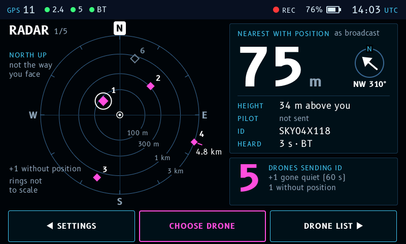

# Writing these docs

**Level: 🟡 Intermediate** · The rules every page in this documentation follows, and how to
build the site on your own machine.

The documentation has to serve a first-time visitor who has never soldered anything and an
RF engineer checking a threshold. It does that by layering: beginner pages explain, guide
pages instruct, deep-dive pages specify. This page keeps the layers consistent.

## Where things live

| What | Where |
|---|---|
| Every page | `docs/`, plain Markdown |
| The sidebar (order and titles) | `docs/SUMMARY.md` |
| Guides written for the site | `docs/start/`, `get-going/`, `use/`, `how/`, `detect/`, `hardware/`, `dev/`, `project/` |
| Deep dives written alongside the code | `docs/*.md` in capitals, such as `docs/SPOOFING.md` |
| Pictures | `docs/images/` (`screen/` holds copies of `crates/screen/snapshots/`, the S3's 320x240 layout; `screen/wide/` holds the P4 hub's 800x480 layout, and pages about the hub's screen use those) |
| Look and diagrams | `docs/assets/` |
| Site settings | `book.toml` at the top of the repository |

The capital-letter deep dives are edited by the same change that edits the code they describe.
**Do not move or rename them**: branches in flight touch them, and other pages and commit
messages link to them by name.

## Build and preview

The site is built by [mdBook](https://rust-lang.github.io/mdBook/), a Rust tool.

```bash
cargo install mdbook --version 0.5.4 --locked
```

```bash
tools/docs-build.sh
```

```bash
tools/docs-build.sh serve
```

`serve` opens a live preview at `http://localhost:3000` that reloads as you save. The first
run downloads the diagram library (Mermaid, checked against a fixed checksum) into
`docs/assets/`; it is not committed. Every push to `main` that touches the docs rebuilds the
public site (`.github/workflows/docs.yml`).

## Every page starts the same way

```markdown
# Page title

**Level: 🟢 Beginner** · One sentence saying what the reader will get from this page.
```

Three levels, and only these:

| Marker | Level | The reader |
|---|---|---|
| 🟢 | Beginner | Curious, no electronics or programming background. Every term is explained or linked to the [glossary](../project/glossary.md). |
| 🟡 | Intermediate | Comfortable with a terminal and a USB cable, or has built a kit before. |
| 🔴 | Expert | Reads Rust, datasheets or radio standards. Wants numbers, file paths and limits. |

A page that starts gently and then goes deeper says so in its level line
(`**Level: 🟢 Beginner, then 🟡 Intermediate**`) and marks the place where the level changes, so a
beginner knows where they may stop.

End guide pages with a **Next:** line linking to the page that naturally follows.

## Say what is proven, every time

Rotorscope is a work in progress, and a detector that overstates itself is dangerous. Whenever
a page says a feature exists, it also says how far it has been proven, using exactly these
words:

| Words to use | Meaning |
|---|---|
| **Heard for real** | Received from a real device someone else made (a real aircraft, a real drone). |
| **Proven on the air** | Real boards received it over the air from our own test transmitter. |
| **Proven on recordings** | Decodes public recordings of the real signal; not yet heard live. |
| **Simulated only** | Tested with made-up data on a computer or on the chip itself. |
| **Built, not yet tried** | The code exists and compiles; nobody has run it against the real thing. |
| **Planned** | Not built. |

If you cannot tell which applies from the repository, find out before writing, or leave the
claim out. Never round up.

## Writing rules

1. **Plain words, short sentences.** Write for a clever friend who is not in the trade. Say
   "listens", not "performs passive reception".
2. **Explain a term the first time a page uses it**, in a few words, and link it to the
   [glossary](../project/glossary.md). Beginner pages never assume a term.
3. **Only write what the repository shows.** Pin numbers, part numbers, thresholds, command
   options and file names come from the code or an existing document, never from memory. Do
   not invent prices, ranges or performance figures.
4. **Commands are copy-and-paste ready.** One command per fenced `bash` block, no `$` prompt.
   Show what the reader should see in a separate `text` block. Do not print a command you
   have not found in the repository (read the script or the option parser first).
5. **Speak to the reader as "you".** Avoid "simply", "just", "obviously", "easy".
6. **British spelling**, to match the deep dives and the screen itself: metres, licence (the
   noun), recognise, colour.
7. **Dates are written 2026-11-18.** Say "as of" when a fact will age.
8. **Rotorscope only listens.** Never describe transmitting at, jamming or interfering with
   anything. The one transmitter, `rid-beacon`, is a bench test tool with a fake identity.
9. **No secrets and nothing personal.** No keys, passwords, serial numbers of real devices,
   board addresses, home locations or names of private people. Example positions use public
   landmarks. Example identifiers are obviously made up.
10. **Describe limits as plainly as features.** The reader must leave knowing what Rotorscope
    will miss.

## Formatting

**Callouts** use the GitHub form, which the site also understands:

```markdown
> [!NOTE]
> Background that helps.

> [!TIP]
> A shortcut or a good habit.

> [!IMPORTANT]
> Something the reader must not skip.

> [!WARNING]
> Something that can damage hardware or mislead you.
```

Use them sparingly: one or two a page.

**Diagrams** are [Mermaid](https://mermaid.js.org/) code blocks. They draw themselves on
GitHub and on the site, in light and dark themes. Keep them small (a dozen boxes at most),
with short labels, and no custom colours.

````markdown

````

**Tables** for anything the reader compares or looks up. **Numbered lists** for steps in
order. **Bold** for the name of a thing on first mention or a button to press, not for
emphasis in general.

**Pictures** go in `docs/images/` and always carry alt text that says what the picture shows:

```markdown

```

## Links

| Linking to | Write |
|---|---|
| Another page in `docs/` | A relative path: `[the glossary](../project/glossary.md)`, `[spoofing checks](../SPOOFING.md)` |
| A heading on another page | `[text](../SITE.md#silencing-alarms)` |
| A file or folder outside `docs/` | The full address: `https://github.com/holdTheDoorHoid/rotorscope/blob/main/PLAN.md` (`/tree/main/` for a folder) |
| Somewhere else on the web | The full address, to the primary source |

Relative links to files outside `docs/` work on GitHub but break on the site, which is why
they are written in full.

Intermediate and expert pages end with a short **Where this lives in the code** list, so a
reader can go from the explanation to the source.

## Before you send a change

- `tools/docs-build.sh` finishes with no warnings.
- `tools/docs-build.sh check` reports no broken links.
- Every new page is in `docs/SUMMARY.md`.
- Every claim about what works carries one of the six proof phrases above.
