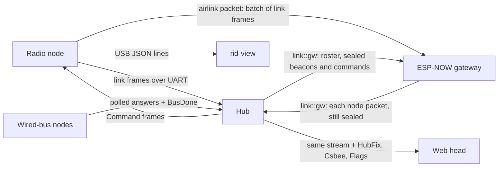

# Wire protocol reference

**Level: 🔴 Expert** · Every byte that travels between Rotorscope boards: the node-to-hub frames in
`crates/link`, the ESP-NOW air packet in `crates/airlink`, the wired-bus framing in
`crates/wirebus`, and the USB JSON lines the laptop viewer reads.

This page is the implementer's view. For the plain-language story of how the boards talk, read
[The link between boards](../how/link.md) first. Where this page and an older document disagree,
this page follows the code at commit `6651ecd` (2026-11-18), and for the ESP-NOW link and
protocol 14 the link-key cut-over later that day.

> [!IMPORTANT]
> Nothing here is secret, and nothing here transmits at anything outside the kit. The only radio
> traffic Rotorscope makes is between its own boards (ESP-NOW, opt-in), and the test transmitter
> `rid-beacon` on the bench.

## The layers at a glance

| Layer | Crate | Carries | Integrity check |
|---|---|---|---|
| Link frame | `crates/link` | One `Frame` (node to hub) or `Command` (hub to node), postcard + COBS | None of its own: a chunk that does not decode is dropped as corrupt |
| ESP-NOW packet | `crates/airlink` | A batch of whole link frames, a beacon or commands | The radio's own frame check; on a sealed kit (version 3) a 12-byte HMAC-SHA256 tag under that node's own key and a freshness stamp, checked by the hub and the node |
| Gateway wire | `crates/link` (`gw`) | `GwUp` / `GwDown` messages: node packets passed on whole, sealed beacons and commands, the gateway's reports | None of its own; the packets inside carry their tags |
| Wired bus | `crates/wirebus` | Polled answers made of whole link frames | CRC-16/CCITT-FALSE over each answer (`BusDone`) |
| USB JSON | node firmware, `tools/rid-view` | One JSON object per line | None (a line that does not parse is counted as bad) |

## Link frames: framing

Source: `crates/link/src/lib.rs`.

Each message is one Rust value, a `Frame` from a node or a `Command` from the hub, serialised with
[postcard](https://postcard.jamesmunns.com/wire-format) and then COBS-encoded with a trailing zero
byte (`postcard::to_slice_cobs`). So:

- **Delimiter.** Every frame ends in one `0x00`. COBS guarantees no other zero inside the frame, so
  a reader that joins mid-stream throws away bytes up to the next zero and is back in step.
- **Padding.** Zero bytes between frames are ignored by the decoder (`StreamDecoder::feed` skips
  leading zeros while it holds no partial frame).
- **Maximum size.** `MAX_FRAME = 320` bytes, COBS overhead and delimiter included. The decoder
  (`postcard::accumulator::CobsAccumulator<MAX_FRAME>`) reports `LinkError::Overflow` and drops
  the bytes if more than 320 arrive without a delimiter.
- **No CRC.** A link frame carries no checksum of its own. A damaged chunk almost always fails to
  decode and is reported as `LinkError::Corrupt`; the wired bus adds a CRC per answer and ESP-NOW
  relies on the radio's frame check (plus the tag on a sealed kit).
- **Encoders.** `link::encode(&Frame, &mut buf)` and `link::encode_command(&Command, &mut buf)`
  return the used part of `buf`, delimiter included, ready to write.
- **Decoders.** `link::Decoder` (= `StreamDecoder<Frame>`) and `link::CommandDecoder`
  (= `StreamDecoder<Command>`): feed any chunking of the byte stream and get one
  `Result<T, LinkError>` per frame, in order. Fixed 320-byte buffer, no allocation.

### How postcard lays out the fields

Postcard writes struct fields in declaration order with no names or padding. The rules that matter
for these types:

| Rust type | On the wire |
|---|---|
| `u8`, `i8`, `bool` | one byte |
| `u16`, `u32`, `u64` | unsigned LEB128 varint |
| `i16`, `i32`, `i64` | zigzag, then varint |
| `f32` | four bytes, little-endian |
| `Option<T>` | `0x00` for `None`; `0x01` then `T` |
| enum | varint of the variant's index (its position in the declaration, from 0), then its fields |
| `[u8; N]` | exactly `N` bytes, no length |
| `heapless::Vec`, `heapless::String` | varint length, then the items |

Because an enum is tagged by **position**, the order of variants is part of the protocol. Every
enum in this page lists its index in the first column. New variants are only ever appended (see
[Compatibility](#compatibility-rules)).

## Protocol version and history

`link::PROTOCOL_VERSION = 14`. A node puts it in its `Hello`. It is bumped "when a change would
make an old hub misread a new node" (the constant's doc comment). The history below comes from that
doc comment, with dates from `git log -- crates/link/src/lib.rs`.

| Version | Date (commit) | What it added |
|---|---|---|
| 1 | 2026-11-09 (`44b141e`, `c625c4a`) | `Hello`, `Detection`, `Stats`; COBS framing |
| 2 | 2026-11-09 (`2b7c4c6`) | `Frame::OpenLink` (open FPV / telemetry links) |
| 3 | 2026-11-14 (`14d5294`) | `Frame::Via`, written by an ESP-NOW gateway |
| 4 | 2026-11-14 (`4639b04`) | `Status`, `DroneId`, `Rf`, `DjiWifi`, `WifiDrone`; the hub-to-node `Command` stream; `NodeRole::DroneId` and `NodeRole::Gateway` |
| 5 | 2026-11-15 (`9211f08`) | `HubFix` and `Csbee`, hub to web head only |
| 6 | 2026-11-15 (`23f684c`) | `Flags`, hub to web head only (possible FAA rule violations) |
| 7 | 2026-11-15 (`ab68252`) | `RfKind` gains `DjiVideo`, `DjiO4Video`, `DjiFpvAirUnit`, `DjiController` |
| 8 | 2026-11-16 (`a2ac0ab`) | `DroneIdRecord::O4` (nodes from v8 send `O4` instead of `Encrypted`) |
| 9 | 2026-11-17 (`e8c13e8`) | `Frame::Threat`: attacks on Wi-Fi or Bluetooth, and jamming |
| 10 | 2026-11-17 (`10c603d`) | Wired bus: `Command::Poll`, `JoinSlot`, `Address`; `Frame::BusJoin`, `BusDone` |
| 11 | 2026-11-17 (`6ce307e`) | Aero node: `Frame::Air`, `Frame::AeroStatus`, `Command::TimeSync`, `NodeRole::Aero`, `AeroMode` plan codes |
| 12 | 2026-11-17 (`73e3e2e`) | Control links: `Frame::Control`, `Frame::ControlEnergy`; `AeroMode::Control` and `AeroMode::ControlFlags` |
| 13 | 2026-11-17 (`a087392`, `d86c3b1`, `cf1a090`) | Six `ThreatKind`s (`DroneDeauth`, `DroneTakeover`, `DroneNetClone`, `ControlContested`, `MavlinkAttack`, `AreaGnss`); `Frame::MavlinkEvidence`; a Wi-Fi plan may carry an `AeroMode::ControlFlags` entry |
| 14 | 2026-11-18 (`587de38`) | Per-node link keys: the ESP-NOW gateway's UART speaks [`link::gw`](#the-gateway-wire-linkgw) instead of frames, so `Via` no longer appears on it; `Frame::NodeHealth`; `ThreatKind::LinkLoss`; `ForgedLink` detail codes 8-16. **Not append-only:** `HubFix` gains `held` and `utc_held` at its end, so the hub and its web head are reflashed together |

Changes made between versions 13 and 14 that needed **no** bump, because every existing frame still
encoded the same way:

- `ForgedLink` detail codes 5 (origin) and 6 (table full), 2026-11-18 (`92910fc`, `1bfc1ac`).
- `ThreatKind::IdFlood`, raised by the hub only and never sent on the node link, 2026-11-18
  (`85e9607`).
- `MAVLINK_SUSPECT` (bit 24 of a `MavlinkAttack` detail), 2026-11-18 (`d93a95f`).

## `Frame`: node to hub (and hub to web head)

Source: `crates/link/src/lib.rs` (`enum Frame`); origin rules from `crates/link/src/origin.rs`
(`Head::origin`). "Origin" says who may write a frame: **Node** (a radio node, relayed or wired),
**Gateway** (the node link's own end: the hub's bus attributor; before protocol 14 also the ESP-NOW
gateway, which now sends `link::gw` messages and no frames; the hub's own `forged_link` reports are
filed under this role so no node may send one), **Hub** (only the hub, on its feed to the web head) or **Bus** (wired-bus control, never
inside a relayed stream).

| # | Variant | Since | Origin | Meaning |
|---|---|---|---|---|
| 0 | `Hello { role, protocol, firmware }` | 1 | Node; Gateway if `role` is `Gateway` | Sent at boot and every few seconds so a restarted hub learns who is attached |
| 1 | `Detection(Detection)` | 1 | Node | One Remote ID reception: everything one frame or advert carried |
| 2 | `Stats { .. }` | 1 | Node | Once a second: running totals for the health screen |
| 3 | `OpenLink(OpenLinkSighting)` | 2 | Node | One stream of an open FPV link, at most about once a second per stream |
| 4 | `Via { node, rssi }` | 3 | Gateway | Marker: the **next** frame came from `node`, heard at `rssi`. Since protocol 14 written only by the hub: its wired-bus attributor, and its feed to the web head |
| 5 | `Status { role, can, plan }` | 4 | Node; Gateway if `role` is `Gateway` | What the node can do and is doing; with every `Hello` and on change |
| 6 | `DroneId(DroneIdSighting)` | 4 | Node | One DJI OcuSync DroneID burst, decoded on the node |
| 7 | `Rf(RfSighting)` | 4 | Node | What a raw-capture scanner recognised on one frequency |
| 8 | `DjiWifi { channel, rssi, mac, uptime_us, element }` | 4 | Node | A DJI legacy Wi-Fi DroneID vendor element (OUI 26:37:12), raw |
| 9 | `WifiDrone(WifiDroneSighting)` | 4 | Node | A Wi-Fi network that looks like a drone's |
| 10 | `HubFix(HubFix)` | 5 | Hub | The hub's own GPS state, position and UTC, about once a second |
| 11 | `Csbee(Vec<u8, 200>)` | 5 | Hub | One CSBee line from the hub's ADSBee 1090, exactly as printed |
| 12 | `Flags(FlagReport)` | 6 | Hub | Possible FAA rule violations on one track |
| 13 | `Threat(ThreatSighting)` | 9 | depends on `kind` (below) | An attack or jamming seen by a node, or raised by the hub |
| 14 | `BusJoin { mac, want, check }` | 10 | Bus | A node without a bus address answering a `JoinSlot` |
| 15 | `BusDone { addr, seq, more, crc }` | 10 | Bus | The end of a node's answer to a `Poll` |
| 16 | `Air(AirFrame)` | 11 | Node | One raw aircraft frame from an aero (LR2021) node |
| 17 | `AeroStatus(AeroStatus)` | 11 | Node | An aero node's state |
| 18 | `Control(ControlReport)` | 12 | Node | One drone control link heard by an LR2021 node |
| 19 | `ControlEnergy(ControlEnergy)` | 12 | Node | An LR2021 node's energy map of one band |
| 20 | `MavlinkEvidence(MavlinkEvidence)` | 13 | Node | The MAVLink frame behind a `MavlinkAttack` threat |
| 21 | `NodeHealth(NodeHealth)` | 14 | Node | A node's own health counters, every 5 s |

The wired bus relies on three of these indices without decoding: `TAG_VIA = 4`,
`TAG_BUS_JOIN = 14`, `TAG_BUS_DONE = 15` (`crates/wirebus/src/lib.rs`, checked by a test against
`link`).

### Field by field

Units are as the code's doc comments give them. "100 kHz units" means 5756.5 MHz is sent as
`57565`. `mac` and address fields are six bytes in display order (most significant first, as
printed `aa:bb:..`).

**`Hello`** (0)

| Field | Type | Meaning |
|---|---|---|
| `role` | `NodeRole` | The role the image is running |
| `protocol` | `u8` | The sender's `PROTOCOL_VERSION` |
| `firmware` | `heapless::String<16>` | Firmware label, for example `node-wifi 0.1.0` |

**`Detection`** (1), struct `Detection`

| Field | Type | Meaning |
|---|---|---|
| `transport` | `rid::Transport` | Which over-the-air method carried it (table below) |
| `channel` | `u8` | Wi-Fi channel, or BLE advertising channel 37-39 when known, else 0 |
| `rssi` | `i8` | dBm |
| `mac` | `[u8; 6]` | Wi-Fi transmitter or BLE advertiser address |
| `counter` | `u8` | The F3411 message counter from the frame |
| `uptime_us` | `u64` | Node uptime when the frame arrived, µs |
| `messages` | `Vec<[u8; 25], 9>` | The **raw** 25-byte Remote ID messages; the hub decodes them with `rid` |

A full 9-message pack is about 245 bytes on the wire (`docs/WIREBUS.md`).

**`Stats`** (2): every count is a running total since boot; the hub takes differences.

| Field | Type | Meaning |
|---|---|---|
| `uptime_us` | `u64` | Node uptime, µs |
| `frames_seen` | `u32` | Frames (or adverts) looked at |
| `rid_found` | `u32` | Of those, frames that carried Remote ID |
| `dropped` | `u32` | Lost frames (node-wifi adds hub frames it could not send) |
| `by_transport` | `Vec<(Transport, u32), 5>` | Per transport, for nodes that can tell them apart (the BLE node); empty otherwise |

**`OpenLink`** (3), struct `OpenLinkSighting`

| Field | Type | Meaning |
|---|---|---|
| `link` | `openlink::OpenLink` | `system`, `id: Option<u32>` (cleartext link, vehicle or comm ID), `port: u8`, `direction`, `tx: [u8; 6]` |
| `channel` | `u8` | Wi-Fi channel, 0 if unknown |
| `rssi` | `i8` | dBm, most recent frame |
| `uptime_us` | `u64` | Node uptime of the most recent frame |
| `packets` | `u32` | Running frame count on this stream; restarts if the node reboots or drops the stream |

`openlink::System`: 0 `WfbNg` (also OpenIPC), 1 `OpenHd`, 2 `RubyFpv`, 3 `DroneBridge`.
`openlink::Direction`: 0 `AirToGround`, 1 `GroundToAir`, 2 `Unknown`. Source:
`crates/openlink/src/lib.rs`.

**`Via`** (4): `node: [u8; 6]` (the node's station address), `rssi: i8` (0 on the wired bus; up to
protocol 13 the ESP-NOW gateway wrote it with the dBm it heard). A marker, not a wrapper, so the
frame after it keeps its full 320-byte budget. Since protocol 14 only the hub writes it: its
`wirebus::Attributor` before each bus node's frame (`rssi` 0), and its web-head feed before each
verified ESP-NOW node's frame (with the RSSI the gateway reported). A `Via` inside a node's ESP-NOW
packet is refused as origin (detail 5).

**`Status`** (5): `role: NodeRole`, `can: u8` (mask of `NodeRole::bit`, one bit per role the
node's images can take), `plan: u16` (the `Assignment::id` applied; 0 = built-in plan).

**`DroneId`** (6), struct `DroneIdSighting`

| Field | Type | Meaning |
|---|---|---|
| `freq` | `u32` | Burst centre, 100 kHz units |
| `rssi` | `i8` | dBm |
| `snr_db` | `i8` | dB |
| `uptime_us` | `u64` | Node uptime, µs |
| `record` | `DroneIdRecord` | What the burst carried (table below) |

**`Rf`** (7), struct `RfSighting`

| Field | Type | Meaning |
|---|---|---|
| `kind` | `RfKind` | What was recognised (table below) |
| `freq` | `u32` | Centre, 100 kHz units |
| `width_khz` | `u16` | Occupied width, kHz (0 if unknown) |
| `snr_db` | `i8` | Level above the noise floor, dB |
| `duty_pct` | `u8` | Percent of the dwell the signal was on |
| `line_hz` | `u16` | Measured line rate for analog video, Hz (0 if none) |
| `uptime_us` | `u64` | Node uptime, µs |

**`DjiWifi`** (8): `channel: u8`, `rssi: i8`, `mac: [u8; 6]`, `uptime_us: u64`,
`element: Vec<u8, 255>` (the vendor element, raw; the hub decodes it with `rid::dji`).

**`WifiDrone`** (9), struct `WifiDroneSighting`: `maker: u8` (index into
`wifidrone::MAKERS`, append-only), `mac: [u8; 6]`, `ssid: heapless::String<32>`, `channel: u8`,
`rssi: i8`, `uptime_us: u64`.

**`HubFix`** (10), struct `HubFix`

| Field | Type | Meaning |
|---|---|---|
| `state` | `GnssState` | 0 `Absent`, 1 `Searching`, 2 `Fix2d`, 3 `Fix3d` |
| `sats` | `Option<u8>` | Satellites used (or tracked while searching) |
| `position` | `Option<HubPosition>` | The latest usable fix, if still fresh; never a typed-in position |
| `utc_ms` | `Option<u64>` | UTC (Unix ms) when the frame was built |
| `utc_pps` | `bool` | The hub's UTC is anchored to a GPS PPS edge |
| `held` | `bool` | Protocol 14. `position` is a held value, not live (GPS not trusted just now) |
| `utc_held` | `bool` | Protocol 14. `utc_ms` is held, not live |

`HubPosition`: `lat_e7: i32`, `lon_e7: i32` (degrees x 1e7), `alt_hae_mm: Option<i32>` (height
above the WGS-84 ellipsoid, mm; `None` for a 2D fix), `age_ms: u32` (age of the fix when the frame
was built).

**`Csbee`** (11): one ADSBee CSBee line, CRC and line end included, at most
`MAX_CSBEE_LINE = 200` bytes (the same number as `adsb::MAX_LINE`, repeated because `link` does not
depend on `adsb`). The web head parses it with `adsb::parse`.

**`Flags`** (12), struct `FlagReport`, about once a second per flagged track

| Field | Type | Meaning |
|---|---|---|
| `who` | `heapless::String<24>` | A drone's primary UAS ID as text (or its transmitter address as 12 hex digits before it has one), or `ICAO-xxxxxx` for an aircraft |
| `level` | `u8` | The worst level: 0 Note, 1 Watch, 2 Warning, 3 Alert |
| `items` | `Vec<FlagItem, 6>` | The worst flags (`MAX_FLAG_ITEMS = 6`) |
| `pack_date` | `u32` | Airspace pack build date, Unix s; 0 = the hub has no pack |

`FlagItem`: `rule: u8` (`faarules::Rule` as u8), `area: u8` (`airspace::AreaKind` as u8, 0 for
none), `level: u8` (0-3 as above), `value: f32` (height above ground m, distance m, terrain over
the sight line m, sun elevation degrees ... per rule; 0 when none), `secs: u16` (how long it has
held).

**`Threat`** (13), struct `ThreatSighting`: see [Threats](#threats) below.

**`BusJoin`** (14): `mac: [u8; 6]`, `want: u8` (the address it held last, 0 for none),
`check: u16`. **`BusDone`** (15): `addr: u8`, `seq: u8` (1-255; 0 = the answer carried no
frames), `more: bool` (frames still queued), `crc: u16`. See [The wired bus](#the-wired-bus).

**`Air`** (16), struct `AirFrame`

| Field | Type | Meaning |
|---|---|---|
| `proto` | `AirProto` | Which signal, and so what `raw` is (table below) |
| `freq_khz` | `u32` | Frequency the radio was tuned to, kHz |
| `rssi` | `i8` | Packet RSSI, dBm |
| `utc_ms` | `Option<u64>` | The node's UTC estimate at reception (from `TimeSync`); `None` without time |
| `uptime_us` | `u64` | Node uptime at reception |
| `raw` | `Vec<u8, 64>` | The frame (`MAX_AIR_RAW = 64`) |

**`AeroStatus`** (17), struct `AeroStatus`, with every `Hello` and whenever mode, time state or
parking changes

| Field | Type | Meaning |
|---|---|---|
| `mode` | `u32` | The `AeroMode::code` running now (0: none, the radio is down) |
| `freq_khz` | `u32` | Where the radio is (or was last) tuned |
| `time` | `AeroTime` | 0 `Unknown` (no `TimeSync` for 10 s, or ever), 1 `Hub`, 2 `HubPps` |
| `parked` | `bool` | A hopping mode that is not hopping (no time): parked on `freq_khz` |
| `radio_ok` | `bool` | The LR2021 answered at boot; false = nothing is being received |
| `rx_restarts` | `u32` | Times the 1090 MHz receive watchdog restarted reception |
| `rejected` | `u32` | Packets dropped by the node's checks (CRC, Manchester, length), total |
| `rate_dropped` | `u32` | `Air` frames not sent because of the rate limit, total |

**`Control`** (18), struct `ControlReport`. Two kinds, told apart by `part`:

- `part == 0`: the link's running summary, at most every 2 s per link while it is heard. No
  content, no raw bytes.
- `part >= 1`: one packet's decoded content, only when the hub has turned content decoding on
  (`AeroMode::ControlFlags`). `raw` rides in part 1. A packet with more than
  `MAX_CONTROL_CONTENT = 2` items is split over several parts.

| Field | Type | Meaning |
|---|---|---|
| `sighting` | `ctrlwatch::ControlSighting` | `system`, `region`, `probe`, `freq_hz: u32`, `rssi_dbm: i16`, `snr_db: i8`, `t_us: u64`, `confidence`, `direction`, `id: Option<LinkId>` (`None` unless ID reading is on), `version: Option<u8>` |
| `best` | `ctrlwatch::Confidence` | 0 `Energy`, 1 `Likely`, 2 `Confirmed` |
| `packets`, `confirmed` | `u32` | Running totals on this link |
| `peak_rssi` | `i16` | dBm |
| `part` | `u8` | 0 summary, 1.. content parts |
| `content` | `Vec<ControlContent, 2>` | Decoded content items (empty unless opted in) |
| `raw` | `Option<Vec<u8, 96>>` | The packet as received (`ctrlwatch::MAX_RAW = 96`), part 1 only |

`ctrlwatch::System` (index): 0 `ExpressLrs`, 1 `Mlrs`, 2 `Sik`, 3 `OpenLrsNg`, 4 `Crossfire`,
5 `Tracer`, 6 `Ghost`, 7 `FrskyR9`, 8 `FrskyX`, 9 `FlyskyAfhds2a`. `ctrlwatch::Direction`:
0 `Uplink`, 1 `Downlink`, 2 `Unknown`. `ctrlwatch::LinkId`: 0 `ElrsUid { uid3: Option<u8>, uid4,
uid5, uid5_real }`, 1 `MlrsSyncWord(u16)`, 2 `SikNetId(u16)`, 3 `OpenLrsMagic(u32)`. Source:
`crates/ctrlwatch/src/lib.rs`. Region indices are in the [`AeroMode`](#aeromode-plan-codes) table.

**`ControlEnergy`** (19), struct `ControlEnergy`: sent when a hopper or a steady carrier is seen,
and otherwise about every 30 s per band.

| Field | Type | Meaning |
|---|---|---|
| `region` | `ctrlwatch::Region` | The band |
| `windows` | `u32` | Windows the node's map has seen (its background needs about 20) |
| `activity` | `EnergyActivity` | 0 `Quiet`, 1 `Steady` (only steady carriers), 2 `Background` (hopping energy that is not one transmitter), 3 `Hopper(HopperReport)` |
| `steady` | `Vec<(u32, i8), 4>` | Steady carriers: (kHz, dBm) |
| `uptime_us` | `u64` | Node uptime |

`HopperReport`: `low_khz`, `high_khz: u32`, `channels: u16`, `spacing_khz: Option<u32>`,
`occupied_khz: u32`, `rssi: i8`, `spread_db: i8`, `burst_us: Option<u32>`,
`interval_us: Option<u32>` (median burst length and packet interval), `periodic_pct: u8`,
`candidates: Vec<(ctrlwatch::System, u8), 4>` (scores 0-100, best first).

**`MavlinkEvidence`** (20), struct `MavlinkEvidence`: sent right after its `Threat`, and only with
control content decoding on (the frame is content).

| Field | Type | Meaning |
|---|---|---|
| `detail` | `u32` | The threat's `detail` (`mavwatch::Kind` number) |
| `sysid`, `compid` | `u8` | Sender as claimed in the frame |
| `msgid` | `u32` | MAVLink message ID |
| `truncated` | `bool` | The frame was longer than 255 bytes and was cut |
| `uptime_us` | `u64` | Node uptime |
| `frame` | `Vec<u8, 255>` | The frame as received: header, payload, CRC, signature (`MAX_MAVLINK_EVIDENCE = 255`) |

**`NodeHealth`** (21), struct `NodeHealth`, every 5 s; running totals since the node booted, wrapping
at `u32::MAX` (the hub takes differences); a node without one of these sends 0. Fields in wire order:
`uptime_s: u32`; `shed: [u32; 8]` (frames turned away by the node's queue budget, per kind in
`SHED_KIND_NAMES` order); `alternations: [u32; 2]` (DJI Wi-Fi DroneID, Wi-Fi drone networks);
`frames_sent`, `batches_sent`, `batches_given_up`, `send_attempts: u32` (uplink accounting, which
the hub compares with what it verified to raise `link_loss`); `rejects: [u32; 10]` (hub packets the
node refused, per `NODE_REJECT_CODES`, see [Reject reasons](#reject-reasons)); `duplicates`,
`plans_refused`, `deaf_fallbacks`, `deaf_blamed`, `deaf_outages`, `deaf_refused`,
`switches_refused`, `switch_wait_s: u32`. At most 168 bytes encoded.

## Supporting enums

### `NodeRole`

Source: `crates/link/src/lib.rs`; origin from `crates/link/src/origin.rs` (`role_origin`).

| # | Variant | `can` bit | Since | Origin | What the node does |
|---|---|---|---|---|---|
| 0 | `Wifi24` | 0x01 | 1 | Node | 2.4 GHz Wi-Fi: Remote ID, DJI legacy DroneID, open FPV links, Wi-Fi drones |
| 1 | `Wifi5` | 0x02 | 1 | Node | 5 GHz Wi-Fi, same frames |
| 2 | `Ble` | 0x04 | 1 | Node | Bluetooth Remote ID (legacy, extended, Long Range) |
| 3 | `Fpv` | 0x08 | 1 | Node | Raw-capture scanner for analog FPV and RF fingerprints (`Rf`) |
| 4 | `DroneId` | 0x10 | 4 | Node | Raw-capture DJI OcuSync DroneID receiver (`DroneId`) |
| 5 | `Gateway` | 0x20 | 4 | Gateway | An ESP-NOW gateway: relays other nodes, listens to nothing itself |
| 6 | `Aero` | 0x40 | 11 | Node | LR2021 aircraft signals (1090, 978 UAT, FLARM / OGN) and control links |

`NodeRole::bit(self) = 1 << index`.

### `rid::Transport`

Source: `crates/rid/src/lib.rs`.

| # | Variant | Meaning |
|---|---|---|
| 0 | `WifiBeacon` | Wi-Fi beacon (vendor-specific element) |
| 1 | `WifiNan` | Wi-Fi Neighbour Awareness Networking action frame |
| 2 | `BleLegacy` | Bluetooth 4 legacy advertising (single message, no packs) |
| 3 | `BleExtended` | Bluetooth 5 extended advertising on the 1M PHY |
| 4 | `BleLongRange` | Bluetooth 5 Long Range (coded PHY) |

### `DroneIdRecord` and `O4Kind`

Source: `crates/link/src/lib.rs`; raw units from `crates/droneid/src/payload.rs` (`FlightInfo`).

| # | Variant | Since | Fields and meaning |
|---|---|---|---|
| 0 | `Flight { .. }` | 4 | OcuSync 2/3 plaintext flight record, raw units as the drone sent them (the hub scales). Fields in wire order: `serial: [u8; 16]`; `lat_raw`, `lon_raw: i32` (radians x 1e7); `altitude_raw`, `height_raw: i16` (raw units, see `FlightInfo::altitude_m`); `v_north`, `v_east`, `v_up: i16` (believed cm/s); `yaw_raw: i16` (hundredths of a degree); `pilot_lat_raw`, `pilot_lon_raw`, `home_lat_raw`, `home_lon_raw: i32` (radians x 1e7); `product_type: u8` |
| 1 | `Encrypted { key_id: [u8; 4] }` | 4 | O4 encrypted record from a protocol 4-7 node: the session key ID only |
| 2 | `Detected` | 4 | A burst matched the DroneID reference pattern but did not decode: presence only |
| 3 | `O4 { kind, key_id: [u8; 4], object: Vec<u8, 173> }` | 8 | An O4 record that passed every structural check of the spec; `object` is the whole logical object (`length + 3` bytes, at most 173), ciphertext included, exactly as received |

`O4Kind`: 0 `Cryp` (selector 0x13, the session-key record, name `CRYP`), 1 `Infp10` (selector 0x10,
128-byte core, flight telemetry, `INFP-10`), 2 `Infp11` (selector 0x11, 160-byte core,
`INFP-11`). See [O4 DroneID in depth](../DRONEID-O4.md).

### `RfKind`

Source: `crates/link/src/lib.rs`. Background: [DJI radio links in depth](../DJI-LINKS.md).

| # | Variant | Since | What was recognised |
|---|---|---|---|
| 0 | `AnalogVideo` | 4 | Analog FM video: the 15.6/15.7 kHz line rate was found |
| 1 | `FpvCarrier` | 4 | Strong carrier on an analog FPV channel, line rate not (yet) confirmed |
| 2 | `Hdzero` | 4 | HDZero: continuous, 17 or 27 MHz wide, on its 37 MHz grid |
| 3 | `LteStyle` | 4 | LTE-style OFDM (15 kHz spacing): DJI, Walksnail, Autel, Herelink |
| 4 | `WifiNarrow` | 4 | Wi-Fi OFDM at half or quarter clock (Skydio narrow modes) |
| 5 | `Energy` | 4 | Unclassified energy above the floor |
| 6 | `DjiVideo` | 7 | DJI-style video downlink, generation not determined: 15 kHz OFDM, DJI's 4.7 µs prefix, 9 MHz or wider, on DJI's x.5 MHz raster when measurable |
| 7 | `DjiO4Video` | 7 | DJI O4 video: 30 kHz OFDM of video width, or the 15 kHz shape on 5.170-5.250 GHz |
| 8 | `DjiFpvAirUnit` | 7 | The same on a whole-MHz DJI FPV (V1 / Vista) channel |
| 9 | `DjiController` | 7 | DJI controller uplink: narrow 15 kHz OFDM bursts (1.1/2.2 MHz) or about 4.4 MHz 30 kHz bursts (O4), confirmed hopping |

### `AirProto`

Source: `crates/link/src/lib.rs`. Background: [The aero node](../AERO-NODE.md).

| # | Variant | `raw` holds | Checked on the node? |
|---|---|---|---|
| 0 | `Es1090` | The 14-byte DF17 frame, parity included | Yes (CRC syndrome 0) |
| 1 | `Uat978` | The 48 bytes after the sync word, Reed-Solomon parity included, not corrected | No: the hub runs Reed-Solomon |
| 2 | `Flarm` | 26 Manchester-decoded bytes (24 payload, still scrambled, then CRC-16) | Yes (CRC) |
| 3 | `Ogn` | 26 Manchester-decoded bytes (20 payload, 6 LDPC parity) | No |

### `AeroMode` plan codes

Source: `crates/link/src/lib.rs` (`AeroMode::code`, `AeroMode::from_code`). `AeroMode` is not
serialised as an enum: each mode is a `u32` code inside an `Assignment::plan` entry
`(code, dwell_ms)`. `from_code` returns `None` for any code that does not match exactly (unused
bits set), and a node skips such an entry as unknown.

| Mode | Code | Bits |
|---|---|---|
| `Es1090` | `10900` (`ES1090_CODE`) | 1090 MHz in 100 kHz units |
| `Uat978` | `9780` (`UAT978_CODE`) | 978 MHz in 100 kHz units |
| `FlarmHop { band, ogn }` | `HOP_FLAG` (bit 31) \| `HOP_OGN` (bit 8) if `ogn` \| `band` | bits 0-7 region (SoftRF's `RF_BAND_*`: 1 Europe, 2 USA/Canada, 3 Australia/South America, ...); bit 8 follow OGN trackers instead of FLARM. Needs `TimeSync` |
| `Control { regions, energy }` | `CONTROL_FLAG` (bit 30) \| regions \| energy << 10 | bits 0-9 regions to scan with packet plans and energy sweeps; bits 10-19 regions swept for energy only |
| `ControlFlags { read_ids, decode_content }` | `FLAGS_FLAG` (bit 29) \| bit 0 \| bit 1 | bit 0 read link IDs, bit 1 decode content. A setting, not a mode: skipped when walking the plan, dwell ignored. No entry = both off |

Region bits (`link::control_region_bit`, the index in `ctrlwatch::Region::ALL`):

| Bit | `ctrlwatch::Region` |
|---|---|
| 0 | `Fcc915` |
| 1 | `Au915` |
| 2 | `Eu868` |
| 3 | `In866` |
| 4 | `Au433` |
| 5 | `Eu433` |
| 6 | `Us433` |
| 7 | `Us433W` |
| 8 | `Th920` |
| 9 | `Ism2g4` |

An aero plan's entries are visited in order, each for its dwell, and repeated; a single entry or a
dwell of 0 stays put; an empty plan is the node's built-in default (1090 MHz). Helper functions:
`plan_control_flags(plan)` and `is_control_flags_code(code)`.

## Threats

Source: `crates/link/src/lib.rs` (`ThreatKind`, `ThreatSighting`), origins from
`crates/link/src/origin.rs` (`threat_origin`), detail encodings from the crates named per row.
Background: [Attacks and interference](../detect/threats.md).

`ThreatSighting`, one threat summarised over a window, sent at most about once a second per kind
and target while it lasts:

| Field | Type | Meaning |
|---|---|---|
| `kind` | `ThreatKind` | Table below |
| `channel` | `u8` | Wi-Fi channel or BLE advertising channel; 0 if unknown |
| `freq` | `u32` | Centre, 100 kHz units; 0 if unknown (jamming kinds always set it) |
| `width_khz` | `u32` | Affected width, kHz; 0 if unknown |
| `level` | `i8` | Frame kinds: strongest RSSI in the window, dBm. Jamming kinds: rise above the learned floor, dB |
| `count` | `u32` | Frames, bursts or dwells counted in the window |
| `window_ms` | `u32` | Length of the window |
| `source` | `[u8; 6]` | Transmitter address; all zero when unknown or many random addresses |
| `target` | `[u8; 6]` | Who is hit: a BSSID or station, all `0xFF` for broadcast, all zero if not applicable |
| `detail` | `u32` | Kind-specific number (table below) |
| `ssid` | `heapless::String<32>` | Network name involved, may be empty |
| `uptime_us` | `u64` | Sender's uptime |

### `ThreatKind`

`name()` is the snake-case name used in JSON and logs. "Jamming" kinds are those for which
`is_jamming()` is true.

| # | Variant | `name()` | Since | Origin | `detail` |
|---|---|---|---|---|---|
| 0 | `Deauth` | `deauth` | 9 | Node | bits 0-15 most common reason code; bit 16 any frame to broadcast; bit 17 every frame protected (802.11w, reason then reads 0) (`wifiwatch::floods`) |
| 1 | `Disassoc` | `disassoc` | 9 | Node | as `Deauth` |
| 2 | `BeaconFlood` | `beacon_flood` | 9 | Node | Distinct names among the new transmitters; `count` = new transmitters |
| 3 | `EvilTwin` | `evil_twin` | 9 | Node | `(original security << 8) \| twin security` (`wifiwatch::mac::Security`; the twin is always `Open` = 0) |
| 4 | `Karma` | `karma` | 9 | Node | Distinct names one transmitter used; `ssid` = the latest |
| 5 | `ChannelSwitch` | `channel_switch` | 9 | Node | The channel clients are told to move to |
| 6 | `AuthFlood` | `auth_flood` | 9 | Node | Distinct source addresses (lower bound); `target` = the access point |
| 7 | `ProbeFlood` | `probe_flood` | 9 | Node | Distinct source addresses (lower bound) |
| 8 | `AttackTool` | `attack_tool` | 9 | Node | Index into `wifiwatch::tools::TOOLS` (0 Pwnagotchi, 1 Wi-Fi Pineapple, 2 ESP8266 Deauther, 3 Ghost ESP, 4 RemoteIDSpoofer, 5 DroneSploit, 6 Wifiphisher) |
| 9 | `BleSpam` | `ble_spam` | 9 | Node | New addresses in the window; `ssid` = the pairing family with the most |
| 10 | `JamBroadband` | `jam_broadband` | 9 | Node | Raw-capture nodes: percent of the band's recent hops raised; `level` median rise |
| 11 | `JamTone` | `jam_tone` | 9 | Node | Raw-capture nodes: distinct tone frequencies (1 MHz apart) in the window |
| 12 | `JamSweep` | `jam_sweep` | 9 | Node | Sweep rate, MHz per second |
| 13 | `JamPulsed` | `jam_pulsed` | 9 | Node | Median percent of probes loud (duty cycle); for a flooded DroneID decoder, the decoder's busy percent |
| 14 | `Blinded` | `blinded` | 9 | Node | Raw-capture nodes: estimated percent of free-space detection range left, `100 x 10^(-level / 20)`; sent when the median floor rise reaches 12 dB |
| 15 | `ForgedLink` | `forged_link` | 9 | Gateway (raised by the hub since protocol 14) | Reject reason, 1-16: 1 bad tag, 2 replay, 3 unauthenticated, 4 stale, 5 origin, 6 table full (retired), 8 old firmware, 9 not in roster, 10 over budget, 11 late uplink, 12 future uplink, 15 malformed, ... (see [Reject reasons](#reject-reasons)) |
| 16 | `DroneDeauth` | `drone_deauth` | 13 | Node | bits 24-31 `wifidrone` maker index; bits 0-15 most common reason code, plus flag bits (`wifiwatch::drones`) |
| 17 | `DroneTakeover` | `drone_takeover` | 13 | Node | bits 24-31 maker; low bits `TAKE_*` flags (`wifiwatch::drones`) |
| 18 | `DroneNetClone` | `drone_net_clone` | 13 | Node | bits 24-31 maker; low bits `CLONE_*` flags (`wifiwatch::drones`) |
| 19 | `ControlContested` | `control_contested` | 13 | Node | bits 0-7 `ctrlwatch::System` index; 8-11 transmitters (at least, max 15); 12-15 rules (1 interleaved timing, 2 two clocks, 4 two sequence counts, 8 new transmitter after silence); 16-23 `ctrlwatch::Region` index (`ctrlwatch::contested::encode_detail`) |
| 20 | `MavlinkAttack` | `mavlink_attack` | 13 | Node | low byte `mavwatch::Kind` (1-19); bit 24 `MAVLINK_SUSPECT` while it is one uncorroborated frame |
| 21 | `AreaGnss` | `area_gnss` | 13 | Hub | Raised by the hub from aircraft and drone tracks (`tracker::area_gnss`) |
| 22 | `IdFlood` | `id_flood` | after 13, no bump | Hub | bits 24-31 table (0 drones, 1 aircraft, 2 control links, 3 one node shedding); bits 16-23 rule (0 rate, 1 minute, 2 active) or, for table 3, new IDs a second; bits 0-15 the figure (`tracker::probation`) |
| 23 | `LinkLoss` | `link_loss` | 14 | Hub | Percent of the frames the node says it sent that the hub never verified; `count` = frames missing over `window_ms` (`tracker::delivery`) |

Per-kind field conventions not covered by `detail`:

- `ControlContested`: `source` holds the node's handle for the link in its last byte (not an
  identifier); `target` holds the link's identifier right-aligned, all zero unless the hub turned
  ID reading on; `level` the strongest packet; `count` pieces of evidence.
- `MavlinkAttack`: `source` and `target` hold the claimed sender and target system/component in
  their last two bytes; `ssid` an excerpt. From an LR2021 node `channel` is 0; from a Wi-Fi node
  (MAVLink over open Wi-Fi) `channel` is the Wi-Fi channel and `freq` its centre.
- `ForgedLink`: since protocol 14 always the hub's own frame (node 0, the link). `source` the
  claimed node (all zero when the refusal table overflowed, or for the gateway's shared reports);
  `target`, `channel` and `freq` 0; `level` the strongest RSSI of the refused packets; `count`
  refused packets or frames over `window_ms`. Before protocol 14 the gateway raised it for details
  1-4 and 6, with its own address in `target`, `channel` 6 and `freq` 24370.
- `mavwatch::Kind` codes 1-19 are listed in [Crate reference](crates.md#mavwatch).

## Hub to node: `Command`

Source: `crates/link/src/lib.rs` (`enum Command`). Framed exactly like `Frame` (postcard + COBS),
on the reverse direction of a wired link, through an ESP-NOW gateway, or on the bus command wire.

| # | Variant | Since | Fields | Meaning |
|---|---|---|---|---|
| 0 | `Assign(Assignment)` | 4 | `role`, `plan`, `id` | Listen as described. Idempotent; resent every few seconds |
| 1 | `To { node: [u8; 6] }` | 4 | station address | The next command is for this node (the reverse of `Via`). On the bus every node hears it; only the named one acts |
| 2 | `Poll { addr: u8, epoch: u16, ack: u8, budget: u16 }` | 10 | | Bus: "node `addr`, go ahead", with at most `budget` bytes; `ack` = sequence number of the last answer the hub accepted (0: none since the address was given) |
| 3 | `JoinSlot { epoch: u16, slots: u8, slot_us: u16 }` | 10 | | Bus: "anyone new?" Answer in one of `slots` random slots of `slot_us` µs |
| 4 | `Address { mac: [u8; 6], addr: u8, epoch: u16, check: u16 }` | 10 | | Bus: the node with station address `mac` is bus address `addr` for this `epoch` |
| 5 | `TimeSync { utc_ms: u64, pps: bool }` | 11 | | "It is now `utc_ms`" (Unix ms), about once a second; the node takes the command's arrival as that instant. `pps`: the hub's UTC is anchored to a GPS PPS edge. A broadcast: no `To` needed |

### `Assignment`

| Field | Type | Meaning |
|---|---|---|
| `role` | `NodeRole` | The job |
| `plan` | `heapless::Vec<(u32, u16), 24>` | Entries `(code, dwell_ms)`, visited in order and repeated. Empty = the role's built-in plan |
| `id` | `u16` | Changes whenever the plan changes; echoed in `Status.plan` so the hub knows it was applied |

What a plan entry's `u32` means depends on the role:

| Role | `code` | `dwell_ms` |
|---|---|---|
| `Wifi24`, `Wifi5` | Wi-Fi channel number; or one `AeroMode::ControlFlags` entry (bit 29, protocol 13) carrying the control-link opt-ins, which switch on the Wi-Fi MAVLink scan | Dwell on that channel |
| `Fpv`, `DroneId` (raw capture) | Centre frequency, 100 kHz units (5756.5 MHz = 57565) | Dwell |
| `Aero` | `AeroMode` code (above) | Dwell; 0 = stay |
| `Ble`, `Gateway` | Not used (Bluetooth has no plan) | |

A node whose running image has the role applies it at once; otherwise it switches firmware image (a
reboot of a few seconds, `crates/nodeimage`) and applies it after boot. The coverage coordinator
that writes these plans is described in [Crate reference](crates.md#coverage).

The hub decides every 2 s, sends a changed assignment at once and resends every assignment every 5 s
(`docs/ESPNOW.md`, "Downlink").

## Who may send what

Source: `crates/link/src/origin.rs`. `Head::origin` is one exhaustive table with no wildcard arm,
so a new `Frame` variant does not compile until someone decides who may send it. Every hop that can
check, checks:

| Where | How | What happens to a refused frame |
|---|---|---|
| ESP-NOW gateway | Holds no key and writes no link frames: it passes each node packet on whole (`GwUp::Packet`) after keyless filters (`airlink::relay`); its own messages are `link::gw` reports (`origin::gw_up_origin`) | Packets it refused are reported in `GwUp::Refused`; the hub raises `ForgedLink` 8, 9, 10 or 15 |
| P4 hub, gateway link | Verifies each node packet with that node's key (`hublink::link`), then `origin::node_batch` takes only frames a node may originate: a `Via`, a hub-only frame, a gateway report or bus control inside a node packet is refused | Dropped and counted; the hub raises `ForgedLink` detail 5 naming the node |
| P4 hub, wired link | `origin::Sorter::new()`: a `Via` names exactly the next frame, which must be a node's; a frame with no `Via` must be a node's or the link's own; a `Via` straight after a `Via` is refused with the one it follows | Dropped and counted; hub raises its own `ForgedLink` detail 5 (source all zero for the link's own stream) |
| Web-head feed | `forward::Forwarder` runs the same sort; only `Forwarder::send` queues the hub's own `HubFix`, `Csbee`, `Flags` | Not passed on (`refused` counter) |
| Web head | `Sorter::hub_link()` on the link from the P4: also takes hub-origin frames when no `Via` came before them | Dropped |
| Wired bus | `wirebus::Attributor` in the hub's UART interrupt, from each frame's first bytes (`origin::origin_of_encoded`) | Dropped; `ForgedLink` detail 5 |

`origin::RefusalLog<N>` keeps refusals per claimed sender and reason with a fixed table (overflow
shares one all-zero entry) and drains one report per window; `origin::forged_link` turns a
`Refusal` into the `ThreatSighting`. The plain-language version, and what a captured node can and
cannot do, is in [ESP-NOW in depth](../ESPNOW.md#who-may-send-what).

## Compatibility rules

The protocol is **append-only**. Every change so far added a variant at the end of an enum, so a
frame an older peer knows encodes byte for byte as before. Tests in `crates/link/src/lib.rs` pin
this down for versions 1, 4-5 and 7-14 (`protocol_1_frames_unchanged`,
`protocol_4_and_5_append_only` ... `protocol_14_hub_fix_and_link_loss`). Protocol 14 broke the rule
once, on purpose: `HubFix` gained two fields at its end (see the history above). What happens on a mismatch:

| Situation | Result |
|---|---|
| Older hub, newer node sends a new frame variant | Postcard fails on the unknown variant index: `LinkError::Corrupt`, counted, the hub carries on at the next zero byte |
| Older hub, a known frame carrying a new inner variant (new `RfKind`, `DroneIdRecord::O4`, new `ThreatKind`) | The whole frame fails to decode and counts as corrupt |
| Older node, newer hub sends a new `Command` | The node's `CommandDecoder` reports it as corrupt and ignores it |
| Older aero node, unknown plan code | Skipped as unknown (so a pre-12 node never reads IDs or content) |
| Wi-Fi node built before 13, plan carrying a `ControlFlags` entry | Rejected as a bad channel; the node keeps its previous plan |
| New `detail` codes (for example `ForgedLink` 5 and 6) | No change on the wire; an older hub shows an unknown reason |
| Older hub, `Via` (protocol 3) from a gateway | Counted as corrupt; the relayed frame after it is still read |
| Protocol 14 hub, gateway on protocol 13 or older | The gateway's frames are read as link frames; a sealed (or closed) hub drops what it relays, sends it nothing, and shows `OLD FIRMWARE: gateway` |
| Protocol 14 hub or gateway, node still sending version 2 packets | Refused as `old_firmware` (`ForgedLink` 8); the screen counts such nodes |
| v14 web head, v13 hub's `HubFix` | Counted as corrupt (a v13 web head reading a v14 `HubFix` ignores the two new bytes) |

`Hello.protocol` carries the sender's version. In the P4 hub's link reader
(`firmware/hub-p4/src/links.rs`) the `Hello` sets the node's role; the hub does not refuse a node
because of its `protocol` number. The gateway is the exception: its protocol 14 `Hello` (a
`link::gw` message) switches the link to the gateway wire, and an older gateway is refused. Rule for anyone adding a
variant: append it last, never reorder or remove one, add an `append_only` test, add its line to
`Head::origin`, and bump `PROTOCOL_VERSION` with a line in its doc comment.

## Text from the air

Source: `crates/link/src/printable.rs`. Strings that arrived over the air (an SSID, a serial number,
a `Hello` firmware label) can hold any bytes. Before printing them on a console or writing them into
evidence text, the hub wraps them in `Printable` (every character outside printable ASCII, space to
`~`, becomes one `?`) or `JsonPrintable` (also replaces `"` and `\`).

## The bench fence

Source: `crates/link/src/benchfence.rs`. Not part of the `link` library: every firmware's `build.rs`
except `rid-beacon`'s includes the file by path, and `link`'s unit tests test its decision.

A **bench feature** fakes data, opens a debug door or loops a board's own pins back. A build that
carries one, or a bench build switch (an environment variable), stops with an error unless the
environment has `ROTORSCOPE_BENCH=1` (exactly `1`, after trimming). When it is allowed, the build
prints a warning and passes three values into the firmware:

| Variable | Content | Used for |
|---|---|---|
| `ROTORSCOPE_BENCH_LIST` | Comma-separated list, empty for a normal build | The evidence boot event |
| `ROTORSCOPE_BENCH_JSON` | JSON array, `[]` for a normal build | The `hello` line |
| `ROTORSCOPE_BENCH_TAG` | `bench-build:<list>` or `bench-build:none` | Carried in every image except hub-p4's; `tools/flash-node.sh` finds it in the ELF and refuses to flash a bench image into a field node |

Bench features and switches each firmware declares (from each `firmware/*/build.rs`):

| Firmware | Bench features | Bench switches (`env:` in the list) |
|---|---|---|
| hub-p4 | `selftest`, `fakenode`, `fakedrone`, `benchlog`, `gpsloop`, `gpsloop-m10`, `webheadloop`, `embedpack`, `modesloop`, `faulttest`, `testpoint` | none |
| hub (S3) | `demo`, `open-hotspot` | none |
| gateway | `faulttest`, `gwforge` | none |
| node-wifi | `faulttest`, `forgetest`, `floodtest` | `ROTORSCOPE_BENCH_CAN`, `ROTORSCOPE_BENCH_FLIP` |
| node-ble | `faulttest` | `ROTORSCOPE_BENCH_CAN`, `ROTORSCOPE_BENCH_FLIP` |
| node-sdr | `faulttest`, `bringup` | `NODE_SDR_BOOT`, `NODE_SDR_ALLOW_UNVERIFIED_PHY` |
| node-lr | `faulttest` | none |

How to make a bench build on purpose is in [Bench tests](../BENCH.md).

## ESP-NOW air packet

Source: `crates/airlink/src/lib.rs` (version 1), `crates/airlink/src/v3/` (version 3: `mod.rs`,
`hub.rs`, `node.rs`), `crates/airlink/src/relay.rs` (the gateway), keys from `crates/kitkeys`. The
plain-language guide, how to seal a kit and the bench results are in
[ESP-NOW in depth](../ESPNOW.md); the design is docs/LINK-KEYS-DESIGN.md. Since 2026-11-17 the
hub's default build listens for the wired bus (simulated only, never wired) and ESP-NOW is an
opt-in node build. This section describes the link as it is after the 2026-11-18 cut-over (link
protocol 14, packet version 3); the bench kit ran the version 2 link described in the bench results
before that.

### Header

Every packet starts with `HEADER = 6` bytes:

| Offset | Size | Field | Values |
|---|---|---|---|
| 0 | 2 | magic | `RS` (`MAGIC`) |
| 2 | 1 | version | `3` (`v3::VERSION_V3`) sealed; `1` (`VERSION`) open; `2` (`VERSION_KIT_KEY`) retired, refused |
| 3 | 1 | kind | per version (tables below) |
| 4 | 2 | seq | `u16`, little-endian |

| Version | Who uses it | What happens to it |
|---|---|---|
| 3 | a sealed kit | read with `v3::inspect` (version, kind, exact size, no key) and checked with the receiver's key |
| 1 | an open kit (open key records) | read with `airlink::parse`; nothing is authenticated. A sealed hub refuses it as `unauthenticated` |
| 2 | nothing since the cut-over (the one-key-per-kit packet) | recognised by its header alone and refused as `old_firmware`: that is how a board still on the old firmware shows up. Nothing can make or check one |

Packets without the `RS` magic belong to other ESP-NOW users and are counted as foreign, not as an
attack. Sizes: `MAX_PACKET = 1024` (ESP-NOW v2 allows 1470; both ends run Espressif blobs that
support v2), and `MAX_PAYLOAD = MAX_PACKET - HEADER - v3::TRAILER = 990`. Room for the trailer is
always kept, so a batch can be sealed or not without repacking. `Batch::push` accepts only one
whole, delimited frame at a time.

### Version 3 kinds and sizes

Sizes are exact; `v3::inspect` refuses any other size as `malformed`.

| Kind | Direction | After the header | Size |
|---|---|---|---|
| 1 Sync | hub to one node | channel (1), stamp (16), tag (12, node's down key) | `SYNC_LEN` = 35 |
| 2 Frames | node to hub | whole COBS link frames (1-990 bytes), stamp, tag (12, node's up key) | up to 1024 |
| 3 Command | hub to one node | whole COBS `Command` frames, stamp, tag (12, down key) | up to 1024 |
| 4 Beacon | hub to all, broadcast by the gateway | channel (1), `n` (1, 1-16), stamp (16, session 0), `n` tags of 8 | `24 + 8n`: 152 for 16 |
| 5 Unprovisioned | node, unsealed | MAC (6), image (1), firmware name (16) | `UNPROVISIONED_LEN` = 29 |

A Frames or Command packet is `header (6) | payload | stamp (16) | tag (12)`: 28 bytes of trailer
(`v3::TRAILER`). Version 1 numbers its kinds differently: 1 Beacon (header plus the channel,
`BEACON_LEN = 7`), 2 Frames, 3 Command, no trailer.

**Tag.** HMAC-SHA256 truncated to `TAG_LEN = 12` bytes (96 bits), over the radio source address of
the sender followed by everything before the tag (header, payload, stamp). The sender is the node's
MAC for Frames and the gateway's MAC for everything the hub makes (the gateway's `Hello` tells the
hub its address). Covering the address stops a genuine packet passing as another node's; covering
the kind stops one kind passing as another. Up and down keys differ, so a packet can never be
reflected back the other way. Beacon tag `i` is 8 bytes under slot `i`'s down key over
`gateway MAC | header | channel | n | stamp`; empty and revoked slots get eight zero bytes, and a
node checks only its own slot. Checked in constant time. The keys: `kitkeys` (per node:
`K_node = HMAC(master, "rotorscope/node-key/v1" | slot | generation | MAC)`, then
`K_up` and `K_down` from it).

**Stamp**, four `u32` little-endian:

| Field | Node to hub (Frames) | Hub to node (Sync, Command, Beacon) |
|---|---|---|
| `epoch` | The hub epoch the node holds | The hub's boot counter (`rsboot`), one higher at every hub boot |
| `clock` | The node's estimate of the hub clock: the highest it accepted plus one tick per 10 ms since | The hub's clock: `max(previous + 1, uptime_ms / 10)`, one tick per 10 ms, strictly increasing |
| `session` | The node's session: random from the TRNG, new at every boot and every relink | Echo of the node's `session` (Sync, Command); 0 in a beacon |
| `counter` | The node's packet counter, +1 per transmission (every retry is sealed afresh) | Echo of the node's newest accepted `counter` |

### Freshness

Constants from `crates/airlink/src/v3/mod.rs` (one tick = 10 ms):

| Packet | Refused if | As |
|---|---|---|
| Sync, Command, Beacon at the node | `clock + 300 < floor` (`DOWN_SLACK`) | `late` |
| A Command carrying a `TimeSync` at the node | `clock + 50 < floor` (`TIMESYNC_SLACK`) | `late` |
| Frames at the hub | `now - clock > 200` (`UPLINK_MAX_AGE`: 2 s) | `late_uplink` |
| Frames at the hub | `clock > now + 50` (`UPLINK_MAX_AHEAD`: 0.5 s) | `future_uplink` |

- **Floor.** A node keeps a floor under the hub clock: the highest clock it accepted plus
  `FLOOR_TICKS_PER_S = 90` per second of its own uptime since (the real clock grows 100 a second;
  the margin covers crystal error). A recording is refused about 3.3 s after the node last heard
  the hub (3 s while it keeps hearing beacons), plus about 0.11 s per second it was jammed before;
  a `TimeSync` after 0.55 s plus the same.
- **Order.** At the hub, per slot, `(clock, counter)` must be above the last accepted pair (equal is
  a radio retry, dropped quietly; below is `replay`). At the node, an echoed packet's
  `(echoed counter, clock)` must be above the last one taken in the current epoch, and it must echo
  the node's current session (else `replay`).
- **Epochs.** The node holds one epoch, tentative (learned from a beacon) or proven (an echoed
  packet of that epoch was taken). After boot a genuine beacon of any epoch is taken tentatively;
  a Sync moves the node to a higher epoch and proves it; a beacon of a higher epoch moves only a
  tentative node, and a proven one refuses it as `unproven`; a Command never moves the node; a
  lower epoch is `stale` (a Sync may still move a tentative node down). A `TimeSync` needs a proven
  epoch equal to the packet's.
- **Relink.** A node that has taken nothing for `RELINK_MS` (60 s) starts a new session, exactly
  as after a boot. This is how a kit follows a hub that came back with a lower boot counter; every
  command recorded for the old session is then dead.
- **Syncs.** The hub answers a node's first verified batch of a new session with a Sync echoing it,
  and a genuine batch refused as `stale`, `late_uplink` or `future_uplink` with a Sync, at most one
  per slot per second (`hublink::link::SYNC_ANSWER_MS`).
- **Wrap.** At `u32::MAX` (about 497 days) the hub refuses to seal and must restart for a new
  epoch.

Timings: the hub seals a beacon every 500 ms; the gateway beacons on 2.4 GHz channel 6
(`GATEWAY_CHANNEL`). A node batches for up to 50 ms, retries a failed batch for 2 s (sealed afresh
each time) then drops it, and forgets a gateway it has neither heard nor reached for 30 s. The
gateway retries a command for up to 2 s and a `TimeSync` for up to 300 ms
(`hublink::link::COMMAND_GIVE_UP_MS`, `TIMESYNC_GIVE_UP_MS`), both inside the node's slack.

**Sequence numbers.** `seq` counts packets per sender. `SeqTracker` counts `received`, `lost` (gaps)
and `duplicates` (same number again: a retry whose ACK was lost). A backward jump of 0x8000 or more
is taken as a reboot and not counted as loss. The gateway drops a packet byte-identical to the
previous one from the same address.

### The gateway wire (`link::gw`)

Source: `crates/link/src/gw.rs`. Since protocol 14 the gateway's UART to the hub (XIAO D6 = GPIO11
to the hub, D7 = GPIO12 from it, 921600 baud) carries `link::gw` messages, never link frames.
Framing as for frames (postcard, COBS, a zero byte after each), but the limit is
`MAX_GW_FRAME = 1100` bytes (a full 1024-byte packet plus its fields), not `MAX_FRAME`. A message
that breaks a limit is never encoded and never handed out; one with bytes left over is corrupt. The
hub recognises a gateway by its protocol 14 `Hello` and from then on reads the link this way; until
then it reads link frames (a wired node or the wired bus).

`GwUp`, gateway to hub (variants by index, append-only):

| # | Variant | Meaning |
|---|---|---|
| 0 | `Hello { protocol, firmware: String<16>, mac, channel }` | At boot and every 5 s. `protocol` must be 14 (`hublink::link::MIN_GATEWAY_PROTOCOL`); a sealed hub refuses an older gateway (`OLD FIRMWARE: gateway`). `mac` is the gateway's address, which every hub-sealed tag covers |
| 1 | `Packet { src, rssi: i8, held_us: u32, data }` | One ESP-NOW packet as heard, still sealed: radio source address, dBm, time it waited in the gateway, at most 1024 bytes |
| 2 | `TxDone { id: u16, to, radio_acked: bool, attempts: u8, held_ms: u16 }` | A `Transmit` is finished: acknowledged by the radio (which proves only that something answered) or given up |
| 3 | `Refused { src, reason, count: u32, rssi: i8, window_ms: u32 }` | Packets from `src` dropped for `reason`, at most once a second per address and reason; `src` all zero = many addresses, shared |
| 4 | `Stats(GwStats)` | Once a second: `uptime_s`, `beacons_sent`, `foreign`, `uart_drops`, `refused[4]`, running totals |

`RefuseReason` (index, name, the `ForgedLink` detail the hub reports it under): 0 `not_in_roster`
(9), 1 `over_budget` (10), 2 `old_firmware` (8), 3 `malformed` (15).

`GwDown`, hub to gateway:

| # | Variant | Meaning |
|---|---|---|
| 0 | `Roster(Vec<[u8; 6], 16>)` | The kit's node addresses, on every `Hello` and every 5 s. Before the first one the gateway relays no sealed node packet |
| 1 | `Beacon(data)` | A hub-sealed beacon (at most `MAX_BEACON = 160` bytes): broadcast once as it is; a newer one replaces one not yet sent, none is repeated |
| 2 | `Transmit { id: u16, to, urgent: bool, give_up_ms: u16, data }` | A hub-sealed packet for one node: sent unicast at once, again whenever that node is heard (at most every 20 ms) and blind every 50 ms, until the radio acknowledges it or `give_up_ms` runs out; `urgent` (time syncs) goes first and is dropped 300 ms after arrival. Ends in one `TxDone` |
| 3 | `Cancel { to }` | Drop whatever is queued for `to`: a newer command replaces it |

**What the gateway does** (`airlink::relay`, holding no key): a packet that is not ours, or a
hub-to-node kind heard back, is counted as foreign; version 2 is refused `old_firmware`; a wrong
size is `malformed`; an Unprovisioned announcement is passed on at most once a second in total;
version 3 Frames pass only from a roster address (`not_in_roster` otherwise); version 1 Frames pass
in their own lane from a roster address, or in one shared lane from anyone (an open kit's hub
pushes the addresses it heard). Then a byte-identical retry is dropped, and each address gets at
most 40 packets and 16 KB a second (`over_budget`). Lanes are served round-robin under a total cap
of 50 KB a second, and a packet queued for more than 1 s is dropped. The gateway cannot verify or
make a tag: a packet it alters is refused at the hub or the node.

### Reject reasons

`airlink::v3::Reject` (the number is the `ForgedLink` `detail`), plus the codes from
`crates/link/src/origin.rs`. Words for each: `link::origin::forged_reason`.

| Code | Name | Meaning | Seen by |
|---|---|---|---|
| 1 | `bad_tag` | The tag does not match: forged, corrupted, a captured node speaking as another, or a board keyed for another kit or generation | Hub (`ForgedLink`); counted on nodes |
| 2 | `replay` | Genuine but not newer than one already taken, or echoing another session | Hub; counted on nodes |
| 3 | `unauthenticated` | A version 1 (open) packet at a sealed receiver | Hub; counted on nodes |
| 4 | `stale` | Genuine, from an epoch the receiver is past (before the hub's last restart) | Hub; counted on nodes |
| 5 | origin | A frame type the sender may not originate (`origin::FORGED_ORIGIN`) | Hub (also on the wired bus) |
| 6 | table full | Raised only by the retired version 2 gateway; kept so old logs read (`FORGED_TABLE_FULL`) | Nothing any more |
| 7 | `late` | Genuine, in order, but older than the node's floor allows | Node only (`NodeHealth.rejects`, `link_auth` line) |
| 8 | `old_firmware` | A version 2 packet: a board that was not reflashed | Hub, from its own check and the gateway's `Refused`; counted on nodes |
| 9 | `not_in_roster` | The sender's address is not one of the kit's nodes | Hub and gateway |
| 10 | over budget | A roster address over the gateway's per-address budget (`FORGED_OVER_BUDGET`) | Gateway's `Refused`, reported by the hub |
| 11 | `late_uplink` | A genuine node batch more than 2 s behind the hub's clock | Hub |
| 12 | `future_uplink` | A genuine node batch more than 0.5 s ahead of the hub's clock | Hub |
| 13 | `not_for_this_slot` | A beacon with no (or a zero) tag for this node's slot | Node only |
| 14 | `unproven` | Genuine, but from an epoch the node has not been moved to, or a `TimeSync` before its epoch is proven | Node only |
| 15 | `malformed` | Ours (magic `RS`) but the wrong size, kind or direction | Hub, gateway; counted on nodes |
| 16 | `foreign` | Not ours at all: other ESP-NOW users. Not an attack | Counted only |

The hub reports each claimed address and reason at most once a second (`origin::RefusalLog`); when
its table is full, further addresses share one all-zero entry. A node counts its refusals by reason
in `NodeHealth.rejects` (`link::NODE_REJECT_CODES`: 1, 2, 3, 4, 7, 8, 13, 14, 15, 16).

### The keys

No key is in the repository or in any firmware image, and no build reads a key file or a key
variable: every image is the same for every kit. `cargo run -p link-key -- kit new` makes the kit
master (`tools/kit.key`, git-ignored) and an empty roster (`tools/kit.roster`); link-key then
writes each node's own key record to its `rskey` partition and the master and roster to the hub's
`rskit` partition, with the hub's boot counter in `rsboot` ([Tools reference](tools.md#link-key),
[ESP-NOW in depth](../ESPNOW.md#securing-the-link)). Each board reads its record at boot; the
gateway gets only the roster's MAC addresses from the hub, in RAM.

The **kit id** (`HMAC(master, "rotorscope/kit-id/v1")`, first 4 bytes) and each node's **key check**
(`HMAC(K_node, "rotorscope/check/v1")`, first 4 bytes) are printed as eight hex digits; they name a
key without revealing it. A node's boot line says
`{"t":"uplink","auth":"kit:<id> slot:<n> gen:<g> check:<c>",...}`. Key types (`MasterKey`, `NodeKey`,
`LinkKey`) print as `..` in `Debug`, have no `Display`, and overwrite themselves when dropped.

## The wired bus

Source: `crates/wirebus` (`lib.rs`, `master.rs`, `node.rs`, `crc.rs`). Wiring, pins, timing tables,
simulated results and the bench checklist are in [The wired bus in depth](../WIREBUS.md).

The hub's TX goes to every node's RX (the command wire); every node's TX goes, open-drain, onto one
shared return wire with one pull-up. The bus carries ordinary link frames and commands unchanged; it
only adds the five protocol-10 messages.

**Addressing.** Bus addresses are `1..=MAX_ADDR` (32); 0 means none. A node joins by answering a
`JoinSlot` with `BusJoin { mac, want }` in a random slot; the hub answers `Address { mac, addr,
epoch }`. The address is bound to the MAC: the same MAC gets the same address back after a reboot,
an image switch or (asking with `want`) a hub restart. `epoch` is random per hub boot; a node
holding an address from another epoch joins again.

**Checks** (CRC-16/CCITT-FALSE: polynomial 0x1021, initial 0xFFFF, no reflection, no final XOR;
`crc(b"123456789") == 0x29B1`), each with its own one-letter prefix so the three cannot be
confused:

| Field | Computed over |
|---|---|
| `BusJoin.check` | `"J"`, `mac`, `want` (`wirebus::crc::join_check`) |
| `Address.check` | `"A"`, `mac`, `addr`, `epoch` as two bytes little-endian (`address_check`) |
| `BusDone.crc` | every byte of the answer before the `BusDone` frame, then `addr`, `seq`, `more` as 0/1 (`done_crc`) |

**Polling.** One answer in flight per node (stop-and-wait). A polled node sends whole units (a
frame, or a `Via` with its frame) up to `budget` bytes, always at least one unit if any is waiting,
then a `BusDone`. The hub keeps an answer only if the CRC matches and acknowledges it in the next
poll's `ack`; until then the node resends the same answer. A node talks only when polled by its own
address and only if no newer command has arrived by the time it is ready, or in a join slot while it
has no address.

Defaults (`MasterConfig::new`, `NodeConfig::new`, at `BAUD = 921_600`):

| Setting | Value | Meaning |
|---|---|---|
| `cycle_us` | 20 000 | Every present node polled at least this often |
| `first_byte_us` | 4 000 | From the end of a poll to the node's first byte; a late node stays silent |
| `gap_us` | 2 000 | Longest silence inside an answer |
| `guard_us` | 1 000 | Quiet time after a timeout or broken answer before the next poll |
| `join_every_us` | 1 000 000 | "Anyone new?" in steady state |
| `join_fast_us`, `join_fast_for_us` | 100 000, 5 000 000 | Faster joining while no node holds an address, and for 5 s after boot and after any join activity |
| `join_slots`, `join_slot_us` | 8, 600 | Join slots per round and their length |
| `absent_after` | 10 | Consecutive silent polls before a node is marked absent |
| `absent_poll_us` | 1 000 000 | How often an absent node is still asked |
| `min_budget`, `max_budget` | 256, 1024 | Bounds on the per-answer byte budget |
| node `silence_us` | 3 000 000 | A node not polled this long gives up its address |
| node `max_backoff_exp` | 4 | After `k` failed joins, skip a random 0..2^min(k, 4) slots |

The budget per answer is `cycle_bytes / present_nodes - 64`, clamped to 256..1024
(`Master::budget`); `cycle_bytes` is the line's capacity in one cycle at 10 bits a byte (1843 at
921600 baud and 20 ms). `MAX_UNIT = MAX_FRAME + 16` and `MAX_DONE = 16` bound one unit and one
`BusDone` / `BusJoin`.

**Attribution.** The hub's `wirebus::Attributor` puts a `Via { node: mac, rssi: 0 }` before each bus
node's frame, so the rest of the hub knows which node sent each frame (an ESP-NOW node is named by
the roster slot whose key verified its packet instead). A node-supplied
`Via` is honoured only from a node registered as a gateway (`register_gateway`, at most
`MAX_GATEWAYS = 4`); `docs/WIREBUS.md` notes that no firmware registers one today.

## USB JSON lines (for rid-view)

Every node also prints one JSON object per line on its USB serial port. The laptop viewer
[rid-view](../use/rid-view.md) reads these lines (from a serial port, a recorded file or stdin) and
runs them through the same `tracker` crate the hub uses. The parser is `tools/rid-view/src/parse.rs`
(`parse::line`); unknown fields are ignored so firmware can add to the format freely.

What rid-view does with each `"t"` value:

| `t` | Produced by | rid-view |
|---|---|---|
| `rid` | node-wifi (`firmware/node-wifi/src/report.rs`, `RidLine`), node-ble (`firmware/node-ble/src/out.rs`, `RidLine`) | A Remote ID detection, into the tracker |
| `open` | node-wifi (`report.rs`, `OpenLine`) | An open FPV link sighting |
| `frame` | No firmware at `6651ecd` prints it (it appears in rid-view's parser and tests only) | Any `link::Frame` in serde JSON form, into the tracker |
| `hello` | every node and the gateway; rid-view's own BlueZ and Sniffle readers | Node role and a summary for the node panel |
| `stats` | node-wifi, node-ble, node-sdr, node-lr; rid-view's own readers | Frames per second and drops for the node panel |
| anything else | many (see below) | Ignored (counted as neither good nor bad) |

A line that is not JSON, or a `rid` / `open` / `frame` line missing a required field, counts as a
bad line.

### `rid`

| Key | Type | Meaning |
|---|---|---|
| `t` | `"rid"` | |
| `tr` | string | `rid::Transport` name: `WifiBeacon`, `WifiNan`, `BleLegacy`, `BleExtended`, `BleLongRange` (required) |
| `ch` | int | Channel (0 if absent) |
| `rssi` | int | dBm |
| `mac` | string | `aa:bb:cc:dd:ee:ff` (required; `-` also accepted as separator) |
| `ctr` | int | F3411 message counter |
| `up_us` | int | Node uptime, µs |
| `msgs` | array | Each message as the `rid` crate serialises it (`{"BasicId":{...}}`, `{"Location":{...}}` ...), or a hex string for one the node could not decode; node-ble writes `{"error":..,"raw":"hex"}` for those |
| `raw` | array of strings | Each raw 25-byte message as 50 hex digits. When present rid-view decodes these instead of `msgs` (lossless) |
| `err` | `rid::Error` | node-wifi only, when the payload could not be split into messages |
| `trunc` | `true` | node-ble only, present when part of the advert was lost |

node-ble also prints `rid_err` lines (an advert that matched the Remote ID service data but whose
payload `rid` rejected: `tr`, `rssi`, `mac`, `up_us`, `error`, `len`, `data` in hex); rid-view
ignores them.

### `open`

Example: `{"t":"open","sys":"WfbNg","id":7669206,"port":0,"dir":"AirToGround","ch":161,"rssi":-60,"mac":"57:42:..","up_us":..,"n":1234}`.

| Key | Meaning |
|---|---|
| `sys` | `openlink::System` serde name (required) |
| `id` | Cleartext link, vehicle or comm ID, or `null`. The node prints it; the hub and rid-view hide it unless their operator opts in (`--show-link-ids` on rid-view) |
| `port` | Port byte (required) |
| `dir` | `AirToGround`, `GroundToAir` or `Unknown` (default `Unknown`) |
| `ch`, `rssi`, `mac`, `up_us` | As in `rid` |
| `n` | The node's running frame count for that stream |

### `frame`

`{"t":"frame","frame":{...}}`, where `frame` is a `link::Frame` in serde's JSON form, for example
`{"Rf":{"kind":"AnalogVideo","freq":58060,...}}` or
`{"Status":{"role":"DroneId","can":16,"plan":5}}`. rid-view decodes it with the `link` crate's own
types, so the field names cannot drift from the wire protocol.

### `hello` and `stats`

rid-view reads only a few keys and shows the rest as a summary:

| Line | Keys rid-view uses | Where they come from |
|---|---|---|
| `hello` | `role`, or else `node` (`wifi24`, `wifi5`, `ble`, `fpv`, `droneid`, `gateway`, `aero` or `lr`, compared ignoring case: node-wifi sends `Wifi24`) | node-wifi prints `role` (plus `fw`, `ver`, `chip`, `proto`, `fcs`, `can`, `images`, `plan_id`, `plan`, `reset`, `faulttest`, `bench`); node-ble prints `node: "ble"` (plus `fw`, `chip`, `proto`, `scan`, `uart_baud`, `espnow`, `can`, `images`, `plan_id`, `reset`, `faulttest`, `bench`) |
| `stats` | `fps` and `drop` (Wi-Fi node), or `adv` per `win_ms` and `tot_drops` (BLE node) | `firmware/node-wifi/src/report.rs` `StatsLine`; `firmware/node-ble/src/out.rs` `StatsLine` |

The node-lr `hello` line says `"node":"lr"` and carries no `role`; rid-view reads it as the
`Aero` role.

### Other line types

Some of the lines rid-view ignores but a developer meets on a node's console, by the firmware that
prints them: `uplink`, `link_auth` (node uplinks), `warn` (for example `"what":"bench_build"` or
`"link_key"`); `assign`, `switch`, `err`
(roles and errors); `dji`, `wifidrone`, `mavlink_attack`, `flood`, `forge` (node-wifi); `air`,
`mode`, `ctrl`, `contested`, `energy`, `follow` (node-lr); `jam`, `jamhop`, `jam_state`, `plan`,
`link` (node-sdr); `gw`, `roster`, `refused`, and `gwforge` in a bench build (gateway). The hub's own USB stream is different:
track lines (`{"t":"track",...}`) and the other tracker lines, whose schemas are in
[`crates/tracker/README.md`](https://github.com/holdTheDoorHoid/rotorscope/blob/main/crates/tracker/README.md),
plus the P4 hub's own `{"t":"hub"}` status line (`firmware/hub-p4/src/report.rs`).

## Where this lives in the code

- `crates/link/src/lib.rs`: `Frame`, `Command`, every struct and enum above, `PROTOCOL_VERSION`,
  `MAX_FRAME`, `encode`, `Decoder`, and the append-only tests.
- `crates/link/src/origin.rs`: who may originate each frame, `Sorter`, `node_batch`,
  `RefusalLog`, the `FORGED_*` detail codes and `forged_reason`.
- `crates/link/src/forward.rs`: the web-head forwarder.
- `crates/link/src/printable.rs`: cleaning over-the-air text.
- `crates/link/src/benchfence.rs`: the bench fence, included by every `firmware/*/build.rs` except
  `rid-beacon`'s.
- `crates/link/src/gw.rs`: the gateway's UART messages (protocol 14).
- `crates/airlink/src/lib.rs` (version 1), `src/v3/` (version 3: sealing, freshness, epochs),
  `src/relay.rs` (the keyless gateway): the ESP-NOW packet.
- `crates/kitkeys`: kit master, per-node keys, key records, roster, boot counter;
  `crates/hublink`: the hub's side of the gateway wire.
- `crates/wirebus/src/lib.rs`, `master.rs`, `node.rs`, `crc.rs`, `sim.rs`: the wired bus.
- `firmware/hub-p4/src/links.rs`, `firmware/gateway/src/main.rs`: the two ends of the gateway
  wire; `links.rs` also reads wired links.
- `tools/rid-view/src/parse.rs`, `firmware/node-wifi/src/report.rs`,
  `firmware/node-ble/src/out.rs`: USB JSON lines.
- Related reference pages: [Crate reference](crates.md), [Firmware reference](firmware.md),
  [Evidence log format](../EVIDENCE-FORMAT.md).
