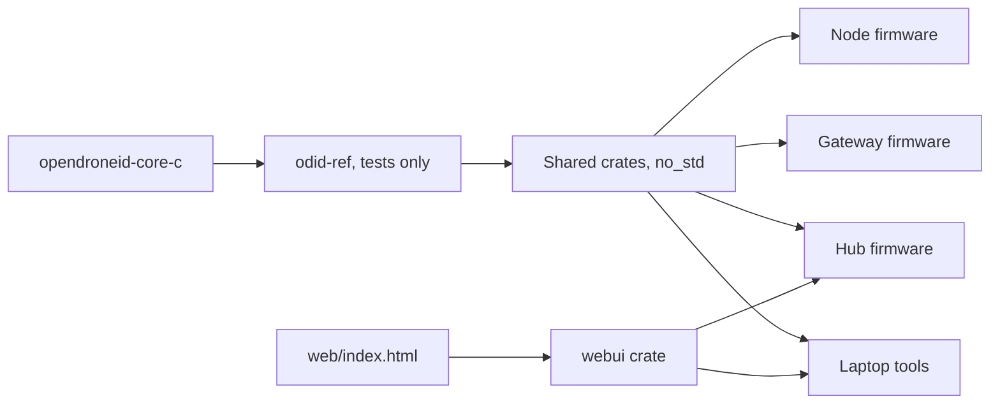

# A tour of the repository

**Level: 🟡 Intermediate** · What lives where in the Rotorscope repository, how the pieces depend
on each other, and what is deliberately kept out of it.

Rotorscope is one Git repository holding everything: the firmware for every board, the shared
logic the firmware is built from, the programs you run on a laptop, the phone page and these
documents. Facts on this page are as of 2026-11-18 (commit `6651ecd`).

## The top level

| Path | What it holds |
|---|---|
| `crates/` | The shared logic, one Rust library ("crate") per job: decoders, the tracker, the wire protocol, the screen. Almost all of it is `no_std` (it runs on a microcontroller with no operating system) and is tested on your computer. |
| `firmware/` | One project per board role: the listener nodes, the gateway, the two hubs and the test transmitter. Each is its own Cargo project, outside the main workspace. |
| `tools/` | Programs and scripts for a laptop: the live viewer, flashing and bench scripts, key makers, recording decoders. See the [tools reference](tools.md). |
| `web/` | The phone page, one self-contained file (`web/index.html`). |
| `docs/` | These documents (an mdBook site). See [Writing these docs](docs-style.md). |
| `third_party/opendroneid-core-c/` | The official Remote ID reference library, in C, under its own Apache-2.0 licence. Used only by host tests, to check our decoder against it. |
| `testdata/` | Not in the repository: created on your machine when you download test recordings (see below). |
| `PLAN.md` | Requirements, decisions and the phase-by-phase plan. |
| `RESEARCH.md` | The survey of other projects, chips and signals the plan rests on. |
| `SECURITY.md` | How to report a security problem privately. |
| `Cargo.toml` | The workspace: lists every crate and host tool that `cargo test` builds. |
| `book.toml` | Settings for the documentation site. |

### `crates/`: shared logic

The root `Cargo.toml` lists 34 crates as workspace members. Every one except `odid-ref` declares
itself `no_std` (most of them only outside their own tests, and `droneid`, `evidence` and
`rawcap` also have a `std` feature for the laptop tools). A few examples, to show the range:

| Crate | Job |
|---|---|
| `rid` | Remote ID decoding and encoding (Wi-Fi beacon, Wi-Fi NAN, Bluetooth) |
| `link` | The node-to-hub wire protocol: postcard + COBS frames over a serial line |
| `airlink` | ESP-NOW packets between nodes and the gateway, sealed with each node's own key (from `kitkeys`) |
| `tracker` | The hub's logic: merging detections into tracks, range and bearing, JSON / TAK CoT / CSV output |
| `droneid` | DJI OcuSync DroneID receiver, fixed point, for the ESP32-C5 |
| `screen` | The on-device screen: view model, buttons, drawing |
| `odid-ref` | Host only: compiles the C reference library so tests can compare against it |

The full list, crate by crate, is the [crate reference](crates.md).

### `firmware/`: one project per board role

| Folder | Board role | Chips |
|---|---|---|
| `node-wifi` | Wi-Fi listener node (Remote ID, open FPV links, Wi-Fi attacks) | ESP32-S3, ESP32-C5 |
| `node-ble` | Bluetooth listener node | ESP32-S3, ESP32-C5 |
| `node-sdr` | Raw-radio node: DJI DroneID, FPV video scan, jamming | ESP32-C5 |
| `node-lr` | Receive-only LR2021 "aero" node | ESP32-C3 |
| `node-common` | Code shared by the node images (image switching, fault handling, the node's key record) | |
| `gateway` | Relays ESP-NOW nodes onto one wire to the hub, holding no key | ESP32-C5 |
| `hub-p4` | The current hub, on a 5-inch touch screen board | ESP32-P4 |
| `hub` | The first hub; now also the P4's "web head" that serves the phone page | ESP32-S3 (also builds for the C5) |
| `rid-beacon` | The bench test transmitter, with an obviously fake identity | ESP32-S3, ESP32-C5 |
| `patches/` | Patched copies of upstream crates the firmware needs (see [Hard-won lessons](gotchas.md)) | |

The root `Cargo.toml` says why the firmware sits outside the workspace: each firmware folder is
"its own workspace (different targets and toolchains)", and depends on the shared crates by
path. That is why each firmware folder has its own `Cargo.lock` (except `node-common`, a library
built inside whichever node uses it) and its own `rust-toolchain.toml` (for `hub`, `node-wifi`
and `node-sdr` these sit in the per-chip `s3/` and `c5/` subfolders), and why `cargo test` at
the top never builds firmware. Which board does what is explained in
[Nodes, gateway and hub](../how/nodes-gateway-hub.md); every firmware's features and build
switches are in the [firmware reference](firmware.md).

`firmware/hub-p4/recordings/` is the one place a radio recording is committed: 300 seconds of
real aircraft ADS-B frames captured from an ADSBee, which the P4's `modesloop` bench build plays
back to check its own decoder. Aircraft broadcasts are public; the drone recordings below are
someone else's work and are never committed.

### `tools/`, `web/` and `third_party/`

`tools/` mixes Rust programs (thirteen of them are workspace members, so `cargo test` covers
them) with shell and Python scripts for flashing, bench tests and the documentation site. The
[tools reference](tools.md) covers each one.

`web/index.html` is a single file with its styles and script inline, because the hub's hotspot
has no internet. The `webui` crate gzips it at build time for the hub's flash, so editing the
page and rebuilding the hub is the whole workflow.

`third_party/opendroneid-core-c` keeps its Apache-2.0 licence. Only `crates/odid-ref` compiles
it, and only for tests: no firmware contains it.

## How the pieces feed each other

In words: the firmware projects and the laptop tools are thin layers over the same crates. The
laptop viewer `rid-view` runs the hub's own `tracker` crate, so what you see on a laptop is what
the hub would show. The test transmitter and the laptop Bluetooth test transmitter build their
messages with the same `rid` encoder the receivers decode with.

## How a feature is layered

Nearly every feature in the history arrives in the same three layers:

1. **A pure crate with host tests.** The logic (a decoder, a detector, a rule) goes into a crate
   under `crates/`, with no hardware in it, and is tested with `cargo test` on a laptop: against
   reference implementations, public recordings or synthetic signals. Example: `crates/wifiwatch`
   detects Wi-Fi attacks; its tests feed it made-up floods.
2. **Firmware glue.** The firmware project calls the crate from the radio driver's callback or
   the main loop, and reports through the `link` protocol. This layer is not unit-tested; it is
   kept thin for that reason.
3. **A bench test on real boards.** `tools/bench/run.py`, `tools/droneid-hil` or a written
   procedure in [Bench tests](../BENCH.md) checks it on hardware, and the result (PASS, the
   numbers, the date) goes into the documents.

Commit messages say how far a change got: "Host tests: ...", "Compile-checked only", or a bench
result. The [contributing guide](contributing.md) asks the same of new work.

## What is deliberately not in the repository

The repository is public, so `.gitignore` keeps out anything secret, anything licensed
differently, and anything that only describes one person's bench. Grouped:

| Kept out | Patterns in `.gitignore` | Why |
|---|---|---|
| **Keys** | `tools/kit.key`, `tools/kit.roster` (and their `.new` files), `tools/link.key`, `*.linkkey`, `*.evkey`, `O4KEY.TXT`, `*.o4key`, `*o4key*.txt`, `tools/flarm.keys`, `FLARMKEY.TXT`, `*.flarmkeys` | The ESP-NOW kit master (and the kit's roster, which holds no secret but is per kit), the retired one-per-kit link key of the pre-2026-11-18 firmware, evidence signing keys, DJI O4 keys and FLARM keys belong to whoever runs a kit. Anyone holding them could forge traffic or decrypt what they protect. |
| **Credentials** | `firmware/hub/wifi.local.toml` | The S3 hub's station-mode Wi-Fi password. |
| **Recordings and their products** | `testdata/`, `rfuav-results/`, `rfuav-data/` | Third-party recordings carry their own licences (the DroneID recordings are AGPL-3.0) and real identities; they are downloaded on demand and checked by checksum. |
| **Bench logs and local boards** | `bench-logs/`, `tools/boards.local` | Logs and board lists name one machine's boards (by MAC address) and runs; they mean nothing elsewhere. |
| **Downloads and generated files** | `tools/airspace-pack/cache/`, `*.PAK`, `evidence-data/`, `docs/assets/mermaid.min.js`, `firmware/patches/esp-hal-p4-pre-v3/upstream` | Public data or upstream code that a script fetches again whenever needed, and an evidence server's data folder. |
| **Build output** | `target/`, `**/target/`, `**/target-band24/`, `**/target-espnow/`, `**/target-bus/`, `*.bin`, `*.elf`, `__pycache__/` | Built firmware images and caches. |

> [!IMPORTANT]
> Two of the key tools (`link-key`, `flarm-keys`) write their files with owner-only permissions,
> and `flarm-keys` refuses to write anywhere inside a Git repository that Git would not ignore. Do not work around that: a key
> pushed to a public repository cannot be taken back.

**Next:** [Set up your machine](setup.md)

## Where this lives in the code

- `Cargo.toml`: the workspace members and the note on why firmware is separate
- `.gitignore`: everything listed in the last table
- `crates/*/Cargo.toml`: each crate's one-line description
- `firmware/*/Cargo.toml`: which shared crates each firmware uses, by path
- `crates/webui/build.rs`: how `web/index.html` reaches the hub
