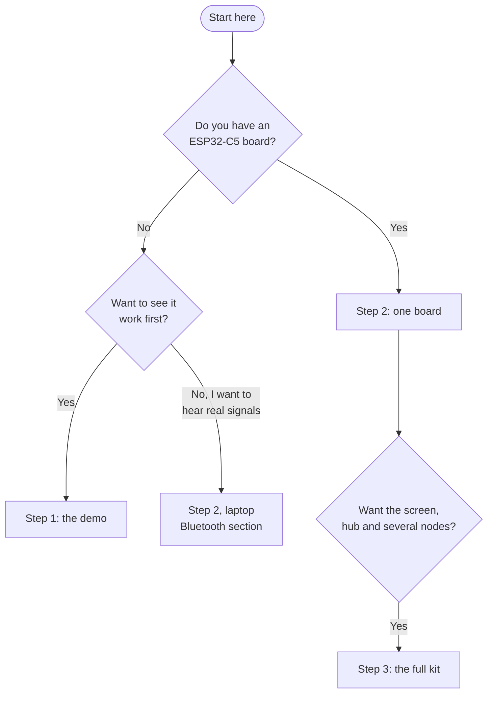

# Choose your path

**Level: 🟢 Beginner** · Three steps, from no hardware at all to a full bench kit. This page
helps you pick where to start.

You do not have to buy anything to try Rotorscope. Each step builds on the one before, and
you can stop at any of them.

> [!IMPORTANT]
> As of 2026-11-18 there is **no Rotorscope kit on sale**, and Rotorscope has not yet heard a
> real drone. Steps 1 and 2 work today. Step 3 follows the developer's own bench
> setup, which is still changing.

## The three steps

| Step | What you need | Roughly how long | What you get | Level |
|---|---|---|---|---|
| [**1. The demo**](step-1-demo.md) | A Linux computer and an internet connection | An hour or less, most of it waiting for the first build | Made-up drones, aircraft and radio signals moving in a live table on your screen. Nothing is received from the air. | 🟢 Beginner |
| [**2. One board**](step-2-one-board.md) | Step 1, plus one ESP32-C5 board and a USB-C data cable | An evening | A real Remote ID receiver on your desk, with the laptop showing what it hears. Or, with no board at all, your laptop's own Bluetooth as a receiver. | 🟡 Intermediate (a determined beginner can follow it) |
| [**3. The full kit**](step-3-full-kit.md) | Several ESP32-C5 boards, an ESP32-P4 touch-screen hub, wires and patience | Several sessions | The whole system: listener nodes, a gateway and a hub with a 5-inch touch screen, radar view and SD-card log. | 🟡 Intermediate to 🔴 Expert |

The times are rough guesses, not measurements. They depend mostly on how fast your computer
builds software.

**Remote ID** is the radio "licence plate" that many drones must broadcast: who the drone is,
where it is, and where its pilot is standing. It travels over ordinary Wi-Fi and Bluetooth.
See the [glossary](../project/glossary.md) for this and any other word you do not know.

## Which step is for me?

Everyone should do Step 1 first, even if you already have a board: Step 2 uses the same
tools, so Step 1 sets up your computer for it.

## What each step really proves

- **Step 1** is **simulated only**: the demo makes up its drones on your computer. It shows
  you what Rotorscope would display; it does not listen to anything.
- **Step 2** is a real receiver. The board's Bluetooth and Wi-Fi listening has been **proven
  on the air** from the project's own test transmitter. Unless a drone that sends Remote ID
  flies near you, though, you will see an empty table, and that is normal. Step 2 explains how
  to make a harmless test signal on your desk.
- **Step 3** builds the system the developer runs on the bench: nodes talking to a gateway by
  radio, the gateway wired to the hub. That chain is **proven on the air** with the test
  transmitter. Some parts are still missing on the bench: the phone page's board (the "web
  head") is not yet connected, and its firmware currently does not link (it needs more memory
  than its chip has).
  Step 3 says which parts work and which do not.

## Before you start

- Rotorscope **only listens**. Read [Law, safety and ethics](../start/law-and-ethics.md)
  before you build a receiver, and before you switch on any test transmitter.
- If something goes wrong, see [Troubleshooting](troubleshooting.md).
- The full, dated list of what works is on the [Status](../project/status.md) page.

**Next:** [Step 1: The demo, no hardware](step-1-demo.md)
