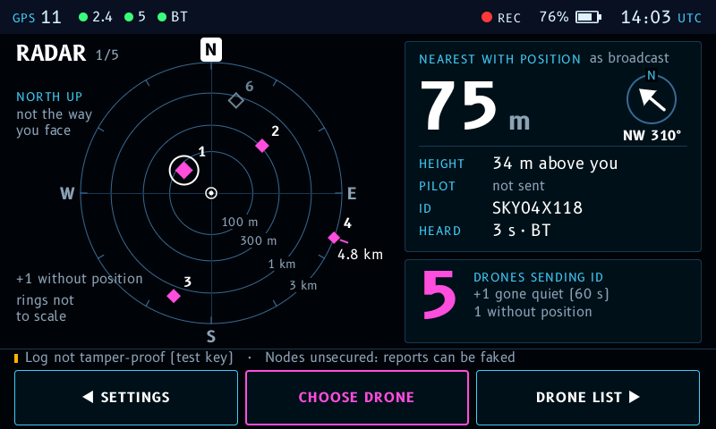
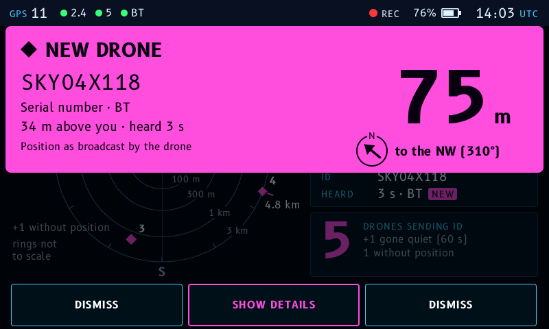

# First power-up

**Level: 🟡 Intermediate** · How to prepare the SD card, what the hub's screen should show as
the kit comes up, and how to prove the whole chain works with the test transmitter.

## About the screen pictures

The pictures on this page are drawn by the hub's own screen code (`crates/screen`) from made-up
drones and nodes, in the 800 x 480 layout the P4 hub draws now, so your kit's names and numbers
will differ. As of 2026-11-19 this layout is **simulated only**: drawn and tested on a computer
and built into the hub's firmware, but not yet looked at on the real panel. The panel and its
touch were confirmed by eye on 2026-11-14 with the hub's earlier layout, and the power-up order
below is what the developer's bench showed from 2026-11-14 to 2026-11-18. One difference from
the pictures: some show a battery level, but the P4 always shows **USB** (it cannot read its
battery).

**Moving around:** three touch keys run along the bottom of the screen, and each one says what
it does. While you browse, the left and right keys are labelled with the name of the page they
go to, and holding the middle key for 1 second goes back to the radar. You can also touch the
page itself, for example a drone. The full tour is in [The screen](../use/screen.md#the-three-keys).

## Prepare the SD card

Format the card as **FAT32** on your computer (see [Parts and tools](kit-parts.md#the-sd-card)
for why). The hub creates its own folder, `ROTORSCP`, the first time it sees the card. You can
create it yourself to put files in before the first boot.

| File in `ROTORSCP` | Who writes it | What it is |
|---|---|---|
| `LOGnnnnn.CSV` or `MMDDhhmm.CSV` | The hub, one per power-up | The detection log, a row a second for every active drone, open link, radio emitter, Wi-Fi drone and aircraft. Dated names need GPS time; without it the files are numbered. |
| `EVIDENCE/EVnnnnnn.EVL` | The hub, one per card mount | The signed [evidence log](../EVIDENCE.md) |
| `AIRSPACE.PAK` | You | The airspace pack for FAA rule flags (below) |
| `SITE.TXT` | You, and the hub (it only ever adds lines) | Where each node stands, the hub's home, and muted alarms: [Site settings](../SITE.md) |
| `GPSMEM.TXT` | The hub | The last position and time its GPS trusted |

The hub never deletes, never formats and never writes outside this folder. More on reading
these files is in [SD card and logs](../use/sd-card.md).

### The airspace pack (optional)

The FAA rule flags need a map of the airspace around you: controlled airspace, restricted
areas, temporary flight restrictions, terrain and so on. `tools/airspace-pack` downloads it
from public US-government sources (FAA, USGS, NOAA, Census) and writes one file. For a pack
centred on Philadelphia City Hall, covering 100 km around it by default:

```bash
cargo run --release -p airspace-pack -- --lat 39.9526 --lon -75.1652 --out AIRSPACE.PAK
```

Use your own site's latitude and longitude. `--radius-km` changes the size (100 by default).
A 100 km Philadelphia pack is about 662 KB. Copy `AIRSPACE.PAK` into the card's `ROTORSCP`
folder. As of 2026-11-18, tfr.faa.gov refuses the tool's downloads, so the tool prints
`TFRs skipped` and the pack has **no temporary flight restrictions** unless you save that day's
TFR files from a web browser into its cache folder and run it again (the message says how). A
pack holds only the TFRs active on the day it was made, so make a fresh one before you rely on
the flags. What the flags mean, and what they cannot tell you, is on
[FAA rule flags](../use/faa-flags.md).

## Power up, in this order

1. **The hub**, with the SD card in.
2. **The gateway**, wired to the hub's UART1 header.
3. **The nodes**, one at a time.

## What you should see

### 1. The hub starts on its first page

The first page is the Radar, but the radar needs to know where the hub is. **Without a
position** (no GPS fitted, or no fix yet) the hub shows a list of drones in its place, newest
first, titled **HOME · NO POSITION**. An amber band under the top bar says
**NO POSITION · distances and directions unavailable**, and the top left of the bar shows a
**chip** (a small boxed word): **NO GPS** when no GPS receiver was found, or **NO FIX** when there
is one but it has no position yet.


A normal hub build has no way to type in its own position, so on a hub without a working GPS
this is the page you will see: drones are still listed, with their signal strength, but there are
no distances or directions. The page reminds you that "signal strength is not distance". The
middle key reads **NO DRONES YET** and does nothing until there is a drone to choose.

**With a position**, the same first page is the radar, titled **RADAR**:


The bar along the top is the **status bar**. From the left it shows the GPS state (`GPS` and the
number of satellites, or a chip), a chip for each warning, then a dot and a short label for each
listener that is answering: `2.4`, `5`, `BT`, `DJI`, `LINK` (the gateway), `PLANES` (an ADSBee).
On the right are the SD card (`REC` with a red dot while it records, a quiet `no SD` without a
card, or an `SD ERROR` chip), **USB** for power, and the time in UTC (`--:--` until the hub knows
the time). More in [The status bar](../use/screen.md#the-status-bar).

**Before any node has reported**, the hub knows it cannot hear drones and says so on every page.
The amber **warning band** reads **NOT LISTENING · no receivers reported**, the status bar shows a
`NOT LISTENING` chip, and the radar's card says **NOT LISTENING: no receivers answering**:


This should clear within a few seconds of the gateway and the first node starting. If nodes
have reported and then all stopped, the band says how many answer instead, for example
`0 of 3 receivers responding`, and a chip such as `DOWN 2.4 5 BT` names them. When more than one
warning holds, the band shows the most serious and ends in `+1 more` (or more);
the status bar shows each as a chip ([The warning band](../use/screen.md#the-warning-band)).

**The aircraft receiver is expected to show as down.** The P4 hub always lists its aircraft
(ADS-B) input as a listener, whether or not anything is wired to it. Unless you have added an
ADSBee, that input never answers, so the status bar shows a `PLANES DOWN` chip, the warning band
says **PLANE RECEIVER DOWN · planes won't be heard** whenever nothing more serious is showing, and
the Health page has an **ADS-B** row marked NOT RESPONDING. With no position as well, that band
comes first and ends in `+1 more`; the NO POSITION line pictured above is the one waiting behind
it. None of this is a fault in your kit: the hub is saying it cannot hear aircraft. The pictures on
this page were drawn without that input, so they do not show it.

**Muted notes just above the keys** (one or two lines) say what this kit cannot yet vouch for. On
a kit as it ships they read
`Log not tamper-proof (test key)` (`Log not evidence-grade (dev key)` with a development key) and
`Nodes unsecured: reports can be faked` (the kit is not sealed yet: the hub's own key record is
open). A bench build adds `Bench build`. When there are more notes than fit, the second line says
`+N notes: see Health`, and the Health page lists them, as far as its Notes row has room
([The notes above the keys](../use/screen.md#the-notes-above-the-keys)).



### 2. Nodes appear on the Health page

From the radar, press the **left key**, labelled **SETTINGS**. On the Settings page the left key is
now labelled **HEALTH**: press it again. That is the shortest way (the right key, labelled
**DRONE LIST**, gets there too, in four presses). The page title reads **HEALTH 5/6**: the P4
hub always has the Flags page in its cycle, so it has six pages (the pictures on this page were
drawn without it, so they count to 5). To go back, tap the middle key, labelled
**BACK TO RADAR** ("tap or hold").

Within a few seconds of the gateway starting, each node should appear as a row named after the
job it is doing (Wi-Fi 2.4, Wi-Fi 5, Bluetooth, DroneID, FPV 5.8, Gateway), with its frames per
second, ID messages, frames lost and time up. A green dot means the hub has heard from it in the
last 5 seconds.


**FRAMES/S** shows `--` until the hub has measured that node's rate. Two things to look out for:

- **A silent node** is answering but hears nothing at all. Its dot becomes a hollow ring, its
  name turns amber, and **HEARS NOTHING** appears in a box where its frames per second would be.
  In the status bar its label gets a hollow ring too.
- **A dead node** has not been heard for 5 seconds. Its row turns amber with a slashed mark and
  **NOT RESPONDING**, and a line under it says what you lose and what to check, for example
  `last heard 2 min ago · drones on 5 GHz won't be heard · check power, cable, range`. The status
  bar shows a chip such as `5 DOWN`, and the warning band says `5 GHz RECEIVER DOWN`.


With no node reporting at all, the page says `no radio nodes reported: the hub hears nothing`.
More in [Health](../use/screen.md#health).

### 3. The hub gives each node a job

Every two seconds the hub decides who listens to what, and sends each node its job through the
gateway. The Health page then gains an **ASSIGNED ROLE** column, which shows for each node
`<job> plan <four hex digits>`, ending in `sent` (in amber) until the node confirms it and
`running` after. The jobs are handed out from a fixed ladder:

| Nodes | Jobs |
|---|---|
| 1 | Wi-Fi 2.4 GHz Remote ID |
| 2 | + Bluetooth Remote ID |
| 3 | + Wi-Fi 5 GHz |
| 4 | + DJI DroneID (needs the node-sdr image) |
| 5 | + analog FPV scan (needs the node-sdr image) |

A job that needs a different image makes the node restart into it; on the bench, node-ble was
running about a second after node-wifi switched to it. The full ladder is in
[Nodes, gateway and hub](../how/nodes-gateway-hub.md).

### 4. A GPS fix (if you fitted one)

> [!IMPORTANT]
> No real GPS module has been connected to the P4 yet. This is what the code is written to
> do, tested only against the chip pretending to be a GPS.

The hub listens for the GPS at three speeds in turn, recognises the module, sets it up, and
then waits for a fix. The **GPS** tile on the Health page moves from `no receiver found` to
`no fix · N satellites`, then to `2D fix · N satellites` or `3D fix · N satellites`. The status
bar shows `GPS` and the satellite count instead of the NO GPS or NO FIX chip, and the first page
becomes the radar, with distances and directions. Before it trusts a position or a time the hub
checks it for signs of jamming or spoofing; until then the tile may say `no trusted position`
([Position and time](../how/position-and-time.md)).

## Prove it with the test transmitter

> [!WARNING]
> `rid-beacon` transmits. Use it indoors, on the bench, only while testing, and read
> [Law, safety and ethics](../start/law-and-ethics.md) first. It sends a plainly fake drone
> at the lowest power the radio allows.

With one node, the hub gives it the Wi-Fi 2.4 GHz job, which listens mostly on channel 6. The
C5 test transmitter starts on 5 GHz channel 149, so it needs the key `b` to move to channel 6.
Plug in a spare C5 that is registered as, say, `c5d` (not a node or the gateway), then flash it
and type `b` on its console 8 seconds after it starts:

```bash
tools/dev-board.sh --send b firmware/rid-beacon/target/riscv32imac-unknown-none-elf/release/rid-beacon 120 c5d
```

Its once-a-second line should show `"band":"2.4","ch":6`. Within a few seconds a drone should
appear on the hub's Radar and List pages with the ID `TESTDRONE0000000001`, flying a 50 m
circle around Philadelphia City Hall (the transmitter's built-in fake position). On the
2026-11-15 bench run every transport arrived at the hub in under 3 seconds.

When a drone is new, a **banner** covers the top of the page for a few seconds: **NEW DRONE**,
its ID, how far away it is and in which direction, and "Position as broadcast by the drone". A
drone within 300 m keeps its banner until you press a key. The middle key, labelled
**SHOW DETAILS**, opens the drone's details; the other two keys, labelled **DISMISS**, only put it
away ([New-drone banner](../use/screen.md#new-drone-banner)). The P4 hub has no buzzer, so it
does not beep.



Then the radar shows the drone as a diamond, numbered 1, with its pilot as an X when the drone
reports one. The card on the right gives the distance in large figures, the direction as an
arrow and as a compass point with degrees, the height, the pilot, the ID and when it was last
heard. The count below turns to 1, and the middle key now reads **CHOOSE DRONE**.


*Examples from the screen tests: your test drone's ID, distance and height will differ.
Without a hub position you will see it in the list on the HOME · NO POSITION page instead,
with its signal strength in place of a distance.*

That is the whole chain proven on the air: test transmitter → node → ESP-NOW → gateway → wire
→ hub. Unplug the test transmitter when you are done (or press `x` on its console to silence it).

## Where the logs go

| Where | What |
|---|---|
| SD card, `ROTORSCP/` | The CSV log and evidence files above, flushed every 5 seconds |
| The P4's USB-C console (115200 baud) | Log lines starting `hub-p4:` and JSON lines starting `{`: a `hub` line every second with link, GPS, SD and ADSBee status, and `track`, `link`, `aircraft` lines. Type `h` for the list of console commands |
| Each C5's own USB | That board's JSON lines (`hello`, `stats`, the gateway's `gw` and `node` lines) |

> [!TIP]
> Opening the P4's console port **restarts the hub every time**, even with the port's control
> lines held low. So the first log you see is always a fresh boot, and your SD card gets a new
> log file.

## Where this lives in the code

- `firmware/hub-p4/src/display.rs`: the panel and the touch keys
- `crates/screen/src/wide/`: the 800 x 480 layout the P4 draws
- `firmware/hub-p4/src/app.rs`: what the hub puts on the screen
- `firmware/hub-p4/src/sd.rs`: the SD card folder and files
- `crates/screen/`: every page, and `crates/screen/tests/snapshots.rs` for the pictures
- `crates/coverage/README.md`: the job ladder
- `tools/airspace-pack/`: the airspace pack

**Next:** [Using Rotorscope: the screen](../use/screen.md), or
[Troubleshooting](troubleshooting.md) if something did not appear.
