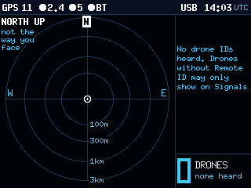
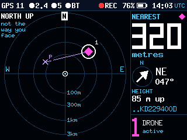

# First power-up

**Level: 🟡 Intermediate** · How to prepare the SD card, what the hub's screen should show as
the kit comes up, and how to prove the whole chain works with the test transmitter.

> [!NOTE]
> The order below is what the developer's bench showed on 2026-11-14 to 2026-11-18. Some
> screen elements described here were added after anyone last looked at the P4's screen, and
> are marked as not yet checked by eye.

## About the screen pictures

The pictures on this page are drawn by the project's screen tests (`crates/screen`) at
**320x240**, the size of the earlier S3 hub's panel. As of 2026-11-19 the P4 hub draws the same
pages in a newer layout made for its 800x480 panel, with three touch keys along the bottom that
say what each does. So what you see on the P4 holds the same information as the pictures here,
arranged with more room; this page has not yet been updated with pictures of it. The newer
layout is **simulated only**: not yet looked at on the panel.

Two differences: some test pictures show a battery level, but the P4 always shows USB power
(it cannot read its battery); and the test pictures use made-up drones and nodes, not your kit.

**Moving around:** UP and DOWN change page (Radar, Drone list, Flags when there are any,
Signals, Health, Settings). SELECT enters a page or picks a row; **holding** SELECT goes back.
The full tour is on [The screen](../use/screen.md).

## Prepare the SD card

Format the card as **FAT32** on your computer (see [Parts and tools](kit-parts.md#the-sd-card)
for why). The hub creates its own folder, `ROTORSCP`, the first time it sees the card. You can
create it yourself to put files in before the first boot.

| File in `ROTORSCP` | Who writes it | What it is |
|---|---|---|
| `LOGnnnnn.CSV` or `MMDDhhmm.CSV` | The hub, one per power-up | The detection log, a row a second for every active drone, open link, radio emitter, Wi-Fi drone and aircraft. Dated names need GPS time; without it the files are numbered. |
| `EVIDENCE/EVnnnnnn.EVL` | The hub, one per card mount | The signed [evidence log](../EVIDENCE.md) |
| `AIRSPACE.PAK` | You | The airspace pack for FAA rule flags (below) |
| `SITE.TXT` | You, and the hub (it only ever adds lines) | Where each node stands, the hub's home, and muted alarms: [Site settings](../SITE.md) |
| `GPSMEM.TXT` | The hub | The last position and time its GPS trusted |

The hub never deletes, never formats and never writes outside this folder. More on reading
these files is in [SD card and logs](../use/sd-card.md).

### The airspace pack (optional)

The FAA rule flags need a map of the airspace around you: controlled airspace, restricted
areas, temporary flight restrictions, terrain and so on. `tools/airspace-pack` downloads it
from public US-government sources (FAA, USGS, NOAA, Census) and writes one file. For a pack
centred on Philadelphia City Hall, covering 100 km around it by default:

```bash
cargo run --release -p airspace-pack -- --lat 39.9526 --lon -75.1652 --out AIRSPACE.PAK
```

Use your own site's latitude and longitude. `--radius-km` changes the size (100 by default).
A 100 km Philadelphia pack is about 662 KB. Copy `AIRSPACE.PAK` into the card's `ROTORSCP`
folder. As of 2026-11-18, tfr.faa.gov refuses the tool's downloads, so the tool prints
`TFRs skipped` and the pack has **no temporary flight restrictions** unless you save that day's
TFR files from a web browser into its cache folder and run it again (the message says how). A
pack holds only the TFRs active on the day it was made, so make a fresh one before you rely on
the flags. What the flags mean, and what they cannot tell you, is on
[FAA rule flags](../use/faa-flags.md).

## Power up, in this order

1. **The hub**, with the SD card in.
2. **The gateway**, wired to the hub's UART1 header.
3. **The nodes**, one at a time.

## What you should see

### 1. The hub starts on its first page

The first page is the Radar, but the radar needs to know where the hub is. **Without a
position** (no GPS fitted, or no fix yet) the hub shows a list in its place, newest drone
first, under a yellow warning, and the top bar says **NO GPS** (no receiver found) or
**NO FIX**:


A normal hub build has no way to type in its own position, so on a hub without a working GPS
this is the page you will see: drones are still listed, with signal strength, but there are no
distances or bearings. **With a position**, the same page is the radar:



The bar along the top shows, from the left, the GPS state, a mark for each kind of listener
(crossed out when that listener has stopped responding), the SD card state and the time.

**A strip along the bottom edge** should read `TEST KEY: log not evidence` on every page until
the hub signs its evidence with a key of its own (`DEV KEY: not evidence-grade` with a
development key); a bench build adds `BENCH BUILD`, and a kit that is not sealed yet (the hub's
own key record is open, as a kit ships) adds `OPEN LINK`. These strip messages are built but have not yet been checked by eye on the P4.

### 2. Nodes appear on the Health page

Press DOWN until you reach **HEALTH**. Within a few seconds of the gateway starting, each node
should appear as a row named after the job it is doing, with its Remote ID count, drops and
uptime. A node not heard from recently shows **NOT RESPONDING**. With no node reporting at all
the page says `no radio nodes reported`.


On the P4 the **FR/S** column reads 0 for nodes relayed by the gateway: the hub does not get
that figure from them.

### 3. The hub gives each node a job

Every two seconds the hub decides who listens to what, and sends each node its job through the
gateway. Under each node a small line shows `-> <job> plan <four hex digits>`, ending in `sent` until
the node confirms it and `running` after. The jobs are handed out from a fixed ladder:

| Nodes | Jobs |
|---|---|
| 1 | Wi-Fi 2.4 GHz Remote ID |
| 2 | + Bluetooth Remote ID |
| 3 | + Wi-Fi 5 GHz |
| 4 | + DJI DroneID (needs the node-sdr image) |
| 5 | + analog FPV scan (needs the node-sdr image) |

A job that needs a different image makes the node restart into it; on the bench, node-ble was
running about a second after node-wifi switched to it. The full ladder is in
[Nodes, gateway and hub](../how/nodes-gateway-hub.md).

### 4. A GPS fix (if you fitted one)

> [!IMPORTANT]
> No real GPS module has been connected to the P4 yet. This is what the code is written to
> do, tested only against the chip pretending to be a GPS.

The hub listens for the GPS at three speeds in turn, recognises the module, sets it up, and
then waits for a fix. The Health page's **GPS** line moves from `no receiver found` to
`no fix, N satellites`, then to `2D fix` or `3D fix` with the satellite count, and the top bar
shows the satellite count instead of NO GPS. Once there is a fix, distances and bearings
appear. Before it trusts a position or a time the hub checks it for signs of jamming or
spoofing; until then the line may say `no trusted position`
([Position and time](../how/position-and-time.md)).

## Prove it with the test transmitter

> [!WARNING]
> `rid-beacon` transmits. Use it indoors, on the bench, only while testing, and read
> [Law, safety and ethics](../start/law-and-ethics.md) first. It sends a plainly fake drone
> at the lowest power the radio allows.

With one node, the hub gives it the Wi-Fi 2.4 GHz job, which listens mostly on channel 6. The
C5 test transmitter starts on 5 GHz channel 149, so it needs the key `b` to move to channel 6.
Plug in a spare C5 that is registered as, say, `c5d` (not a node or the gateway), then flash it
and type `b` on its console 8 seconds after it starts:

```bash
tools/dev-board.sh --send b firmware/rid-beacon/target/riscv32imac-unknown-none-elf/release/rid-beacon 120 c5d
```

Its once-a-second line should show `"band":"2.4","ch":6`. Within a few seconds a drone should
appear on the hub's Radar and List pages with the ID `TESTDRONE0000000001`, flying a 50 m
circle around Philadelphia City Hall (the transmitter's built-in fake position). On the
2026-11-15 bench run every transport arrived at the hub in under 3 seconds.



*An example from the screen tests: your test drone's ID, distance and height will differ.
Without a hub position you will see it in the list that replaces the radar instead.*

That is the whole chain proven on the air: test transmitter → node → ESP-NOW → gateway → wire
→ hub. Unplug the test transmitter when you are done (or press `x` on its console to silence it).

## Where the logs go

| Where | What |
|---|---|
| SD card, `ROTORSCP/` | The CSV log and evidence files above, flushed every 5 seconds |
| The P4's USB-C console (115200 baud) | Log lines starting `hub-p4:` and JSON lines starting `{`: a `hub` line every second with link, GPS, SD and ADSBee status, and `track`, `link`, `aircraft` lines. Type `h` for the list of console commands |
| Each C5's own USB | That board's JSON lines (`hello`, `stats`, the gateway's `gw` and `node` lines) |

> [!TIP]
> Opening the P4's console port **restarts the hub every time**, even with the port's control
> lines held low. So the first log you see is always a fresh boot, and your SD card gets a new
> log file.

## Where this lives in the code

- `firmware/hub-p4/src/display.rs`: the panel and the touch keys
- `firmware/hub-p4/src/app.rs`: what the hub puts on the screen
- `firmware/hub-p4/src/sd.rs`: the SD card folder and files
- `crates/screen/`: every page, and `crates/screen/tests/snapshots.rs` for the pictures
- `crates/coverage/README.md`: the job ladder
- `tools/airspace-pack/`: the airspace pack

**Next:** [Using Rotorscope: the screen](../use/screen.md), or
[Troubleshooting](troubleshooting.md) if something did not appear.
