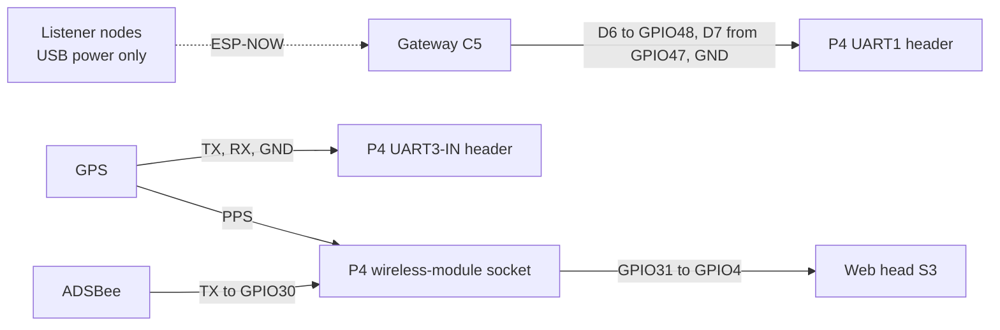

# Wiring

**Level: 🟡 Intermediate** · Which pin on which board goes to which pin on the other, for the
gateway, the GPS, the ADSBee and the web head, with the warnings that protect your boards.

This is the guided version: one connection at a time, in the order you will make them. Every
pin, header and voltage is in [Pins and wiring reference](../hardware/pinouts.md). The pins
below were checked against the firmware source on 2026-11-18.

> [!WARNING]
> Every signal in this kit is **3.3 V logic**. The P4's UART3-IN header has a **5 V power
> pin**: never connect it to a GPS, a C5 or any signal wire. Unplug every board from USB
> before you connect or move a wire.

## The whole picture

The listener nodes have **no wires** in the ESP-NOW kit: each needs only USB power. Every
other board in the picture shares a ground wire with the P4.

## Before you start

- **Power each board from its own USB port.** The bench powers the hub, the gateway and every
  node from USB. Do not also feed power down a signal lead.
- **Set DIP switch 1 on the P4 to UART1.** The UART1 header shares its two pins with the
  wireless-module socket; the switch picks which one they go to. The gateway link needs UART1.
- **Leave the wireless-module socket empty.** Three of the kit's wires (GPS PPS, ADSBee, web
  head) use pins of that socket. Never fit a radio module in it while they are connected.
- **Check the socket holes with a multimeter.** The socket pin numbers come from Elecrow's
  documentation, not from a measurement on this project's bench. Before wiring GPIO29, GPIO30
  or GPIO31, find which hole is which with a meter.

## 1. Gateway to hub (required)

The gateway is the only wired board the ESP-NOW kit needs. The link runs at 921600 baud in
both directions: the gateway sends the nodes' reports, and the hub sends back each node's job.

| Gateway (XIAO ESP32-C5) | P4 hub, UART1 header (PH2.0, 4 pins) | Signal |
|---|---|---|
| **D6** (GPIO11), the gateway's TX | **RX** (GPIO48) | Reports, gateway to hub |
| **D7** (GPIO12), the gateway's RX | **TX** (GPIO47) | Jobs for the nodes, hub to gateway |
| **GND** | **GND** | Shared ground |

TX goes to RX and RX to TX: the wires cross. The UART1 header also has a 3.3 V pin; the gateway
does not need it, because it runs from its own USB.

> [!NOTE]
> Until 2026-11-17 the gateway used the UART3-IN header (GPIO28 and GPIO27) and the GPS the
> UART1 header. They were swapped that day. Some bench notes from before then still name the
> old pins; the table above is what the firmware uses now.

## 2. GPS to hub (optional)

Either supported module, the u-blox MAX-M10S or the Quectel LC29H(AA), wires the same way.
**This has never been done with a real module**; the hub's GPS code has only run against the
chip pretending to be a GPS.

| GPS module | P4 hub | Where on the P4 |
|---|---|---|
| **TX** | **GPIO28** | UART3-IN header (XH2.54), pin marked RX |
| **RX** | **GPIO27** | UART3-IN header, pin marked TX |
| **PPS** | **GPIO29** | Wireless-module socket (the SX1262 BUSY / nRF24 IRQ position) |
| **VCC** | **3V3** | The UART1 header's 3.3 V pin, or the I2C header's. **Not** the UART3-IN header's power pin: that one is 5 V. |
| **GND** | **GND** | Any ground pin |

The UART1 header's 3.3 V pin can supply up to 1 A, according to the hub's notes. The hub
listens for the GPS at 115200, 9600 and 38400 baud in turn, so you do not set a speed.

## 3. ADSBee to hub (optional)

Only the ADSBee's transmit line is used: the hub never sends it anything on this port.
**This has never been done with a real ADSBee**; it has only run as a loop-back on the chip.

| ADSBee 1090 header | P4 hub | Notes |
|---|---|---|
| **TX** (COMMS_UART) | **GPIO30** | Wireless-module socket (the SX1262 NSS position). 115200 baud |
| **GND** | **GND** | Shared ground |
| RX | Not connected | The ADSBee takes no commands on this port |

Power the ADSBee from its own USB. Before you connect it, set it once over its USB to send
CSBee text on this header ([ADSBee 1090](../ADSBEE.md), "2. On the hub"; the same section has the P4 pin).

## 4. Web head to hub (optional, not usable yet)

> [!IMPORTANT]
> As of 2026-11-18 the web-head firmware does not link (it is over the S3's memory), and this
> wire has never been connected on the bench. The table is here so the picture is complete.

| P4 hub | Web head (ESP32-S3 board) | Notes |
|---|---|---|
| **GPIO31** (wireless-module socket, the SX1262 IRQ / nRF24 CE position) | **GPIO4** (its node-A RX) | 921600 baud, one way only |
| **GND** | **GND** | Shared ground |

Nothing comes back from the web head to the hub. **GPIO32**, the next socket pin, is kept free
for a return wire if one is ever needed; leave it unconnected.

## Pins that must stay unconnected

| Pin or header | When | Why |
|---|---|---|
| The whole wireless-module socket: no module fitted | Always, while GPIO29, 30 or 31 are wired | Those pins are the module's pins |
| UART3-IN header power pin (5 V) | Always, for 3.3 V parts | It is 5 V |
| GPIO32 | Always (today) | Reserved for a future return wire from the web head |
| UART3-IN header, GPIO29 and GPIO30 | While a `gpsloop` bench build runs | The chip drives those pins itself to pretend to be a GPS and an ADSBee |
| GPIO30 and GPIO31 | While a `webheadloop` bench build runs | The chip reads its own web-head output back on them |
| GPIO30 | While a `modesloop` bench build runs | The chip plays recorded aircraft onto it |

The bench builds named here exist only for testing and refuse to build without
`ROTORSCOPE_BENCH=1`; a normal build never drives these pins.

## The wired bus instead of ESP-NOW

The hub's default firmware can also poll many nodes over two shared wires plus ground, so that
nothing in the kit transmits at all. It is **simulated only**: tested in a computer simulation, and nobody has wired it. If you
want to be the first, follow the full guide in [The wired bus in depth](../WIREBUS.md#wiring-guide-for-the-person-with-the-soldering-iron).
In short:

| Wire | P4 UART1 header | Each node (XIAO ESP32-C5) |
|---|---|---|
| Command wire | **TX** (GPIO47) | **D7** (GPIO12), optionally through 1 kohm |
| Return wire | **RX** (GPIO48), pulled up to 3.3 V by one 470 ohm resistor at the P4 | **D9** (GPIO9) through a Schottky diode, stripe towards D9 |
| Ground | **GND** | **GND** |

Keep the run under about 1 m. A gateway and bus nodes cannot share these two wires: the
gateway talks whenever it likes and would garble the bus. Do not power the nodes from the P4's
5 V pin.

## Where this lives in the code

- `firmware/hub-p4/src/main.rs`: every pin the hub claims, and its boot line naming them
- `firmware/hub-p4/src/links.rs` and `src/bus.rs`: the node link on the UART1 header
- `firmware/hub-p4/src/gps.rs`, `src/adsbee.rs`, `src/webhead.rs`: GPS, ADSBee, web head
- `firmware/gateway/src/main.rs`: the gateway's hub UART
- `firmware/node-common/src/bus.rs`: the nodes' wired-bus pins
- `firmware/hub-p4/PARITY.md`, "Pins chosen"; `firmware/hub-p4/WEBHEAD.md`, "Wiring"

**Next:** [Build and flash](kit-flash.md)
