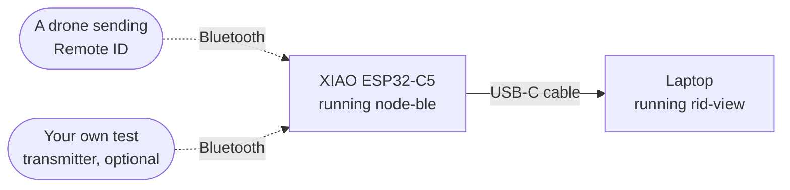

# Step 2: One board, a real receiver

**Level: 🟡 Intermediate** · Turn one small ESP32-C5 board into a real Remote ID receiver
plugged into your laptop, with rid-view showing what it hears. Written so that a determined
beginner who has finished [Step 1](step-1-demo.md) can follow it.

In Step 1 rid-view made its drones up. Here a real radio board listens to the air and sends
what it hears to rid-view over the USB cable. No soldering is needed: the board plugs
straight into your laptop.

If you have no board at all, skip to
[No board? Use your laptop's Bluetooth](#no-board-use-your-laptops-bluetooth).

## What you are building



- The **board** is a Seeed **XIAO ESP32-C5**, a thumb-sized computer with a radio. You will
  load it with **node-ble**, Rotorscope's Bluetooth listener **firmware** (the program that
  runs on the board).
- It listens for **Remote ID**, the identity and position broadcast many drones must send,
  and writes one line of text to the USB cable for each message it hears.
- The **laptop** runs **rid-view**, the viewer from Step 1, reading those lines instead of
  making up drones.
- The dotted lines are radio. The board only listens; nothing in this picture transmits
  except a drone or a test transmitter you choose to switch on.

## Which board, and why this one

**Get a Seeed XIAO ESP32-C5** and a **USB-C cable that carries data**. Many cheap cables only
charge; with one of those the board powers up but your laptop never sees it.

Why this board:

- The project plans to use it for every listening job. As of 2026-11-12 a XIAO
  ESP32-C5 has passed each listener role on the bench: Wi-Fi Remote ID on 2.4 and 5 GHz, and
  Bluetooth 4, Bluetooth 5 and Long Range.
- Its firmware builds with the ordinary Rust you installed in Step 1. The older ESP32-S3
  needs Espressif's own extra toolchain (see [If you have an ESP32-S3](#if-you-have-an-esp32-s3)).
- It is the same board Step 3 uses, so nothing is wasted if you go on.

Fit the antenna that comes with the board. That antenna covers 2.4 GHz only, which is what
Bluetooth and 2.4 GHz Wi-Fi use. Listening on 5 GHz Wi-Fi needs a dual-band antenna instead.
For more about the boards see [Boards and chips](../hardware/boards.md).

## Which firmware: Bluetooth or Wi-Fi

One board's radio listens to one band at a time, so a single board hears either Bluetooth or
Wi-Fi Remote ID, not both. This page takes **Bluetooth (node-ble)** as the main path because:

- it hears all three Bluetooth kinds of Remote ID: Bluetooth 4 ("legacy"), Bluetooth 5
  "extended" and Bluetooth 5 **Long Range**;
- on a C5 all three are **proven on the air**, heard from the project's own test transmitter
  on a second C5 (2026-11-12);
- a Linux laptop can make a harmless Bluetooth test signal itself, so you can check your
  board with no second board.

The Wi-Fi listener is the other choice, covered in
[The Wi-Fi listener instead](#the-wi-fi-listener-instead).

## What you need to install

You need everything from [Step 1](step-1-demo.md) (Rust, git and the `rotorscope` folder),
plus three things. Run these from inside the `rotorscope` folder.

**1. Rust's support for the C5's processor.** The C5 has a RISC-V processor, so Rust needs
the matching target. The node-ble and rid-beacon folders name Espressif's own toolchain by
default, and the build commands below switch to ordinary Rust with `+stable`, so add the target
to it once (the name is the one in the build commands and in
`firmware/node-wifi/c5/rust-toolchain.toml`):

```bash
rustup target add riscv32imac-unknown-none-elf
```

**2. espflash**, the tool that writes firmware onto ESP32 boards:

```bash
cargo install espflash --locked
```

This builds espflash from source, so it takes a while. The repository does not pin an espflash
version; use a recent release, since the C5 is a new chip (see
[Set up your machine](../dev/setup.md#flashing-tools)).

**3. Python 3 with its serial-port module (pyserial).** Rotorscope's flashing helper,
`tools/dev-board.sh`, uses it to read the board's output. Most Linux systems have Python 3;
the serial module is a separate package (on Debian and Ubuntu, `python3-serial`).

## Do I need a link key?

**No, not for this step.**

Rotorscope's kit boards talk to each other by radio (a link called **ESP-NOW**). Once a kit is
sealed, every such message is signed with that node's own secret **link key**, which `link-key`
writes into the board's flash. No firmware build needs or asks for a key (since 2026-11-18).

The builds on this page send their results down the USB cable only. They contain no ESP-NOW
code, so a key would make no difference to them.

If a board prints a `"what":"link_key"` warning, you have flashed an ESP-NOW version (for
example one built with `cargo fw24-now`). Go back to the commands on this page. Sealing a kit is
part of [Step 3](step-3-full-kit.md), and explained in
[Securing the link](../ESPNOW.md#securing-the-link).

## 1. Build the Bluetooth listener

Go into the firmware's folder:

```bash
cd firmware/node-ble
```

Build it for the C5:

```bash
cargo +stable build --release --no-default-features --features esp32c5 --target riscv32imac-unknown-none-elf
```

The `+stable` matters. This folder is set up for the ESP32-S3 by default, and `+stable`
tells it to use the ordinary Rust you already have. The first build downloads and compiles a
lot, so give it time. The finished firmware is saved as
`firmware/node-ble/target/riscv32imac-unknown-none-elf/release/node-ble`.

Go back to the top of the `rotorscope` folder:

```bash
cd ../..
```

## 2. Plug in the board and give it a name

Plug the board into your laptop with the data cable. Then:

```bash
tools/dev-board.sh --register
```

This finds every Espressif board plugged in, asks each one what chip it has, and gives it a
short name. Your first C5 is called `c5a`. It prints a table with the name, chip, the board's
own hardware address and its **port**: the path Linux uses to reach it, which starts
`/dev/serial/by-id/usb-Espressif_` (the script only looks for names starting that way). The
rest of the name below is how it looks for the project's ESP32-S3; a C5's may differ, so copy
yours from the table rather than from this page. The names are saved in `tools/boards.local`, a file that
stays on your computer and is never uploaded.

Check it:

```bash
tools/dev-board.sh --list
```

You should see your board with `esp32c5` and `attached`, for example (this address is made
up):

```text
NAME   CHIP     STATE     PORT
c5a    esp32c5  attached  /dev/serial/by-id/usb-Espressif_USB_JTAG_serial_debug_unit_AA:BB:CC:DD:EE:01-if00
```

Ignore an `s3` line marked `ABSENT`: it is a built-in default from the developer's bench.

If it says `No Espressif boards attached`, try another cable (it is probably charge-only) or
another USB port.

## 3. Flash it

**Flashing** means writing the firmware onto the board. This command flashes it, restarts
it and shows what it prints for 30 seconds:

```bash
tools/dev-board.sh firmware/node-ble/target/riscv32imac-unknown-none-elf/release/node-ble 30 c5a
```

After the last few lines of espflash's output you should see lines of text starting with `{`. The first
says `"t":"hello"` and `"node":"ble"`; then a `"t":"stats"` line arrives every second. In a
stats line, `adv` is how many Bluetooth adverts the board heard in the last second. Phones,
earbuds and watches nearby send them all the time, so a number above zero means the radio is
working.

A C5 disappears from USB for about a second as its firmware starts. The script waits for it
and may print `dev-board: USB re-enumerated (1), reopened`. That is normal.

The firmware stays on the board. Next time you plug it in, it starts listening on its own.

## 4. Watch it with rid-view

Wait for the flashing script to finish (only one program can read the board at a time).
Then start rid-view with your board's port, copied from the `PORT` column of
`tools/dev-board.sh --list`, and your position:

```bash
cargo run --release -p rid-view -- /dev/serial/by-id/usb-Espressif_USB_JTAG_serial_debug_unit_AA:BB:CC:DD:EE:01-if00 --own-pos 39.9526,-75.1652
```

Replace the port with yours, and the position with your own latitude and longitude. The
port name looks long, but it never changes for this board. A shorter name such as
`/dev/ttyACM0` also works, but it can change when you plug things in, so the long one is
safer.

Press Ctrl+C to stop rid-view. The board keeps listening; it does not need rid-view running.

## What will I actually see?

Probably **nothing in the drone table**, and that is normal.

```text
  (no drones yet)
```

Rotorscope has nothing to show unless a drone that sends Remote ID is within radio range and
switched on. As of 2026-11-18 the project itself has **not yet heard a real drone**: every
over-the-air test so far used its own test transmitters.

What you **will** see, if all is well, is the node line near the top:

```text
  node 0 /dev/serial/by-id/usb-Espressif_..._AA:BB:CC:DD:EE:01-if00  stats: adv=23 coded=0 drops=0 ...  rid lines: 0
```

`adv` going up and down each second means the board is alive and hearing ordinary Bluetooth.
`rid lines` counts Remote ID messages, and stays at 0 until something sends one.

If the board was restarted after rid-view opened it, its node line ends with a note in
brackets saying the input ended. Stop rid-view and start it again.

## Making a test signal

To see a row appear, something nearby has to send Remote ID. The project has two bench test
transmitters, both with a plainly fake identity, `TESTDRONE0000000001`.

> [!WARNING]
> **Rotorscope only listens.** These test transmitters are the one exception, and they exist
> only to test receivers on your desk. Use them indoors, at the lowest power, only while you
> are testing, and switch them off afterwards. Never change their fake identity to anything
> resembling a real aircraft, serial number or manufacturer. Check the rules where you live
> first: see [Law, safety and ethics](../start/law-and-ethics.md).

### Option A: your Linux laptop's own Bluetooth

`rid-ble-beacon` makes the laptop send Bluetooth 4 Remote ID test adverts. It needs a Linux
laptop with Bluetooth switched on, and no root. Its adapter is usually called `hci0`. Open a
**second terminal** in the `rotorscope` folder (leave rid-view running in the first) and run:

```bash
cargo run --release -p rid-ble-beacon -- hci0 --secs 60
```

It sends for 60 seconds, then withdraws the advert. Ctrl+C stops it sooner.

What to expect in rid-view: a row for `TESTDRONE0000000001`, heard as `B4`. You will also see
several short-lived rows named by bracketed addresses. That is a known limit of Linux
Bluetooth, not a fault: the laptop changes its Bluetooth address with every message, and only
the message carrying the identity can be joined to the `TESTDRONE` row. The other messages,
including the position (a 50-metre circle around Philadelphia City Hall, the tool's default
centre), land in those bracketed rows, so the `TESTDRONE` row itself may show no position.
Option B does not have this limit.

How far this is proven: the laptop transmitter is **proven on the air** into another laptop
adapter and into a Sonoff dongle (2026-11-11), and node-ble on an ESP32-S3 has decoded a
laptop's Bluetooth 4 advert. A C5 running node-ble hearing this exact tool is not yet
recorded in the repository; if you try it, the result is worth reporting.

### Option B: a second board running rid-beacon

`rid-beacon` is the project's test transmitter firmware. On a C5 it sends Bluetooth 4,
Bluetooth 5 extended, Bluetooth Long Range, and Wi-Fi Remote ID on 5 GHz, at the lowest power
the chip allows. This needs a **second** XIAO ESP32-C5.

Build it:

```bash
cd firmware/rid-beacon
```

```bash
cargo +stable build --release --target riscv32imac-unknown-none-elf --no-default-features --features esp32c5
```

```bash
cd ../..
```

Plug in the second board, run `tools/dev-board.sh --register` again (it becomes `c5b`), and
flash it:

```bash
tools/dev-board.sh firmware/rid-beacon/target/riscv32imac-unknown-none-elf/release/rid-beacon 40 c5b
```

Keep the two boards on the desk about a metre apart. **The beacon keeps transmitting for as
long as it has power**, even after the script finishes, so unplug it when you are done.

What to expect in rid-view: a `TESTDRONE0000000001` row heard over Bluetooth (some mix of
`B4`, `B5` and `LR` in the HEARD column), circling 50 metres around Philadelphia City Hall. This pairing (a C5 rid-beacon heard by a C5 node-ble)
is **proven on the air**: all three Bluetooth kinds decoded on the bench on 2026-11-12.

## The Wi-Fi listener instead

The same C5 can listen for Wi-Fi Remote ID instead, with `firmware/node-wifi`. Its 2.4 GHz
build is **proven on the air** on a C5: it decoded Wi-Fi beacon and NAN Remote ID (the two
Wi-Fi forms) from a C5 and from an S3 test transmitter (2026-11-12).

```bash
cd firmware/node-wifi/c5
```

```bash
cargo fw24
```

```bash
cd ../../..
```

`cargo fw24` is a short name set up in that folder for the 2.4 GHz C5 build. Flash it:

```bash
tools/dev-board.sh firmware/node-wifi/target-band24/riscv32imac-unknown-none-elf/release/node-wifi 30 c5a
```

While it flashes, its `"t":"stats"` lines show `fps`, the Wi-Fi management frames heard in
the last second; above zero means the radio is working. Then run rid-view exactly as in
[step 4](#4-watch-it-with-rid-view).

For a test signal, rid-beacon on a C5 sends its Wi-Fi on 5 GHz channel 149 unless told
otherwise. Typing `b` on its console switches it to 2.4 GHz channel 6, where this listener
spends most of its time. The flashing script can type it for you, 8 seconds after the restart:

```bash
tools/dev-board.sh --send b firmware/rid-beacon/target/riscv32imac-unknown-none-elf/release/rid-beacon 40 c5b
```

The 5 GHz build (`cargo fw` in the same folder) also works on a C5, but needs a dual-band
antenna. As of 2026-11-18 the project knows of no commercial Remote ID module confirmed to
send on 5 GHz, so 2.4 GHz is the better first choice.

## If you have an ESP32-S3

The listener firmware also builds for the ESP32-S3, and S3 listeners have passed bench tests
too. The S3 has a different kind of processor (Xtensa), so it needs Espressif's own Rust
toolchain, installed with a tool called espup
([instructions](https://github.com/esp-rs/espup)). Once espup is installed:

```bash
espup install
```

Then, in every new terminal before you build:

```bash
. ~/export-esp.sh
```

The build commands are in each firmware's README:
[node-ble](https://github.com/holdTheDoorHoid/rotorscope/blob/main/firmware/node-ble/README.md)
and [node-wifi](https://github.com/holdTheDoorHoid/rotorscope/blob/main/firmware/node-wifi/README.md).
An S3 can only listen on 2.4 GHz. The full set-up is on [Set up your machine](../dev/setup.md).

## No board? Use your laptop's Bluetooth

rid-view can use the laptop's own Bluetooth adapter as a receiver, with no ESP32 at all. It
works on Linux only and needs no root:

```bash
cargo run --release -p rid-view -- --ble hci0 --own-pos 39.9526,-75.1652
```

What to know:

- **Bluetooth 4 only.** It has been tested only with Bluetooth 4 adapters, which hear legacy
  adverts but not Bluetooth 5 extended or Long Range. A drone that sends only Bluetooth 5 is
  invisible to it. A node-ble
  board, or a [Sonoff dongle](../SONOFF.md), hears all three.
- **It is not purely listening.** Linux's Bluetooth service scans actively: the adapter sends
  short "tell me more" requests to nearby devices that invite them. Remote ID adverts do not
  invite them, so a drone never receives one, and nothing is connected or paired.
- If your adapter is not `hci0`, or is switched off, rid-view says so and lists the names it
  knows.
- To test it you need a transmitter other than this adapter: a second adapter running
  `rid-ble-beacon`, or a rid-beacon board.

How far this is proven: laptop to laptop with two adapters, **proven on the air**
(2026-11-11), and a laptop has also decoded a C5 rid-beacon's Bluetooth 4 adverts.

## Things that can go wrong

| What you see | What it means |
|---|---|
| `No Espressif boards attached` | Charge-only cable, a bad USB port, or the board is not plugged in. |
| `Permission denied` on the port | Your Linux user is not allowed to use serial ports. Add yourself to the group that owns them (on Debian and Ubuntu it is called `dialout`), then log out and in again. |
| The board vanishes for a second after a restart | Normal for a C5. The flashing script waits for it; rid-view does not, so start rid-view after the board is running. |
| rid-view's node line says the input ended | The board restarted or was unplugged. Start rid-view again. |
| Garbled or missing lines | Two programs are reading the same board. Close one. |
| `chip feature does not match target` or `no chip selected` | node-wifi was built from the wrong folder. Build from `firmware/node-wifi/c5`. |
| A `"what":"link_key"` warning line on the board's console | You flashed an ESP-NOW version. See [Do I need a link key?](#do-i-need-a-link-key) |
| `is a BENCH build ... refusing` | The firmware was built with a test-only feature. Rebuild with the commands on this page. |
| `board c5a busy for 10 min; giving up` | Another `dev-board.sh` run held the board for 10 minutes. Check `tools/dev-board.sh --list`, which shows `BUSY` and who holds it. |

More in [Troubleshooting](troubleshooting.md).

## Where this lives in the code

- [`firmware/node-ble`](https://github.com/holdTheDoorHoid/rotorscope/tree/main/firmware/node-ble): the Bluetooth listener
- [`firmware/node-wifi`](https://github.com/holdTheDoorHoid/rotorscope/tree/main/firmware/node-wifi): the Wi-Fi listener
- [`firmware/rid-beacon`](https://github.com/holdTheDoorHoid/rotorscope/tree/main/firmware/rid-beacon): the bench test transmitter
- [`tools/rid-view`](https://github.com/holdTheDoorHoid/rotorscope/tree/main/tools/rid-view): the laptop viewer, including `--ble`
- [`tools/rid-ble-beacon`](https://github.com/holdTheDoorHoid/rotorscope/tree/main/tools/rid-ble-beacon): the laptop test transmitter
- [`tools/dev-board.sh`](https://github.com/holdTheDoorHoid/rotorscope/blob/main/tools/dev-board.sh): naming, flashing and reading boards
- [Bench tests](../BENCH.md): the two-board tests behind the "proven on the air" results

**Next:** [Step 3: The full kit](step-3-full-kit.md)
