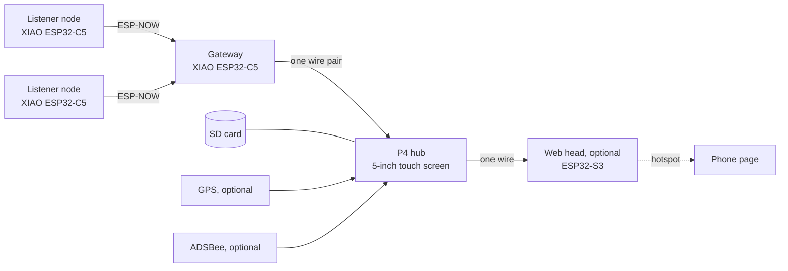

# Step 3: The full kit

**Level: 🟡 Intermediate** · What the full Rotorscope kit is today, which of its parts have
really run on hardware, and the order in which to build it.

> [!IMPORTANT]
> There is **no finished Rotorscope kit**, and nothing is on sale. This step follows the
> developer's own bench as it stood on **2026-11-18**. It is a work in progress: parts of it
> change every week, and some parts have never run on real hardware. The tables below say
> exactly which. Rotorscope has not yet heard a real drone.

## What the kit is

Step 2 gave you one board feeding a laptop. The full kit replaces the laptop with a **hub**: a
board with its own touch screen that collects what every listening board hears, keeps the
track table, logs to an SD card and tells each listener what to listen for.

| Piece | Board | Its job |
|---|---|---|
| **Listener nodes** | Seeed XIAO ESP32-C5, one per job | Each holds up to three firmware images (Wi-Fi, Bluetooth and, optionally, the raw-capture image that looks for DroneID and FPV video) and runs whichever one the hub asks for. |
| **Gateway** | One more XIAO ESP32-C5 | Receives the nodes' reports over **ESP-NOW** (Espressif's short-range board-to-board radio messages) on 2.4 GHz channel 6 and passes them to the hub on a wire. |
| **Hub** | Elecrow CrowPanel Advanced 5" (an ESP32-P4 with an 800x480 touch screen) | The screen, the track table, the SD-card log, the hub's own position from a GPS, aircraft from an ADSBee, and the job each node gets. |
| **GPS** (optional) | u-blox MAX-M10S or Quectel LC29H(AA) | Gives the hub its own position and the time, so it can say how far away a drone is. |
| **ADSBee 1090** (optional) | ADSBee 1090 receiver | Lists crewed aircraft nearby, in their own table. Never a drone alert. |
| **Web head** (optional) | An ESP32-S3 board | Runs the Wi-Fi hotspot and phone page, because the P4 has no radio Rotorscope can use. |

Words you may not know, such as node, gateway and ESP-NOW, are in the
[glossary](../project/glossary.md). [Nodes, gateway and hub](../how/nodes-gateway-hub.md)
explains why the work is split this way.

> [!NOTE]
> The nodes and gateway **transmit** short ESP-NOW messages to each other. That is the one
> radio transmission in this kit, and it is how the developer's bench runs today. A wired
> alternative with no radio at all (the "wired bus") is written and is now the hub's default
> setting, but nobody has wired it yet. See [The link between boards](../how/link.md).

## What has run on hardware, and what has not

The six proof phrases used here are explained on [Writing these docs](../dev/docs-style.md#say-what-is-proven-every-time).

| Part | How far it is proven (as of 2026-11-18) |
|---|---|
| Test transmitter → node → ESP-NOW → gateway → wire → hub track table | **Proven on the air**, 2026-11-15: every Remote ID transport the test transmitter sends (Wi-Fi beacon and NAN on 2.4 and 5 GHz, Bluetooth 4, 5 and Long Range) reached the hub's own track table. |
| The hub giving each node a job, and nodes switching firmware image | **Proven on the air**, 2026-11-15, one node steered through every role (two nodes have run on the gateway at once). |
| Signed ESP-NOW link and refusing forged frames | Before the 2026-11-18 cut-over, with one key for the whole kit: **proven on the air** (the bench kit ran keyed builds, and on 2026-11-18 seven kinds of forbidden frame sent by a test node were all refused at the gateway). The current link, with a key per node and a gateway that holds none: **simulated only** (tested on a computer and built for the boards), not yet run on them. Kits ship open; sealing is in [ESP-NOW in depth](../ESPNOW.md#kits-ship-open-sealing-yours). |
| Touch screen and touch keys | **Proven on the air**: ran on the board 2026-11-14 and checked by eye. Later screen changes (GPS, SD and alarm lines) have **not** been checked by eye. |
| SD-card log | **Proven on the air**: ran on the board with one 4 GB-class card, 2026-11-14 and 2026-11-15. |
| Restart after a crash or a hang | **Proven on the air** on the hub, the gateway and the node-wifi and node-sdr images, 2026-11-18. **Not yet checked** on node-ble, node-lr or any S3 board; `rid-beacon` has no watchdog. |
| GPS on the hub | **Simulated only**: the chip pretended to be a GPS on its own pins. No real GPS module has been connected to the P4. |
| ADSBee on the hub | **Simulated only** on the P4 (the chip fed its own pin). The ADSBee itself has been **heard for real** through a laptop, not through the hub. |
| Web head (phone page) | The P4's side of the feed is **simulated only** (loop-back on the chip). The S3 web-head firmware **does not currently link**: on 2026-11-18 it was about 18 KB over the S3's static RAM. The web head has never run on hardware with the P4. |
| Wired bus (nodes on two shared wires instead of ESP-NOW) | **Simulated only**: tested in a computer simulation; never wired. |
| DroneID on a node | **Proven on recordings**, decoded on the C5 chip itself from public recordings. No real DJI drone has been heard. |
| Analog FPV video detection | **Simulated only**: synthetic signals; no real video transmitter has been tried. |
| FAA rule flags | **Simulated only**: runs on the hub with an airspace pack on the card, against made-up drone positions; never applied to a real drone. |

The full list, with dates, is on the [Status](../project/status.md) page. The bench records
behind this table are [Bench tests](../BENCH.md),
[P4 bring-up](https://github.com/holdTheDoorHoid/rotorscope/blob/main/firmware/hub-p4/BRINGUP.md)
and [P4 parity](https://github.com/holdTheDoorHoid/rotorscope/blob/main/firmware/hub-p4/PARITY.md).

## What this step will not give you

- **A phone page.** The board that would serve it has no working firmware at the moment.
- **Distances, unless a GPS works.** A normal hub build has no way to type in its own position
  (only a bench build has a fixed test point); without a GPS fix the hub cannot give a drone's
  distance or direction from you.
- **A battery reading.** The P4 board's battery voltage is not wired to a pin the firmware
  knows, so the screen always says USB power.
- **A buzzer.** The P4 board has a speaker amplifier but no buzzer; the new-drone beep is not
  ported.
- **A case or a carrier board.** Everything sits on the desk, joined by jumper wires.

## The order to work in

Do the four pages in order. Each one assumes the one before.

1. [**Parts and tools**](kit-parts.md): what to gather, what is required and what is optional,
   including the SD card and the software on your computer.
2. [**Wiring**](kit-wiring.md): which pin goes to which, with the voltage warnings.
3. [**Build and flash**](kit-flash.md): from the repository to firmware on every board,
   including the kit's own link key.
4. [**First power-up**](kit-first-run.md): what the screen should show, in order, and how to
   prove the whole chain with the test transmitter.

If you get stuck, [Troubleshooting](troubleshooting.md) collects the problems met on the bench
so far.

## Where this lives in the code

- `firmware/hub-p4/`: the P4 hub (`BRINGUP.md`, `PARITY.md`, `WEBHEAD.md` alongside)
- `firmware/gateway/`: the ESP-NOW gateway
- `firmware/node-wifi/`, `firmware/node-ble/`, `firmware/node-sdr/`: the three node images
- `firmware/hub/`: the S3 firmware, reused as the web head
- `crates/coverage/`: how the hub decides each node's job

**Next:** [Parts and tools](kit-parts.md)
