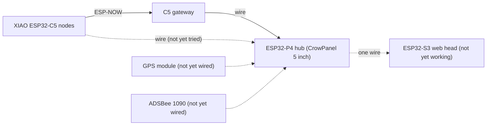

# Boards and chips

**Level: 🟡 Intermediate** · Every board and chip Rotorscope uses or plans to use, what each one
does, which firmware runs on it, and how far each has been proven.

Rotorscope is not one gadget but a small team of boards. Each **node** (a small board that
listens to one kind of radio signal) has one radio and can listen to one band at a time, so the
kit uses several. A **hub** (the board with the screen) gathers what the nodes hear. A few extra
receivers plug into the hub or into a laptop. Terms in bold are explained in the
[glossary](../project/glossary.md).

As of 2026-11-18, Rotorscope has **not yet heard a real drone**. The proof words used below
(**heard for real**, **proven on the air**, **proven on recordings**, **simulated only**, **built,
not yet tried**, **planned**) are defined in [Writing these docs](../dev/docs-style.md#say-what-is-proven-every-time).

## At a glance

| Board or chip | Role | Radio(s) it listens with | PSRAM | Firmware | Proof (as of 2026-11-18) |
|---|---|---|---|---|---|
| Seeed XIAO ESP32-C5 | Every listener node; the ESP-NOW gateway; the test transmitter | Wi-Fi 2.4 and 5 GHz, Bluetooth LE, raw radio samples | Yes, 8 MB | `node-wifi`, `node-ble`, `node-sdr`, `gateway`, `rid-beacon` | Proven on the air (from our own test transmitter) |
| ESP32-S3 boards | First hub, the P4's web head, early nodes, the first test transmitter | Wi-Fi 2.4 GHz, Bluetooth LE | Bench boards: none | `hub`, `node-wifi`, `node-ble`, `rid-beacon` | Nodes and beacon proven on the air; the hub build does not link today (below) |
| Elecrow CrowPanel Advanced 5" (ESP32-P4) | The hub: screen, SD card, GPS, ADS-B, coverage | None of its own | Yes, 32 MB | `hub-p4` | Proven on the air end to end with our test transmitter |
| ESP32-C3 + Semtech LR2021 | The "aero node": aircraft trackers and drone control links | LR2021 (sub-GHz and 2.4 GHz) | Not used | `node-lr` | Built, not yet tried (no hardware in hand) |
| u-blox MAX-M10S or Quectel LC29H(AA) | The hub's own position and time | GNSS | n/a | read by `hub-p4` and `hub` | Simulated only |
| ADSBee 1090 | Crewed aircraft (ADS-B) | 1090 MHz | n/a | its own firmware | Heard for real (from the laptop) |
| Sonoff Zigbee 3.0 USB Dongle Plus (CC2652P) | Laptop Bluetooth 5 Remote ID receiver | Bluetooth LE, including Long Range | n/a | NCC Group's Sniffle | Proven on the air |
| Laptop Bluetooth adapters | Laptop Bluetooth 4 Remote ID receiver | Bluetooth LE, legacy adverts only | n/a | BlueZ | Proven on the air |
| SX1262 LoRa boards | Mesh backhaul between kits | LoRa | n/a | stock Meshtastic or MeshCore | Planned |

## Seeed XIAO ESP32-C5: the node board

**Role.** The project's workhorse. The owner's decision of 2026-11-12 ([PLAN.md](https://github.com/holdTheDoorHoid/rotorscope/blob/main/PLAN.md),
"Node chip") is that every node can be a XIAO ESP32-C5. On the bench one C5 passed every node
role: Wi-Fi Remote ID on 2.4 and 5 GHz (beacon and NAN), Bluetooth 4 legacy, Bluetooth 5 extended
and Long Range, and raw capture for DJI DroneID. The same board type also runs the ESP-NOW gateway
and the 5 GHz test transmitter.

**Radios.** Wi-Fi on 2.4 GHz and 5 GHz (one band at a time) and Bluetooth LE, sharing one radio.
`node-sdr` also reads the radio's raw samples. The receive range measured for raw capture is
2200 to 2650 MHz and 5180 to 5800 MHz ([RESEARCH.md](https://github.com/holdTheDoorHoid/rotorscope/blob/main/RESEARCH.md),
"Can a C5 do it?").

**Chip facts that matter.**
- RISC-V, one core, no floating-point unit; it builds on ordinary stable Rust
  (`riscv32imac-unknown-none-elf`).
- About 384 KB of internal RAM ([RESEARCH.md](https://github.com/holdTheDoorHoid/rotorscope/blob/main/RESEARCH.md)).
- Two full UARTs (serial ports). That is why a C5 can only take two node links if it is ever
  used as a hub (`firmware/hub/src/pins.rs`).
- The bench boards (chip revision v1.0) have a 48 MHz crystal and 8 MB flash
  ([BRINGUP-RESULTS.md](https://github.com/holdTheDoorHoid/rotorscope/blob/main/firmware/node-sdr/BRINGUP-RESULTS.md)).
- The XIAO's stock antenna is 2.4 GHz only; a dual-band antenna is needed for 5 GHz
  ([PLAN.md](https://github.com/holdTheDoorHoid/rotorscope/blob/main/PLAN.md) parts list).

**PSRAM, and why it matters.** **PSRAM** is extra memory in the chip package. The XIAO uses the
C5HR8 part, which has 8 MB of it; the C5HF4 part has none. Only `node-sdr` depends on it: its
DJI DroneID receiver (about 121 KB) does not fit in internal RAM next to the 128 KB capture
bank, the stack and the Wi-Fi driver, so the default build puts the receiver in PSRAM. A C5 without
PSRAM can run `cargo fw-lite` (capture and dump only, decoding on a laptop). The other node images
do not use PSRAM. Details: [Firmware reference](../dev/firmware.md#node-sdr).

**Firmware that runs on it.** `node-wifi` (`cargo fw` for 5 GHz, `cargo fw24` for 2.4 GHz),
`node-ble`, `node-sdr`, `gateway`, `rid-beacon`. A "multi-image" node holds `node-wifi`, `node-ble`
and `node-sdr` in three flash slots, and the hub switches it between them
(`tools/flash-node.sh`, `tools/partitions-node.csv`).

**Proof (as of 2026-11-18).**
- Wi-Fi Remote ID on 5 GHz (beacon and NAN on channel 149) and Bluetooth 4, 5 extended and Long
  Range: **proven on the air** from a second C5 running `rid-beacon` (2026-11-12).
- Fake open FPV link frames (wfb-ng, OpenHD, RubyFPV, DroneBridge): **proven on the air** from
  `rid-beacon` (2026-11-14).
- The ESP-NOW chain, nodes to gateway to P4 hub, with the test drone ending up on the hub's track
  table: **proven on the air** (2026-11-14).
- DJI DroneID decoding: **proven on recordings** (public recordings, also fed through the chip's
  own capture path by `tools/droneid-hil`). No real DJI drone has been heard.
- The wired bus (many nodes on one hub serial line): **simulated only**; nobody has wired it yet.

## ESP32-S3: the first hub, the web head, early nodes

**Role.** The project started on the S3. It was the first hub (`firmware/hub`, built for the
`s3/` directory), the first Wi-Fi node (Node A, 2.4 GHz) and Bluetooth node (Node B), and the
first test transmitter. Today its main job is the P4 hub's **web head**: the P4 has no radio, so
an S3 running the hub firmware with `--features webhead` would serve the phone hotspot, the phone
page and TAK CoT, fed by one wire from the P4
([WEBHEAD.md](https://github.com/holdTheDoorHoid/rotorscope/blob/main/firmware/hub-p4/WEBHEAD.md)).

**Radios.** Wi-Fi 2.4 GHz only, and Bluetooth LE. No 5 GHz and no raw capture.

**Chip facts that matter.**
- Xtensa, two cores. It needs Espressif's own Rust toolchain (`espup install`, then
  `. ~/export-esp.sh`); the C5 and P4 do not.
- Three UARTs, which is why the S3 hub reads at most three wired nodes, and gives one of them up
  for a GPS on UART (`gps-uart`) or an ADSBee (`adsbee`).
- The hub firmware puts the screen, SD card, buttons, buzzer and battery on the second core.

**PSRAM, and why it matters.** The bench S3 boards have **no PSRAM** (and 4 MB flash,
[firmware/hub/README.md](https://github.com/holdTheDoorHoid/rotorscope/blob/main/firmware/hub/README.md)).
Everything therefore has to fit in internal RAM, and on the hub it no longer does. The repository
records that on 2026-11-18 the S3 hub build **did not link**: static RAM was over by 18,088 bytes
(firmware/hub/README.md, "Security checks still to run on hardware", item 14;
[docs/BENCH.md](../BENCH.md), "Bench results, 2026-11-18"). The `adsbee` build had already
stopped linking by about 0.5 KB before the web head work (WEBHEAD.md). So the S3 hub and web
head cannot be flashed until the build is slimmed or moved to a board with PSRAM. The 2026-11-09
plan named an N16R8-class S3 (8 MB PSRAM) for the hub, and the hub's pin choices avoid the pins
such a module reserves (`firmware/hub/src/pins.rs`).

**Firmware.** `hub` (S3 and, kept compiling, C5), `node-wifi` (S3: 2.4 GHz), `node-ble`,
`rid-beacon`.

**Proof (as of 2026-11-18).**
- `node-wifi` on the S3: Wi-Fi beacon and NAN Remote ID from a C5 `rid-beacon` on 2.4 GHz
  (**proven on the air**, mixed-chip bench tests, 2026-11-12).
- `node-ble` on the S3: a Bluetooth 4 Remote ID broadcast from a laptop, and Bluetooth 4, 5
  extended and Long Range from a C5 `rid-beacon` (**proven on the air**, 2026-11-12).
- `rid-beacon` on the S3: the laptop received its Wi-Fi beacon and Bluetooth 4 adverts; a C5
  heard its Bluetooth 4, 5 extended and Long Range, and (as a 2.4 GHz `node-wifi`) its Wi-Fi
  beacon and NAN (2026-11-12).
- The S3 hub: **simulated only** (run on a bare S3 with made-up demo drones); never tried with a
  real GPS, screen, SD card, buttons, buzzer or ADSBee. The web head: **built, not yet tried**.
  The current build does not link (above).

## ESP32-P4: the hub (Elecrow CrowPanel Advanced 5")

**Role.** The hub. It merges what every node hears into tracks, draws them on its touch screen,
logs to the SD card, reads the GPS and the ADSBee, tells each node which job to do (coverage),
keeps the evidence log and checks FAA rules. It does this with no radio of its own.

**Board facts** (from [BRINGUP.md](https://github.com/holdTheDoorHoid/rotorscope/blob/main/firmware/hub-p4/BRINGUP.md)):

| Item | Value |
|---|---|
| Chip | ESP32-P4, silicon revision **v1.3**, 40 MHz crystal, run at 360 MHz |
| Memory | 16 MB flash, 32 MB PSRAM |
| Screen | 800x480 IPS, 16-bit parallel RGB565 |
| Touch | GT911 on the board's I2C bus |
| Backlight | A small STC8 helper chip on the same I2C bus |
| Card | microSD, wired for SD 1-bit native mode only |
| Console | A CH340 USB-to-serial chip on the USB-C port |
| Radio | An ESP32-C6 on SDIO, with factory firmware |

**The silicon revision.** Upstream esp-hal (the Rust hardware library) supports P4 silicon v3.0
and newer only. This board's chip is v1.3, which has a different interrupt controller, clocks and
ROM. So the hub builds against a pinned esp-hal commit with a community patch for pre-v3 chips
(naoNao89's esp32p4-pre-v3-kit 0.1.3, MIT/Apache-2.0), applied by `tools/p4-prepare.sh`, plus one
patch of the project's own that moves RAM out of the L2 cache, where pre-v3 chips keep it. The
build also sets `ESP_HAL_CONFIG_MIN_CHIP_REVISION = "103"`: left unset, esp-hal assumes v3.0 and
the image traps on its first lock. Pre-v3 and v3+ images are not interchangeable. The full story
is in the [Firmware reference](../dev/firmware.md#patches).

**PSRAM, and why it matters.** On this board PSRAM is not optional. The framebuffer, the track
table, the evidence queue, the FAA rule engine, the aero tables and the airspace pack all live in
it. If the PSRAM test fails at boot, the hub stops with a panic message (and, as after any panic,
reboots) rather than run out of stack later.

**Things the chip could not do from Rust, and what the firmware does instead.**
- The esp-hal I2C controller starts no transfer on this chip, so the touch and backlight bus is
  bit-banged (driven by software).
- There is no SDMMC driver for the P4 in the patched esp-hal, so the SD card protocol is
  bit-banged too (about 115 kB/s).
- The screen is driven by a register-level port of ESP-IDF's RGB panel driver.

**The onboard ESP32-C6.** The board's Wi-Fi comes from an ESP32-C6 on SDIO, with factory firmware
that Elecrow does not name. The C6 has no UART or boot pins brought out, so a bad image could
leave the board with no working radio. **Nothing in Rotorscope touches the C6.** Driving it from
Rust would need an SDIO host driver, Espressif's esp-hosted protocol and a network stack on the
P4, estimated at 4 to 8 weeks of work. The stock esp-hosted firmware has no ESP-NOW support. A
read-only probe is the proposed first step, and it waits for the owner's go-ahead (PARITY.md,
"Phone page: the routes"). Until then the web head does the networking.

**Firmware.** `hub-p4`.

**Proof (as of 2026-11-18).**
- Screen, touch, SD card log, the gateway link and node commands: **proven on the air** (they
  worked on the running bench kit). The test drone from `rid-beacon` reached the hub's track table
  through a node and the gateway: **proven on the air** (2026-11-14).
- GPS, ADSBee input and the web-head feed: **simulated only**, by the chip feeding its own pins
  (loop-back tests). No GPS module and no ADSBee are wired to the P4 yet.
- Crash recovery (watchdog and reboot after a panic): **proven on the air**, first bench test on
  2026-11-18.
- The wired bus: **simulated only**; nobody has wired it yet.

## ESP32-C3 + Semtech LR2021: the aero node

**Role.** A receive-only node for signals the ESP32 radios cannot hear: 1090 MHz extended squitter,
978 MHz UAT, FLARM and OGN aircraft trackers, and drone control links (ExpressLRS, mLRS, SiK,
OpenLRSng). See [The aero node](../AERO-NODE.md) and [Control links](../CONTROL-LINKS.md).

**Radios.** The Semtech LR2021 covers 150 to 960 MHz and 1.5 to 2.5 GHz, one band at a time.
There is no transmit path to it in the firmware. The C3's own Wi-Fi is used only by an ESP-NOW
build, to reach the gateway.

**Chip facts that matter.** The ESP32-C3 is RISC-V without the atomics extension
(`riscv32imc-unknown-none-elf`), so counters go through the `portable-atomic` crate. The firmware
allocates a 72 KB heap for the Wi-Fi driver and uses no PSRAM.

**Why these parts** ([PLAN.md](https://github.com/holdTheDoorHoid/rotorscope/blob/main/PLAN.md), Phase 9,
switched from the LR1121 on 2026-11-15): the LR2021 has SX1280-compatible FLRC (ExpressLRS's
high-rate mode), receives up to four LoRa spreading factors at once, has a wider receive bandwidth
and about 4 dB more LoRa sensitivity. Buy the LR2021 itself: the LR2022 and LR2012 lack FLRC.
ExpressLRS's not-yet-released code has LR2021 receiver targets built on ESP32-C3, the same shape
the firmware assumes; none was on sale when the plan was written. For
bench work the plan names a Seeed/Semtech LR2021 evaluation kit or a Waveshare Core2021 or Elecrow
LR2021 module wired to a spare ESP32; a RadioMaster XR1 (ESP32-C3 + LR1121) is kept as the fallback.

**Firmware.** `node-lr`.

**Proof.** **Built, not yet tried.** No LR2021 hardware was in hand when it was written; the pin
map is a proposal (`firmware/node-lr/src/board.rs`).

## GPS modules

The hub needs its own position (for distance and bearing to each drone) and accurate time. Two
modules are supported ([PARITY.md](https://github.com/holdTheDoorHoid/rotorscope/blob/main/firmware/hub-p4/PARITY.md)):

| | u-blox MAX-M10S | Quectel LC29H(AA) |
|---|---|---|
| Bands | L1 | L1 + L5 (dual band) |
| Speed as shipped | 9600 baud | 115200 baud |
| What the P4 hub sets | binary NAV-PVT once a second, text off, PPS, then 115200 | GGA, RMC, GSA, GSV on; GLL, VTG off; PPS only with a 3D fix |

The P4 hub listens at 115200, then 9600, then 38400 baud, asks both kinds of module who they are,
and configures whichever answers for this boot only (it never writes the module's own flash). A
receiver that answers neither is read as plain NMEA. The **PPS** pin (a pulse once a second, on
the second) lets the hub anchor UTC to well under a millisecond. The S3 hub reads a MAX-M10S over
I2C, or over UART with `gps-uart`.

**Proof.** **Simulated only**: the P4 has been tested with the chip pretending to be each module on
its own pins, never with a real module. See [GPS jamming and spoofing at the hub](../GNSS-INTEGRITY.md)
for what the hub checks.

## ADSBee 1090

**Role.** Shows crewed aircraft (helicopters, light aircraft, airliners) beside the drones, in their
own table, never as a drone alert. Made by Pants for Birds; the unit tested runs firmware 0.9.0 and
appears on USB as an RP2040 serial port.

**How it connects.** Its COMMS_UART TX pin sends CSBee text (one checked line per aircraft, once a
second) at 115200 baud. Only that one wire and ground go to the hub. The hub cannot configure it:
the ADSBee takes AT commands only on its own USB console, so the owner sets
`AT+PROTOCOL_OUT=COMMS_UART,CSBEE` once (or `BEAST` for the P4's `modes` build). See
[ADSBee 1090](../ADSBEE.md).

**Proof.** ADS-B from real aircraft: **heard for real**, through the ADSBee from the laptop
(2026-11-14; `rid-view --adsbee`). Our own Mode S decoder agreed with the ADSBee's decode on live
traffic from the laptop. Wired to a hub: **simulated only** (on the P4, recorded real frames
replayed onto its own pin).

## Sonoff Zigbee dongle with Sniffle

**Role.** A laptop add-on that hears all three kinds of Bluetooth Remote ID, including Bluetooth 5
extended and Long Range, which a laptop's own Bluetooth cannot. It is the **Sonoff Zigbee 3.0 USB
Dongle Plus**, model ZBDongle-P: a TI CC2652P radio chip behind a CP2102N USB bridge. Loaded with
NCC Group's Sniffle firmware (v1.11.0, GPL-3.0) by the project's own `tools/cc26xx-flash`, it is
read by `rid-view --sniffle`. The ZBDongle-E (Silicon Labs) is a different chip and will not work.
It only listens. Step-by-step: [A Sonoff dongle as a Bluetooth 5 receiver](../SONOFF.md).

**Proof.** **Proven on the air**: Bluetooth 4 from the laptop's test beacon, and Bluetooth 5
extended and Long Range from a C5 `rid-beacon` (2026-11-11 and 2026-11-12). Restoring the Zigbee
firmware has been tested in simulation only.

## Laptop Bluetooth adapters

**Role.** Any Bluetooth adapter Linux's BlueZ stack can use, such as a laptop's internal Intel
adapter or a Sena UD100, can listen for Bluetooth Remote ID with `rid-view --ble hci1`, without
root. It hears **legacy (Bluetooth 4) adverts only**, not Bluetooth 5 extended or Long Range. The
laptop used for testing has a Bluetooth 4.2 controller. See [The laptop viewer, rid-view](../use/rid-view.md).

**Proof.** **Proven on the air**, laptop to laptop (2026-11-11), and from `rid-beacon`.

## SX1262 LoRa boards (planned backhaul)

**Role.** Sharing detections between several Rotorscope kits over a LoRa mesh (Phase 8 in
[PLAN.md](https://github.com/holdTheDoorHoid/rotorscope/blob/main/PLAN.md)). The plan is a stock
Meshtastic or MeshCore board with an SX1262 radio (Heltec V3/V4, or a XIAO with a Wio-SX1262),
wired to the hub's serial port as a modem, with no mesh code of the project's own. A mesh radio
would never double as a detector: it is deaf to drone links whenever it transmits.

**Proof.** **Planned.** Nothing is built.

## The recorded chip decisions

| Decision | Date | What was decided, and why |
|---|---|---|
| Node chip | 2026-11-12 | Every node can be a XIAO ESP32-C5: one board type for every node, one stock-Rust toolchain, plus 5 GHz and raw capture that the S3 lacks. Each chip still does one job at a time (one radio, one band). The cost is a younger Rust stack: two esp-radio C5 bugs had to be fixed in this repository (the Bluetooth transmit clock, and the receive DC calibration). |
| Hub chip | 2026-11-09 | An ESP32-S3 N16R8 (8 MB PSRAM), for the same toolchain and code. **Not** the ESP32-P4 at the time: no radio of its own, Rust could not drive its companion C6's Wi-Fi, its esp-hal PSRAM support was a stub and its video encoders are C-only. Not the Pico 2 W: a second toolchain and flasher, and 2.4 GHz only. |
| Hub on the P4 | 2026-11-14 | Owner decision recorded in [BRINGUP.md](https://github.com/holdTheDoorHoid/rotorscope/blob/main/firmware/hub-p4/BRINGUP.md): the hub runs bare-metal Rust on the CrowPanel's ESP32-P4, with the pre-v3 patch. The obstacles above were met by patching esp-hal, bit-banging I2C and SD, and handing networking to a separate web head. PLAN.md's "Hub chip" section has not been updated to say so. |
| ESP32-S31 | 2026-11-12 | Watched, not adopted: Espressif's RISC-V successor to the S3 (two 320 MHz cores, four UARTs, in-package PSRAM, Wi-Fi 2.4 GHz only). In mass production since July 2026, but esp-hal lists it as early stages and only AliExpress-class boards existed. Revisit when esp-hal and esp-radio mark it stable or a XIAO or DevKitC-class board ships. |
| LR2021 over LR1121 | 2026-11-15 | FLRC, multi-SF receive, wider bandwidth, better sensitivity (see the aero node above). The separate SX1280 idea was dropped. Backhaul stays on SX1262. |

> [!NOTE]
> This page gives no prices. Part availability and cost change quickly; see
> [Parts and tools](../get-going/kit-parts.md) for what to buy.

## Where this lives in the code

- `firmware/hub-p4/BRINGUP.md`, `PARITY.md`, `WEBHEAD.md`: the P4 board, what it does, the web head
- `firmware/patches/esp-hal-p4-pre-v3/`: the pre-v3 patch and its provenance
- `firmware/hub/README.md` and `src/pins.rs`: the S3 hub and its memory budget
- `firmware/node-sdr/README.md` "Memory": why the DroneID decoder needs PSRAM
- `firmware/node-lr/src/board.rs`: the LR2021 wiring proposal
- `PLAN.md` "Node chip", "Hub chip", Phases 8 and 9; `RESEARCH.md` "Can a C5 do it?"
- `docs/ADSBEE.md`, `docs/SONOFF.md`, `tools/rid-view/README.md`

**Next:** [Pins and wiring reference](pinouts.md)
