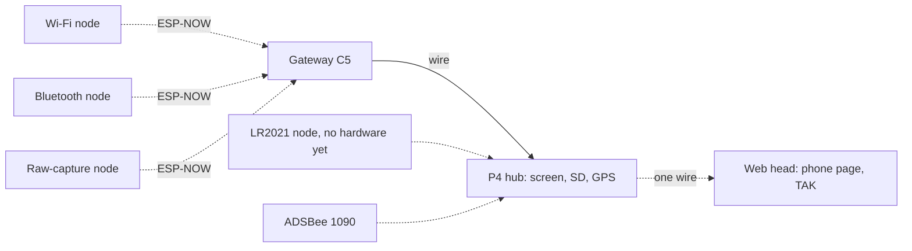
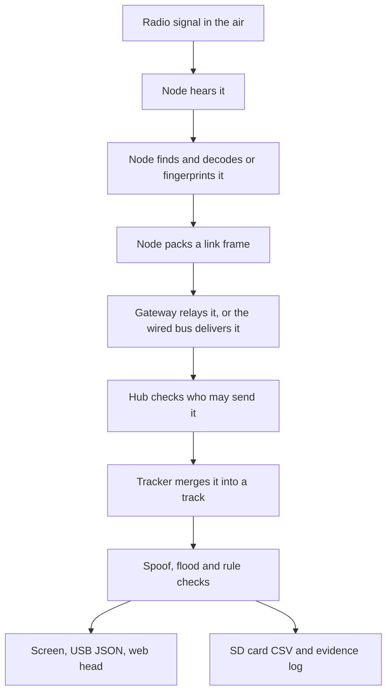

# The big picture

**Level: 🟡 Intermediate** · The whole of Rotorscope on one page: what each board does, how a
radio signal travels from the air to the screen, and the design rules behind it.

## In plain words

Rotorscope is a small team of cheap radio chips with one boss.

- **Listener nodes** are small boards, each with one radio. Each one listens to one kind of
  signal at a time: Wi-Fi, Bluetooth, the raw radio waves of a DJI drone, and so on. When it
  hears something that looks like a drone, it packs a short report.
- **The hub** is the boss. It has the screen, the SD card and the GPS. It collects every
  report, works out which reports belong to the same drone, checks whether the drone's
  claims make sense, and shows and logs the result. It also tells each node what to listen
  to.
- **The link** carries the reports from the nodes to the hub. Today, on the bench, nodes send
  them by radio to a **gateway** board that is wired to the hub. A wired option, where nodes
  never transmit at all, is built but not yet wired up.

Rotorscope only listens. It never transmits at a drone, and the listener nodes have no job
except listening and reporting. Terms you may not know are in the
[glossary](../project/glossary.md).

> [!NOTE]
> As of 2026-11-18 Rotorscope has **not heard a real drone**. Remote ID is **proven on the
> air** from the project's own test transmitter, DJI DroneID is **proven on recordings**, and
> crewed aircraft (ADS-B) have been **heard for real** through an ADSBee receiver read from a
> laptop. See [What it can and cannot do today](../start/capabilities.md).

## The hardware layout

This is the kit as it runs on the bench today, plus the pieces that are built but not yet
connected (dotted lines).

- On the bench every node is a Seeed **XIAO ESP32-C5** board (the Wi-Fi and Bluetooth
  firmware also build for the older ESP32-S3). The exception is the LR2021 aero and
  control-link node, written for an ESP32-C3 with a Semtech LR2021 radio, which has no hardware
  yet. One C5 can hold the Wi-Fi,
  Bluetooth and raw-capture firmware side by side and switch between them when the hub asks
  (see [Nodes, gateway and hub](nodes-gateway-hub.md)).
- The **hub** is an ESP32-P4 on an Elecrow CrowPanel Advanced 5" touch screen. The P4 has no
  radio of its own, which suits a box that should only listen.
- The **web head** is a second board that would run the phone page and the TAK feed, fed by one
  wire from the P4. It is **built, not yet tried**: its firmware (the older ESP32-S3 hub,
  `firmware/hub`) does not currently link, because it is about 18 KB over its RAM budget
  ([bench results](../BENCH.md#bench-results-2026-11-18)).

## A signal's journey, from the air to the screen

1. **Hear.** A node's radio is tuned to one band or frequency at a time. The Wi-Fi node
   listens in "promiscuous" mode, which means it reads every frame on the channel, not only
   frames meant for it. The raw-capture node reads its radio's raw samples directly.
2. **Find, decode or fingerprint.** The node looks for something drone-shaped: a Remote ID
   message (the drone's broadcast "number plate"), a DJI DroneID burst, an open FPV video link,
   an analog video carrier, signs of a Wi-Fi attack or of jamming. For Remote ID the node
   forwards the raw message and the hub does the full decode, so the hub always decides what a
   message says. For DroneID and video signals the node does the heavy signal work itself and
   sends a short summary.
3. **Frame.** The node wraps its report in a small binary **frame** from the shared `link`
   crate. Every board speaks the same frame format (see [The link between boards](link.md)).
4. **Relay.** Today the node sends its frames over ESP-NOW (a short-range Wi-Fi radio message
   between ESP32 chips) to the gateway, which passes each packet unchanged over a wire into the
   hub; the gateway holds no key. The wired bus will do the same over two shared wires, with the
   hub putting a marker naming the node in front of each frame.
5. **Verify.** On a sealed kit the hub first checks, with that node's own key, that every radio
   packet really came from that node of this kit. Then it checks that the sender is allowed to
   send that kind of frame. A node can report a drone; only the hub may state the kit's own GPS
   position.
6. **Track.** The tracker joins every report about the same drone into one **track**, across
   radios and nodes, and works out the distance and direction from you (see
   [The tracker](tracker.md)).
7. **Check.** The tracker runs consistency checks on each track (does the drone's story hold
   together?), watches for floods of fake drones, and the hub checks drones against the FAA rule
   flags and its own GPS against jamming and spoofing.
8. **Show and log.** The result goes to the touch screen, to JSON lines on the USB port, to a
   CSV file and a tamper-evident evidence log on the SD card, and (once the web head works) to
   the phone page and TAK.

The whole chain from the test transmitter, through a node and the gateway, into the P4 hub's
track table is **proven on the air** for every Remote ID transport: Wi-Fi beacon and NAN on
2.4 and 5 GHz, Bluetooth 4, Bluetooth 5 extended and Long Range ([bench tests](../BENCH.md),
"End-to-end through the P4", 2026-11-15).

## The design rules, and why

### One chip per radio

Each ESP32 chip has one radio, and Wi-Fi and Bluetooth share it. A chip can only listen to one
band at a time. `PLAN.md` ("Why one chip per radio") puts it this way: "One open-source project
measured what happens when a single chip time-shares them: it caught 4 Wi-Fi Remote ID frames in
the time it caught 234 Bluetooth ones." That project is the open-source receiver
[orecchino-esp32](https://github.com/isaacbentley/orecchino-esp32) (`RESEARCH.md` credits it
with measuring the Wi-Fi/Bluetooth time-share penalty); the figure is its measurement, not
Rotorscope's. Giving each band its own chip removes that trade-off.

The same rule shows up in Rotorscope's own measurements. The ESP-NOW link makes a Bluetooth
node pause its scan to send, and that costs about **18% of the adverts it hears** (29.4 a second
wired against 24.1 over ESP-NOW, [WIREBUS.md](../WIREBUS.md), "Listening time won back from
ESP-NOW"). Every moment a radio spends on anything else is a moment it is deaf.

### The hub is the only brain

Nodes are kept simple and the decisions live in one place:

- The hub decodes Remote ID itself from the raw messages, so one decoder (`crates/rid`)
  decides what every message means.
- The hub alone keeps tracks, merges them, runs the spoofing checks and raises alarms.
- The hub decides what each node listens to (the coverage coordinator,
  [Who listens where](coverage.md)), so adding a node changes the plan without reflashing
  anything.
- The hub alone knows where and when the kit is (its GPS), and only the hub may state it.

### Listeners never transmit detections on their own

A node's only output is its report to the hub. On the wired bus a node does not transmit on
the air at all. Over ESP-NOW it sends short batches to the gateway, only while it is tuned to
2.4 GHz channel 6, and nothing else. No node broadcasts what it heard to the world, and no
node transmits at a drone. The raw-capture firmware stops the radio's transmit queues while it
captures (firmware/node-sdr README).

### Receive-only

PLAN.md requirement S3: "No jamming, no spoofing." The things in the kit that do transmit, and
why:

| What | Transmits | Why |
|---|---|---|
| ESP-NOW nodes and gateway | short packets on 2.4 GHz channel 6, gateway beacons twice a second | the radio link to the hub; the wired bus removes this |
| Web head (built, not yet tried) | a Wi-Fi hotspot on channel 11, never 6 | the phone page; channel 6 is where Remote ID lives |
| `rid-beacon` | a fake test drone at the lowest power | bench test tool only, clearly fake identity |

### Shared `no_std` crates, tested on a computer

33 of the 34 crates in `crates/` are written `no_std`: they need no operating system, so the
same code runs on an ESP32 and on a laptop. That has two big benefits:

- The logic is tested on a computer with thousands of made-up and recorded cases before it
  ever reaches a chip. The Remote ID decoder is checked against the official
  opendroneid-core-c decoder; the DroneID decoder against public recordings.
- The laptop viewer `rid-view` runs the **same tracker** as the hub, so a laptop and the hub
  merge and expire tracks the same way ([rid-view](../use/rid-view.md)).

The firmware folders hold only what is specific to a chip: drivers, pins, timing. Most of what
the system *thinks* is in `crates/`.

## Stage by stage: where each part lives

| Stage | Crates | Firmware |
|---|---|---|
| Hear | `rawcap` (raw samples), `lr2021cfg` (LR2021 settings) | `node-wifi`, `node-ble`, `node-sdr`, `node-lr` |
| Find and decode | `rid` (Remote ID, DJI Wi-Fi), `droneid`, `djicrypt` (hub), `openlink`, `wifidrone`, `adsb`, `modes`, `uat`, `flarm`, `aerohop` | nodes; aircraft decoding on `hub-p4` |
| Fingerprint and watch | `fpvscan`, `djilink`, `jamwatch`, `wifiwatch`, `ctrlwatch`, `mavwatch` | `node-wifi`, `node-sdr`, `node-lr` |
| Frame | `link` | every board |
| Relay | `airlink` (ESP-NOW), `wirebus` (wired bus) | `gateway`, `node-common`, `hub-p4` |
| Verify | `link::origin`, `airlink` and `kitkeys` (per-node keys), `hublink` | `hub-p4`, `hub` (nodes check what the hub sends them) |
| Track and check | `tracker`, `faarules`, `airspace`, `gnss` | `hub-p4` (and `tools/rid-view`) |
| Plan the listening | `coverage`, `nodeimage` | `hub-p4`, `node-common` |
| Show | `screen`, `webui`, `tracker` (JSON, CoT) | `hub-p4`, `hub` (web head) |
| Log | `tracker` (CSV), `evidence` | `hub-p4` |

The [crate reference](../dev/crates.md) and [firmware reference](../dev/firmware.md) go
through each one.

## What this design will miss

- A node hears one band or frequency at a time. Whatever it is not tuned to at that moment,
  it misses. More nodes split the work; one node per job is the minimum for full coverage.
- Nodes that are not placed apart do not see around obstacles. The coverage coordinator does
  not know where nodes stand.
- A drone that broadcasts nothing, or only on bands no node can reach, is invisible.

## Where this lives in the code

- `firmware/hub-p4/src/main.rs`, `app.rs`: the hub's main loop and track table.
- `crates/link/src/lib.rs`: the frame format every board speaks.
- `crates/tracker/src/lib.rs`: merging, distances and outputs.
- `firmware/gateway/src/main.rs`: the ESP-NOW relay, which holds no key.
- `PLAN.md`, "Architecture" and "Node chip": the recorded decisions,
  <https://github.com/holdTheDoorHoid/rotorscope/blob/main/PLAN.md>.

**Next:** [Nodes, gateway and hub](nodes-gateway-hub.md)
