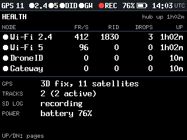

# Who listens where: coverage

**Level: 🟡 Intermediate** · How the hub decides which node listens to which band and channels,
how that changes as nodes join and leave, and how to see the result on the screen.

## In plain words

Each node can listen to one thing at a time, and there are more things to listen to than most
kits have nodes. So someone has to hand out the jobs. In Rotorscope that is the hub, through a
small piece of code called the **coverage coordinator**.

Every 2 seconds the hub looks at its list of nodes (which are there, what each can do, what each
is doing) and gives each node one job. The most important jobs are filled first. With one node,
it listens to 2.4 GHz Wi-Fi Remote ID, where most Remote ID is. Add a second node and it takes
Bluetooth. Add more and they cover 5 GHz, DJI DroneID, analog video, and then share the busiest
jobs between them.

You do not configure any of this. Plug in another node and the hub puts it to work; unplug one
and its job moves to someone else. Radio terms are in the [glossary](../project/glossary.md).

## The ladder

Jobs are handed out from the top of this list down, one node per line (`crates/coverage`,
table `LADDER` in `src/plans.rs`). A node only gets a job it says it can do, from the `can` list
in its Status report. A gateway never gets one.

| # | Job | What the node does |
|---|---|---|
| 1 | Wi-Fi 2.4 GHz Remote ID | channel 6 for 150 ms, 1 for 50 ms, 6 for 150 ms, 11 for 50 ms: about 75% of the time on channel 6, where NAN Remote ID always is |
| 2 | Bluetooth Remote ID | its own built-in scan (Bluetooth has no channel plan to set) |
| 3 | Wi-Fi 5 GHz | channel 149 for 150 ms between 50 ms visits to 153, 157, 161, 165 and 36, 40, 44, 48 |
| 4 | DJI DroneID | 700 ms on each DroneID frequency: eight at 5.8 GHz (5746.5 to 5816.5 MHz) and five at 2.4 GHz. A burst comes about every 640 ms, so each stay catches one if a drone is there |
| 5 | Analog FPV and RF scan | its own built-in sweep: the 15 analog video channels at 2.4 GHz, then the 31 at 5.8 GHz a C5 can reach |
| 6 | Second DroneID | the two split the bands: one keeps 5.8 GHz, the other takes 2.4 GHz |
| 7 | Second Wi-Fi 5 GHz | one parks on 149; the other sweeps 36-48, 153-165 and 169-177, 100 ms each |
| 8 | Second Wi-Fi 2.4 GHz | one parks on 6; the other sweeps 1-5 and 7-14, 80 ms each |
| 9 | Second FPV | the two split the 46 FPV channels in half |
| 10 | Second Bluetooth | a duplicate: more chances to hear each advert |

With more nodes than lines, each extra node keeps whatever job it has: another Bluetooth or Wi-Fi
node adds more chances to hear a packet, and a third DroneID, Wi-Fi or FPV node takes a share of
the sweep.

> [!NOTE]
> The 2.4 GHz channels 12, 13 and 14 are on the sweep list on purpose. US equipment avoids them,
> so a drone or attack tool set to a Japanese or European channel would otherwise never be heard.
> Rotorscope only receives, so listening there is fine.

**The aero node** (the LR2021, [AERO-NODE.md](../AERO-NODE.md)) is not on the ladder: nothing
else can do its job, and it can do nothing else. Alone, it takes turns between 978 MHz UAT (10 s),
FLARM (10 s), OGN trackers (5 s), and 1090 MHz (10 s) only when the hub's ADSBee is not already
hearing 1090. With drone control-link scanning enabled, that takes a share too
([CONTROL-LINKS.md](../CONTROL-LINKS.md)). Two or more aero nodes split the list. This part is
**built, not yet tried**: there is no LR2021 hardware yet.

## Scouting: nothing hides on a skipped channel

Whatever its plan, every Wi-Fi node leaves it for 105 ms every 3 s to visit one channel of its
band that the plan does not cover, in turn: 2.4 GHz channels 1-14, and every 5 GHz channel from
36 to 177, including the radar-sharing (DFS) channels that no plan visits. 105 ms is a little
over one Wi-Fi beacon interval, so every access point on that channel is heard at least once per
visit. It costs 3.5% of listening time. The node does this by itself; the hub's plan does not
change. FPV nodes do something similar at the edges of their band.

## Keeping things calm

Changing a node's job can mean switching firmware image, a reboot of a few seconds, so the
coordinator avoids needless moves (`crates/coverage/README.md`):

- **Nobody moves without a reason.** Of all the ways to fill the most important lines, it picks
  the one that changes the fewest nodes. It is solved exactly, as an "assignment problem" (the
  Hungarian method), for up to 16 nodes.
- **One job change per node per minute at most.** A node that has changed keeps its job for 60 s
  whatever happens.
- **Same table in, same answer out**, whatever order the nodes are listed in.
- **Plan numbers come from the plan itself.** A plan's number changes only when the plan does,
  and survives a hub restart.

## When a node joins or leaves

**Joining.** A new node says `Hello` and sends a `Status` listing the roles its images can do.
At the next run (within 2 s) the coordinator gives it the highest empty line it can fill, and
the hub sends it an `Assign` at once. If its running image cannot do that job, the node switches
image and starts with it (see [Nodes, gateway and hub](nodes-gateway-hub.md)).

**Leaving.** A node not heard for **15 s** is gone. Its line goes to someone else at the next
run (subject to the one-change-a-minute rule).

**Coming back.** The coordinator remembers up to 24 nodes, gone ones included, for 10 minutes.
A node that comes back is put back where it was, if that is still useful.

**Sending.** The hub decides every 2 s, sends a changed job at once, and resends every job every
5 s even if unchanged (`firmware/hub-p4/src/downlink.rs`). A node that restarted therefore gets
its job back within 5 s. The node echoes the plan number in its Status, and the hub marks the
job "applied".

## Channel hopping and ESP-NOW

A node that reports through the ESP-NOW gateway can only send while it is on 2.4 GHz channel 6,
the gateway's channel. So every Wi-Fi plan for such a node gets a 40 ms visit to channel 6 at
least once a second (`ESPNOW_MAX_AWAY_MS`). A 5 GHz node therefore leaves 5 GHz briefly once a
second. A node on the wired bus gets no channel-6 visits: the hub marks it "not relayed", so its
plan stays on its own band. Raw-capture nodes have frequencies in their plan, not channels; when
relayed, they pause capture and retune to channel 6 by themselves when they have something to
send.

## Seeing the assignments: the Health page

The hub's **Health** page lists every node with the job it reports (Wi-Fi 2.4, Wi-Fi 5,
Bluetooth, DroneID, FPV 5.8, ADS-B, Gateway, LR radio), its frames per second, Remote ID found,
drops and how long it has been up. A node that stops reporting shows **NOT RESPONDING**.

On a hub that assigns jobs (the P4), each node also gets a small line under it with what it was
asked to do (the picture above has no such lines), for example `-> Wi-Fi 2.4 plan 5a3c running` (`crates/screen/src/render.rs`).
"running" means the node has echoed that plan back; "sent", in the highlight colour, means the
hub sent it and is still waiting.

The USB console says the same once every 5 s, in a line such as
`hub-p4: coverage nodes=2 assigned=2 applied=2 missing=0x18`. `missing` is a list of the jobs
nobody is doing (bits: 0 Wi-Fi 2.4, 1 Wi-Fi 5, 2 Bluetooth, 3 FPV, 4 DroneID); `0x18` means FPV
and DroneID are uncovered. Each change of job is also printed as a `hub-p4: assign ...` line.

## How far this is proven

**Proven on the air** on the bench, through the ESP-NOW gateway into the P4: the hub assigned
roles to two real nodes and each echoed its plan; a 2.4 GHz plan's channel visits matched the plan
over 270 s; a 5 GHz plan with 18 hops ran with no band or channel errors; and a node was moved
between Bluetooth and Wi-Fi 5 seven times in five and a half minutes, each switch on a hub command
([ESPNOW.md](../ESPNOW.md), "Node roles and image switching"). End-to-end Remote ID through the hub
used the hub's own plans ([bench tests](../BENCH.md)). Assignments over the wired bus are
**simulated only**.

## What it does not do (yet)

- It does not know where nodes stand, so two nodes in the same room count as much as two at
  opposite ends of a field.
- It does not watch whether a job finds anything; the plans are fixed tables, edited at the top
  of `crates/coverage/src/plans.rs`.

## Where this lives in the code

- `crates/coverage/src/lib.rs`: the coordinator (`Coordinator::run`), joining, leaving, memory.
- `crates/coverage/src/plans.rs`: the ladder and every channel table, scouting, the ESP-NOW
  channel-6 rule, aero plans.
- `crates/coverage/README.md`: the rules in plain language.
- `firmware/hub-p4/src/downlink.rs`: running it every 2 s and sending the commands.
- `crates/screen/src/render.rs`: the Health page.

**Next:** [Position and time](position-and-time.md)
