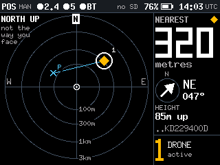
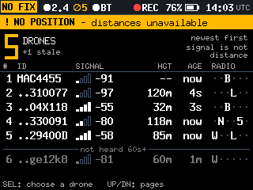
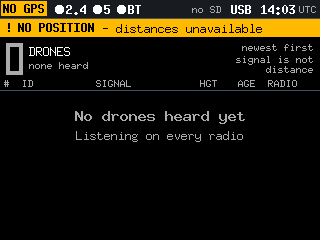

# Position and time

**Level: 🟡 Intermediate** · Why the hub needs to know where and when it is, how it gets that
from GPS, how it decides whether to believe the GPS, and what it does without one.

## In plain words

A drone tells you where *it* is. To say "320 metres north-east of you", the hub also has to
know where *you* are. That comes from a small GPS receiver wired to the hub.

GPS also gives the hub the exact time. That matters for the evidence log (when was this drone
really heard?), for the spoofing checks (is this drone's clock plausible?), and for the aircraft
node, which has to jump between radio channels at exactly the right moments.

Because GPS can be jammed or faked, the hub does not believe it blindly. It only uses a GPS
position and time after ten clean seconds in a row, it remembers where it normally stands, and
if the GPS starts to look wrong it keeps the last position and time it trusted instead.

Without a GPS, everything else still works: drones are still listed with their signal strength
and height, only the distances and directions are missing.

> [!IMPORTANT]
> As of 2026-11-18 **no real GPS module has been connected to the P4 hub**. Everything on this
> page about the P4's GPS is **simulated only**: the chip played the part of each GPS module on
> its own pins ([PARITY.md](https://github.com/holdTheDoorHoid/rotorscope/blob/main/firmware/hub-p4/PARITY.md)),
> and the GPS checks were tested on a computer. Real-receiver behaviour, including real
> satellite signal levels, is still to be seen.

## The GPS receivers

The P4 hub supports two modules and tells them apart by itself (`crates/gnss`,
`firmware/hub-p4/src/gps.rs`):

| | u-blox MAX-M10S | Quectel LC29H(AA) |
|---|---|---|
| Bands | L1 | L1 and L5 (dual band) |
| Speed as shipped | 9600 baud | 115200 baud |
| What the hub sets | binary position messages once a second, text off, PPS, then 115200 baud | the standard text sentences on, two unneeded ones off, PPS only with a 3D fix |

At start-up the hub **hunts**: it listens at 115200 baud, then 9600, then 38400. When it hears
valid GPS data it asks two read-only questions, one that only a u-blox answers and one that only
a Quectel answers, and configures whichever replies, step by confirmed step, in working memory
only (never the module's flash). A receiver that answers neither is read as plain standard text
(NMEA, see the [glossary](../project/glossary.md)). With nothing at any speed the GPS is **absent**, and
the hunt keeps going so a module plugged in later is found.

A fix is used only when the receiver says it is good **and** it is 3D, or 2D with an accuracy
better than 50 m (`Fix::is_usable`).

Wiring on the P4: GPS transmit to GPIO28 and hub transmit (GPIO27) to the GPS, on the board's
UART3-IN header, with PPS on GPIO29. That header's power pin is 5 V; power a 3.3 V GPS from the
3.3 V pin on another header. See [Pins and wiring reference](../hardware/pinouts.md).

## PPS: the exact second

Both modules can output **PPS** (pulse per second): a short electrical pulse whose rising edge
marks the start of each second. The hub notes the instant of each edge, then reads which second
it was from the GPS message that follows. With PPS the hub's time is good to well under a
millisecond; without it, time comes from when the message arrives, which wanders by tens of
milliseconds. The JSON status says which: `utc_src` is `gps_pps` or `gps`.

## Nothing published until trusted

Every second the hub's GPS **integrity monitor** looks at what the receiver reports and gives a
verdict: ok, suspected jamming, jamming, suspected spoofing or spoofing. The thresholds below are
read from the code (`crates/gnss/src/integrity.rs`, `trust.rs`, `timeguard.rs`):

- An epoch (one second of GPS data) is **trusted** when no spoofing check has fired, not even an
  unconfirmed one, for **10 epochs in a row** (`TRUST_EPOCHS`), and the verdict is not a spoofing
  one.
- Only a trusted epoch's position and time are **published**: to the screen, the tracker, the
  aircraft decoder, the aero nodes, the evidence log, the web head and the log file names.
- Any other epoch publishes the **last trusted** position and time, marked as held. While
  spoofing is suspected, the held position is *home* (below) if there is one.
- If nothing has been trusted since power-up (a spoofer present from the start), **nothing** is
  published. The screen's Health page says `no trusted position/time`, and evidence records say
  their time source is `untrusted`.

**The time guard.** The hub has its own clock, from its crystal. GPS time may steer that clock
only as fast as a real crystal could drift: **20 parts per million** (`DRIFT_PPM`). A GPS time
that disagrees with the hub's clock by more than **150 ms** (or **5 ms** when PPS is wired) for two
seconds in a row is a finding and is not adopted. GPS time before the date the firmware was built
is impossible and is refused, and so is time more than 2 s before the latest time the hub
remembers trusting.

Jamming does not stop the hub using a fix: a jammed receiver loses its fix. Spoofing makes
it hold. The checks themselves, their limits and the false alarms they try to avoid are in
[GPS jamming and spoofing at the hub](../GNSS-INTEGRITY.md).

## Home: where the hub normally stands

A detector usually stays put, so a GPS that suddenly says the hub is somewhere else is suspicious.
The hub keeps a **home** position, from three sources, strongest first:

1. **Placed**: a `home` line in the site file, `ROTORSCP/SITE.TXT` on the SD card
   ([SITE.md](../SITE.md)):

   ```text
   home 39.95210 -75.16380 12.5
   ```

   Latitude, longitude and an optional height in metres above the ellipsoid. `home clear` goes
   back to learning. A placed home wins at every start and cannot be changed from the screen.
2. **Remembered**: learned on an earlier run and kept on the card in `ROTORSCP/GPSMEM.TXT`, used
   from the moment the card is mounted.
3. **Learned**: after 900 usable fixes (15 minutes) that all stay close together while nothing
   looks wrong. It is written to the card at once.

Once home exists, a fix more than 75 m from it (or four times the stated accuracy, whichever is
larger) is a spoofing suspicion, and more than 300 m a strong one. A new place is never adopted on
its own: the screen's Settings row changes to **New home / Accept here**, and only you can accept
it. If you move the hub on purpose, choose **Hub moved** to forget home and learn again.

`GPSMEM.TXT` also keeps the latest time the hub trusted, written at most once an hour.

> [!TIP]
> At a fixed site, place `home` in the site file. A placed home cannot be learned from a spoofer
> who happened to be present the first time the hub was switched on.

Home is used by the GPS checks, and while spoofing is suspected it is the position the hub holds
(so distances are then measured from home). It is **not** used as the hub's own position when the
GPS has no fix: then the distances are left out.

## Typed-in position

A typed-in (**manual**) position stands in for the GPS. The rule is the same on both hubs: a
usable GPS fix less than 10 s old wins; the manual position is used only while there is none, and
the hub re-applies it every second so it never times out.

- On the **P4 hub** today the only way to set one is the console command `p`, which sets a fixed
  test point near Philadelphia City Hall (`c` clears it). It exists only in bench builds (feature
  `testpoint`); a normal P4 build has no way to set a manual position.
- The **phone page** has a form to type a position (`POST /api/own-pos`), served by the S3 hub or
  web head. That firmware does not currently link (see
  [Nodes, gateway and hub](nodes-gateway-hub.md)), so with the P4 this is **built, not yet
  tried**.

A manual position is not kept across reboots.



The status bar shows `POS MAN` while a manual position is in use, instead of `GPS` and the number
of satellites.

## With no fix, or no GPS at all



When the GPS is present but has no usable fix, the status bar says **NO FIX** and a banner says
**NO POSITION - distances unavailable**. The list still shows every drone, sorted newest first,
with its signal strength, height, age and the radios that heard it. A note warns that a strong
signal does not mean a near drone.



With no GPS connected the status bar says **NO GPS**. Everything else works the same way. In the
JSON output the hub's `own` position is `null`, every track's `own` (distance and direction) is
`null`, and the CSV log is numbered (`LOG00023.CSV`) instead of named by date. Without GPS time the
TAK feed cannot be time-stamped, and the aero node cannot follow FLARM hops: it parks on one
channel after 10 s.

## Node positions

The tracker's signal-strength check asks: is this drone far too loud for the distance it claims?
That needs to know where the **node** that heard it stands, not only the hub. For a kit with every
node next to the hub, choose **Nodes at hub** in the hub's Settings. For a node elsewhere, add a
line to the site file with its address (shown on the Health page) and position:

```text
node aa:bb:cc:dd:ee:01 39.95210 -75.16380
```

Details in [Site settings](../SITE.md) and [Spoofed drones](../SPOOFING.md).

## Time to the nodes

Most nodes need no clock of their own: each report carries the node's uptime, and the hub stamps
the moment it receives it with its own clock.

The exception is the LR2021 aero node, which must follow FLARM and OGN frequency hops in step with
real time. The hub sends it a `TimeSync` command ("it is now ...", with a flag for PPS) about once
a second, over the wired bus or through the gateway, which corrects the time for its own delay
before passing it on. The node ignores a single sync that is more than 100 ms from its own
estimate; it takes **three in a row** that agree within 50 ms to move its clock
(`crates/aerohop/src/clock.rs`). No sync for 10 s and it stops hopping and parks. The hub sends no
`TimeSync` at all until it has trusted GPS time; after that, while the GPS is not believed, it
sends the last trusted time run on by its own clock. This is **built, not yet tried**: there is no
LR2021 hardware yet.

Wiring the GPS PPS pulse to every node chip, so all their timestamps agree to well under a
millisecond (PLAN.md requirement P3), is **planned**.

## Where this lives in the code

- `crates/gnss`: the GPS parser, module detection and configuration (`module.rs`, `config.rs`),
  the integrity monitor (`integrity.rs`), the time guard (`timeguard.rs`) and the trust gate
  (`trust.rs`). `crates/gnss/README.md` has the details of both modules.
- `firmware/hub-p4/src/gps.rs`: the hunt, PPS and what is published.
- `firmware/hub-p4/src/gpsmem.rs`: `GPSMEM.TXT`.
- `firmware/hub-p4/src/app.rs`: GPS first, manual second, into the tracker.
- `crates/tracker/src/site.rs`: the site file's `home` and `node` lines.
- `crates/aerohop/src/clock.rs`: the aero node's clock.

**Next:** [Signal catalogue](../SIGNALS.md)
