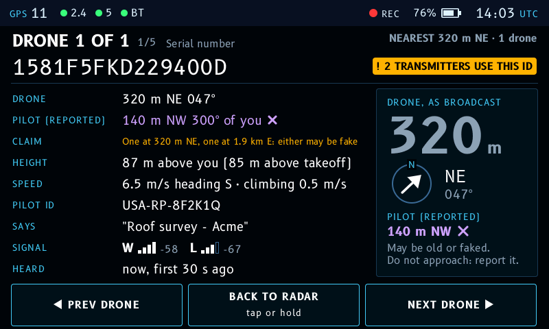

# The tracker

**Level: 🟡 Intermediate** · What the hub does with every report it receives: how reports
become one track per drone, how distance and direction are worked out, how forged and
confusing signals are handled, and what comes out.

## In plain words

Reports arrive at the hub in a jumble. One drone may be heard by three nodes, on Wi-Fi and
Bluetooth, each giving a slightly different picture. The **tracker** sorts that jumble into a
tidy list: **one entry, or "track", per drone**, holding the latest position, who is flying it,
how loud it is and which radios heard it.

Nothing a drone broadcasts is signed or checked by anyone, so the tracker treats every report
as a **claim**, not a fact. It waits to hear a drone twice before alerting, refuses to let one
odd report move a drone across the map, says "disputed" when two transmitters claim one
identity, and stays calm when someone floods the air with fake drones.

The same code runs on the hub and in the laptop viewer `rid-view`, so both show the same list.
Terms are explained in the [glossary](../project/glossary.md).

## Tracks, keyed by ID

A drone's **Basic ID** (its serial number, registration or session ID, part of Remote ID) is
the key. A track can hold at most two IDs, one of each type, because a drone may send both a
serial number and a session ID.

Until a Basic ID arrives, a track is keyed by the **transmitter's address** (its MAC): a
Bluetooth 4 advert carries one message at a time, and the first one heard may be a location.
Addresses are matched within one kind of radio (Wi-Fi beacon and NAN share one set, the three
Bluetooth kinds another). When the ID turns up, the track gains it. That is how a drone's Wi-Fi
and Bluetooth broadcasts, each from a different address, end up as one track: the ID is the
only thing they share.

Each track keeps separate statistics for seven **slots**: Wi-Fi beacon and NAN on 2.4 GHz, the
same two on 5 GHz, and the three Bluetooth kinds. A drone heard on both Wi-Fi bands therefore
shows both, instead of one overwriting the other.

DJI's own broadcasts join the same tracks. A plaintext DroneID burst carries the serial
number, which on DJI aircraft is the same as their Remote ID serial, so a DJI drone heard both
ways is one track. Remote ID's position is preferred: a DroneID position replaces it only once
the Remote ID one is more than 3 s old.

## Merging, carefully

Merging is where a forger could do damage, so it is slow and strict (`claims` module):

- Two IDs of the same type with different values are **never** merged.
- An address-only track joins a drone on the first frame that carries the drone's ID from that
  address, if their positions are compatible.
- Two tracks that already have IDs are merged only after **3 frames over 2 s** name both, their
  positions agree, and neither is disputed.
- A frame naming two different IDs of one type, which no honest drone sends, is counted and
  applied to nothing.

## Probation: confirmed or not

A new track starts **unconfirmed**. It becomes **confirmed** when it is heard again at least
1 s after it was first heard (`probation` module). For a drone sending once a second, that
means confirmed within about 2 s of its first frame, inside the 3 s target in PLAN.md
(requirement D6).

Unconfirmed tracks are shown last and quietly. They never trigger the new-drone alert, are never
sent to TAK, and are the first to give up their place when the table is full. A fake ID that is
sent once and never again stays unconfirmed and fades away.

## Staleness and expiry

| Rule | Value (`tracker::Config`) |
|---|---|
| Marked **stale** after no frame for | 60 s |
| Confirmed track removed after | 10 min |
| Unconfirmed track removed after | 30 s |
| Own GPS position forgotten after no fix for | 10 s |

The hub runs the expiry once a second. Stale tracks stay visible (marked "not heard 60s+" on
the screen) so you can see where a drone was last.

## Distance and direction

When the hub knows its own position, every track gets the distance and **bearing** (compass
direction from true north) to the drone and to its operator, and how far above you the drone
is. These use **Vincenty's inverse formula** on the WGS-84 ellipsoid, the Earth shape GPS uses
(`tracker/src/geo.rs`); a round-Earth formula would be up to 0.5% out, about 5 m at 1 km. Points
over about 1000 km apart, which only a forged position gives, fall back to the round Earth, so a
forger cannot make the sum slow. The code is checked against Vincenty's published example and
against GeographicLib.

With no own position, the distances are left out. See
[Position and time](position-and-time.md).

## Does the story hold together? Spoof checks

The tracker runs **23 consistency checks** on Remote ID and DroneID (`spoof` module): a position
that jumps faster than any drone can fly, a speed that does not match the movement, an operator
standing on the drone, a signal far too strong for its claimed distance, a frozen message
counter, a serial number in the wrong format, a clock that disagrees with GPS time, and more.
Each flag carries a confidence from 0 to 100, and the track gets a combined **suspicion score**.
Weak flags alone keep the score below 30, so one odd reading never raises an alarm. The full
list, with the reasoning and the limits, is in [Spoofed drones](../SPOOFING.md).

If an authentication message is heard, the tracker counts it but checks no signature. The most
any output may say about it is "auth message present, not checked".

## Rival claims and DISPUTED

Anyone in range can broadcast a real drone's ID with a false position. The tracker's answer:

1. A confirmed track with a recent position has an **established path**. A new position report
   is checked against it: within 60 m, plus twice the declared accuracy, plus 100 m/s for the
   time between them, plus a 2 s margin, it is the drone's own.
2. A report outside that is **not applied**. It is held as a **rival claim**.
3. If the rival forms its own believable path (3 reports over 2 s) while the original keeps
   reporting, and the reports switch between the two at least 4 times, the track is
   **DISPUTED**: two transmitters claim one ID. It stays disputed until the rival has been
   silent for 15 s.
4. If the original goes silent for 10 s while the rival continues, the track **follows** the
   rival. A real drone that stops broadcasting or glitches is then not left frozen on the map.

A dispute is not an accusation. It does not say which transmitter is real; the screen keeps showing the
established position, dims its distance, and says where both claims are ("One at 320 m NE, one
at 1.9 km E: either may be fake"). Changed text (Self-ID, operator ID) or a new
session ID is adopted only after 3 frames over 5 s without the old value coming back.

## Identity continuity

A drone may change its ID: a new session ID each flight is legal and normal; a transmitter
swapping serials mid-flight to shake off a tracker is not. When a new track gets its first
position, the `continuity` module looks for a track that went quiet shortly before it and whose
last position, speed and heading fit. If exactly one fits clearly (score at least 50, with no
close runner-up), the new track records "probably the same drone, new identity". A change within
60 s of the old track going quiet, while it was flying, also raises an "identity changed" flag.
The link is undone if the old track is heard again: two drones, not one.

## Floods and limits

Everything is a fixed-size table, so nothing can grow without bound:

| Table | Size | When full |
|---|---|---|
| Drone tracks (P4 hub) | 64 | a new identity takes a stale track's place, else the weakest unconfirmed one (once it has been heard again, about 4 a second at most), else a confirmed track not heard for 15 s; **never** a confirmed track still being heard |
| Aircraft | 32 | a newcomer replaces a stale or unproven aircraft; established aircraft still heard are kept |
| Threats | 16, at most 10 of them floods | ended and muted entries go first; active jamming is never pushed out |
| Open FPV links | 8 | the link heard least recently goes |
| RF emitters, Wi-Fi drones | 16 each | |
| Control links (P4, kept beside the tracker) | 8 links, 3 energy bands | |

A **drone flood** alarm (`id_flood`) is raised by any of: 20 or more new identities a second,
averaged over 5 s; 60 new in the last minute; 32 drone identities heard within 10 s; or one node
dropping frames (8 a second) while the new IDs it delivers do not confirm. The computer tests
behind this (**simulated only**): a real drone kept its track and its single alert through 60 s
of 200 fake IDs a second; a race of 30 drones raised nothing; a race of 40 raised only the
"IDs active at once" rule, which says so in words and blocks nothing
(`crates/tracker/src/tests_flood.rs`). Details:
[Spoofed drones](../SPOOFING.md), "Floods".

## Threats and aircraft

Two more tables sit beside the drones:

- **Threats** are attacks and jamming reported by nodes, plus checks the hub makes itself: a
  node that suddenly hears almost nothing ("blinded"), GPS interference in the area, a flood of
  fake IDs, forged node traffic. Nuisance alarms can be muted for 2 hours, safety-critical ones
  only snoozed for 5 minutes ([Attacks and interference](../detect/threats.md),
  [SITE.md](../SITE.md)).
- **Aircraft** from ADS-B and the aero node are **never** a drone and never an alert. One is
  established after 3 believable position updates over 2 s, stale after 15 s and removed after
  60 s. A quiet "low aircraft nearby" note marks one airborne within 5 km and at most 610 m
  (2000 ft) above you ([Crewed aircraft](../use/aircraft.md)).

Alerts are handed out once per drone, when it is confirmed. On the P4 hub that alert is a banner
on the screen and a line on the USB console; the board has no buzzer, so it makes no sound.

## What comes out

| Output | Format | Where it goes |
|---|---|---|
| JSON lines | `{"t":"track",...}`, one per track, plus `link`, `aircraft`, `threat` and other lines | the hub's USB console; the phone page's `/api/state`; `rid-view` |
| Cursor-on-Target | XML events for TAK, following DragonSync's conventions | the web head's TAK multicast; `rid-view`. Only confirmed tracks are sent |
| CSV | one row per track update, header in `csv::HEADER` | the SD card log |

Every JSON line says what is known and nothing more: `own` is `null` when the hub has no
position, and nothing in a line is verified. The field-by-field schema is in
`crates/tracker/README.md`. See also [SD card and logs](../use/sd-card.md) and
[Phone page and TAK](../use/phone-and-tak.md).

## Memory on the P4

The track table takes about 64 KB. On the P4 it lives in **PSRAM**, the extra memory inside the
chip package, 2 MB in, after the screen's frame buffer (`TRACKER_OFFSET`). Until 2026-11-17 it
sat in internal RAM and squeezed the main stack until mounting the SD card overran it. The
area-GPS watch and the control-link table are in PSRAM too. Without PSRAM the hub refuses to
start rather than crash later.

## Where this lives in the code

- `crates/tracker/src/lib.rs`: tracks, identity, merging, expiry, `Config`.
- `probation.rs` (confirmation, floods), `claims.rs` (rival claims, disputes), `continuity.rs`,
  `spoof.rs`, `threats.rs`, `aircraft.rs`, `geo.rs` (Vincenty).
- `json.rs`, `cot.rs`, `csv.rs`: the three output formats.
- `crates/tracker/README.md`: the full output schemas.
- `firmware/hub-p4/src/main.rs` (`place_tracker`) and `app.rs`: the hub's tracker in PSRAM.

**Next:** [Who listens where: coverage](coverage.md)
