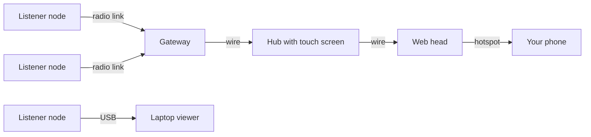

# What is Rotorscope?

**Level: 🟢 Beginner** · What Rotorscope is, who it is for, what the pieces are, and why it is
built the way it is.

## In one paragraph

Rotorscope is a small, home-built box that **listens for drones**. Most drones sold today send
out a short radio message every second saying who they are and where they are. Rotorscope
picks up those messages, works out how far away each drone is and in which direction, and
shows the result on a touch screen and in a log on a memory card (a page for your phone is
planned into the kit but not working yet, see below). It never
transmits anything at a drone. It is open source, it is built from cheap parts, and its
software is written in Rust, a programming language known for catching mistakes before a
program ever runs.

## The problem it solves

In the US, the Federal Aviation Administration (FAA) requires most drones to broadcast
**Remote ID** (14 CFR Part 89): a "digital licence plate" sent over ordinary Wi-Fi and
Bluetooth radio. It carries the drone's identity, its position and height, and the position of the
pilot (or of the place it took off from). Anyone with a suitable receiver may listen; that is
the point of it. See the [glossary](../project/glossary.md) for this and the other terms on
this page.

A phone app can show you one drone at a time, if your phone happens to be listening on the
right radio. Rotorscope is meant to be a dedicated listener that never looks away: it covers
both Wi-Fi bands and Bluetooth at once, keeps track of many drones together, and keeps a
record. It also listens for some signals that are not Remote ID, such as DJI's own drone
identification, video links and, with extra hardware, the radio links pilots fly with (see
[How drones give themselves away](drone-signals-101.md)).

## Who it is for

| Who | What they might use it for |
|---|---|
| **Event staff** | Knowing when a drone is over a crowd, and where its pilot is standing. |
| **Site security** | A fixed sensor on a roof or fence, feeding a log or a TAK map (a map app used by teams in the field). |
| **Hobbyists** | Seeing which drones fly near them, and learning how drone radio works. |
| **Researchers** | An open, inspectable receiver whose every decision can be checked in the source. |
| **Workshop attendees** | A kit to build and take home. The project plan aims at kits sold at conferences ([PLAN.md](https://github.com/holdTheDoorHoid/rotorscope/blob/main/PLAN.md)). |

## The pieces

- **Listener nodes.** Small boards (ESP32-C5 chips), each with one job at a time: 2.4 GHz Wi-Fi, 5 GHz Wi-Fi, Bluetooth, DJI DroneID, or video
  links. The hub tells each node which job to do.
- **Gateway.** One more ESP32-C5 that collects the nodes' reports over a short-range radio
  link (ESP-NOW, Espressif's board-to-board messaging) and passes them to the hub down a wire.
  Once the owner seals the kit, every packet on that link is signed with that node's own key and
  checked by the hub, so a stranger cannot inject fake reports; the gateway holds no key
  ([ESP-NOW in depth](../ESPNOW.md)).
- **Hub.** An ESP32-P4 board with a 5-inch touch screen (the Elecrow CrowPanel Advanced 5").
  It merges what every node heard into one list of drones, works out distance and direction,
  writes the memory-card log, and runs the alarms. A GPS receiver is meant to tell it where it
  is and what time it is; without a GPS fix it cannot work out distances. As of 2026-11-18 no
  real GPS module has been connected to it.
- **Phone page.** The hub has no Wi-Fi of its own, so a second small board, the **web head**,
  is meant to run a Wi-Fi hotspot and serve a page your phone's browser can open, with no
  internet needed. As of 2026-11-18 the web head's software needs more memory than its board
  has, so it does not link (cannot be turned into a working program), and the kit has **no phone
  page today**; the laptop viewer below can feed a
  TAK map instead.
- **Laptop viewer.** `rid-view`, a program for a laptop, shows the same drones from a node
  plugged in by USB, from a saved file, or from a built-in demo.

The picture shows the radar page of the hub's 800 x 480 screen, drawn by the screen software
from made-up test drones. You are the ring and dot in the centre; each diamond is a drone,
numbered nearest first, and the hollow one has gone quiet. The card on the right gives the
nearest one: 75 metres away, north-west, 34 metres above you. The bar along the top shows the
GPS, which receivers are listening, that the log is recording, the battery and the time. Along
the bottom are three touch keys. As of 2026-11-19 this layout is **simulated only**: tested on
a computer and built into the hub's firmware, but not yet looked at on the real panel.
[The screen](../use/screen.md) explains every page.

## Receive-only, and why it matters

Rotorscope **only listens**. It does not jam, block, take over or send anything to a drone,
and it never pretends to be one. The only things in a working kit that transmit are the
links between its own boards and the hotspot for your phone.

This matters for three reasons. First, interfering with aircraft or radio links is a serious
matter almost everywhere, and a receiver does none of that. Second, a
listener cannot cause an accident. Third, Remote ID is a public broadcast made for exactly
this kind of receiver, so listening to it is what the rule-makers intended. The project has
one test transmitter, `rid-beacon`, for the workbench only; it sends a plainly fake
identity at the lowest power its software allows ([Law, safety and ethics](law-and-ethics.md)).

## Why several small chips instead of one

Each ESP32 chip has one radio and one antenna, shared between Wi-Fi and Bluetooth. It can
listen to only one band at a time. Another open-source Remote ID project, Orecchino,
measured what happens when a single chip takes turns between Wi-Fi and Bluetooth: it caught
**4 Wi-Fi Remote ID frames in the time it caught 234 Bluetooth ones**
([PLAN.md](https://github.com/holdTheDoorHoid/rotorscope/blob/main/PLAN.md), "Why one chip
per radio"; source listed in
[RESEARCH.md](https://github.com/holdTheDoorHoid/rotorscope/blob/main/RESEARCH.md)). A chip
that is busy on one band is deaf to the other.

So Rotorscope gives each band its own chip. The chips are cheap (the plan puts them at about
$8 each), so adding one is a small price for not missing anything. The hub is separate for
the same reason: a listening chip cannot also run a hotspot without going deaf. The plan sets
a parts budget of $100 to $200 a unit as a target; no kit has been priced yet.

## What makes it different

- **Open source.** All of it, firmware to laptop tools, is public under the GPL-3.0-or-later
  licence. Anyone may use, change and sell it, as long as changed versions are published
  under the same licence ([credits and licences](../project/credits.md)).
- **Cheap, common parts.** Off-the-shelf ESP32 boards, a GPS module and a ready-made screen
  panel. No special radio hardware for the core job.
- **Rust.** The firmware runs directly on the chips with no operating system, written in
  Rust. The Remote ID decoder is checked against the official reference decoder across
  hundreds of thousands of random cases (in tests on a computer).
- **Honest about its limits.** Every page in this documentation says how far each feature
  has been proven, and the project has not yet heard a real drone.
  [What it can and cannot do today](capabilities.md) is the scoreboard. When the hub flags a
  drone that may be breaking an FAA rule, it says "possible violation", never "illegal".

> [!NOTE]
> As of 2026-11-18 Rotorscope is a working bench prototype, not a finished product. There is
> no kit, case or carrier board on sale yet.

## Where to go next

| You are | Read next |
|---|---|
| New to all of this | [How drones give themselves away](drone-signals-101.md), then [What it can and cannot do today](capabilities.md) |
| Wanting to try it with no hardware | [Step 1: The demo, no hardware](../get-going/step-1-demo.md) |
| Ready to build | [Choose your path](../get-going/README.md) |
| Running it at an event or site | [The screen](../use/screen.md) and [Law, safety and ethics](law-and-ethics.md) |
| Curious how it works inside | [The big picture](../how/architecture.md) |
| A developer | [A tour of the repository](../dev/repo-tour.md) |

**Next:** [How drones give themselves away](drone-signals-101.md)
