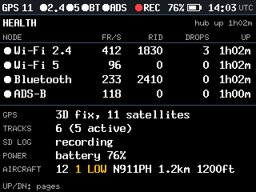
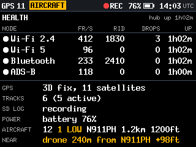

# Crewed aircraft

**Level: 🟢 Beginner** · Why a drone detector shows aeroplanes and helicopters, where that data
comes from, and the one time an aircraft causes a warning.

## Why a drone detector shows aircraft

Rotorscope is about drones, but the sky near a drone also holds aircraft with people in them: a
medical helicopter landing at a hospital, a police helicopter, a crop sprayer, an airliner on its
approach. Knowing they are there helps you judge a drone sighting, and a drone close to a crewed
aircraft is the most dangerous thing a drone can do.

So Rotorscope keeps a **separate aircraft table** beside its drones. It shows each aircraft's
callsign, height, speed, distance and bearing from you.

## ADS-B in plain words

Most aircraft carry a transponder that broadcasts, about once a second, who the aircraft is,
where it is (from its own GPS), how high, how fast and which way. This is **ADS-B** (Automatic
Dependent Surveillance-Broadcast), sent on 1090 MHz. It is what flight-tracking websites show.
Anyone with a suitable receiver can hear it; nothing has to be sent back. See the
[glossary](../project/glossary.md) and [Crewed-aircraft signals](../detect/aircraft-signals.md).

Not every aircraft sends it. Many small private planes in the US use a different system on
978 MHz (UAT), gliders often carry FLARM instead, and some aircraft send nothing at all. An empty
aircraft table does not mean an empty sky.

## Where the data comes from

| Source | What it is | How far it is proven |
|---|---|---|
| **ADSBee 1090** read by the laptop viewer (`rid-view --adsbee`) | A small ready-made 1090 MHz receiver. Its own software decodes the aircraft and sends one text line per aircraft each second | **Heard for real** on 2026-11-14: 30 seconds indoors in centre city Philadelphia, 77 aircraft lines with no errors, six aircraft including two arrivals on the PHL approach |
| **ADSBee 1090 wired to the P4 hub** | The same receiver, its output wire on the hub's GPIO30 | **Simulated only.** The hub's chip fed its own pin with made-up lines and with a recording of real frames; no real ADSBee has been wired to the P4 yet |
| **ADSBee 1090 wired to the older S3 hub** | Its output wire on the S3's GPIO41 (this costs the S3 one node link) | **Built, not yet tried** with a real ADSBee |
| **Rotorscope's own decoder** (`crates/modes`) | Instead of trusting the ADSBee's summary, the hub (or laptop) decodes the raw radio frames itself | **Heard for real** on the laptop on 2026-11-15: over 15 minutes of live traffic it agreed with the ADSBee's own decode on 98 to 100% of checks, and every disagreement looked at was the ADSBee's value being out of date. On the P4 it is off by default and has run only on a recording |
| **UAT (978 MHz), OGN and FLARM decoders** | For aircraft the ADSBee 1090 cannot hear | **Simulated only**: tested with frames made up on a computer; no real radio frame has been through them |
| **The "aero node"** | A planned small receiver box (an ESP32-C3 with an LR2021 radio chip) that would hear 1090 MHz, 978 MHz UAT, or FLARM and OGN trackers, one at a time, and pass them to the hub | **Built, not yet tried**: the firmware compiles and is tested on a computer; no board has been in hand |

The details are in [ADSBee 1090](../ADSBEE.md), [Beyond 1090 MHz: UAT and FLARM](../AIRCRAFT-SIGNALS.md)
and [The aero node](../AERO-NODE.md).

> [!NOTE]
> FLARM decoding needs a key file the owner supplies on the SD card (`ROTORSCP/FLARMKEY.TXT`).
> The keys are never in the repository. Without the file, FLARM aircraft are only counted, not
> decoded. See [SD card and logs](sd-card.md).

## Aircraft never raise an alert by themselves

This is a deliberate rule. Aircraft are for awareness, not detection:

- they never enter the drone list;
- they never sound the new-drone alert or the buzzer;
- they are listed in their own section everywhere: the screen's Health page, the phone page's
  "Aircraft (ADS-B)" section, the SD card log, the USB output, TAK and the laptop table.

The only mark an aircraft gets on its own is a quiet **LOW** label: airborne, within 5 km of
you and at most 2,000 ft above you (above sea level, if the hub does not know its own height). It is a word on the screen, not an alarm.



On the hub's screen, the Health page lists the ADSBee as a node (here `ADS-B`), with its message
rate. The **AIRCRAFT** line gives the number of aircraft heard recently, how many are low, and the
nearest one with its distance and its pressure height in feet. A crewed aircraft flying below its legal minimum height can
also get a `LOW` flag on the [FAA flags](faa-flags.md) page.

Aircraft go stale after 15 seconds without being heard and are removed after 60 seconds, much
sooner than drones, because they move fast.

## The one exception: a drone near a crewed aircraft

Once a second the hub compares every drone with every aircraft. When they are close, or on course
to pass close within the next 45 seconds, it warns. A medical helicopter coming in low over a park
where a drone is flying is the case this is for.

| Level | When |
|---|---|
| **Warning** | Within 300 m and about the same height now, or predicted to pass within 300 m in the next 20 s |
| **Caution** | Within 1 km and about the same height now, or predicted to pass within 600 m in the next 45 s |
| **Advisory** | Within 3 km and within about 1,000 ft of height |

"About the same height" means within 150 m (about 500 ft).

At Caution or Warning the status bar shows **AIRCRAFT** in a box, ahead of JAMMED and ATTACK, and
the Health page gets a **NEAR** line:



Each pair is also written to the [evidence log](../EVIDENCE.md), once per level (and again
after 5 minutes if it is still close).

It is a prompt to look up, not a finding of fault. Drone pilots must give way to crewed aircraft,
but the hub cannot see what either pilot can see. It ignores aircraft on the ground, aircraft
that are themselves drones, and drones that have sent no position. If either side sends no
height, the warning is judged on distance alone and never goes above Caution. How heights and
predictions are worked out is in [Drone near a crewed aircraft](../AIRCRAFT-CONFLICT.md).

**How far it is proven:** **Simulated only** (tests on a computer with made-up tracks).

## Setting up an ADSBee

The ADSBee 1090 is set up once over its own USB connection, from a laptop. The hub cannot
configure it: the ADSBee does not take commands on the wire to the hub. The full steps, with the
exact commands, are in [ADSBee 1090](../ADSBEE.md). In outline:

1. Plug the ADSBee into the laptop by USB and find its serial port.
2. Tell it to send its text output (the **CSBee** format) on the USB console, record 30 seconds,
   and check the recording with `rid-view --adsbee`. Look for zero bad lines and sensible
   aircraft.
3. For the hub, tell the ADSBee to send the same output on its wired output pins
   (`COMMS_UART`), at 115,200 baud. For the hub's own decoder, send the raw **BEAST** format
   there instead.
4. Wire the ADSBee's TX pin and ground to the hub: GPIO30 on the P4, GPIO41 on the S3 (see
   [Pins and wiring reference](../hardware/pinouts.md)). Nothing goes back to the ADSBee.

> [!WARNING]
> These steps change the ADSBee's **running** settings only; unplugging it undoes them. Making
> them permanent needs a separate save command, which the steps never send. Do it yourself only
> if you want the ADSBee to start that way every time.

To see what the laptop sees, with your position for distance and bearing:

```bash
cargo run --release -p rid-view -- --own-pos 39.9526,-75.1652 --adsbee /dev/serial/by-id/usb-...
```

Use your ADSBee's own path from `/dev/serial/by-id/`. See
[The laptop viewer, rid-view](rid-view.md).

**Next:** [Phone page and TAK](phone-and-tak.md)
