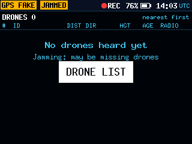
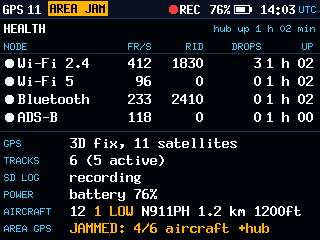
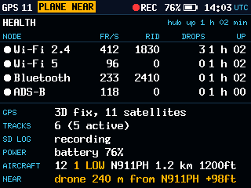
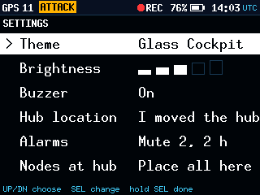
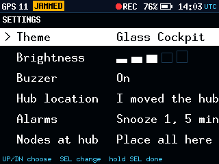
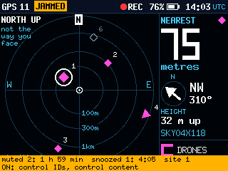

# Alarms and warnings

**Level: 🟢 Beginner** · Every alarm the hub can raise, what it means, how far it has been
proven, what to do about it, and how to quieten one you have dealt with.

Besides drones, the hub watches for things going wrong around it: a drone whose story does not
add up, someone attacking the Wi-Fi or Bluetooth nearby, a jammer, interference with GPS, a
drone close to a crewed aircraft, and fake traffic on Rotorscope's own link between its boards.
These are **alarms**. They are not drones, and they never appear as drones.

> [!IMPORTANT]
> As of 2026-11-18 almost every alarm on this page is **simulated only**: tested with made-up
> signals on a computer or on the chip itself, never yet against a real attacker, jammer or
> spoofer. Treat an alarm as "worth a look", not as proof.

## Where alarms show

On the P4 hub there is no beeper and no pop-up for an alarm. You see it in three places:

1. **One boxed word in the status bar**, in place of the listener dots. If several alarms are
   up, the most urgent wins: **AIRCRAFT**, then **JAMMED**, **AREA FAKE**, **AREA JAM**,
   **ID FLOOD**, **ATTACK**. Problems with the hub's own GPS replace the satellite count on the
   left (**GPS JAM**, **GPS FAKE**).
2. **The health page**: an **ALARMS** line (`1 sounding, 3 silenced`), and **NEAR** and
   **AREA GPS** lines when they apply.
3. **The hub's console and the evidence log**: one line per alarm, with the full wording (the
   names in the table below) and what was heard.

The older S3 hub fills in only part of this: its screen shows the DISPUTED marks on drones,
but none of the status-bar boxes or health lines above.

## Every alarm, in groups

For attacks, jamming and floods, the **Alarm** column gives the exact name the console and the
evidence log use; for the others it is a short description. The **box** is what the status bar
shows.

### Something is wrong with a drone's story

| Box or mark | Alarm | What it means | Proven | Read more |
|---|---|---|---|---|
| `!` and **DISPUTED** | Two transmitters claim this ID | Two senders give one drone ID two different believable paths. Says nothing about which is real | Simulated only | [Spoofed drones](../SPOOFING.md) |
| none (console `SPOOF?`) | Spoof flag | A drone's broadcast breaks physics or its own story, with a confidence of 30 or more | Simulated only | [Spoofed drones](../SPOOFING.md) |
| **ID FLOOD** | Flood of new drone IDs | Far more new drones a second or a minute, or more at once, than a real sky produces: fakes meant to bury real ones | Simulated only | [Spoofed drones](../SPOOFING.md), "Floods" |
| **ATTACK** | Node shedding a flood of drone IDs; Flood of new aircraft addresses; Flood of new control links | The same kind of flood, seen by one listening board, or among aircraft or control links | Simulated only | [Spoofed drones](../SPOOFING.md), "Floods" |

### Someone is attacking Wi-Fi or Bluetooth nearby

All show **ATTACK**. Details and thresholds: [Wi-Fi and Bluetooth attacks](../WIFI-ATTACKS.md).

| Alarm | What it means | Proven |
|---|---|---|
| Wi-Fi deauth attack | Floods of "disconnect" messages knocking devices off a network | Simulated only |
| Wi-Fi disassociation attack | The same, with a different kind of disconnect message | Simulated only |
| Fake network flood | Many made-up networks appearing at once | Simulated only |
| Evil twin network | An open copy of a nearby protected network's name | Simulated only |
| Rogue access point (Karma) | One transmitter answering to many network names, to lure devices | Simulated only |
| Forced channel switch | Messages telling devices to move to another channel | Simulated only |
| Wi-Fi login flood | A flood of connection requests at one access point | Simulated only |
| Wi-Fi probe flood | A flood of "is network X here?" requests | Simulated only |
| Wi-Fi attack tool | A known attack gadget's own signature | Simulated only |
| Bluetooth spam | A flood of fake Bluetooth adverts (pairing pop-up spam) | Simulated only |

### Jamming, or a listener gone deaf

All show **JAMMED**, and an empty list then says "Jamming: may be missing drones". JAMMED
means the hub **may be missing drones**: never read an empty screen as "all clear" while it is
up.

| Alarm | What it means | Proven | Read more |
|---|---|---|---|
| Jamming (wideband) | Noise raised across a wide part of a band | Simulated only | [Jamming](../JAMMING.md) |
| Jamming (tone) | A strong steady signal parked on one frequency | Simulated only | [Jamming](../JAMMING.md) |
| Jamming (sweep) | A signal sweeping up and down the band | Simulated only | [Jamming](../JAMMING.md) |
| Jamming (pulsed) | Strong bursts switching on and off | Simulated only | [Jamming](../JAMMING.md) |
| Node blinded | A listening board can hardly hear anything it normally hears, whatever the cause. Raised by the board itself, or by the hub when a board's usual traffic suddenly drops | Simulated only | [Jamming](../JAMMING.md) |

A board that stops reporting altogether is not an alarm: the health page says **NOT
RESPONDING** and its dot in the status bar is crossed out.

### Someone is attacking a drone

All show **ATTACK**. Details: [Attacks on drones](../DRONE-ATTACKS.md).

| Alarm | What it means | Proven |
|---|---|---|
| Drone kicked off its Wi-Fi | Disconnect messages aimed at a drone's own Wi-Fi network: the first step of a hijack | Simulated only |
| Drone Wi-Fi taken over | A new controller joined a drone's Wi-Fi after the old one was kicked off | Simulated only |
| Copy of a drone's network | A second transmitter using a drone's network name, to catch its pilot's phone | Simulated only |
| Second controller on a link | A drone control link heard from more transmitters than it can have | Simulated only |
| Hostile drone telemetry | Attack content in a drone's telemetry (MAVLink) | Simulated only |

"Possible hostile drone telemetry (one frame)" is listed but never alarms until a second frame
backs it up.

### GPS trouble

| Box | Alarm | What it means | Proven | Read more |
|---|---|---|---|---|
| **GPS JAM?** / **GPS JAM** | Hub GPS jamming | The hub's own GPS shows signs of jamming (with `?`: some signs; without: strong) | Simulated only | [GPS at the hub](../GNSS-INTEGRITY.md) |
| **GPS FAKE?** / **GPS FAKE** | Hub GPS spoofing | The hub's own GPS looks faked. The hub stops trusting its position and time, and holds the last ones it trusted | Simulated only | [GPS at the hub](../GNSS-INTEGRITY.md) |
| **AREA JAM** / **AREA FAKE** | GPS interference nearby | Aircraft report poor GPS, or several drones' positions jump together: drone positions may be wrong | Simulated only | [Attacks on drones](../DRONE-ATTACKS.md), "GPS interference in the area" |

### A drone near a crewed aircraft

| Box | Alarm | What it means | Proven | Read more |
|---|---|---|---|---|
| **AIRCRAFT** | Drone near a crewed aircraft | A drone and a plane or helicopter are close, or on course to pass close within the next 45 seconds (Caution or Warning level). The health page's **NEAR** line says which, how far and the height difference | Simulated only | [Drone near a crewed aircraft](../AIRCRAFT-CONFLICT.md) |

It needs an ADS-B receiver on the hub. It is a prompt to look up, not a finding of fault.

### Fake traffic on Rotorscope's own link

| Box | Alarm | What it means | Proven | Read more |
|---|---|---|---|---|
| **ATTACK** | Forged node traffic | Packets claiming to come from one of your own boards failed the kit's signature check, were replays, or were of a kind that board may not send | Proven on the air for one case (our own test board sending frames it may not send, 2026-11-18); the other cases simulated only | [ESP-NOW in depth](../ESPNOW.md), "Securing the link" |

If the kit has no link key at all, the strip along the bottom says **OPEN LINK** for as long as
it runs: there is nothing to check signatures against.

## What to do when one fires

Stay calm. An alarm is information, and most have innocent explanations.

1. **Read the box and the health page.** Which kind of alarm, and on which listener?
2. **Ask whether it could be ordinary.** See "False alarms" below.
3. **Look up and around** if it is AIRCRAFT or JAMMED. JAMMED means you may be blind to drones.
4. **Let the hub record it.** It already writes each new alarm to the evidence log, with the time
   (unless a mute already covered it when it started; see below).
   Keep the card safe ([The evidence log](../EVIDENCE.md)).
5. **Never interfere.** Do not transmit at, jam, chase or try to take over anything.
   Rotorscope only listens, and so should you ([Law, safety and ethics](../start/law-and-ethics.md)).
   If someone may be in danger, contact the people whose job that is.

## False alarms, and why they happen

Every detail in an alarm (which transmitter, which victim, which network name) is what the radio
frames **claimed**, and anyone can send frames claiming anything. Some ordinary causes:

| Alarm | Ordinary cause |
|---|---|
| Evil twin | A café that really runs an open guest network with the same name as its secured one |
| Wi-Fi deauth | An access point shutting several networks down at once |
| Wi-Fi login flood | Hundreds of devices rejoining after a router restarts, in a lecture hall |
| Fake network flood | A listener carried quickly through new places, such as in a car |
| Bluetooth spam | A dense crowd of phones and earbuds at a stadium gate |
| DISPUTED | A drone's GPS flicking between two answers; two test modules set to the same serial |
| ID FLOOD | A light show with more drones than the hub can follow (about 320 for a 64-drone table) |
| GPS FAKE | Moving the hub without telling it (Settings, **Hub moved**) |

Microwave ovens and busy Wi-Fi are recognised by the jamming checks and do not count as
jamming. More cases are listed in each deep dive.

## Muting and snoozing

The **Alarms** row in Settings says what one press will do, and acts only on alarms already on
the screen when you press it.

| The row says | What happens | For |
|---|---|---|
| `Mute 2 (2h)` | Mutes each nuisance alarm sounding now, one by one: Wi-Fi and Bluetooth attacks, attacks on drones | 2 hours |
| `Snooze 1 (5m)` | Shown only when the alarms left are the **safety** kinds: jamming, node blinded, GPS interference in the area, a flood of fake IDs, forged node traffic. They can only be snoozed | 5 minutes |
| `Unmute 3` | Nothing is sounding but you have muted or snoozed something: drops all of yours | |
| `None sounding` | Nothing to do | |

Things to know:

- **Each mute covers one specific thing**: that kind of alarm, from that transmitter, against
  that victim, with that name, on that listener or frequency. No wildcards. This stops an
  attacker raising cheap nuisance alarms to get you to press Mute while something real sounds.
- **A snooze does not clear the box.** JAMMED, AREA JAM, AREA FAKE and ID FLOOD stay up for as
  long as they are true. If a jammer is still on after 5 minutes, it alarms again. (Forged node
  traffic shows as ATTACK, and that box does go while it is snoozed.)
- **Mutes from the screen are forgotten at a reboot** and are not saved to the site file.
- **While anything is silenced**, the strip along the bottom says so, for example
  `MUTED 2 1h59  SNOOZED 1 4m05  SITE MUTES 1`.

**For good, in the site file.** A false alarm a venue always has (that café's guest network) can
be muted permanently with one line in `SITE.TXT` on the hub's card that names exactly that
thing, for example `mute evil_twin source=02:11:22:33:44:55 ssid=Cafe WiFi`. Safety kinds can
never be muted this way. Every load of the file is logged. See [Site settings](../SITE.md),
"Silencing alarms".

## Alarms in the evidence log

Each alarm, spoof flag, dispute, GPS finding and aircraft conflict is written to the
[evidence log](../EVIDENCE.md) when it starts, with the time and what was heard (spoof flags,
disputes and aircraft conflicts again when they grow more serious, and an alarm again when its
mute or snooze ends while it is still on). Muting an alarm that has already sounded does not
remove its record. Each mute, snooze and unmute is logged too, saying what it silences and until
when.

> [!WARNING]
> An alarm that is **already covered by a mute when it starts** (for example one matching a
> line in the site file) is not written to the evidence log as a new alarm and makes no console
> line; it shows only, marked as muted, in the hub's USB data. Mute sparingly.

## Where this lives in the code

- [`crates/link/src/lib.rs`](https://github.com/holdTheDoorHoid/rotorscope/blob/main/crates/link/src/lib.rs):
  `ThreatKind`, every kind of alarm a board can report
- [`crates/tracker/src/threats.rs`](https://github.com/holdTheDoorHoid/rotorscope/blob/main/crates/tracker/src/threats.rs):
  names, mutes (`OPERATOR_MUTE_MS`, `SNOOZE_MS`, `is_safety_kind`), the deaf-listener check;
  `probation.rs` (floods), `claims.rs` (disputes), `conflict.rs` and `area_gnss.rs`
- [`crates/screen/src/render.rs`](https://github.com/holdTheDoorHoid/rotorscope/blob/main/crates/screen/src/render.rs):
  the status-bar boxes and their order

**Next:** [FAA rule flags](faa-flags.md)
