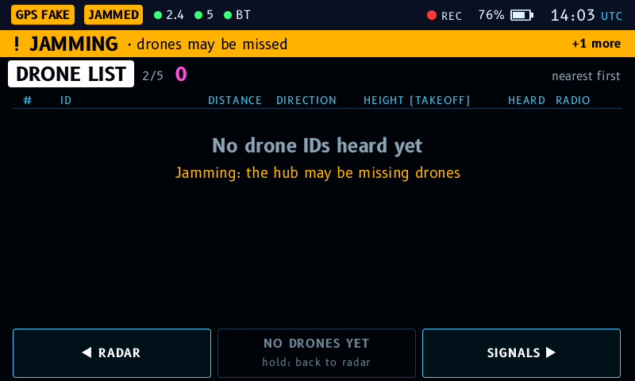
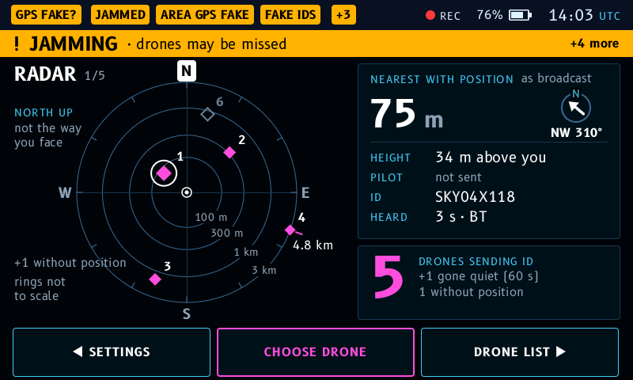
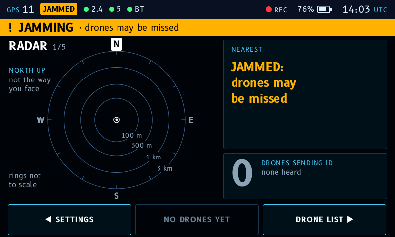
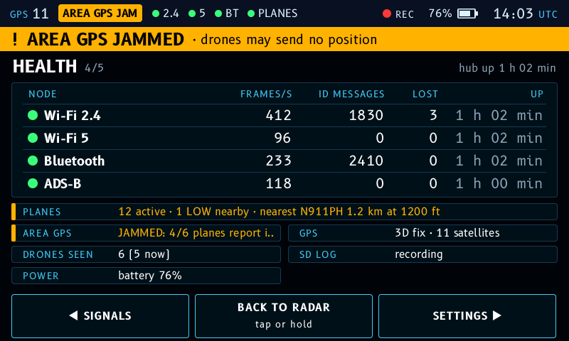
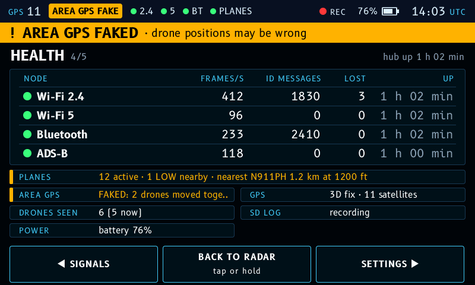
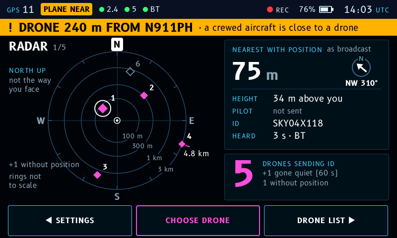
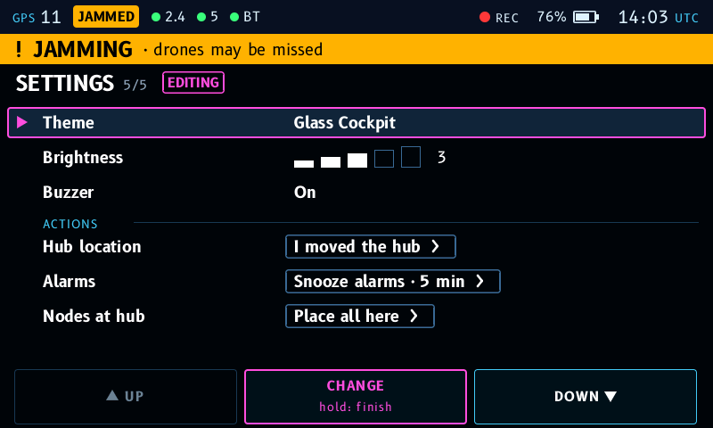
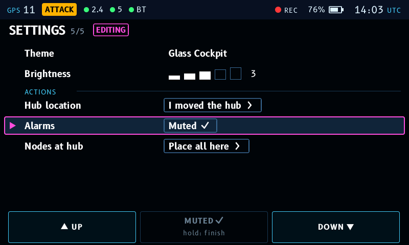
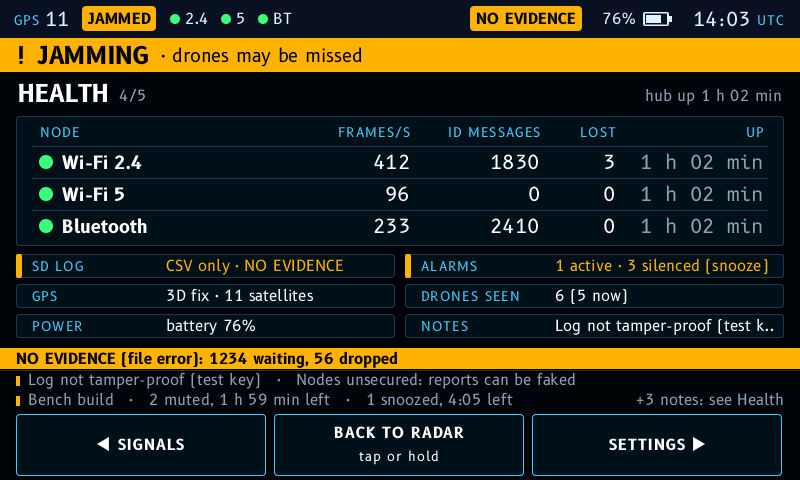

# Alarms and warnings

**Level: 🟢 Beginner** · Every alarm the hub can raise, what it means, how far it has been
proven, what to do about it, and how to quieten one you have dealt with.

Besides drones, the hub watches for things going wrong around it: a drone whose story does not
add up, someone attacking the Wi-Fi or Bluetooth nearby, a jammer, interference with GPS, a
drone close to a crewed aircraft, and fake traffic on Rotorscope's own link between its boards.
These are **alarms**. They are not drones, and they never appear as drones.

> [!IMPORTANT]
> As of 2026-11-18 almost every alarm on this page is **simulated only**: tested with made-up
> signals on a computer or on the chip itself, never yet against a real attacker, jammer or
> spoofer. Treat an alarm as "worth a look", not as proof.

## Where alarms show

The P4 hub has no buzzer and puts up no pop-up for an alarm. On its screen you see it in three
places (how the screen works in general is on [The screen](screen.md)):

1. **A chip in the status bar.** A chip is a small, highlighted boxed word, such as
   **JAMMED** or **PLANE NEAR**. Every warning that holds gets its own chip, most urgent first;
   what does not fit ends in a **+N** chip. Problems with the hub's own GPS replace the
   satellite count at the far left (**GPS JAM**, **GPS FAKE**). See
   [The status bar](screen.md#the-status-bar).
2. **The warning band**, the amber band under the status bar. It gives the most urgent warning
   in words, a bold head and what it means for you, such as "JAMMING · drones may be missed",
   with "+N more" on the right when there are others. See
   [The warning band](screen.md#the-warning-band).
3. **The Health page**: an **Alarms** row (for example "1 active · 3 silenced"), and **Near a
   plane** and **Area GPS** rows when they apply. See [Health](screen.md#health).

The hub's USB console and the evidence log carry one line per alarm, with the full name (the
names in the tables below) and what was heard.

**How far the screen is proven:** the 800 x 480 layout pictured on this page is **Simulated
only** as of 2026-11-19: drawn and tested on a computer and built into the hub's firmware, but
not yet looked at on the real panel. The panel itself was confirmed by eye on 2026-11-14 with an
earlier layout. The pictures are the screen code's own test drawings, made from made-up drones.

### Chips and band wording

The band shows the first warning in this list that holds; each has its own chip.

| Chip | Band wording | When |
|---|---|---|
| **NOT LISTENING** | NOT LISTENING · 0 of 3 receivers responding (or "no receivers reported") | No drone receiver is answering. Not an alarm, but nothing can be heard |
| **PLANE NEAR** | DRONE 240 m FROM N911PH · a crewed aircraft is close to a drone | A drone near a crewed aircraft, Caution or Warning level |
| **JAMMED** | JAMMING · drones may be missed | A jamming or blinded-node alarm |
| **GPS FAKE?** / **GPS FAKE** (in place of the satellite count) | GPS MAY BE FAKED · distances may be wrong | The hub's own GPS looks faked |
| **AREA GPS FAKE** | AREA GPS FAKED · drone positions may be wrong | The positions of several drones or aircraft jumped together |
| **FAKE IDS** | FAKE IDS · flood of made-up drone IDs | A flood of new drone IDs |
| **FLAG** | POSSIBLE SERIOUS RULE ISSUE · see Flags | An [FAA rule flag](faa-flags.md) at its highest level. Not an alarm |
| **5 DOWN**, **DOWN 2.4 5 BT** | 5 GHz RECEIVER DOWN · drones on 5 GHz won't be heard (or "2 RECEIVERS DOWN") | Some receivers have stopped answering. Not an alarm. A P4 hub with no ADSBee wired to it always shows **PLANES DOWN** ("PLANE RECEIVER DOWN · planes won't be heard"): it cannot hear aircraft |
| **AREA GPS JAM** | AREA GPS JAMMED · drones may send no position | Aircraft report poor GPS around the hub |
| **GPS JAM?** / **GPS JAM** (in place of the satellite count) | GPS JAMMED · hub position and time may be old | The hub's own GPS shows signs of jamming |
| **NO GPS** or **NO FIX** (in place of the satellite count) | NO POSITION · distances and directions unavailable | The hub does not know where it is. Not an alarm |
| **ATTACK** | none | Any other alarm that is sounding and not silenced: Wi-Fi and Bluetooth attacks, attacks on drones, other floods, forged node traffic. Shown only when neither JAMMED nor FAKE IDS is up |

The `?` on a GPS chip means some signs; without it, strong signs.

The older S3 hub, with its small screen, shows only part of this: the disputed marks on drones,
but none of the chips, band or Health rows above.

## Every alarm, in groups

For attacks, jamming and floods, the **Alarm** column gives the exact name the console and the
evidence log use; for the others it is a short description. The **chip** is what the status bar
shows.

### Something is wrong with a drone's story

| Chip or mark | Alarm | What it means | Proven | Read more |
|---|---|---|---|---|
| **2 senders** in the list, **! 2 TRANSMITTERS USE THIS ID** on the drone's page | Two transmitters claim this ID | Two senders give one drone ID two different believable paths. Says nothing about which is real | Simulated only | [Spoofed drones](../SPOOFING.md) |
| none (console `SPOOF?`) | Spoof flag | A drone's broadcast breaks physics or its own story, with a confidence of 30 or more | Simulated only | [Spoofed drones](../SPOOFING.md) |
| **FAKE IDS** | Flood of new drone IDs | Far more new drones a second or a minute, or more at once, than a real sky produces: fakes meant to bury real ones | Simulated only | [Spoofed drones](../SPOOFING.md), "Floods" |
| **ATTACK** | Node shedding a flood of drone IDs; Flood of new aircraft addresses; Flood of new control links | The same kind of flood, seen by one listening board, or among aircraft or control links | Simulated only | [Spoofed drones](../SPOOFING.md), "Floods" |

### Someone is attacking Wi-Fi or Bluetooth nearby

All show the **ATTACK** chip. Details and thresholds: [Wi-Fi and Bluetooth attacks](../WIFI-ATTACKS.md).

| Alarm | What it means | Proven |
|---|---|---|
| Wi-Fi deauth attack | Floods of "disconnect" messages knocking devices off a network | Simulated only |
| Wi-Fi disassociation attack | The same, with a different kind of disconnect message | Simulated only |
| Fake network flood | Many made-up networks appearing at once | Simulated only |
| Evil twin network | An open copy of a nearby protected network's name | Simulated only |
| Rogue access point (Karma) | One transmitter answering to many network names, to lure devices | Simulated only |
| Forced channel switch | Messages telling devices to move to another channel | Simulated only |
| Wi-Fi login flood | A flood of connection requests at one access point | Simulated only |
| Wi-Fi probe flood | A flood of "is network X here?" requests | Simulated only |
| Wi-Fi attack tool | A known attack gadget's own signature | Simulated only |
| Bluetooth spam | A flood of fake Bluetooth adverts (pairing pop-up spam) | Simulated only |

### Jamming, or a listener gone deaf

All show the **JAMMED** chip and the band "JAMMING · drones may be missed". With no drones on
screen, the radar's readout says "JAMMED: drones may be missed" and the drone list says
"Jamming: the hub may be missing drones". JAMMED means the hub **may be missing drones**: never
read an empty screen as "all clear" while it is up.

| Alarm | What it means | Proven | Read more |
|---|---|---|---|
| Jamming (wideband) | Noise raised across a wide part of a band | Simulated only | [Jamming](../JAMMING.md) |
| Jamming (tone) | A strong steady signal parked on one frequency | Simulated only | [Jamming](../JAMMING.md) |
| Jamming (sweep) | A signal sweeping up and down the band | Simulated only | [Jamming](../JAMMING.md) |
| Jamming (pulsed) | Strong bursts switching on and off | Simulated only | [Jamming](../JAMMING.md) |
| Node blinded | A listening board can hardly hear anything it normally hears, whatever the cause. Raised by the board itself, or by the hub when a board's usual traffic suddenly drops | Simulated only | [Jamming](../JAMMING.md) |

A board that stops reporting altogether is not an alarm: the Health page says **NOT
RESPONDING** beside it, and the status bar shows a chip naming it, such as **5 DOWN**.

### Someone is attacking a drone

All show the **ATTACK** chip. Details: [Attacks on drones](../DRONE-ATTACKS.md).

| Alarm | What it means | Proven |
|---|---|---|
| Drone kicked off its Wi-Fi | Disconnect messages aimed at a drone's own Wi-Fi network: the first step of a hijack | Simulated only |
| Drone Wi-Fi taken over | A new controller joined a drone's Wi-Fi after the old one was kicked off | Simulated only |
| Copy of a drone's network | A second transmitter using a drone's network name, to catch its pilot's phone | Simulated only |
| Second controller on a link | A drone control link heard from more transmitters than it can have | Simulated only |
| Hostile drone telemetry | Attack content in a drone's telemetry (MAVLink) | Simulated only |

"Possible hostile drone telemetry (one frame)" is listed but never alarms until a second frame
backs it up.

### GPS trouble

| Chip | Alarm | What it means | Proven | Read more |
|---|---|---|---|---|
| **GPS JAM?** / **GPS JAM** | Hub GPS jamming | The hub's own GPS shows signs of jamming (with `?`: some signs; without: strong) | Simulated only | [GPS at the hub](../GNSS-INTEGRITY.md) |
| **GPS FAKE?** / **GPS FAKE** | Hub GPS spoofing | The hub's own GPS looks faked. The hub stops trusting its position and time, and holds the last ones it trusted | Simulated only | [GPS at the hub](../GNSS-INTEGRITY.md) |
| **AREA GPS JAM** / **AREA GPS FAKE** | GPS interference nearby | Aircraft report poor GPS, or several drones' positions jump together: drone positions may be wrong | Simulated only | [Attacks on drones](../DRONE-ATTACKS.md), "GPS interference in the area" |

The Health page's **Area GPS** row says what the hub saw: "JAMMED: 4/6 planes report it", or
"FAKED: 2 drones moved together", with ", hub agrees" added when the hub's own GPS sees the same.

### A drone near a crewed aircraft

| Chip | Alarm | What it means | Proven | Read more |
|---|---|---|---|---|
| **PLANE NEAR** | Drone near a crewed aircraft | A drone and a plane or helicopter are close, or on course to pass close within the next 45 seconds (Caution or Warning level). The band names the aircraft and the distance; the Health page's **Near a plane** row adds the height difference | Simulated only | [Drone near a crewed aircraft](../AIRCRAFT-CONFLICT.md) |

It needs an ADS-B receiver on the hub. It is a prompt to look up, not a finding of fault. More on
[Crewed aircraft](aircraft.md).

### Fake traffic on Rotorscope's own link

| Chip | Alarm | What it means | Proven | Read more |
|---|---|---|---|---|
| **ATTACK** | Forged node traffic | Packets claiming to come from one of your own boards failed the kit's signature check, were replays, or were of a kind that board may not send | Proven on the air for one case (our own test board sending frames it may not send, 2026-11-18); the other cases simulated only | [ESP-NOW in depth](../ESPNOW.md), "Securing the link" |
| **ATTACK** | Node reports going missing | A board says it sent far more than the hub received | Simulated only | [Threats](../detect/threats.md) |

If the kit's link is not secured, a note above the keys says "Nodes unsecured: reports can be
faked" for as long as it runs: there is nothing to check signatures against. See
[The notes above the keys](screen.md#the-notes-above-the-keys).

## What to do when one fires

Stay calm. An alarm is information, and most have innocent explanations.

1. **Read the chip, the band and the Health page.** Which kind of alarm, and on which listener?
2. **Ask whether it could be ordinary.** See "False alarms" below.
3. **Look up and around** if it is PLANE NEAR or JAMMED. JAMMED means you may be blind to drones.
4. **Let the hub record it.** It already writes each new alarm to the evidence log, with the
   time, even one a mute already covers. Keep the card safe ([The evidence log](../EVIDENCE.md)).
5. **Never interfere.** Do not transmit at, jam, chase or try to take over anything.
   Rotorscope only listens, and so should you ([Law, safety and ethics](../start/law-and-ethics.md)).
   If someone may be in danger, contact the people whose job that is.

## False alarms, and why they happen

Every detail in an alarm (which transmitter, which victim, which network name) is what the radio
frames **claimed**, and anyone can send frames claiming anything. Some ordinary causes:

| Alarm | Ordinary cause |
|---|---|
| Evil twin | A café that really runs an open guest network with the same name as its secured one |
| Wi-Fi deauth | An access point shutting several networks down at once |
| Wi-Fi login flood | Hundreds of devices rejoining after a router restarts, in a lecture hall |
| Fake network flood | A listener carried quickly through new places, such as in a car |
| Bluetooth spam | A dense crowd of phones and earbuds at a stadium gate |
| Two transmitters use this ID | A drone's GPS flicking between two answers; two test modules set to the same serial |
| FAKE IDS | A light show with more drones than the hub can follow (about 320 for a 64-drone table) |
| GPS FAKE | Moving the hub without telling it (Settings, **Hub location**, **I moved the hub**) |

Microwave ovens and busy Wi-Fi are recognised by the jamming checks and do not count as
jamming. More cases are listed in each deep dive.

## Muting and snoozing

The P4 hub never beeps, so "muting" an alarm here means taking it off the screen's ATTACK chip
and its Alarms count, for a while. It is done from the **Alarms** row of the Settings page, under
**Actions**. To get there, go to Settings and press the middle key, labelled **EDIT SETTINGS**
(or touch a row). Move to the Alarms row with the left key (labelled UP) and the right key
(labelled DOWN), or touch it. Press the middle key, or touch the row again, to act. See
[Settings](screen.md#settings).

The row says what one press will do, and acts only on alarms already on the screen when you
press it. While the Alarms row is chosen, the middle key carries the same action in short.

| The row says | The middle key says | What happens | For |
|---|---|---|---|
| "Mute Wi-Fi deauth attack +1 · 2 h" | MUTE 2 H | Mutes each nuisance alarm sounding now, one by one: Wi-Fi and Bluetooth attacks, attacks on drones. The row names the first and counts the others ("+1") | 2 hours |
| "Snooze Jamming (wideband) · 5 min" | SNOOZE 5 MIN | Shown only when the alarms left are the **safety** kinds: jamming, node blinded, GPS interference in the area, floods of fake IDs, forged node traffic, node reports going missing. They can only be snoozed | 5 minutes |
| "Unmute 2" | UNMUTE | Nothing is sounding but you have muted or snoozed something: drops all of yours (not the site file's) | |
| "None active" | NONE ACTIVE | Nothing to do | |

When the hub does not pass the alarm's name, the row says "alarms" in its place ("Mute alarms +1
· 2 h"). After a press, the row and the key say **Muted**, **Snoozed** or **Unmuted** with a
tick.

Things to know:

- **Each mute covers one specific thing**: that kind of alarm, from that transmitter, against
  that victim, with that name, on that listener or frequency. No wildcards. This stops an
  attacker raising cheap nuisance alarms to get you to press Mute while something real sounds.
- **A snooze does not clear the warning.** The JAMMED, AREA GPS JAM, AREA GPS FAKE and FAKE IDS
  chips, and their band, stay up for as long as they are true. If a jammer is still on after 5
  minutes, it alarms again. (Forged node traffic and node reports going missing show as ATTACK,
  and that chip does go while they are snoozed.)
- **Mutes from the screen are forgotten at a reboot** and are not saved to the site file.
- **While anything is silenced**, the screen says so in the notes lines just above the keys, for
  example "2 muted, 1 h 59 min left", "1 snoozed, 4:05 left" and "1 muted by the site file". The
  time is that of the first one to end. Only two lines of notes fit; the rest are counted ("+3
  notes: see Health"), and the Health page lists them in its **Notes** row, as far as the row
  has room. Its **Alarms**
  row counts what is sounding and what is silenced, such as "1 active · 3 silenced (snooze)". See
  [The notes above the keys](screen.md#the-notes-above-the-keys).

**For good, in the site file.** A false alarm a venue always has (that café's guest network) can
be muted permanently with one line in `SITE.TXT` on the hub's card that names exactly that
thing, for example `mute evil_twin source=02:11:22:33:44:55 ssid=Cafe WiFi`. Safety kinds can
never be muted this way. Every load of the file is logged. See [Site settings](../SITE.md),
"Silencing alarms".

## Alarms in the evidence log

Each alarm, spoof flag, dispute, GPS finding and aircraft conflict is written to the
[evidence log](../EVIDENCE.md) when it starts, with the time and what was heard (spoof flags,
disputes and aircraft conflicts again when they grow more serious, and an alarm again when its
mute or snooze ends while it is still on). Muting an alarm that has already sounded does not
remove its record. Each mute, snooze and unmute is logged too, saying what it silences and until
when.

An alarm that is **already covered by a mute when it starts** (for example one matching a line
in the site file) is still written to the evidence log and the console, marked as silenced: the
mute stops the alert, never the record.

## Where this lives in the code

- [`crates/link/src/lib.rs`](https://github.com/holdTheDoorHoid/rotorscope/blob/main/crates/link/src/lib.rs):
  `ThreatKind`, every kind of alarm a board can report
- [`crates/tracker/src/threats.rs`](https://github.com/holdTheDoorHoid/rotorscope/blob/main/crates/tracker/src/threats.rs):
  names, mutes (`OPERATOR_MUTE_MS`, `SNOOZE_MS`, `is_safety_kind`), the deaf-listener check;
  `probation.rs` (floods), `claims.rs` (disputes), `conflict.rs` and `area_gnss.rs`
- [`crates/screen/src/model.rs`](https://github.com/holdTheDoorHoid/rotorscope/blob/main/crates/screen/src/model.rs):
  `UiState::warnings` (which warnings hold, in order) and `Warning::text` (the band's words);
  `Caveats::notes` (the notes lines)
- [`crates/screen/src/wide/pages.rs`](https://github.com/holdTheDoorHoid/rotorscope/blob/main/crates/screen/src/wide/pages.rs):
  the status bar's chips (`status_bar`) and the warning band (`band`);
  [`crates/screen/src/render.rs`](https://github.com/holdTheDoorHoid/rotorscope/blob/main/crates/screen/src/render.rs)
  `settings_text`: the Alarms row's words

**Next:** [FAA rule flags](faa-flags.md)
