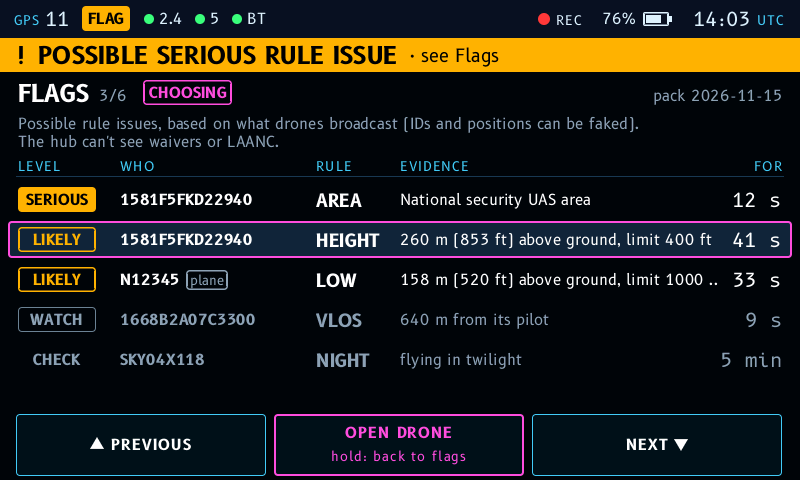

# FAA rule flags

**Level: 🟢 Beginner** · What the Flags page means, why it says "possible" and never "illegal",
and what it needs on the SD card to work.

Rotorscope can mark a flight that **possibly** breaks a rule of the US Federal Aviation
Administration (FAA): a drone flying very high, inside an area where drones are banned, or far
from its pilot. These marks are called **flags**. They are a note for you to look into, not a
finding of guilt.

> [!IMPORTANT]
> The flags are for the **United States only**. The rules are US rules, and the map data comes
> from US government sources. Outside the US the airspace checks have nothing to work with.

**How far it is proven:** **Simulated only.** The checks have been run against the real public
FAA map data, with made-up drones placed at known spots around Philadelphia International (PHL)
and Northeast Philadelphia (PNE) airports, on a laptop and on the P4 hub. Rotorscope has not yet
flagged a real drone.

## Why "possible", never "illegal"

A flight that looks wrong from the ground is often perfectly legal. The hub cannot see:

- **waivers** the FAA has granted to a pilot (for example to fly at night or out of sight);
- **authorisations** to fly in controlled airspace, including the near-instant ones pilots get
  through the FAA's LAANC system (Low Altitude Authorization and Notification Capability);
- **public-safety operations** flown under a special certificate (police, fire, rescue);
- whether the pilot holds a **Part 107 certificate** (commercial) or is flying for fun, which
  changes which rules apply.

So every flag says "possible violation", names the rule it is about, gives the numbers it saw,
and says where its map data came from and how old it is. On the screen, the Flags page says it
plainly under its title: "Possible rule issues, based on what drones broadcast (IDs and positions
can be faked). The hub can't see waivers or LAANC."

## What it checks

Each flag has a short code, shown on the screen and in the log.

| Code | In plain words | Rule cited |
|---|---|---|
| `HEIGHT` | More than 400 ft above the ground | 14 CFR 107.51(b), 49 USC 44809(a)(6) |
| `UASFM` | Above the ceiling the FAA's drone map allows at that spot (the LAANC grid) | 14 CFR 107.41 |
| `CTRL` | Inside controlled airspace around an airport (Class B, C, D or E from the ground up). Only a note: this is often authorised | 14 CFR 107.41, 49 USC 44809(a)(5) |
| `AREA` | Inside a prohibited or restricted area, a national-security drone restriction, a stadium's 3 nautical-mile ring, a **TFR**, or national defence airspace | depends on the area |
| `NORID` | DJI DroneID heard, but no Remote ID, outside a recognised flying field (FRIA) | 14 CFR 89.105 |
| `NOOP` | Remote ID heard, but it never says where the pilot is | 14 CFR 89.305(c), 89.315(c) |
| `SERIAL` | The drone's Remote ID serial number changed mid-flight | 14 CFR 89.305(a) |
| `VLOS` | The drone is far from its pilot, so the pilot probably cannot see it | 14 CFR 107.31, 49 USC 44809(a)(7) |
| `VLOS-T` | A hill is in the way between the pilot and the drone | same |
| `NIGHT` | It is night or twilight. Only a note: night flying is legal with lights, which radio cannot see | 14 CFR 107.29 |
| `LOW` | A **crewed** aircraft (from ADS-B) flying below the legal minimum height, away from airports | 14 CFR 91.119 |

A **TFR** (Temporary Flight Restriction) is a short-lived no-fly area the FAA sets up, for example
around a presidential visit or a wildfire. **Remote ID** is the identity and position broadcast
US drones must send; **DJI DroneID** is DJI's own broadcast. See the
[glossary](../project/glossary.md) and [Remote ID](../detect/remote-id.md).

A few details worth knowing:

- **Height** is worked out the best way available: the drone's own "height above ground" if it
  sends one, otherwise its GPS height minus the ground height from the map pack, otherwise its
  height above take-off, otherwise its barometer. Each way carries an error allowance, and the
  hub subtracts that before it judges the stronger levels. In a city the hub stays soft below
  800 ft ("check for structures"), because the rule lets a drone fly up to 400 ft above a
  building it is near, and the pack has no buildings in it.
- **Out of sight** has no fixed distance in the rule, so the hub grades it: a Watch from 500 m
  between drone and pilot, a Warning from 1,000 m held for 30 seconds. Many drones send their
  **take-off point** as the pilot's position rather than where the pilot really is; then the
  distance flag stays at Watch unless it passes 1,500 m.
- **Crewed aircraft** are checked against 1,000 ft over built-up areas (US Census urban areas
  stand in for "congested") and 500 ft elsewhere. Aircraft within 3 nautical miles of a public
  airport, or 1 nautical mile of a private strip, are skipped, since they may be taking off or
  landing. Helicopters, gliders and balloons are not checked at all.

Flying over people is not checked: the hub has no data about people.

## The four levels

| Level | Name in the log | On the screen | Meaning | Example |
|---|---|---|---|---|
| 0 | Note | **CHECK** | Context, not a problem | Night; inside Class D airspace (often authorised) |
| 1 | Watch | **WATCH** | One rule possibly exceeded, briefly or within the error margin | 420 ft above ground for a few seconds; 600 m from the pilot |
| 2 | Warning | **LIKELY** | Clearly exceeded, and held | Over 450 ft above ground for 30 s; above the drone-map ceiling |
| 3 | Alert | **SERIOUS** | Strong, combined evidence | Inside a TFR or prohibited area for 5 s; over 600 ft and far from the pilot at night |

The screen uses its own words for the levels (Check, Watch, Likely, Serious) because the hub
sees only what drones broadcast; the console and the log keep the rule engine's names.

A flag starts low and climbs as the evidence builds, so one noisy reading never shouts.
It climbs faster when:

- **it is held longer.** Each rule has its own time; the third separate time a drone goes over a
  line counts as held.
- **two sources agree.** When Remote ID and DJI DroneID are both heard with the same serial
  number, the time needed is halved.
- **factors combine.** Night raises a distance flag one level; a hill in the way raises it one
  more. A height clearly over 600 ft together with a distance, night or no-Remote-ID flag is an
  Alert.

It stays lower when the drone's position is within its own accuracy of an area's edge, when the
drone says it is on the ground, and when the pilot position is only a take-off point.

Every threshold is listed, with the rule it comes from and why its default was chosen, in
[`crates/faarules/src/settings.rs`](https://github.com/holdTheDoorHoid/rotorscope/blob/main/crates/faarules/src/settings.rs).
Some are the rule's own number; others are marked "project choice" or "unsourced". The
out-of-sight distances rest on two published visibility studies that the project has seen only
in summaries. Changing a threshold today means changing that file and rebuilding the firmware.

## What it needs: the airspace pack

Most checks need a map of the airspace and the ground. The hub never downloads anything. Instead,
a laptop tool, `airspace-pack`, builds one file of map data around a point you choose, and you
copy it to the hub's SD card as `ROTORSCP/AIRSPACE.PAK`.

The tool downloads only US government public data, with no account or key:

| Data | Source |
|---|---|
| Controlled airspace, the LAANC drone map, prohibited and restricted areas, national-security restrictions, stadiums, national defence airspace, FRIAs, airports | FAA ADDS open data |
| TFRs | tfr.faa.gov |
| Ground height | USGS 3DEP elevation service |
| The difference between GPS height and sea level | NOAA NGS GEOID18 |
| Built-up areas | US Census TIGERweb 2020 urban areas |

To build a pack for 100 km around Philadelphia City Hall, from the Rotorscope folder:

```bash
cargo run --release -p airspace-pack -- --lat 39.9526 --lon -75.1652
```

It writes `AIRSPACE.PAK` in the current folder. Make a folder called `ROTORSCP` on the card if
there is none, and copy the file into it. The options:

| Option | Default | Does |
|---|---|---|
| `--lat`, `--lon` | (required) | The centre |
| `--radius-km` | 100 | How far around it, 1 to 400 km |
| `--terrain-arcsec` | 15 | Spacing of the ground-height grid |
| `--out` | `AIRSPACE.PAK` | The file to write |
| `--cache` | `tools/airspace-pack/cache` | Where downloads are kept |
| `--offline` | off | Use only what is already in the cache |

A 100 km Philadelphia pack is 662 KB; the hub accepts packs up to 8 MB. The P4 hub copies the
pack into its memory at start-up (about 9 seconds), checks it, and keeps it even if the card is
later removed. See [SD card and logs](sd-card.md).

**Without a pack** the hub still checks night, the Remote ID problems, distance from the pilot,
and height when the drone itself reports its height above ground or above take-off. Everything that needs the map
(airspace, the drone map, ground height, hills, low aircraft) is off, and the Flags page says
"no airspace pack" at its top right.

## What it cannot know

- **Waivers, authorisations, public-safety flights and the pilot's certificate**, as above.
- **Whether the TFR list is current.** TFRs change daily, and the pack holds only the ones that
  were active when it was built. Worse, as of 2026-11-18, tfr.faa.gov refuses the tool's
  downloads. The tool then says "TFRs skipped" and explains how to save the files from a web
  browser into its cache folder and run it again. **A pack built without that step has no TFRs
  at all.** Rebuild the pack before an event if TFRs matter to you.
- **Stadium restrictions** apply only during events, which the pack cannot know, so a stadium
  stays a Note.
- **Times of dated areas without a clock.** A TFR has start and end times. Without GPS time the
  hub cannot tell whether one is in force; it marks the flag "time unknown" and never raises it
  above Warning.
- **The truth of what the drone says.** Every flag rests on what the drone broadcasts. A
  transmitter that lies about its position will produce wrong flags; see
  [Spoofed drones](../SPOOFING.md).

The date of the pack is at the top right of the Flags page ("pack 2026-11-15") and in the
source of every flag, so stale data is obvious.

## On the screen

The P4 hub's screen has a **Flags** page, third in the cycle of pages after Radar and Drone list
(its title reads "FLAGS 3/6"). A hub without the rule engine leaves the page out. How to move
between pages is on [The screen](screen.md#the-three-keys).


The page lists flagged drones and aircraft, worst first, then the longest held. Each row has:

| Column | What it shows |
|---|---|
| **Level** | A pill: **SERIOUS** filled in the warning colour, **LIKELY** outlined in it, **WATCH** faintly outlined, **CHECK** plain and dim |
| **Who** | The drone's ID, or an aircraft's callsign with a small **plane** mark after it |
| **Rule** | The rule code from the table above, such as `HEIGHT` or `AREA` |
| **Evidence** | What the hub saw, in metres first, such as "260 m (853 ft) above ground, limit 400 ft" |
| **For** | How long it has held |

The airspace pack's date is at the top right ("pack 2026-11-15"), or what is wrong with the
pack ("no airspace pack", "pack damaged"). With nothing flagged the page says "none". If there
are more flags than fit, the bottom right says "+N more".

**When a flag reaches Serious**, the status bar shows a **FLAG** chip (a small boxed word) on
every page, and the warning band under it says "POSSIBLE SERIOUS RULE ISSUE · see Flags",
unless a more urgent warning has the band. See [The status bar](screen.md#the-status-bar) and
[The warning band](screen.md#the-warning-band). This is a pointer, not an alarm: it never
appears in the Alarms count and cannot be muted.

**Opening a flagged drone.** Touch a drone's row to open its detail page. Or press the middle
key, labelled **CHOOSE FLAG**: a row is highlighted, the left key (**PREVIOUS**) and the right
key (**NEXT**) move between rows, and the middle key, labelled **OPEN DRONE**, opens that drone.
Hold the middle key for 1 second to stop choosing. An aircraft's row has no detail page (the key
says "A plane: no detail"), nor has a drone the hub no longer holds ("Drone gone").



**How far the screen is proven:** the Flags page as drawn here is **Simulated only** as of
2026-11-19: drawn and tested on a computer with made-up flags and built into the hub's firmware,
not yet looked at on the real panel.

Flags also appear:

- on the **phone page**, in a "Possible violations" section of the list and as a tag on the
  drone's row, and in the drone's **TAK** remark, once the P4's web head works: as of 2026-11-18
  its firmware does not link, so neither is available from the P4 kit, and the laptop viewer's
  phone page and TAK output carry no flags (see [Phone page and TAK](phone-and-tak.md));
- in the **CSV log** on the SD card, as two extra columns, `flag_level` and `flags`;
- on the hub's USB console, as a full sentence each time a flag first reaches Watch or a higher
  level, and as `{"t":"flags"}` JSON lines.

### The per-flight summary

When a flagged drone or aircraft leaves (the tracker drops it), the hub writes one summary of
that flight to its USB console, as a log line and a `{"t":"flight"}` JSON line: the worst level
and rule, the greatest height above ground seen, how many seconds it spent inside each kind of
area, and how long it was above the drone-map ceiling.

Only the P4 hub runs the rule engine. The older S3 hub, and the S3 "web head" beside a P4, only
show flags the P4 sends them.

**Next:** [Crewed aircraft](aircraft.md)
