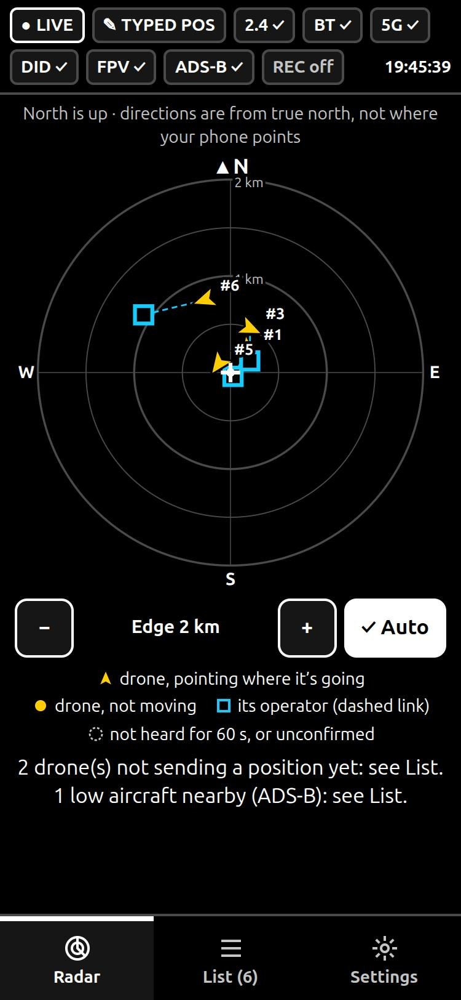
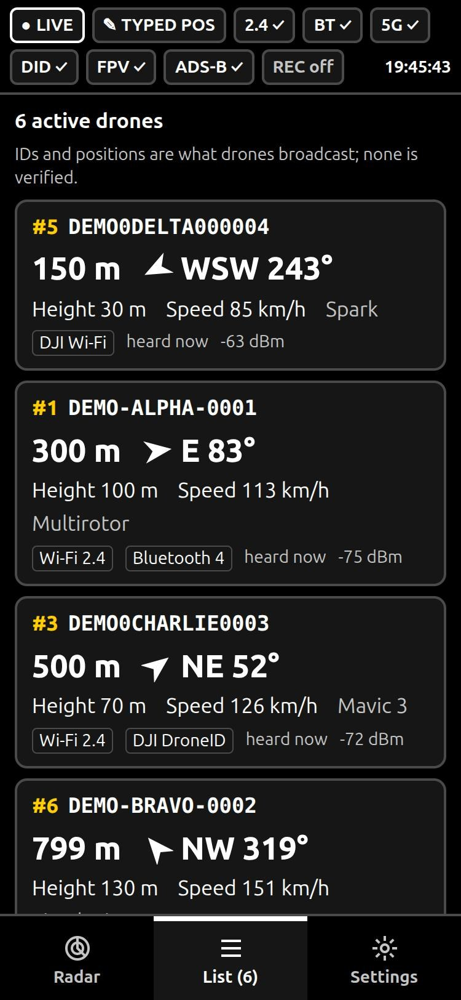

# Phone page and TAK

**Level: 🟢 Beginner** · How to see Rotorscope's drones on your phone with no app and no
internet, and (for TAK users) how it feeds a map app.

## The phone page in one paragraph

A Rotorscope hub can run its own small Wi-Fi network, a **hotspot**. Join it with any phone, and
the phone's browser opens a page showing the drones the kit hears, on a radar around you and as a
list. No app to install, no mobile data, no internet: everything comes from the hub a few metres
away. Up to four phones can join at once.

> [!IMPORTANT]
> **Which board serves it, as of 2026-11-18.** The P4 hub (the one with the 5-inch touch screen)
> has no Wi-Fi radio of its own. The phone page comes from a second, small board beside it, an
> ESP32-S3 called the **web head**, fed by one wire from the P4. The same S3 firmware also runs
> the older stand-alone S3 hub. The honest state:
>
> - An earlier version of the S3 hub's hotspot and page was tested end to end from a laptop on
>   the bench on 2026-11-09.
> - The web head has **never run on hardware**: the P4's side has been tested only by the P4
>   reading its own output (loop-back), and the S3 side and the real wire have not been tried.
> - The S3 firmware **does not currently link**: it needs about 18 KB more static memory than
>   the chip has (18,088 bytes over, measured 2026-11-18). Until that is fixed it cannot be
>   built, so the hotspot security work done since 2026-11-09 has not run on a board either.
>
> Meanwhile you can see the same page on a laptop with `rid-view --http` (below).

## Joining the hotspot

| | |
|---|---|
| Network name | `Rotorscope-` and four letters or digits, taken from the board's own hardware address, so each unit's name differs |
| Password | Each unit has its own: 12 characters in three groups, such as `abcd-efgh-jkmn` (an example, not a real one). It is made from random bytes created on the unit's first boot |
| Wi-Fi channel | 11, kept away from channel 6 where most Remote ID is sent |
| Page address | `http://192.168.4.1/` |

**Where to find the password.** Only on the web head's (or S3 hub's) USB connection, and only
while someone holds the board's **BOOT** button: connect a laptop to its USB port, wait for the
hub to start, hold BOOT, and type `h`. The line that comes back includes the password. Without
the button the line leaves it out, and the start-up messages never contain it, so a pasted log
never gives it away. Holding BOOT and typing `R` (capital) makes a new password, for when the old
one has been shared too widely. The full scheme is in
[`firmware/hub/README.md`](https://github.com/holdTheDoorHoid/rotorscope/blob/main/firmware/hub/README.md).

**The page opens by itself.** The hotspot answers every web address with its own page, the way
hotel Wi-Fi does (a **captive portal**), so most phones pop the page open as soon as they join.
If yours does not, open `http://192.168.4.1/` in the browser. Use the number, not a name: the hub
refuses requests addressed to other names, which stops a web page elsewhere on your phone from
reading or changing the hub.

## What the page shows

The page has three tabs along the bottom.




*The page at phone size, showing the made-up drones of `rid-view --demo` (see
[The phone page on a laptop](#the-phone-page-on-a-laptop)). The same page is what the hub's
hotspot serves.*

- **Radar**: drones placed around you by distance and direction, with buttons to zoom in, out,
  or automatically.
- **List**: every drone, with sections below for open FPV video links, radio signals, Wi-Fi
  drones, **Possible violations** (the [FAA rule flags](faa-flags.md), from a P4 hub), and
  **Aircraft (ADS-B)** (see [Crewed aircraft](aircraft.md)). Tap **View** on a drone for its
  details: distance and direction from you, the drone's and pilot's positions, a DJI home point,
  the operator's own text, its identity, and which radios heard it.
- **Settings**: your position, alerts for new drones (sound, vibrate, and a test button), dark or
  light theme, metric or imperial units, the hub's status, and an About section.

A strip along the top shows the state of the hub at a glance, such as whether the ADS-B receiver
is working and whether the TAK feed is switched off. A build made for bench testing shows a
striped **BENCH BUILD, NOT FOR USE** banner on every view.

**Your position.** Distances need to know where you are. A hub with a GPS knows. Otherwise type
your position under **Settings**: phone browsers only share their location with secure (HTTPS)
pages, and the hub's page is plain HTTP, so it cannot ask your phone. On a P4 kit the typed
position only affects the web head; the P4's own position comes from its GPS, or from a position
typed on the P4's USB console. See
[Position and time](../how/position-and-time.md).

What the rows and labels mean is the same as on the hub's screen: see
[Reading a detection](reading-detections.md).

---

*From here on: 🟡 Intermediate.*

## TAK: drones on a shared map

**TAK** (Team Awareness Kit; ATAK is the Android app) is a free map app used by emergency
services, search-and-rescue teams and others to share positions on a common map. Devices tell
each other where things are in short messages called **Cursor-on-Target (CoT)**: a few lines of
XML saying "this thing, this type, is here, at this time".

Rotorscope sends CoT so that a TAK device on the same network shows the drones with no setup.
On a hub, CoT comes from the same S3 firmware as the phone page, so as of 2026-11-18 only the
laptop viewer, `rid-view`, can send it (below).

| | |
|---|---|
| Where to | UDP multicast **239.2.3.1, port 6969**: ATAK's default "SA multicast" input |
| How often | Once a second |
| What | One event per drone with a position, one per pilot position, and one per crewed aircraft when the hub has an aircraft table |
| Reach | Hop limit 1: the messages stay on the network they were sent on |
| Needs | UTC time from the hub's GPS. Without it, events are skipped and counted |
| Switch | On by default. Turn it off with `m` on the hub's USB console, or with a request to the hub's `/api/cot` address; the page then shows a **TAK off** chip. The switch is shared by every phone |

Each drone appears as `drone-<its ID>` and its pilot as `pilot-<its ID>`, following the
conventions of DragonSync (the TAK bridge on a WarDragon kit), so TAK users see what they already
know. Two differences are deliberate: a detector has no basis to mark anything "friendly", so
aircraft-shaped drones get an "unknown" type; and every remark says the position is a claim,
"Claim: unverified broadcast", or "DISPUTED" with the rival position when two transmitters claim
the same ID (see [Spoofed drones](../SPOOFING.md)). From a P4 kit with a working web head, a
drone's possible FAA flags would be added to its remark; `rid-view` adds none.

**How far it is proven:** the format is checked by tests on a computer. As far as the repository
records, CoT from Rotorscope has not yet been checked in a TAK app.

### CoT from a laptop

`rid-view` can send the same CoT from a laptop, with the same code. Point it at ATAK's default
multicast:

```bash
cargo run --release -p rid-view -- --demo --own-pos 39.9526,-75.1652 --cot udp://239.2.3.1:6969
```

`--demo` makes simulated drones, so this works with no hardware. Replace it with a node's serial
port for real data. See [The laptop viewer, rid-view](rid-view.md).

### The phone page on a laptop

The same page, from a laptop, at `http://127.0.0.1:8080/`:

```bash
cargo run --release -p rid-view -- --demo --own-pos 39.9526,-75.1652 --http 127.0.0.1:8080
```

Keep it on `127.0.0.1` (the laptop itself). Any other address lets anyone on that network read
the drone table and set your position, and `rid-view` prints a warning if you do it.

## DragonSync and WarDragon

[DragonSync](https://github.com/alphafox02/DragonSync) is the program on a
[WarDragon](https://github.com/alphafox02/WarDragon) kit that passes detections on to TAK, MQTT
and other systems. It listens for detections over **ZeroMQ** (a message-passing library).
`rid-view` can publish its drones and its radio-signal alerts in the JSON DragonSync expects, so
a laptop running Rotorscope's receivers appears through an existing WarDragon setup.

```bash
cargo run --release -p rid-view -- /dev/ttyACM0 --own-pos 39.9526,-75.1652 --dragonsync tcp://127.0.0.1:4230 --dragonsync-signals tcp://127.0.0.1:4231
```

There are two ports because DragonSync reads two streams: drones, and signal alerts (FPV video,
DJI links, open FPV links). Neither has a default, so they never collide with a WarDragon's own
4224 and 4226; pick any two free ones and set DragonSync's `zmq_port` and `fpv_zmq_port` to
match. Crewed aircraft are not sent (DragonSync has its own ADS-B input). The settings and the
exact fields are in [The laptop viewer, rid-view](rid-view.md#dragonsync-wardragon-output) and in
[`tools/rid-view/README.md`](https://github.com/holdTheDoorHoid/rotorscope/blob/main/tools/rid-view/README.md).

**How far it is proven:** **Simulated only.** Checked on the laptop with a real ZeroMQ
subscriber and with DragonSync's own parsing functions run on the demo's output; not yet against
a running DragonSync or a WarDragon. The hubs do not have this output; only `rid-view` does.

## Station mode

The S3 firmware can also join an existing Wi-Fi network as a fixed sensor and serve the same page
and CoT there. It is compiled in only when the builder creates a private settings file, and it
has not been run on hardware. On that network the page is read-only unless the builder allows
changes. See
[`firmware/hub/README.md`](https://github.com/holdTheDoorHoid/rotorscope/blob/main/firmware/hub/README.md).

## Where this lives in the code

- `web/index.html`: the phone page itself.
- `crates/webui`: the page packed into the firmware, the password scheme, request checks, DHCP.
- `firmware/hub/src`: the hotspot (`hotspot.rs`), web server (`http.rs`, `api.rs`), CoT
  (`cot.rs`) and flags from the P4 (`flags.rs`).
- `firmware/hub-p4/WEBHEAD.md`: the web head and its wire.
- `crates/tracker/src/cot.rs`: the CoT events, shared by the hubs and `rid-view`.
- `tools/rid-view/src/dragonsync.rs`: the DragonSync output.

**Next:** [The laptop viewer, rid-view](rid-view.md)
