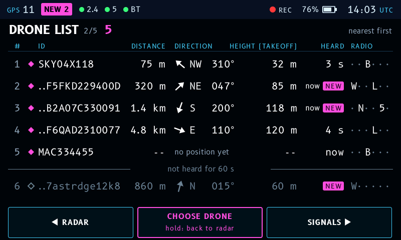
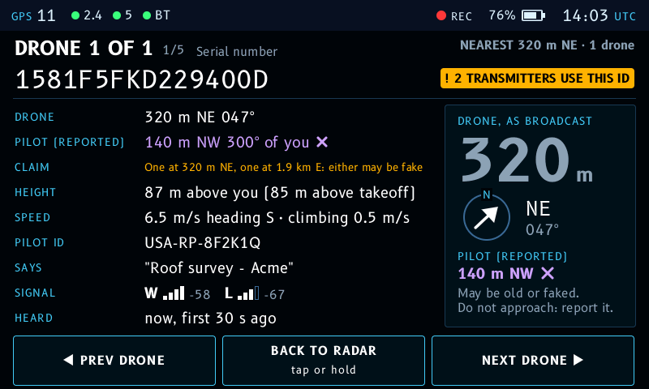
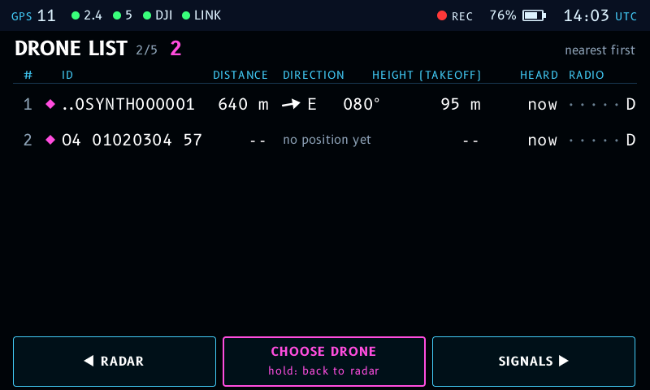
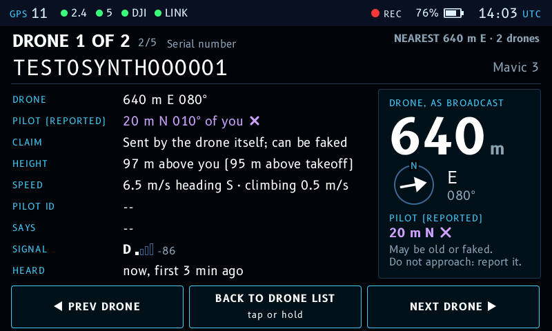
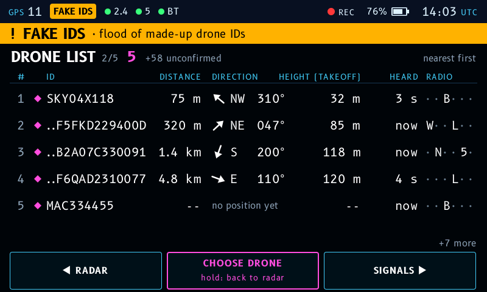
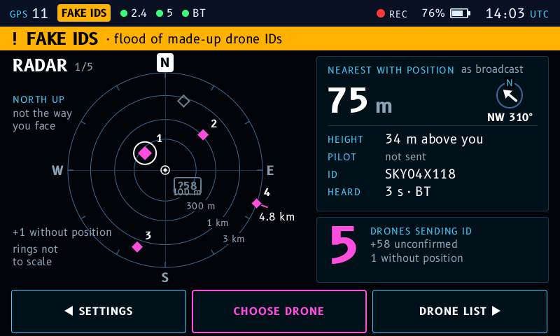

# Reading a detection

**Level: 🟢 Beginner** · What a drone's row and detail page tell you, field by field, and how
much of it you can believe.

The pictures on this page are the hub's 800 x 480 screen, drawn by the screen code itself from
made-up drones. As of 2026-11-19 this layout is **simulated only**: drawn and tested on a
computer and built into the P4 hub's firmware, but not yet looked at on the real panel. The
panel and its touch keys were checked by eye on 2026-11-14 with an earlier layout. How every
page and key works is in [The screen](screen.md); this page is about what one drone's numbers
mean.

## What a track is

A **track** is the hub's record of one drone. Every time a listening board hears a broadcast,
the hub asks "which drone is this?" and adds what it heard to that drone's track: where it
says it is, how high, how fast, who flies it, and which radios heard it. One drone is one track
and one row, however many radios hear it.

The key is the drone's **ID** (the identity in its Remote ID broadcast, usually the maker's
serial number). Until an ID arrives, a track is filed under the radio address it was heard
from, and its row shows that address. Two different IDs of the same kind are never merged into
one track.

A track goes **stale** after 60 seconds with nothing heard, and is removed after 10 minutes
(30 seconds if it was never confirmed; see below).

## The drone list, column by column

The title says **DRONE LIST**, its place among the pages (`2/6` on the P4 hub, which always has the Flags page; the
pictures, drawn without it, show `2/5`), and the number of
drones heard now. On the right it says how the rows are sorted: **nearest first** while the hub
knows where it is.

| Column | Example | Meaning |
|---|---|---|
| `#` | `1` | Place in the list. The same number labels the drone on the radar and its detail page. `?` means not yet confirmed (see below) |
| `ID` | `..F5FKD229400D` | The ID, shortened from the front when it is long (the start of a serial number is the maker's code; the end is what differs). A row like `MAC334455` has no ID yet: it is a radio address. A boxed **2 senders** beside the ID means two transmitters are using it (see below) |
| `DISTANCE` | `75 m`, `1.4 km` | Distance from the hub to where the drone says it is. `--`: it has sent no position |
| `DIRECTION` | arrow, `NW`, `310°` | Which way to look: an arrow on a north-up compass, the compass point and the bearing in degrees. "no position yet" when the drone has sent none |
| `HEIGHT (TAKEOFF)` | `32 m` | The height the drone reports, usually above where it took off. `--` if it sent none |
| `HEARD` | `now`, `3 s`, `1 min` | How long since it was last heard. A pink **NEW** mark here means it was announced in the last minute |
| `RADIO` | `W··L··` | Which radios heard it, each letter in its own fixed place; a dot where that radio did not |

The order is: confirmed drones with a position, nearest first; then drones with no position
yet; then unconfirmed ones. Below a faint line reading **not heard for 60 s** come the stale
drones, greyed, with a hollow diamond, in the same order (nearest first while the hub knows
where it is, otherwise most recently heard first). When there are more rows than
fit, the bottom right says how many more (`+7 more`).

The radio letters, always in the same order. The radar's readout uses the words in the second
column instead ("now · Wi-Fi, BT LR").

| Letter | Word on the radar | Radio | Typical sender |
|---|---|---|---|
| `W` | Wi-Fi | Wi-Fi beacon, 2.4 GHz | Remote ID modules and drones; also DJI's older Wi-Fi DroneID |
| `N` | Wi-Fi NAN | Wi-Fi NAN, 2.4 GHz (a phone-to-phone Wi-Fi mode) | Remote ID |
| `B` | BT | Bluetooth (ordinary and Bluetooth 5 extended adverts) | Remote ID |
| `L` | BT LR | Bluetooth 5 Long Range | Remote ID |
| `5` | 5 GHz | Wi-Fi on 5 GHz (beacon or NAN) | Remote ID |
| `D` | DroneID | DJI DroneID on the drone's own video and control link | DJI drones |

### New drones

Each new drone gets a banner (see [New-drone banner](screen.md#new-drone-banner)) and a **NEW**
mark in the HEARD column for a minute, so a banner you missed still leaves a trace. The time
since it was heard moves, small, to the left of the mark. While new drones arrive soon after you
dismissed a banner, they are counted in a **NEW 2** chip (a small boxed word) in the status bar
instead of a fresh banner each time.

### When the hub has no position of its own

Distances and directions are worked out on the hub from two positions: the drone's claimed one
and the hub's own (from its GPS, or one typed in). Without its own, the hub cannot say how far
anything is. The list then shows **SIGNAL** in place of DISTANCE and DIRECTION, and sorts
**newest first** (by when each drone was first heard):

The home page also changes: without a position, the hub opens on this list instead of the radar,
titled **HOME · NO POSITION**, with the drone count above it and a reminder on the right:

**Signal strength is not distance.** Bluetooth and Wi-Fi transmit at different powers, and walls,
bodies and aerials change everything. A strong signal is a hint, never a measurement. The bars
are four steps of the same number: 4 bars at -60 dBm or stronger, 3 down to -70, 2 down to -80,
1 below that (dBm: closer to zero is stronger).

## Opening a drone, and getting back

- **Touch** a row in the list, or a drone's marker or the readout card on the radar.
- **Or use the keys.** The middle key, labelled **CHOOSE DRONE**, puts a cursor on a drone; the
  left and right keys (**PREVIOUS**, **NEXT**) move it; the middle key, now **OPEN**, opens it.
- **On the detail page** the left and right keys, **PREV DRONE** and **NEXT DRONE**, step
  through the drones in list order. The middle key, **BACK TO RADAR** or **BACK TO DRONE LIST**
  (whichever page you came from), goes back with a tap or a hold. Touching the detail page itself
  only shows the hint "Tap a drone, or use the keys below". After 2 minutes with no press it goes back by itself.

The whole story is in [The three keys](screen.md#the-three-keys) and
[Drone detail](screen.md#drone-detail).

## The detail page, row by row

![The detail page for serial 1581F5FKD229400D, a Multirotor. Title DRONE 1 OF 1 1/5, Serial number; top right NEAREST 320 m NE · 1 drone. Rows: DRONE 320 m NE 047°; PILOT (REPORTED) 140 m NW 300° of you with a lavender X; CLAIM Sent by the drone itself; can be faked; HEIGHT 87 m above you (85 m above takeoff); SPEED 6.5 m/s heading S · climbing 0.5 m/s; PILOT ID USA-RP-8F2K1Q; SAYS "Roof survey - Acme"; SIGNAL W with 4 bars -58, L with 3 bars -67; HEARD now, first 30 s ago. A card on the right: DRONE, AS BROADCAST, a big 320 m, a compass rose pointing NE 047°, PILOT (REPORTED) 140 m NW, May be old or faked. Do not approach: report it. Keys: PREV DRONE, BACK TO RADAR tap or hold, NEXT DRONE](../images/screen/wide/detail.png)

**The top lines**

| Part | Example | Meaning |
|---|---|---|
| Title | `DRONE 1 OF 1` | Its place in the list, out of how many drones are listed. Beside it, the place of the page you came from (`1/6` for the radar on the P4 hub; `1/5` in the pictures) and what kind of ID it is: Serial number, Registration, UTM ID, Session ID (changes every flight), "No ID yet (radio address)", "DJI DroneID, no ID" or "ID type unknown" |
| Top right corner | `NEAREST 320 m NE · 1 drone` | The nearest drone with a position and how many are heard now, so a detail page never hides a closer drone |
| ID line | `1581F5FKD229400D` | The full ID, exactly as broadcast. A pink **NEW** mark after it if the drone was announced in the last minute. `(none)` if it has none |
| Right of the ID | `Multirotor`, `Mavic 3` | The model if DJI says it, else the kind of aircraft (Multirotor, Fixed wing, Balloon/airship, Other aircraft, Type unknown). A grey **GONE QUIET** box instead when it has not been heard for 60 seconds. An amber **! 2 TRANSMITTERS USE THIS ID** box when two transmitters claim it |

**The rows on the left**

| Row | Example | Meaning |
|---|---|---|
| **DRONE** | `320 m NE 047°` | Distance and direction from the hub to where the drone says it is. Without the hub's own position: "unknown: this hub has no GPS position". If the drone sent none: "drone sent no position" |
| **PILOT (REPORTED)** | `140 m NW 300° of you` ✕ | Where the drone says its pilot (or its take-off point) is, from you. Without the hub's position it can still say `390 m from the drone`. Or "pilot position not sent" |
| **CLAIM** | `Sent by the drone itself; can be faked` | A reminder that the two rows above, and everything else here, are what the drone **says**. If an authentication message was heard: "(auth seen, not checked)" is added. When two transmitters claim the ID it says where both are, in amber (see below) |
| **HEIGHT** | `87 m above you (85 m above takeoff)` | See [Heights](#heights) below |
| **SPEED** | `6.5 m/s heading S · climbing 0.5 m/s` | Ground speed, the direction it is moving over the ground (not necessarily the way it points), and `climbing`, `sinking` or `level`. `--` if not sent |
| **PILOT ID** | `USA-RP-8F2K1Q` | The operator's registration, if broadcast. `--` if not |
| **SAYS** | `"Roof survey - Acme"` | Free text the pilot typed, in quotation marks. Anyone can type anything. `--` if none |
| **SIGNAL** | `W` ▂▄▆█ `-58`  `L` ▂▄▆ `-67` | Each radio that heard it: its letter, signal bars and strength in dBm (closer to zero is stronger) |
| **HEARD** | `now, first 30 s ago` | When last heard, and when first heard: `3 s ago, first 2 min ago` once it has been quiet for 2 seconds or more |

**The card on the right** repeats where the drone is, large enough to read at a glance:
**DRONE, AS BROADCAST**, the distance in big figures, a compass rose with an arrow, the compass
point and degrees. Under it, **PILOT (REPORTED)** with the pilot's distance and direction from
you, and the words "May be old or faked. Do not approach: report it." When there is no distance
to show, the card says "No position sent" (the drone sent none) or "Hub has no GPS position", and
"distance unknown".

If the drone's track is removed while you are looking at it, the page says **DRONE GONE** and
"Drone no longer tracked".

### Without the hub's position, or without the drone's

If the hub has no position, everything measured *from you* disappears, but the drone-to-pilot
distance still works:

A drone heard on Bluetooth before its ID or position has arrived looks like this:

### Heights

The HEIGHT row, and the HEIGHT line on the radar's readout, lead with the height that matters to
you when the hub can work it out:

| What the hub knows | HEIGHT says |
|---|---|
| Its own height (a 3D GPS fix) and the drone's GPS height | `87 m above you (85 m above takeoff)`: its height above the hub, then the height it reports. `below you` if it is lower than the hub |
| Not its own height, or the drone sent no GPS height | `85 m above its takeoff`, or `85 m above ground` if that is what the drone reports from |
| Nothing | `--` |

The list's `HEIGHT (TAKEOFF)` column always shows the height the drone reports. Every number on
the screen has a space before its unit (`320 m`, `1.4 km`, `12 s`, `4 min`). Distances are
rounded to the metre below 100 m, to 10 m below 1 km, to 0.1 km below 10 km, then to the
whole kilometre.

### A detail page during warnings

The status bar and the warning band stay on every page, the detail page too. Warnings such as
jamming or a faked GPS change how far you can trust the numbers below them. What each means is in
[Alarms and warnings](alarms.md).

## Confirmed, unconfirmed and disputed

### Confirmed: heard twice, a second apart

Every new track starts **unconfirmed**. It becomes **confirmed** once it has been heard at least
twice, with at least one second between its first and latest frames. Remote ID repeats its
position at least once a second, so a real drone is confirmed within about two seconds. A
forger who invents hundreds of drones a second sends one frame per fake, and a single frame is
never confirmed.

Until then a track is shown quietly: a `?` instead of a number, greyed text, a hollow marker on
the radar, no **NEW** mark and no new-drone banner, and it is not counted in the big drone
number (the list title and the radar's count add `+58 unconfirmed` instead). Unconfirmed
tracks are also the first to make room when the table is full.

### Disputed: two transmitters, one ID

Nothing a drone broadcasts is signed, so anyone can send a real drone's serial with a made-up
position. The hub treats each frame as a **claim**, not an order. Once a drone has an
established path, a position that jumps impossibly far from it is not applied; it is kept aside
as a **rival claim**. If that rival keeps reporting along its own believable path while the
original carries on too, the track is **disputed**: two transmitters are claiming one ID.

What you see:

- On the detail page, **! 2 TRANSMITTERS USE THIS ID** beside the ID, and the CLAIM row saying
  where both claims are: "One at 320 m NE, one at 1.9 km E: either may be fake" (or "Two claims
  1.9 km apart: either may be fake" when one has no distance from you). The big distance is
  dimmed.
- In the list, a boxed **2 senders** beside the shortened ID.
- On the radar, when the disputed drone is the one the readout shows: **! 2 TRANSMITTERS** and
  "one ID" at the top of the readout, the big number dimmed, "! 2 senders" beside the ID, and on
  the plot the other claim drawn as the same diamond, joined to the first by a dashed line, each
  marked with a `?`.

**Disputed is not an accusation.** It does not say which transmitter is the real drone. Both
claims are drawn the same way. The hub keeps showing the claim it heard first, because showing
the newcomer would let one forged frame move a real drone. If the original goes quiet for 10
seconds and the rival carries on, the track follows the rival. Honest causes exist too: a GPS
that flicks between two answers, or two test modules set to the same serial
([Spoofed drones](../SPOOFING.md), "Known false-alarm cases").

## More you should know

### Spoof confidence

Beyond disputes, the hub runs 23 consistency checks on every track: does it fly faster than
any drone can, is its signal far too strong for the distance it claims, does its clock agree
with GPS time, and so on. Each check that fires leaves a **flag** with a confidence from 0 to
100, and the flags combine into one **score**. In plain words: under 30 means "some odd details
that honest drones also have"; the score cannot reach 30 from weak signs alone. Each time a flag
reaches 30 (and again each time it rises by 20), the hub writes a "SPOOF?" line on its console
and an entry in the [evidence log](../EVIDENCE.md). The score is in the hub's data feed (USB and the [phone
page](phone-and-tak.md) data), not on the screen. Details: [Spoofed drones](../SPOOFING.md).

### One drone, several letters

The Remote ID rules let a drone send the same messages over several radios at once: Bluetooth,
Bluetooth Long Range, Wi-Fi beacon, Wi-Fi NAN. The hub merges them by ID, so you see one row
with several letters, each with its own signal on the detail page. A Bluetooth 4 advert carries
one message at a time, so a drone can briefly appear as a radio address (`MAC334455`) before its
ID arrives and the row joins its track.

### Why 2.4 and 5 GHz Wi-Fi are kept apart

A drone heard by both the 2.4 GHz listener and the 5 GHz listener keeps a separate record for
each band, shown as `W` and `5`, each with its own strength and channel. Kept together, the two
bands' readings would overwrite each other and only one band would ever show.

### DJI DroneID rows

DJI drones also send their own **DroneID** on their video and control link, heard by the DroneID
listener (letter `D`). A readable DroneID record carries the same serial the drone uses for
Remote ID, so both join one track. Its position is used only when the Remote ID position is
more than 3 seconds old. DJI's height is from a barometer (air pressure).

Newer DJI **O4** drones encrypt DroneID. Without a key the hub can read only a session number,
so the row shows an O4 session number (the list shortens it, as in `O4 01020304 57` below),
has no position, and its ID type is "DJI DroneID, no ID": it tells you a DJI O4 drone is near,
not where.

### Changed IDs (continuity)

Some drones get a new **session ID** every flight, which is normal and legal. When a new
identity appears right where an old one stopped, the hub links the two as "probably the same
drone". If the ID changed in mid-flight, which is suspicious, that adds a flag. The link shows
in the data feed and TAK remarks, not on the screen.

### Not drones: video links and radio emitters

Open-source digital video links (wfb-ng/OpenIPC, OpenHD, RubyFPV, DroneBridge) are kept in their
own table, never as drones, and their identifiers are hidden unless the hub was built to show
them; they are listed on the phone page, which the P4 kit does not have yet. Analog video, control links and other radio emitters
have no position and appear on the [Signals page](screen.md#signals).

### A flood of fake IDs

If far more new IDs appear than a real sky produces, the hub raises a **flood** warning. The
status bar shows a **FAKE IDS** chip, the amber warning band reads "FAKE IDS · flood of made-up
drone IDs", and the drone count adds `+58 unconfirmed`. The unconfirmed rows (marked `?`) are
then mostly fakes. Confirmed drones stay at the top of the list, and the fakes fall below them
(here past the bottom of the page, counted as `+7 more`).

On the radar, fakes that claim to be right on top of the hub (within 20 m), and those the screen
had no room to list, are drawn as one boxed count such as `?58` near the centre instead of a
pile of markers:

## How much should I trust this?

- **Every field is a claim.** Remote ID and DroneID are unsigned broadcasts. The hub checks
  that the story hangs together; it cannot prove it is true.
- **The pilot position** may be where the drone took off, not where the pilot stands now.
- **Height** is usually above take-off, not above the ground under the drone. "Above you" needs
  both GPS heights, the drone's and the hub's.
- **Distances are only as good as two GPS fixes**, the drone's and the hub's.
- **Silence is not proof of an empty sky.** A drone without Remote ID, or out of range, or
  drowned out by jamming, is not shown. When the hub knows it may be missing drones it says so
  (a **JAMMED** chip and "JAMMING · drones may be missed"; see [Alarms and warnings](alarms.md)).
- **How far this is proven.** As of 2026-11-18 Rotorscope has **not yet heard a real drone**.
  Remote ID is **proven on the air** from the project's own test transmitter and a laptop's
  Bluetooth; DJI DroneID is **proven on recordings** of real drones; the spoofing, dispute and
  flood logic is **simulated only**. See [What it can and cannot do today](../start/capabilities.md).

## Where this lives in the code

- [`crates/tracker`](https://github.com/holdTheDoorHoid/rotorscope/tree/main/crates/tracker):
  tracks and merging (`src/lib.rs`), confirmation (`src/probation.rs`), disputes
  (`src/claims.rs`), spoof checks (`src/spoof.rs`), ID changes (`src/continuity.rs`), DJI
  (`src/dji.rs`)
- [`crates/screen/src/wide/pages.rs`](https://github.com/holdTheDoorHoid/rotorscope/blob/main/crates/screen/src/wide/pages.rs):
  how the P4's list rows and detail page are drawn, and every word on them
- [`crates/screen/src/model.rs`](https://github.com/holdTheDoorHoid/rotorscope/blob/main/crates/screen/src/model.rs):
  what the screen knows about each drone, the radio letters and the list order;
  [`src/from_tracker.rs`](https://github.com/holdTheDoorHoid/rotorscope/blob/main/crates/screen/src/from_tracker.rs)
  turns tracks into rows
- [`crates/screen/src/draw.rs`](https://github.com/holdTheDoorHoid/rotorscope/blob/main/crates/screen/src/draw.rs):
  rounding of distances, ages and shortened IDs

**Next:** [Alarms and warnings](alarms.md)
