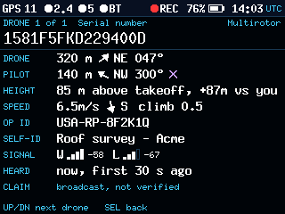
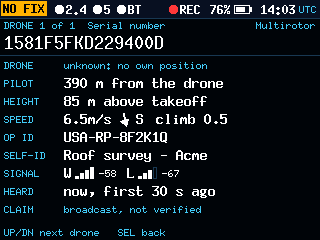
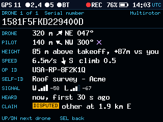
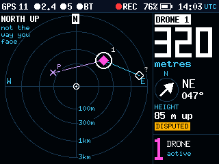
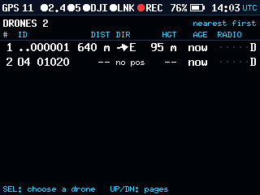
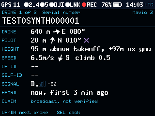
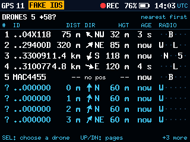

# Reading a detection

**Level: 🟢 Beginner** · What a drone's row and detail page tell you, field by field, and how
much of it you can believe.

## What a track is

A **track** is the hub's record of one drone. Every time a listening board hears a broadcast,
the hub asks "which drone is this?" and adds what it heard to that drone's track: where it
says it is, how high, how fast, who flies it, and which radios heard it. One drone is one track
and one row, however many radios hear it.

The key is the drone's **ID** (the identity in its Remote ID broadcast, usually the maker's
serial number). Until an ID arrives, a track is filed under the radio address it was heard
from, and its row shows that address. Two different IDs of the same kind are never merged into
one track.

A track goes **stale** after 60 seconds with nothing heard, and is removed after 10 minutes
(30 seconds if it was never confirmed; see below).

## The list, column by column

| Column | Example | Meaning |
|---|---|---|
| `#` | `1` | Place in the list, nearest first. The same number labels it on the radar. `?` means not yet confirmed |
| `ID` | `..04X118` | The end of the ID (the start is the maker's code). `!` in front means **disputed**. A row like `MAC4455` has no ID yet: it is a radio address |
| `DIST` | `75m` | Distance from the hub to where the drone says it is. `--` and `no pos`: it sent no position |
| `DIR` | `↖ NW` | Which way to look, as an arrow on a north-up compass and a compass point |
| `HGT` | `32m` | The height the drone reports (usually above where it took off) |
| `AGE` | `now`, `3s`, `1m` | Time since it was last heard |
| `RADIO` | `W··L·` | Which radios heard it; a dot where one did not |

The radio letters, always in the same order:

| Letter | Radio | Typical sender |
|---|---|---|
| `W` | Wi-Fi beacon, 2.4 GHz | Remote ID modules and drones; also DJI's older Wi-Fi DroneID |
| `N` | Wi-Fi NAN, 2.4 GHz (a phone-to-phone Wi-Fi mode) | Remote ID |
| `B` | Bluetooth (ordinary and Bluetooth 5 extended adverts) | Remote ID |
| `L` | Bluetooth 5 Long Range | Remote ID |
| `5` | Wi-Fi on 5 GHz (beacon or NAN) | Remote ID |
| `D` | DJI DroneID on the drone's own video and control link | DJI drones |

## The detail page, row by row

| Row | Example | Meaning |
|---|---|---|
| Header | `DRONE 1 of 1  Serial number` | Its place in the list, and what kind of ID it is: serial number, registration, UTM ID, session ID (changes every flight), "No ID yet (radio address)" or "DJI DroneID, no ID" |
| Top right | `Multirotor`, `Mavic 3`, **STALE** | The model if DJI says it, else the kind of aircraft. **STALE** when not heard for a minute |
| ID | `1581F5FKD229400D` | The full ID, exactly as broadcast |
| **DRONE** | `320m ↗ NE 047°` | Distance and direction from the hub. Without the hub's own position: "unknown: no own position". If the drone sent none: "drone sent no position" |
| **PILOT** | `140m ↖ NW 300° ✕` | Where the drone says its pilot (or its take-off point) is. Without the hub's position it can still say `390m from the drone`. Or "pilot position not sent" |
| **HEIGHT** | `85m above takeoff, +87m vs you` | Reported height, and what it is measured from (take-off or ground). "vs you" is its height above the hub, shown only when the hub knows its own height (a 3D GPS fix) and the drone sent its GPS height |
| **SPEED** | `6.5m/s ↓ S climb 0.5` | Ground speed, the direction it is moving (not the way it points), and climb, sink or level in metres a second |
| **OP ID** | `USA-RP-8F2K1Q` | The operator's registration, if broadcast. `--` if not |
| **SELF-ID** | `Roof survey - Acme` | Free text the pilot typed. Anyone can type anything |
| **SIGNAL** | `W ▂▄▆ -58  L ▂▄ -67` | Each radio that heard it, with bars and strength in dBm (closer to zero is stronger) |
| **HEARD** | `now, first 30s ago` | When last heard, and when first heard |
| **CLAIM** | `broadcast, not verified` | A reminder that every row above is what the drone **says**. See below |

Distances and directions are worked out on the hub from two positions: the drone's claimed one
and the hub's own (from its GPS, or one typed in). If the hub has no position, everything
measured *from you* disappears, but the drone-to-pilot distance still works:

**Signal strength is not distance.** Bluetooth and Wi-Fi transmit at different powers, and walls,
bodies and aerials change everything. A strong signal is a hint, never a measurement.

## Confirmed, unconfirmed and disputed

### Confirmed: heard twice, a second apart

Every new track starts **unconfirmed**. It becomes **confirmed** once it has been heard at least
twice, with at least one second between its first and latest frames. Remote ID repeats its
position at least once a second, so a real drone is confirmed within about two seconds. A
forger who invents hundreds of drones a second sends one frame per fake, and a single frame is
never confirmed.

Until then a track is shown quietly: a `?` instead of a number, dim text, a hollow marker on
the radar, no new-drone banner, and it is not counted in the big drone number. Unconfirmed
tracks are also the first to make room when the table is full.

### Disputed: two transmitters, one ID

Nothing a drone broadcasts is signed, so anyone can send a real drone's serial with a made-up
position. The hub treats each frame as a **claim**, not an order. Once a drone has an
established path, a position that jumps impossibly far from it is not applied; it is kept aside
as a **rival claim**. If that rival keeps reporting along its own believable path while the
original carries on too, the track is **disputed**: two transmitters are claiming one ID.

What you see: `!` before the ID in the list, a **DISPUTED** box in the radar readout and on the
CLAIM row with where the other claim is, and on the radar the other claim as a hollow **?**
diamond joined to the shown one.

**Disputed is not an accusation.** It does not say which transmitter is the real drone. The hub
keeps showing the claim it heard first, because showing the newcomer would let one forged frame
move a real drone. If the original goes quiet for 10 seconds and the rival carries on, the
track follows the rival. Honest causes exist too: a GPS that flicks between two answers, or two
test modules set to the same serial ([Spoofed drones](../SPOOFING.md), "Known false-alarm
cases").

## More you should know

### Spoof confidence

Beyond disputes, the hub runs 23 consistency checks on every track: does it fly faster than
any drone can, is its signal far too strong for the distance it claims, does its clock agree
with GPS time, and so on. Each check that fires leaves a **flag** with a confidence from 0 to
100, and the flags combine into one **score**. In plain words: under 30 means "some odd details
that honest drones also have"; the score cannot reach 30 from weak signs alone. Each time a flag
reaches 30 (and again each time it rises by 20), the hub writes a "SPOOF?" line on its console
and an entry in the [evidence log](../EVIDENCE.md). The score is in the hub's data feed (USB and the [phone
page](phone-and-tak.md) data), not on the screen. Details: [Spoofed drones](../SPOOFING.md).

### One drone, several letters

The Remote ID rules let a drone send the same messages over several radios at once: Bluetooth,
Bluetooth Long Range, Wi-Fi beacon, Wi-Fi NAN. The hub merges them by ID, so you see one row
with several letters, each with its own signal on the detail page. A Bluetooth 4 advert carries
one message at a time, so a drone can briefly appear as a radio address (`MAC4455`) before its
ID arrives and the row joins its track.

### Why 2.4 and 5 GHz Wi-Fi are kept apart

A drone heard by both the 2.4 GHz listener and the 5 GHz listener keeps a separate record for
each band, shown as `W` and `5`, each with its own strength and channel. Kept together, the two
bands' readings would overwrite each other and only one band would ever show.

### DJI DroneID rows

DJI drones also send their own **DroneID** on their video and control link, heard by the DroneID
listener (letter `D`). A readable DroneID record carries the same serial the drone uses for
Remote ID, so both join one track. Its position is used only when the Remote ID position is
more than 3 seconds old. DJI's height is from a barometer (air pressure).

Newer DJI **O4** drones encrypt DroneID. Without a key the hub can read only a session number,
so the row says something like `DJI O4 01020304` (or, on a hub set to hide DroneID identifiers,
`DJI O4` and its frequency in MHz), has no position, and its
type is "DJI DroneID, no ID": it tells you a DJI O4 drone is near, not where.

### Changed IDs (continuity)

Some drones get a new **session ID** every flight, which is normal and legal. When a new
identity appears right where an old one stopped, the hub links the two as "probably the same
drone". If the ID changed in mid-flight, which is suspicious, that adds a flag. The link shows
in the data feed and TAK remarks, not on the screen.

### Not drones: video links and radio emitters

Open-source digital video links (wfb-ng/OpenIPC, OpenHD, RubyFPV, DroneBridge) are kept in their
own table, never as drones, and their identifiers are hidden unless the hub was built to show
them; they are listed on the phone page, which the P4 kit does not have yet. Analog video, control links and other radio emitters
have no position and appear on the [Signals page](screen.md#signals).

### The flood state

If far more new IDs appear than a real sky produces, the hub raises a **flood** alarm. The
status bar says **ID FLOOD**, the drone count adds `+58?`, and the unconfirmed rows (marked `?`)
are then mostly fakes. Confirmed drones stay at the top.

## How much should I trust this?

- **Every field is a claim.** Remote ID and DroneID are unsigned broadcasts. The hub checks
  that the story hangs together; it cannot prove it is true.
- **The pilot position** may be where the drone took off, not where the pilot stands now.
- **Height** is usually above take-off, not above the ground under the drone or above you.
- **Distances are only as good as two GPS fixes**, the drone's and the hub's.
- **Silence is not proof of an empty sky.** A drone without Remote ID, or out of range, or
  drowned out by jamming, is not shown. When the hub knows it may be missing drones it says so
  (**JAMMED**; see [Alarms and warnings](alarms.md)).
- **How far this is proven.** As of 2026-11-18 Rotorscope has **not yet heard a real drone**.
  Remote ID is **proven on the air** from the project's own test transmitter and a laptop's
  Bluetooth; DJI DroneID is **proven on recordings** of real drones; the spoofing, dispute and
  flood logic is **simulated only**. See [What it can and cannot do today](../start/capabilities.md).

## Where this lives in the code

- [`crates/tracker`](https://github.com/holdTheDoorHoid/rotorscope/tree/main/crates/tracker):
  tracks and merging (`src/lib.rs`), confirmation (`src/probation.rs`), disputes
  (`src/claims.rs`), spoof checks (`src/spoof.rs`), ID changes (`src/continuity.rs`), DJI
  (`src/dji.rs`)
- [`crates/screen/src/render.rs`](https://github.com/holdTheDoorHoid/rotorscope/blob/main/crates/screen/src/render.rs):
  how each row is drawn; `src/from_tracker.rs` turns tracks into rows

**Next:** [Alarms and warnings](alarms.md)
