# The screen

**Level: 🟢 Beginner, then 🔴 Expert** · A guided tour of every page the hub's screen shows, what
each mark on it means, and what each key and touch does. The expert corner at the end is marked.

The **hub** is the board with the screen: it gathers what every listening board hears (see the
[glossary](../project/glossary.md) for any unfamiliar word). This page describes the screen of
the **P4 hub**, a 5-inch touch screen 800 dots wide and 480 dots tall. The pictures are drawn by
the screen code itself, from made-up drones, at 800 by 480 dots.

**How far this is proven.** The layout pictured here is **simulated only**: it is drawn and tested
on a computer and built into the hub's firmware, but as of 2026-11-19 nobody has looked at it on
the real panel. The panel and its touch were confirmed by eye on 2026-11-14 with the hub's
earlier layout. The brightness control has not been checked on the panel either.

## Which screen you have

Two hubs have been built. This page is about the P4 hub; the S3 hub is the older one.

| | P4 hub (the current one) | S3 hub (the first one) |
|---|---|---|
| Screen | 5-inch touch screen, 800 x 480 | 2.0- or 2.8-inch panel, 320 x 240 |
| How you press | Three touch keys along the bottom, each labelled with what it does right now. You can also touch a drone, a list row, a settings row or the banner | Three push buttons: Up, Down, Select (hold Select for 0.7 seconds to go back) |
| Sound | None: the P4 has no buzzer and never beeps | A buzzer beeps on a new drone |
| Status, as of 2026-11-19 | Builds and runs | Its firmware does not link (over its memory budget; see [Bench tests](../BENCH.md)) |

Both draw the same pages from the same code. The small screen packs them into 320 x 240 with a
plainer font; everything below describes the P4's layout.

From top to bottom, every page has the same parts:

1. The **status bar**: GPS, warnings, listening boards, recording, power and the time.
2. The **warning band**: an amber band that appears under the status bar while anything is
   wrong.
3. The **page** itself, starting with its **title**. The title carries the page's place in the
   cycle, such as `RADAR 1/6`. Most pictures on this page were drawn without the Flags page, so
   they say `1/5`; the P4 always has its Flags page, so on the hub the radar is `1/6`.
4. The **fault bar** and **notes lines**, just above the keys, when there is something that must
   stay in view.
5. The **three keys**.

## The three keys

The bottom strip holds three touch keys: **the left key, the middle key and the right key**. They
are not buttons you can feel; each one is a labelled area of the screen. The label always says
what that key does on the screen showing, so read it before you press.

- **The left and right keys** act as soon as your finger touches them. Each touch is one press;
  holding them does not repeat.
- **The middle key** acts when you lift your finger (a **tap**). If you keep your finger on it for
  **1 second** instead, that is a **hold**: a bar along the bottom of the key fills up while you
  hold, and the hold fires when it is full. Its small second line tells you what holding does
  (`hold: back to radar`, `hold: stop choosing`, `hold: finish`), or says `tap or hold` where
  both do the same thing.
- The page's main action is drawn in the highlight colour; a key that only goes back is drawn
  plain. A key that does nothing right now is drawn faint.

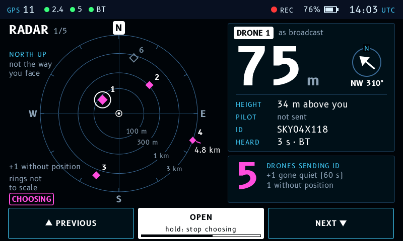

What the keys say, page by page:

| Where you are | Left key | Middle key: tap | Middle key: hold | Right key |
|---|---|---|---|---|
| Any page (browsing) | The previous page's name, such as `SETTINGS` | The page's own action (see each page below) | Back to the radar | The next page's name, such as `DRONE LIST` |
| Choosing a drone | `PREVIOUS` | `OPEN`: that drone's detail | Stop choosing | `NEXT` |
| A drone's detail | `PREV DRONE` | `BACK TO RADAR` (or drone list, or flags) | The same | `NEXT DRONE` |
| The new-drone banner | `DISMISS` | `SHOW DETAILS` | Dismiss | `DISMISS` |
| Scrolling Signals | `SCROLL UP` | `DONE` | The same | `SCROLL DOWN` |
| Choosing a flag | `PREVIOUS` | `OPEN DRONE` | Back to the Flags page | `NEXT` |
| Editing settings | `UP` | Change the row (see [Settings](#settings)) | Finish editing | `DOWN` |

The pages go round in a loop: **Radar**, **Drone list**, **Flags**, **Signals**, **Health**,
**Settings**, then back to Radar. The left and right keys step through them. Flags is in the loop
only on a hub with flags to show; the P4 always has it. After each step the page's title turns
inverse (its text and background colours swap) for 1.5 seconds, so you can see which page you
landed on.

**Timeouts.** Choosing a drone, choosing a flag, scrolling Signals and editing settings all give up
after **30 seconds** without a press and go back to plain browsing. A drone's detail page goes
back by itself after **2 minutes**.

## Touching the page

You can also touch the page above the keys.

| You touch | What happens |
|---|---|
| A drone's marker on the radar | Opens that drone's detail. A finger may miss the marker by about 26 dots; if two are in reach, the nearer wins |
| The radar's readout card (the right-hand card) | Opens the drone the card describes |
| A row of the drone list | Opens that drone's detail |
| A row of the Flags page | Opens the flagged drone's detail, when it is a drone the hub is still tracking |
| A settings row | The first tap starts editing and chooses that row, without changing anything. A second tap on the same row changes it, as the middle key would |
| The new-drone banner | Shows that drone's detail. A tap anywhere else on the page only dismisses the banner |
| Anything else, including the detail page | Nothing changes. The title says "Tap a drone, or use the keys below" for 2.5 seconds, and a line flashes along the top of the keys |

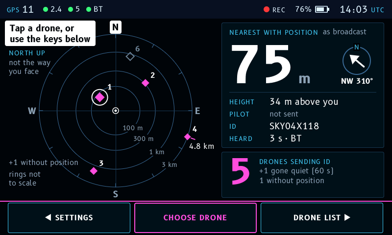

The rules for a touch:

- A tap counts when you **lift** your finger, where it went down.
- A touch that **moves** more than 20 dots before you lift is ignored, so brushing the screen does
  nothing.
- A touch that began before the screen last changed (a new page, a new mode, the banner
  appearing) is ignored, so the screen cannot change under your finger and act on the new page.
- The row or marker you tapped lights up briefly to show what was hit.

## The status bar

The bar along the top is on every page. A small boxed word in it is a **chip**: dark letters on
an amber box. Chips are warnings; anything plain is normal. Read the bar from left to right; the
right-hand end is fixed and the left fills up.

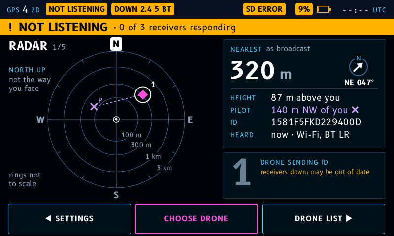

**Left: where the hub is**

| You see | Meaning |
|---|---|
| `GPS 11` | The hub's own GPS has a fix from 11 satellites |
| `GPS 4` and a small `2D` | A weaker, flat fix: no height |
| `POS TYPED` | No GPS fix, but a typed-in position is in use, so distances still work |
| **NO FIX** chip | A GPS receiver is there but has no fix: no distances or directions |
| **NO GPS** chip | No GPS receiver found |
| **GPS FAKE?** or **GPS FAKE** chip | The hub's own GPS may be, or is, being faked ([Alarms and warnings](alarms.md)) |
| **GPS JAM?** or **GPS JAM** chip | The hub's own GPS may be, or is, being jammed |

**Middle: warnings, new drones and listening boards**

| You see | Meaning |
|---|---|
| **NOT LISTENING** | No drone receiver is answering at all |
| **PLANE NEAR** | A drone is close to a crewed aircraft ([Crewed aircraft](aircraft.md)) |
| **JAMMED** | A listening board is jammed or blinded: drones may be missed |
| **AREA GPS FAKE** | Positions of drones and aircraft around the hub jumped together: GPS in the area may be faked |
| **FAKE IDS** | A flood of made-up drone IDs |
| **FLAG** | A flight may break an FAA rule at the most serious level ([FAA rule flags](faa-flags.md)) |
| **AREA GPS JAM** | Aircraft around the hub report GPS jamming |
| **ATTACK** | Another alarm is sounding, such as an attack on Wi-Fi or Bluetooth nearby ([Alarms and warnings](alarms.md)) |
| **5 DOWN**, or **DOWN 2.4 5 BT** | Listening boards that have stopped reporting, by name |
| **NEW 2** (in the highlight colour) | Two new drones arrived soon after you dismissed a banner (see [New-drone banner](#new-drone-banner)) |
| `● 2.4  ● 5  ● BT` | One dot per listening board that is answering, with its label |
| A hollow ring instead of a dot, label in amber | That board answers but hears nothing at all |
| `+3` | Three more items that did not fit |

The labels: `2.4` and `5` are Wi-Fi listeners, `BT` Bluetooth, `DJI` the DJI DroneID listener,
`FPV` the video-link scanner, `LINK` the gateway that relays wireless boards, `PLANES` an ADS-B
aircraft receiver and `LR` a long-range radio board.

The P4 always lists its ADS-B input. With no ADSBee wired to it (none is, as of 2026-11-19) you
will see a **PLANES DOWN** chip and the band will say "PLANE RECEIVER DOWN". That is expected,
not a fault: the hub is telling you it cannot hear aircraft.

**Right: recording, power and time**

| You see | Meaning |
|---|---|
| `● REC` | The memory-card log is recording |
| `no SD` (small, dim) | No card. Allowed; not a fault |
| **SD ERROR** chip | The card is failing: nothing is being recorded |
| **NO EVIDENCE** chip | The plain log records, but the [evidence log](../EVIDENCE.md) is not being written |
| `USB` | Running from USB. The P4 always says this: its battery level is not wired up |
| `76%` and a battery | Battery level. At 15% or less it becomes a chip |
| `14:03 UTC` | World time from GPS, not your local time. `--:--` means no time yet |

## The warning band

While anything makes the screen partly blind or its numbers doubtful, an amber band appears under
the status bar on **every** page. It shows the most important warning in words: a bold heading,
then what it means for you. If there are others, it ends in `+4 more`, and each of them is also a
chip in the status bar. An empty radar never reads as "all clear" while the band is up.

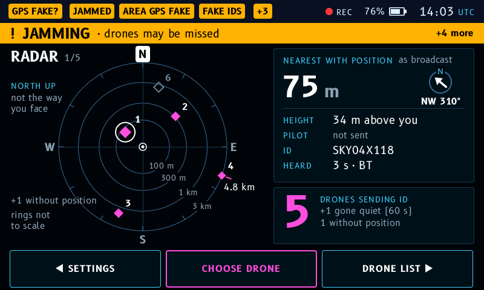

The warnings, most important first. Only the first one that holds is written in the band.

| The band says | What it means | What to do |
|---|---|---|
| **NOT LISTENING** · 0 of 3 receivers responding (or "no receivers reported") | No drone receiver is answering. The hub hears nothing | Open [Health](#health) to see which boards are down; check their power, cable and range |
| **DRONE 240 m FROM N911PH** (or DRONE NEAR A PLANE) · a crewed aircraft is close to a drone | A drone and a crewed aircraft are close together | See [Crewed aircraft](aircraft.md) |
| **JAMMING** · drones may be missed | A listening board is jammed or blinded | Treat an empty radar as "unknown", not "clear". See [Alarms and warnings](alarms.md) |
| **GPS MAY BE FAKED** · distances may be wrong | The hub's own GPS looks faked | Do not trust distances or directions. See [Alarms and warnings](alarms.md) |
| **AREA GPS FAKED** · drone positions may be wrong | Drone and aircraft positions around the hub jumped together | Do not trust where drones say they are |
| **FAKE IDS** · flood of made-up drone IDs | Someone is broadcasting many invented drones | See [Reading a detection](reading-detections.md#a-flood-of-fake-ids) |
| **POSSIBLE SERIOUS RULE ISSUE** · see Flags | A flight may break an FAA rule at the most serious level | Open the [Flags](#flags) page |
| **5 GHz RECEIVER DOWN** · drones on 5 GHz won't be heard (or **2 RECEIVERS DOWN** · drones on them won't be heard) | Some, not all, receivers have stopped reporting | Open [Health](#health); check that board's power, cable and range |
| **AREA GPS JAMMED** · drones may send no position | Aircraft around the hub report GPS jamming | Expect drones without a position |
| **GPS JAMMED** · hub position and time may be old | The hub's own GPS looks jammed | Distances may be out of date |
| **NO POSITION** · distances and directions unavailable | The hub has no position of its own | The home page becomes a list (see [Drone list](#drone-list)) |

What each alarm means, and why it may be a false one, is on
[Alarms and warnings](alarms.md).

## Radar

The home page, `RADAR 1/6`. It answers "is there a drone, how far, which way?" at a glance.

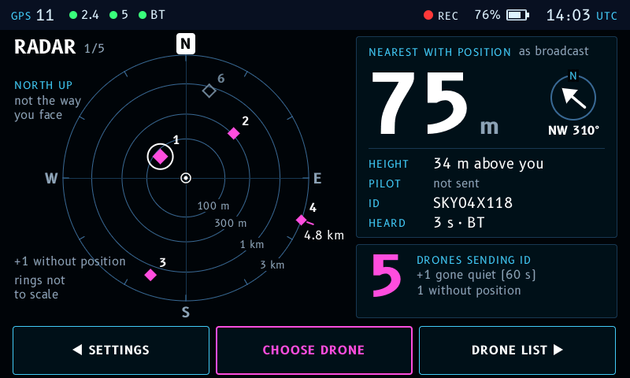

**The plot, on the left**

- **North is always up.** The radar does not turn with you; the hub has no compass. The corner
  says `NORTH UP / not the way you face`, and a boxed **N** marks the top. If you face east, a
  drone straight ahead of you is drawn on the right.
- **You** are the ring with a dot in the middle (deliberately not an arrow: the hub does not know
  which way you face).
- **Range rings** at 100 m, 300 m, 1 km and 3 km, each labelled. The scale is squeezed outwards,
  so near drones get room and far ones still fit; the corner says `rings not to scale`. It never
  rescales, so a spot on the plot always means the same distance.

| Mark | Meaning |
|---|---|
| Filled diamond | A drone heard in the last minute |
| Hollow grey diamond | A drone not heard for 60 seconds, or one not yet confirmed (marked `?`) |
| Bigger diamond with a ring round it | The drone the readout card describes |
| Number beside it | Its place in the drone list (1 is nearest), so "drone 2" is the same drone on every page. Only the first nine are numbered |
| Diamond on the outer ring with a distance, such as `4.8 km` | A drone more than 3 km away, placed in its direction |
| An **X** marked **P** (lavender in Glass Cockpit), joined by a dashed line | The pilot of the ringed drone, where the drone says the pilot is |
| Diamond joined by a dashed line, both marked **?** | Two transmitters claim the same ID at different places: see [disputes](reading-detections.md#confirmed-unconfirmed-and-disputed) |
| **NEW** beside a number | A drone that arrived in the last minute |
| `+1 without position` | Drones heard that sent no position, so cannot be placed |

**The readout card, on the right**

The top card describes the nearest drone that sent a position (`NEAREST WITH POSITION` when some
drones sent none), "as broadcast": what the drone says, which could be false. It shows the
distance in big digits with the unit, an arrow in a small compass with the compass point and
degrees (`NW 310°`), then **HEIGHT**, **PILOT**, **ID** and **HEARD** (how long ago, and on
which radio). The lower card counts the drones sending an ID, with how many have gone quiet.

With no drone it says "No drone IDs heard. Drones without Remote ID may only show on Signals."
If something is wrong it says so instead of looking calm: `NOT LISTENING: no receivers answering`,
`JAMMED: drones may be missed` or `NOT ALL RECEIVERS LISTENING`. When radio links without an ID
were heard, the count card adds a line such as `+8 radio links, no ID: see Signals`.

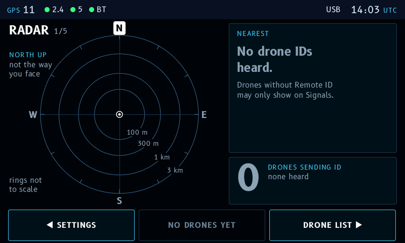

**Keys on the radar**

| Key | Does |
|---|---|
| Left, `SETTINGS` | Go to the Settings page (the loop wraps round) |
| Middle, `CHOOSE DRONE` | Start choosing a drone. With no drones it reads `NO DRONES YET` and does nothing |
| Right, `DRONE LIST` | Go to the Drone list |

**Choosing a drone.** Tap the middle key, labelled CHOOSE DRONE. A cursor lands on the nearest
drone (or on the one you looked at last), and a **CHOOSING** box appears at the bottom left. The
left key, PREVIOUS, and the right key, NEXT, move the cursor through the drones in list order. The
readout card then describes the chosen drone and says so in an inverse box, **DRONE 3**, instead
of NEAREST, so a forgotten cursor cannot pass for the nearest drone. Tap the middle key, labelled
OPEN, to see its detail; hold it to stop choosing. After 30 seconds without a press, choosing
stops by itself.

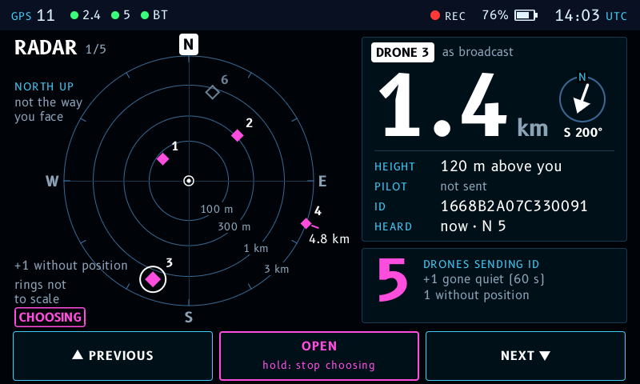

You can skip choosing: touch a drone's marker, or the readout card, to open its detail at once.

## Drone list

`DRONE LIST 2/6`: every drone in rows, with the count of active drones beside the title and the
sort order at the right (`nearest first`). Drones not heard for 60 seconds go below a
`not heard for 60 s` divider.

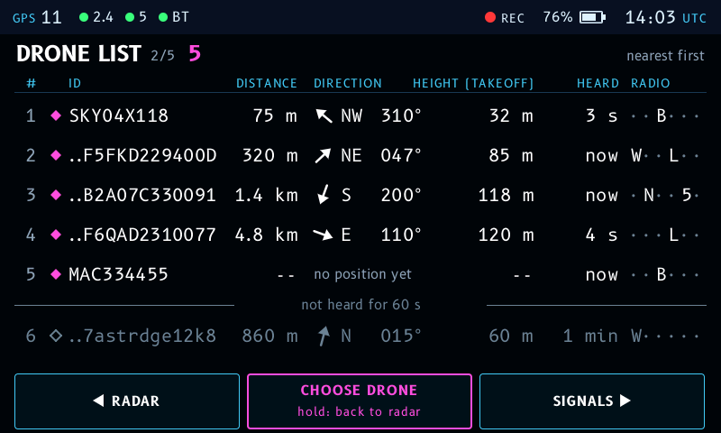

The columns are `#`, `ID`, `DISTANCE`, `DIRECTION`, `HEIGHT (TAKEOFF)`, `HEARD` and `RADIO`. What
each one means is explained in [Reading a detection](reading-detections.md#the-drone-list-column-by-column).
A drone that arrived in the last minute shows **NEW** in its HEARD column. When there are more
rows than fit, the bottom right says `+1 more`.

| Key | Does |
|---|---|
| Left, `RADAR` | Back to the radar |
| Middle, `CHOOSE DRONE` (hold: back to radar) | Start choosing: the chosen row is outlined with an arrow; then PREVIOUS / NEXT move, OPEN shows the detail, hold stops choosing |
| Right, `FLAGS` on the P4 (`SIGNALS` in the picture, drawn without flags) | The next page |

Touch any row to open that drone's detail.

**Without a position of its own** the hub cannot work out distances or directions. The warning
band says **NO POSITION**, and the home page is no longer a radar but a list titled
`HOME · NO POSITION`. It is sorted newest first, and shows signal strength as bars and dBm where
the distance would be, with the reminder "signal strength is not distance (Wi-Fi and Bluetooth
send at different powers)". The Drone list page shows the same rows, newest first, without the
count card or that reminder.

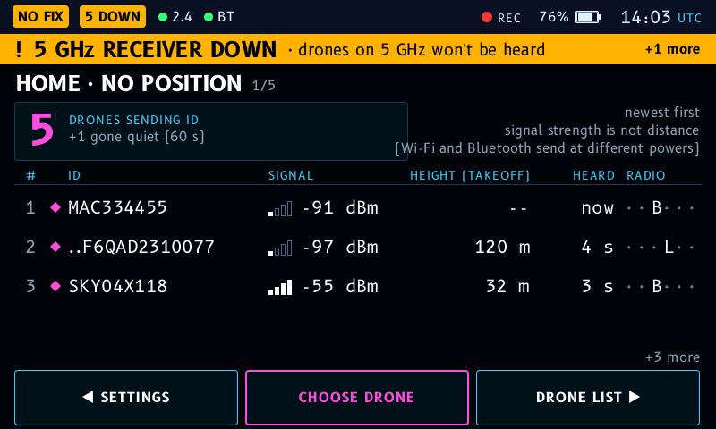

## Drone detail

Everything known about one drone. You reach it from the radar, the list, a flag, a touch or the
banner.

- **The title** says which drone this is, `DRONE 1 OF 1`, and the kind of ID (`Serial number`).
  At the top right, `NEAREST 320 m NE · 1 drone` keeps the overall picture in view, so a detail
  page never hides a closer drone.
- **The full ID** in large letters, with the drone's model or type at the right (`Multirotor`).
  A drone that has gone quiet says **GONE QUIET** there; one whose ID two transmitters are using
  says **! 2 transmitters use this ID**.
- **The rows** on the left: DRONE, PILOT (REPORTED), CLAIM, HEIGHT, SPEED, PILOT ID, SAYS, SIGNAL
  and HEARD. Each is explained in [Reading a detection](reading-detections.md#the-detail-page-row-by-row).
- **The card** on the right repeats the distance and direction in large type, then the reported
  pilot with the warning "May be old or faked. Do not approach: report it."

| Key | Does |
|---|---|
| Left, `PREV DRONE` | The previous drone in list order |
| Middle, `BACK TO RADAR` (tap or hold) | One tap or a hold goes straight back to the page you opened the drone from. The label names it: `BACK TO RADAR`, `BACK TO DRONE LIST` or `BACK TO FLAGS` |
| Right, `NEXT DRONE` | The next drone in list order |

Touching the detail page does nothing (it only shows the touch hint). After **2 minutes** without a
press the page goes back by itself, so a hub left alone returns to showing the nearest drone. The
drone you were reading stays the first one CHOOSE DRONE picks. If the drone stops being tracked
while you read, the page says "Drone no longer tracked" and "tap or hold the middle key to go
back".

## New-drone banner

When a new drone is confirmed, a banner covers the top of whatever page you are on, and the page
behind it fades. It shows the drone's ID, the kind of ID and radio, its height and when it was
heard, and on the right its distance in big digits and its direction (`to the NW (310°)`). The
line "Position as broadcast by the drone" is a reminder that this is the drone's own claim.

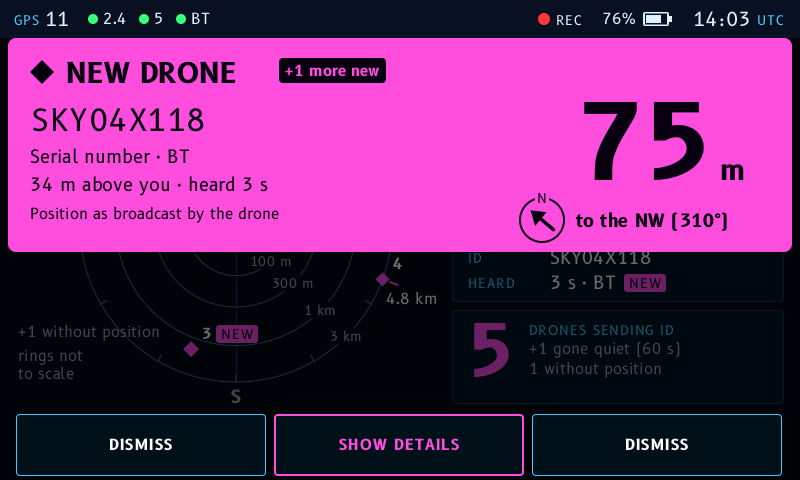

- **Which drone.** If several are new at once, the banner shows the most serious one (one flagged
  at the worst level), otherwise the nearest, and says `+1 more new` rather than stacking banners.
- **How long it stays.** A drone within 300 m (as broadcast), or one flagged at the most serious
  level, keeps its banner up until you press a key; the banner says "close by: stays until you
  press a key". Any other banner goes after **5 seconds**.
- **The first press goes to the banner**, never to the page underneath. The middle key, labelled
  SHOW DETAILS, opens that drone's detail; the left and right keys, labelled DISMISS, and a hold
  only dismiss it. Touching the banner shows the details; touching anywhere else dismisses it. A
  press that began before the banner appeared is ignored, so a press meant for the page cannot
  hit the banner by accident.
- **After you dismiss a banner**, drones that arrive in the next 15 seconds do not raise a new
  one. They count up a **NEW** chip in the status bar instead (`NEW 2`), so a swarm cannot keep a
  banner in your way. Every new drone is also marked **NEW** on the radar and in the list for a
  minute, so a banner you missed still leaves a trace.

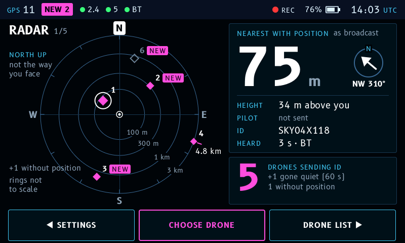

The P4 never beeps; the banner is the only sign.

## Flags

`FLAGS 3/6`. On the P4 this page lists flights that **may** break an FAA rule, worst first, then
longest held. It never says "illegal". The top right gives the date of the airspace map pack on
the memory card (`pack 2026-11-15`), or says `no airspace pack`, in which case only some checks
run. What the levels and rules mean is on [FAA rule flags](faa-flags.md).

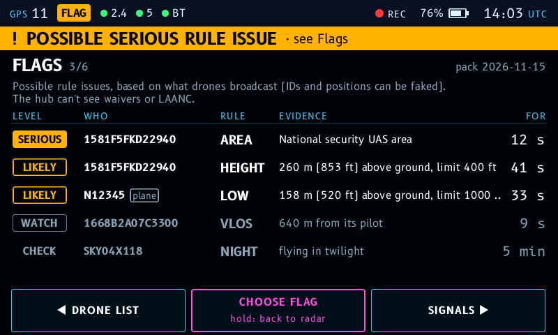

The columns are LEVEL (`SERIOUS` filled, `LIKELY` outlined, `WATCH` muted, `CHECK` plain), WHO
(the drone's ID, or an aircraft's callsign tagged `plane`), RULE, EVIDENCE and FOR (how long it
has held). With nothing flagged it says `none`.

**Choosing a flag.** Tap the middle key, labelled CHOOSE FLAG. A **CHOOSING** box appears and the
first row is outlined. The left key, PREVIOUS, and the right key, NEXT, move the outline. The
middle key then says what it can do with that row:

| Middle key says | Means |
|---|---|
| `OPEN DRONE` | Tap to open that drone's detail; its BACK key returns you here |
| `A PLANE: NO DETAIL` | The row is a crewed aircraft; there is no detail page for it |
| `DRONE GONE` | The drone is no longer tracked |

Hold the middle key to stop choosing. You can also touch a row to open its drone. With no rows,
the middle key reads BACK TO RADAR (tap or hold).

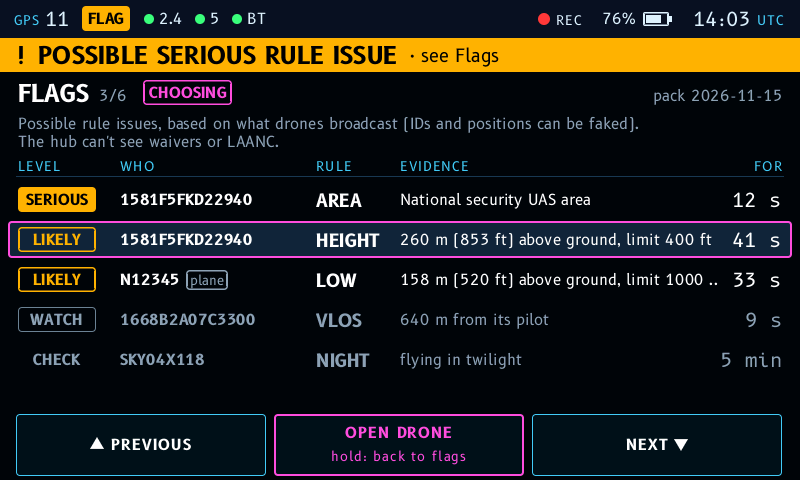

## Signals

`SIGNALS 4/6`: drone radio links that have no ID or position, so they cannot go on the radar. The
page reminds you that "A control link can also be an RC car or plane." The top right counts each
kind.

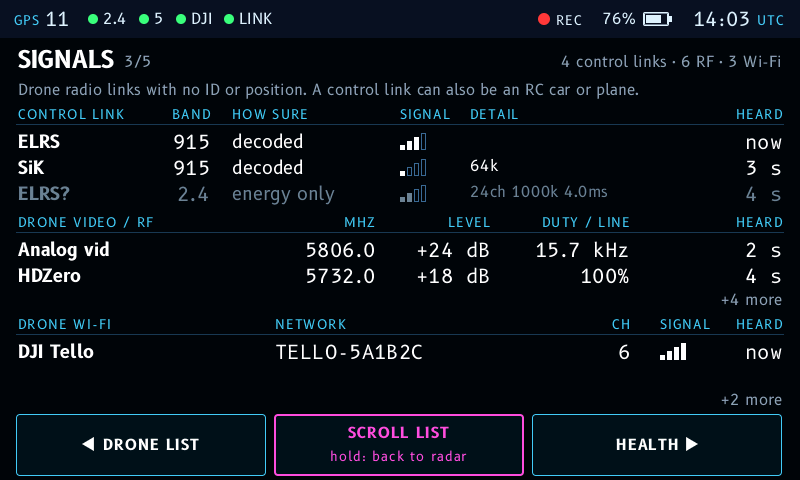

| Table | What it lists |
|---|---|
| **CONTROL LINK** | Drone control links (such as ELRS or SiK): the BAND (`915` MHz, `2.4` GHz), HOW SURE the hub is (`decoded`, `looks like`, `energy only`), signal bars, a detail and when heard |
| **DRONE VIDEO / RF** | Radio emitters such as analog video, HDZero or plain `Energy`: frequency in MHz, LEVEL above the background (`+24 dB`), DUTY / LINE (how much of the time it is on, or an analog video signal's line rate in kHz) and when heard |
| **DRONE WI-FI** | Toy and camera drones recognised by their own Wi-Fi network: maker, network name, channel, signal bars, when heard |

When a table is empty it says `none heard`. The control-link table shows at most three rows; the
other two tables end in `+4 more` when rows do not fit. Grey rows have not been heard for a while.

**Scrolling.** When rows of the video or Wi-Fi table do not fit, the middle key reads SCROLL LIST. Tap it, and the page
becomes one long list of all three tables, with a **SCROLLING** box by the title and
`rows 4-13 of 17` at the bottom. The left key, SCROLL UP, and the right key, SCROLL DOWN, move one
row at a time. Tap or hold the middle key, labelled DONE, to leave. When everything fits, the
middle key reads BACK TO RADAR (tap or hold) instead.

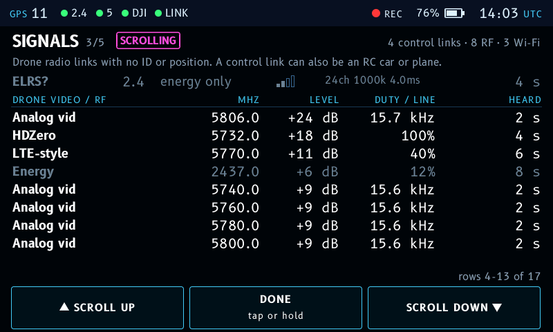

## Health

`HEALTH 5/6`: is every part of the kit working? The top right says how long the hub has been
running (`hub up 1 h 02 min`).

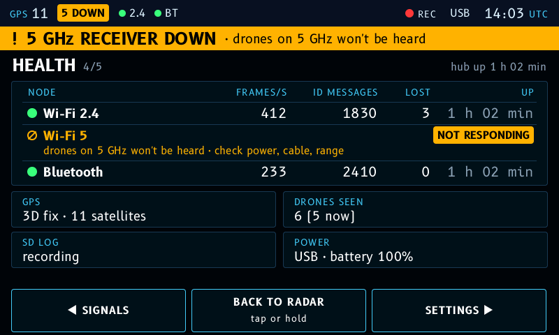

**One row per listening board**, with a dot: filled when it is fine, a hollow ring when it hears
nothing, a slashed ring when it has stopped answering. The columns are FRAMES/S (radio frames it
hears per second, `--` when the hub does not know yet), ID MESSAGES (Remote ID messages found),
LOST and UP (how long it has been running). A board that has stopped answering shows
**NOT RESPONDING**, with a line such as "last heard 2 min ago · drones on 5 GHz won't be heard ·
check power, cable, range". A board that answers but hears nothing at all shows
**HEARS NOTHING**. A board given a job by the hub shows it in an ASSIGNED ROLE column, ending
`running` once the board has taken it up or `sent` until then.

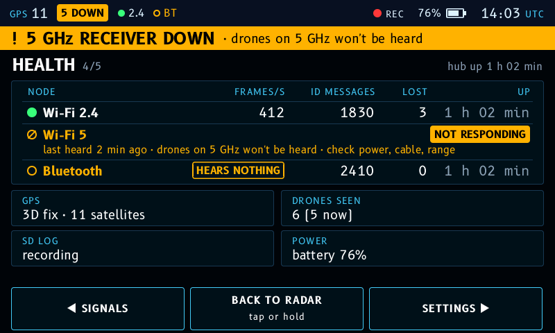

**Below the boards**, tiles. A tile with something wrong has a heavy amber bar down its left edge
and comes first.

| Tile | What it may say |
|---|---|
| **GPS** | `3D fix · 11 satellites`, `2D fix`, `no fix`, `no fix; typed position in use`, `no receiver found`, or `no trusted position or time` when the hub doubts its own GPS |
| **DRONES SEEN** | All drones seen, and how many now: `6 (5 now)` |
| **SD LOG** | `recording`, `no card`, `off`, `ERROR · not recording`, or `CSV only · NO EVIDENCE` |
| **POWER** | `USB` (always, on the P4), or a battery level |
| **PLANES** | With an ADS-B input: active aircraft, how many are LOW nearby, and the nearest (see [Crewed aircraft](aircraft.md)) |
| **NEAR A PLANE**, **AREA GPS**, **ALARMS** | Only when they apply (see [Alarms and warnings](alarms.md)) |
| **NOTES** | The standing notes, one after another (see [The notes above the keys](#the-notes-above-the-keys)) |

If the tiles do not all fit, the top right says how many lines had no room.

The P4 always lists its ADS-B input as an **ADS-B** row. With no ADSBee wired to it (none is, as of
2026-11-19), that row says NOT RESPONDING: expected, not a fault.

The middle key reads BACK TO RADAR (tap or hold): this page has nothing to choose.

## Settings

`SETTINGS 6/6`. On the P4 the rows are:

| Row | What it is |
|---|---|
| **Theme** | `Glass Cockpit`, `Field Day`, `Red Night` or `Auto` (see [Themes](#themes)) |
| **Day theme**, **Night theme**, **Switch at** | Only while Theme is Auto, indented under it |
| **Brightness** | Five steps, drawn as bars, with the number |
| Under **ACTIONS**: **Hub location** | `I moved the hub`, or `Use this spot` (as **New spot found**) while the hub waits for your yes on a new place |
| **Alarms** | What one press will do, naming the alarm, such as `Mute Wi-Fi deauth attack +1 · 2 h`, `Snooze Jamming (wideband) · 5 min`, `Unmute 2`, or `None active` |
| **Nodes at hub** | `Place all here` |

The P4 has no buzzer, so it has no **Buzzer** row. Some pictures below were drawn for a hub that
has one and show a Buzzer row; ignore it.

**Editing.** Tap the middle key, labelled EDIT SETTINGS. An **EDITING** box appears and the Theme
row is outlined. The left key, UP, and the right key, DOWN, move between rows and stop at the ends.
The middle key says what it will do to the row you are on:

| Row | Middle key | What a tap does |
|---|---|---|
| Theme | `CHANGE` | Steps Auto, Red Night, Glass Cockpit, Field Day, then back to Auto (the two dark themes sit together, so you never flash the bright one between them) |
| Day theme, Night theme | `CHANGE` | Steps Red Night, Glass Cockpit, Field Day |
| Switch at | `CHANGE` | Toggles `Dawn & dusk` and `Sunrise & sunset` |
| Brightness | `ADJUST` | Starts adjusting (below) |
| Hub location | `I MOVED THE HUB` | Asks to confirm, then tells the hub you moved it on purpose, so it learns its new spot rather than treat it as faked GPS ([GPS checks](../GNSS-INTEGRITY.md)) |
| New spot found | `USE THIS SPOT` | Accepts the place the hub found as its home. It asks to confirm only while the hub's GPS may be jammed or faked, and the page then warns "GPS may be faked: use this spot only if you really moved the hub" |
| Alarms | `MUTE 2 H`, `SNOOZE 5 MIN`, `UNMUTE`, or `NONE ACTIVE` (faint, does nothing) | Mutes, snoozes or unmutes the alarms named in the row ([muting and snoozing](alarms.md#muting-and-snoozing)) |
| Nodes at hub | `PLACE ALL HERE` | Asks to confirm, then records that every listening board stands where the hub is, a wired or bench kit ([Site settings](../SITE.md)) |

Hold the middle key (`hold: finish`) to stop editing. Editing also ends after 30 seconds without
a press, or when a banner's SHOW DETAILS takes you to a drone.

**Brightness.** On the Brightness row, tap the middle key, labelled ADJUST. An **ADJUSTING** box
appears and the row says `left / right keys`. The left key, DIMMER, and the right key, BRIGHTER,
change the level between 1 and 5 (each goes faint at its end). Tap the middle key, labelled DONE,
to stop adjusting; hold it to finish editing. The backlight follows at once. Red Night holds the backlight at level 2 or
lower; see [Themes](#themes).

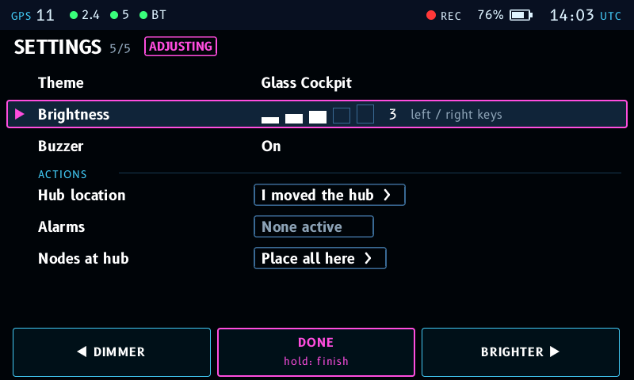

**Actions that ask first.** Hub location's `I moved the hub`, and Nodes at hub, overwrite what the
spoofing checks rely on, so the first tap only arms them. The row's value turns amber and reads
`Press again to confirm`, and the middle key reads **PRESS AGAIN TO CONFIRM** with what it will do
underneath (`place 3 nodes here`, `forget the learned spot`, `use this spot as home`). Tap again
within 4 seconds to go ahead; otherwise, or if you move to another row, nothing happens.

**Results.** Once an action is sent, the row says `Working...` until the hub answers. Only when
the hub says it worked does the row show the result with a check mark (`Placed`, `Muted`,
`Snoozed`, `Unmuted`, `Learning new spot...`, `Spot in use`), and the middle key repeats it,
faint, so a second tap cannot undo it under your finger. If the hub could not do it, the row
gives the reason in amber, such as `No GPS position: not placed`, and the middle key reads
**DID NOT WORK** with "move off the row to retry". With no answer in 10 seconds, the row says
`No answer from the hub`.

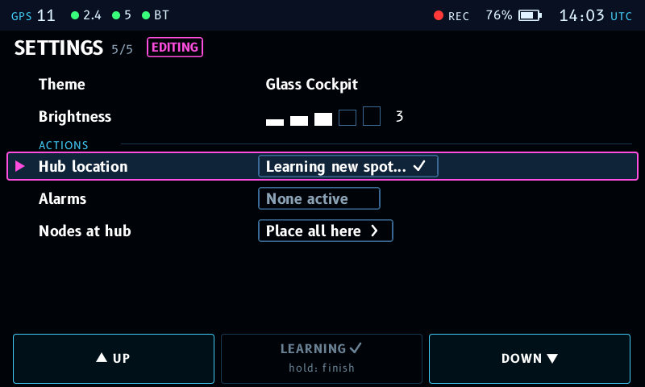

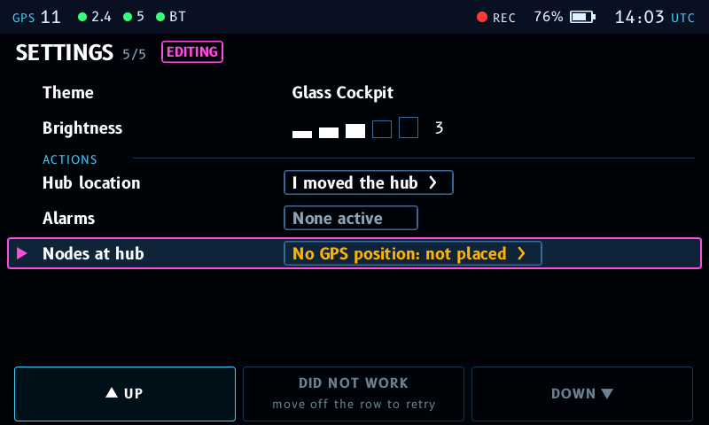

**Touch.** Tapping a row starts editing on that row without changing it; tapping the same row again
changes it, exactly as the middle key would. Actions that ask first still ask.

**Saving.** When editing ends with the theme or brightness changed, the P4 adds one line per
changed setting (`theme`, `theme-day`, `theme-night`, `theme-switch`, `brightness`) to the site
file on its memory card, `ROTORSCP/SITE.TXT`, and records each as a setting in the evidence log.
The file is read again at the next start, so your choice survives a restart. Mutes and snoozes
are not saved: they end at a restart.

## The notes above the keys

Some facts must not be forgotten, so they stay just above the keys on **every** page for as long
as they are true. There are two kinds.

**The fault bar.** A filled amber bar (outlined in Red Night) is a fault: something is going wrong
now. There can be two.

| Fault bar says | Meaning |
|---|---|
| `NO EVIDENCE (no SD): 12 waiting` | Evidence records are not reaching the card because no card answers. They are held in memory meanwhile |
| `NO EVIDENCE (SD error): ...` | The card answered but failed (full, a write error, wrong format) |
| `NO EVIDENCE (file error): 1234 waiting, 56 dropped` | The card works, but the evidence file could not be opened; the hub keeps retrying. "Dropped" records could not even be held, and are lost |
| `NO KIT KEYS: link closed` | The hub has no kit keys, so it does not accept reports from its wireless boards |
| `KIT RECORDS DAMAGED: link closed` | No good copy of the hub's kit records: the link is closed |
| `ROSTER FROM OTHER KIT` | The hub's kit records were made for another kit |
| `NO BOOT COUNTER: link closed` | The hub could not record this start, which the keyed link needs: the link is closed |
| `BENCH GATEWAY` | The gateway is a bench build that sends made-up traffic on purpose. Not for real use |
| `OLD FIRMWARE: gateway`, `OLD FIRMWARE: 2 nodes` | The gateway, or boards heard in the last minute, run older firmware than the keyed link needs |
| `UNPROVISIONED NODE 1` | Boards heard in the last minute that have not been given the kit's keys |

The keyed link is described in [link keys](../LINK-KEYS-DESIGN.md).

**The notes lines.** Standing facts that are not faults appear as at most two muted lines, each
line marked with a small amber tick, the notes on it separated by `·`. When more notes hold than
fit, the last line ends in `+3 notes: see Health`, and the **NOTES** tile on [Health](#health)
lists them.

| Note says | Meaning |
|---|---|
| `Log not tamper-proof (test key)` | The evidence log is signed with the published test key: anyone could have signed it |
| `Log not evidence-grade (dev key)` | It is signed with a development key built into the firmware |
| `Nodes unsecured: reports can be faked` | The wireless link between boards has no key |
| `Bench build` | The firmware has bench-only test features in it. Not for real use |
| `2 muted, 1 h 59 min left` | Alarms you muted, and the time left on the first to end |
| `1 snoozed, 4:05 left` | Alarms you snoozed, and the time left |
| `1 muted by the site file` | Alarms muted for good in `SITE.TXT` ([Site settings](../SITE.md)) |
| `Control IDs read (site file)`, `Control content kept (site file)`, `Audio clips kept (site file)` | Collection switches turned on in the site file ([Law, safety and ethics](../start/law-and-ethics.md)) |

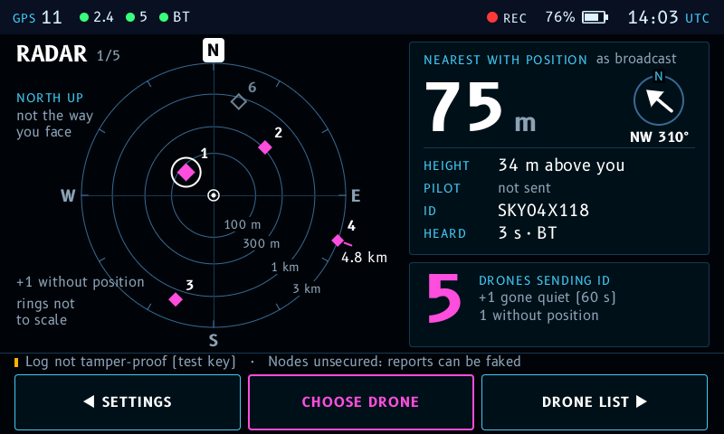

## Themes

There are three looks, and **Auto**, which picks between two of them by the sun.

| Theme | What it is for |
|---|---|
| **Glass Cockpit** (the default) | White text on near-black, with drones in magenta, labels in light blue and warnings in amber. Works by day and by night |
| **Field Day** | Dark text on light grey for direct sun, with drones in dark orange |
| **Red Night** | Pure red on black, to protect night vision, with the backlight held low. Large warning areas are outlined rather than filled |
| **Auto** | Your day theme while the sun is up and your night theme after dark, worked out from the hub's GPS position and time |

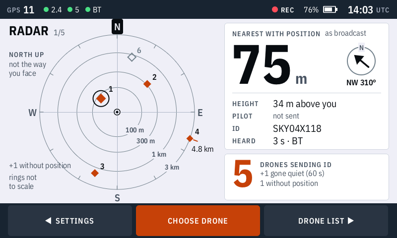

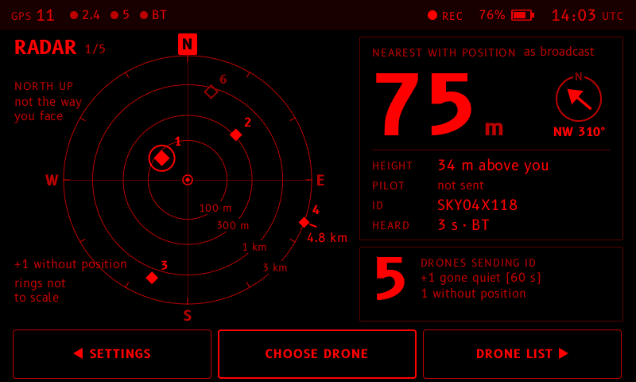

Nothing relies on colour alone: filled or hollow, an X, a ring, a boxed word or a letter carries
every meaning, so the screen still makes sense in any theme.

**Auto.** Set Theme to Auto and three more rows appear under it:

| Row | Choices | Starts as |
|---|---|---|
| **Day theme** | Red Night, Glass Cockpit, Field Day | Field Day |
| **Night theme** | the same | Red Night |
| **Switch at** | `Dawn & dusk` (the day theme stays on through twilight, while there is still light) or `Sunrise & sunset` | Dawn & dusk |

A line at the foot of the page says what Auto is doing, for example
`Now: Glass Cockpit (daytime) · Red Night at dusk, in 8 h 30 min (22:33 UTC)`. Until the hub has
known both its position and the time, Auto shows Glass Cockpit and says
`Waiting for GPS · showing Glass Cockpit until it knows the time`. If it loses the time later it
keeps the last look (`No GPS time · keeping ...`).

Auto does not switch while you are busy: never while a banner is up, while you are choosing,
reading a detail or editing, during an urgent warning, or within 2 minutes of a key press or a new
drone. It waits at most 10 minutes for a quiet moment. It never switches while the hub's own GPS
may be faked, since the time may be faked too. When it switches, the title says so for 4 seconds,
for example "Switched to Red Night (dusk)".

**Brightness.** Five levels, from dim to full. **Red Night holds the backlight at level 2** unless
you set it lower, and the row says so: `4 (2 in Red Night)`, or `3 (2 at night)` when Auto will
use Red Night after dark. The P4 sets its backlight to match; as of 2026-11-19 this has not been
checked on the panel.

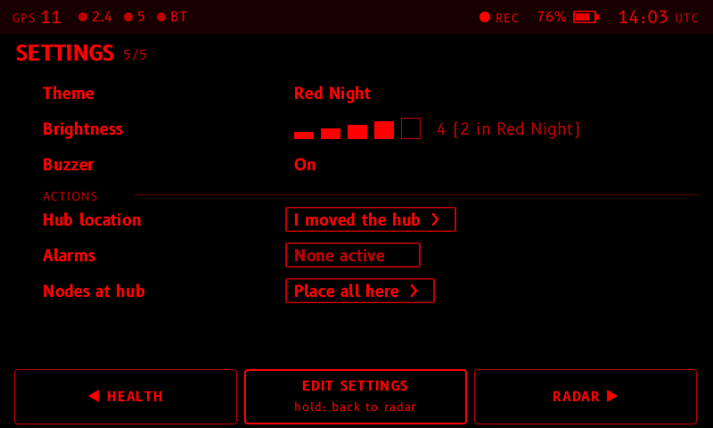

**Where it is saved.** The P4 writes the theme, the Auto rows and the brightness to
`ROTORSCP/SITE.TXT` on its memory card when you finish editing, and reads them at the next start.
A line in that file, or typed on the hub's console (`L theme red-night`, `L brightness 2`), sets
them too ([Site settings](../SITE.md)).

## Deeper: why it looks like this

**Level: 🔴 Expert.** The design notes, colour values, the full list of snapshot cases and the
tests are in the
[screen notes beside the code](https://github.com/holdTheDoorHoid/rotorscope/blob/main/crates/screen/README.md).
In short:

- **One big number.** Distances round to 1 m below 100 m, 10 m below 1 km, then 0.1 km up to
  10 km and whole kilometres beyond. That is
  about what GPS at both ends supports, and it stops the last digit flickering.
- **The list stays still.** With a position it sorts by distance; without one, by when each
  drone was **first** heard. Sorting by last heard would reshuffle the rows every second.
- **Claims, not facts.** Positions are what drones broadcast, so the screen says "as broadcast",
  and the pilot is always "reported".
- **The layout is measured, not guessed, for touch.** A touch runs the same layout code that drew
  the frame, without drawing, to find what is under the finger (`wide::tap_target`).
- **Drawing.** The P4 draws each frame in ten bands of 48 rows and redraws at most four times a
  second, at once after a key press, and every 0.1 second while the middle key is held (so the
  hold bar moves). Lettering is anti-aliased, from the B612 and IBM Plex Sans Condensed fonts.
- **Auto** uses NOAA's solar-position method, tested against US Naval Observatory times to within
  two minutes.

## Where this lives in the code

- [`crates/screen/src/wide/`](https://github.com/holdTheDoorHoid/rotorscope/tree/main/crates/screen/src/wide):
  the 800 x 480 layout. `pages.rs` draws every page and the words on it, `mod.rs` holds the key
  labels (`key_labels`), the touch mapping (`key_at`, `tap_target`) and `HOLD_MS`, `look.rs` the
  three themes' colours
- [`crates/screen/src/ui.rs`](https://github.com/holdTheDoorHoid/rotorscope/blob/main/crates/screen/src/ui.rs):
  what every key and tap does, the banner, the settings and every timeout
- [`crates/screen/src/model.rs`](https://github.com/holdTheDoorHoid/rotorscope/blob/main/crates/screen/src/model.rs):
  what the hub hands the screen, the warnings (`UiState::warnings`), the fault bar and notes
- [`crates/screen/src/sun.rs`](https://github.com/holdTheDoorHoid/rotorscope/blob/main/crates/screen/src/sun.rs):
  sunrise, sunset, dawn and dusk for Auto
- [`firmware/hub-p4/src/app.rs`](https://github.com/holdTheDoorHoid/rotorscope/blob/main/firmware/hub-p4/src/app.rs):
  touch, the hold, what the hub feeds the screen, and drawing; `display.rs` for the panel,
  `main.rs` for the backlight, `site.rs` for saving the theme and brightness
- [`firmware/hub/src/screen.rs`](https://github.com/holdTheDoorHoid/rotorscope/blob/main/firmware/hub/src/screen.rs):
  the S3 hub's small panel, buttons and buzzer

**Next:** [Reading a detection](reading-detections.md)
