# The screen

**Level: 🟢 Beginner** · A guided tour of every page the hub shows, what each mark on it means,
and what you can press.

The **hub** is the board with the screen: it gathers what every listening board hears (see the
[glossary](../project/glossary.md) for any unfamiliar word). The pictures here are drawn by the
screen code itself, from made-up drones, at 320 by 240 dots.

## Which screen you have

There are two hubs, and they draw the **same pages** with the same code.

| | P4 hub (the current one) | S3 hub (the first one) |
|---|---|---|
| Screen | 5-inch touch screen, 800 x 480 | 2.0- or 2.8-inch panel, 320 x 240 |
| How the pages are drawn | The 320 x 240 picture, **doubled** to 640 x 480 on the left | The 320 x 240 picture, as is |
| How you press | Three touch keys in a column on the right: **UP**, **SELECT**, **DOWN** | Three buttons: Up, Down, Select |
| Beeper | None (the board has a speaker, not yet used) | Beeps on a new drone |

On the P4 every dot of the pictures below becomes a block of 2 x 2 dots: the same layout, only
bigger. Touching the picture itself does nothing; only the three keys respond, lighting up
briefly when touched. A layout made for the 5-inch screen may come later.

**How far this is proven.** The pictures are **simulated only**: the test suite draws them from
made-up data. The P4 has drawn these pages on its own panel on the bench, and its touch keys
were tested by hand on 2026-11-14. Newer parts of the screen (GPS state, the alarm boxes, the
strip along the bottom) have not yet been checked by eye on the panel. The S3 hub has not yet
been tried with a real panel, and the bench notes of 2026-11-18 record that its firmware did not
link (over its memory budget by about 18 KB; [Bench tests](../BENCH.md)).

## Pressing things

The screen needs only three keys. One of them does two jobs: a short press is **Select**, and
holding it for 0.7 seconds is **Back**.

| You press | On most pages | While choosing a drone | On a drone's detail |
|---|---|---|---|
| UP / DOWN | Next or previous page (they wrap round) | Move the cursor | Next or previous drone |
| SELECT (short) | Start choosing a drone (radar, list) or edit (settings) | Open that drone's detail | Nothing |
| SELECT (hold) | Go home to the radar | Stop choosing | Back to choosing |

The pages, in order: **Radar**, **List**, **Flags** (P4 hub only), **Signals**, **Health**,
**Settings**. After each flip, the page's name shows in the
middle of the screen for 1.5 seconds (a **toast**):

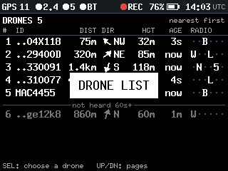

On the S3, holding Up or Down repeats; on the P4 each tap is one press. Choosing a drone and
editing settings give up after 30 seconds without a press; a detail page never times out.

## The status bar

The thin bar along the top is on every page. Read it left to right.

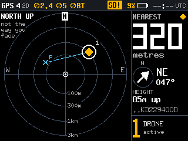

| Part | What you may see | Meaning |
|---|---|---|
| **Own position** | `GPS 11` | The hub's GPS has a fix from 11 satellites |
| | `GPS 4` and a small `2D` | A weaker, flat fix: no height |
| | `POS MAN` | No GPS fix, but a typed-in position is in use, so distances still work |
| | **NO FIX** box | GPS present but no fix: no distances |
| | **NO GPS** box | No GPS receiver found |
| | **GPS JAM?**, **GPS JAM**, **GPS FAKE?**, **GPS FAKE** box | P4 hub: its own GPS looks jammed or faked ([alarms](alarms.md)) |
| **Listeners** | `●2.4 ●5 ●BT` | One dot per listening board with its label: filled when it is reporting, hollow and crossed when it is not |
| | or one boxed word | P4 hub: an alarm, which takes the place of the dots: **AIRCRAFT**, **JAMMED**, **AREA FAKE**, **AREA JAM**, **ID FLOOD** or **ATTACK** (most urgent first; see [Alarms and warnings](alarms.md)) |
| **Recording** | `● REC` | The memory-card log is recording |
| | `no SD` (small, grey) | No card. Allowed; not a fault |
| | **SD!** box | The card is failing |
| | **NO EVID** box | The plain log records but the [evidence log](../EVIDENCE.md) is not being written |
| **Power** | `76%` and a battery | Battery level; turns to the warning colour at 15% or less |
| | `USB` | Running from USB. The P4 always says this: its battery level is not wired up |
| **Time** | `14:03 UTC` | World time from GPS, not your local time. `--:--` means no time yet |

Listener labels: `2.4` and `5` are Wi-Fi listeners, `BT` Bluetooth, `DID` the DJI DroneID
listener, `FPV` the video-link scanner, `GW` the gateway that relays wireless boards, `ADS` an
ADS-B aircraft receiver and `LR` a long-range radio board.

## Radar

The home page. It answers "is there a drone, how far, which way?" in one glance.

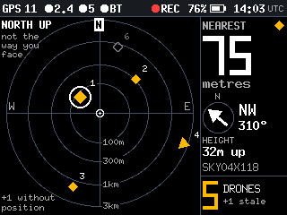

- **North is always up.** The radar does not turn with you; the hub has no compass. The corner
  says `NORTH UP / not the way you face`, and the boxed **N** marks the top. If you face east, a
  drone straight ahead of you is drawn on the right.
- **You** are the ring with a dot in the middle (deliberately not an arrow: the hub does not know
  which way you face).
- **Range rings** at 100 m, 300 m, 1 km and 3 km. The scale is squeezed outwards, so near
  drones get room and far ones still fit; it never rescales, so a spot on the plot always means
  the same distance.

| Mark | Meaning |
|---|---|
| Filled diamond | A drone heard in the last minute |
| Hollow grey diamond | A **stale** drone (not heard for 60 seconds), or one not yet confirmed |
| Bigger diamond with a ring | The drone the big readout describes |
| Small number beside it | Its place in the list (1 is nearest), so "drone 2" is the same drone on every page |
| Triangle on the edge | A drone more than 3 km away, pointing its way |
| Blue **X** marked **P**, joined by a line | The pilot of the drone being described, where the drone says the pilot is |
| Hollow diamond marked **?**, joined by a line | Another transmitter's claim to the same drone: see [disputes](reading-detections.md#confirmed-unconfirmed-and-disputed) |
| `+1 without position` (bottom left) | Drones heard that sent no position, so cannot be placed |

The right-hand column is the **readout**: `NEAREST`, the distance in big digits with the unit as
a word, an arrow in a small compass with the compass point and degrees (`NW 310°`), the height,
and the end of the ID. At the bottom: active drones, and how many are stale. With nothing heard
it says "Listening for drones".

**Choosing a drone.** Press SELECT and a cursor lands on the nearest drone. The readout then
describes the chosen one and says so in an inverse box, **DRONE 3**, instead of NEAREST, so a
forgotten cursor cannot pass for the nearest drone.

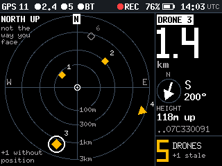

## List

Every drone in rows, nearest first. Stale drones go below a `not heard 60s+` divider.

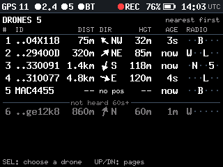

Press SELECT to choose a row (it turns inverse), UP/DOWN to move, SELECT again to open its
**detail page**: everything known about that drone, where UP/DOWN steps through the drones. The
columns and every detail row are explained in [Reading a detection](reading-detections.md).

**Without a position of its own** the hub cannot work out distances. A **NO POSITION** bar
appears, the list is sorted newest first, and signal strength replaces distance, with the
warning "signal is not distance".

## New-drone banner

When a new drone is confirmed, a banner covers the top of whatever page you are on for
5 seconds: its ID, distance and direction. If more arrive meanwhile it says `+1 more new` rather
than stacking banners. The S3 beeps at most once every 3 seconds.

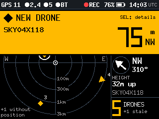

While the banner shows, your **first press goes to it**: SELECT opens that drone's detail; UP,
DOWN or a hold only dismiss it. A press meant for the page underneath never does something
unexpected.

## Flags

Shown only on the P4 hub. It lists flights that **may** break an FAA rule, at four levels (NOTE,
WATCH, WARN, ALERT), with who, which rule and for how long. It never says "illegal". The top
right gives the date of the airspace map pack on the card, or `no airspace pack`: without one,
only some checks run. See [FAA rule flags](faa-flags.md).

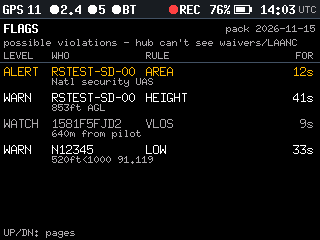

## Signals

Things that are not Remote ID drones and have no position, so they are not on the radar.

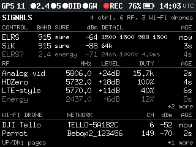

| Table | What it lists |
|---|---|
| **CONTROL** | Drone control links (such as ExpressLRS or SiK), the band, how sure the hub is (`energy`, `likely`, `sure`), strength in dBm, a detail and age |
| **RF** | Radio emitters such as analog video, HDZero or plain "Energy": frequency, how far above the background (`+24dB`), how much of the time it is on (`DUTY`, or for analog video its line rate) and age |
| **WI-FI DRONE** | Toy and camera drones recognised by their own Wi-Fi network: maker, network name, channel, strength, age |

When there is nothing, each table says "none heard".

## Health

Is every part of the kit working?

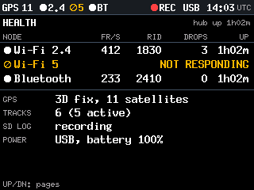

One row per listening board: frames per second (`FR/S`), Remote ID frames found (`RID`), frames
lost (`DROPS`) and time running (`UP`), or **NOT RESPONDING**. As of 2026-11-18 the P4 does not
count frames per second for its listening boards and shows `0` there; only an ADS-B row has a
real figure. On the P4 a board given a job
shows it underneath, such as `-> Wi-Fi 2.4 plan 5a3c running`.

Below: **GPS** ("no trusted position/time" when the hub doubts its own GPS), **TRACKS**,
**SD LOG** (`recording`, `no card`, `ERROR - not recording`, `CSV only - NO EVIDENCE`) and
**POWER**. **AIRCRAFT** appears when the hub has an ADS-B input (see
[Crewed aircraft](aircraft.md)); **NEAR**, **AREA GPS** and **ALARMS** only when needed
([Alarms and warnings](alarms.md)).

The P4 always lists its ADS-B input, as an `ADS` dot in the status bar and an **ADS-B** row here,
with an AIRCRAFT line. With no ADSBee wired to it (none is, as of 2026-11-18) that row says
**NOT RESPONDING** and the dot is crossed: expected, not a fault.

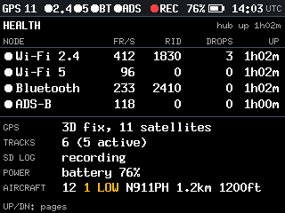

## Settings

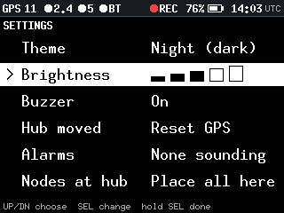

Press SELECT to start editing, UP/DOWN to pick a row, SELECT to change it, hold SELECT when done.

| Row | What SELECT does |
|---|---|
| **Theme** | Swaps Night (dark) and Day (light) |
| **Brightness** | Steps through five levels. The S3 dims its backlight; the P4 does not yet apply it and stays at full |
| **Buzzer** | On or off. Only the S3 has a beeper; the banner shows either way |
| **Hub moved** / **New home** | Tells the hub you really moved it, so it does not treat the new place as faked GPS ([GPS checks](../GNSS-INTEGRITY.md)). Reads **New home: Accept here** while a new place waits for your yes |
| **Alarms** | Says what one press will do: `Mute 2 (2h)`, `Snooze 1 (5m)`, `Unmute 3` or `None sounding`. See [muting and snoozing](alarms.md#muting-and-snoozing) |
| **Nodes at hub** | Records that every listening board stands where the hub is (a wired or bench kit), which sharpens one spoofing check ([Site settings](../SITE.md)) |

After an action the row says what happened (`Done`, `Relearning`, `Accepted`, `Placed`). As
of 2026-11-18 neither hub saves theme, brightness or buzzer: they reset at power-up.

## The strip along the bottom

On the P4, facts that must not be forgotten stay as lines in the warning colour along the
bottom of **every** page for as long as they are true.

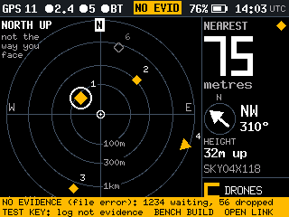

| Line | Meaning |
|---|---|
| `NO EVIDENCE (no SD / SD error / file error): N waiting, M dropped` | Evidence is not reaching the card. Records are held in memory meanwhile; "dropped" ones are lost |
| `TEST KEY: log not evidence` | The evidence log is signed with the published test key: anyone could have signed it |
| `DEV KEY: not evidence-grade` | Signed with a development key built into the firmware |
| `BENCH BUILD` | The firmware has bench-only test features in it. Not for real use |
| `OPEN LINK` | The wireless link between boards has no key, so anyone nearby could inject fake reports |
| `MUTED 2 1h59  SNOOZED 1 4m05  SITE MUTES 1` | Alarms silenced right now, and time left on the first to end |
| `ON: control IDs, control content` | Collection switches turned on in the site file ([Law, safety and ethics](../start/law-and-ethics.md)) |

## Night and Day

Night is the default: white text on black, drones in amber, kind to night vision. Day is dark
text on white for direct sun, with drones in dark orange.

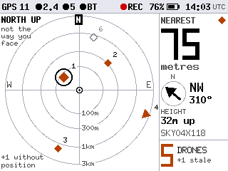

Nothing relies on colour alone: filled or hollow, an X, a cross, a boxed word or a letter
carries every meaning, so the screen still makes sense in black and white.

## Deeper: why it looks like this

- **One big number.** Distances round to 1 m below 100 m, 10 m below 1 km, 0.1 km below 10 km,
  then whole kilometres. That is
  about what GPS at both ends supports, and it stops the last digit flickering.
- **The list stays still.** With a position it sorts by distance; without one, by when each
  drone was **first** heard. Sorting by last heard would reshuffle every second.
- **The P4 redraws** at most four times a second, and at once after a key press.

## Where this lives in the code

- [`crates/screen`](https://github.com/holdTheDoorHoid/rotorscope/tree/main/crates/screen): every
  page (`src/render.rs`), the key logic (`src/ui.rs`), colours (`src/theme.rs`), its README
- [`firmware/hub-p4/src/display.rs`](https://github.com/holdTheDoorHoid/rotorscope/blob/main/firmware/hub-p4/src/display.rs):
  the 2x drawing and the touch key column; `touch.rs` and `app.rs` for the presses
- [`firmware/hub/src/screen.rs`](https://github.com/holdTheDoorHoid/rotorscope/blob/main/firmware/hub/src/screen.rs):
  the S3's panel, buttons and beeper

**Next:** [Reading a detection](reading-detections.md)
