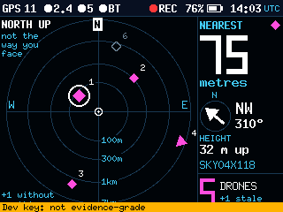

# SD card and logs

**Level: 🟢 Beginner** · What the hub keeps on its SD card, how to read the logs on a computer,
and how to take the card out safely.

The hub records what it hears onto a memory card (a microSD card in the slot on the hub board).
It also reads a few files from the card that you put there: the airspace map, site settings and,
if you have them, private keys. This page describes the P4 hub, the one with the 5-inch touch
screen. The older S3 hub writes the same CSV log but none of the other files.

## Which card

- The card must be formatted **FAT32** (or the older FAT16), and that must be its first
  partition. Most cards up to 32 GB come this way.
- **exFAT is not supported.** Most cards larger than 32 GB come formatted exFAT; the hub reports
  such a card and leaves it alone, and nothing is logged. Reformat it as FAT32 on a computer
  first.
- The hub **never formats the card and never deletes anything**. It only creates the `ROTORSCP`
  folder and writes its own files inside it, so a card can hold other things too.

If the card is missing, the hub keeps working and checks for one every 3 seconds. A card that
answers but cannot be used is retried every 15 seconds.

## What is in the `ROTORSCP` folder

| File | Who writes it | What it is |
|---|---|---|
| `MMDDhhmm.CSV` or `LOGnnnnn.CSV` | the hub, one per start-up, and a new one if the card is put back | The everyday **detection log**, a spreadsheet file |
| `EVIDENCE/EVnnnnnn.EVL` | the hub, one per card mount | The **evidence log**: tamper-evident, signed records |
| `AIRSPACE.PAK` | you, from `airspace-pack` | The US airspace and ground-height map for the [FAA rule flags](faa-flags.md) |
| `SITE.TXT` | you, and the hub (adds lines) | Where your nodes stand, the hub's own fixed position, muted alarms |
| `GPSMEM.TXT` | the hub | What the hub remembers about its own GPS between start-ups |
| `O4KEY.TXT` | you, optional | A private key for reading DJI O4 DroneID |
| `FLARMKEY.TXT` | you, optional | Keys for decoding FLARM aircraft |

### The detection log (CSV)

**How it is named.** If the hub knows the time from its GPS when the card is ready, the file is
named from the date and time in UTC: month, day, hour, minute, so `11160000.CSV` began at 00:00
UTC on 16 November. The name has no year; the file's own date on the card (set from GPS time)
does. Without GPS time the file is `LOGnnnnn.CSV`, numbered one past the highest already there.
While a GPS is answering but has no time yet, the hub waits up to 90 seconds after start-up
before opening the file, keeping rows in memory meanwhile, so a normal start gets a dated name.

**What goes in.** Once a second, one row for each active drone, open FPV video link, radio
signal, Wi-Fi drone and crewed aircraft. The file is saved to the card every 5 seconds, so a
sudden power cut loses at most the last few seconds. If the card falls behind, new rows are
dropped and counted, never half-written.

**The columns.** An empty field means "not known".

| Column | Meaning |
|---|---|
| `utc` | Date and time (UTC), when the hub has GPS time |
| `hub_ms` | Milliseconds since the hub started; always filled, so rows stay in order without GPS |
| `track` | The hub's number for this drone. Other kinds: `L<n>` an open FPV link, `ICAO-<hex>` an aircraft, `R<n>` a radio signal, `W<n>` a Wi-Fi drone |
| `own_lat`, `own_lon`, `own_alt_m` | Where the hub was |
| `uas_id`, `id_type` | The drone's ID and what kind of ID it is (an aircraft's callsign; a signal's frequency) |
| `ua_type` | What kind of aircraft it says it is |
| `transports` | Which radios heard it, separated by `\|` |
| `drone_lat`, `drone_lon`, `drone_alt_m`, `height_m`, `speed_mps` | Where the drone said it was, how high and how fast |
| `op_lat`, `op_lon` | Where the drone said its pilot was |
| `rssi_dbm` | Signal strength (for a radio signal: how far above the noise, in dB) |
| `dist_m`, `brg_deg` | Distance and bearing from the hub to the drone |
| `op_dist_m`, `op_brg_deg` | Distance and bearing from the hub to the pilot |
| `baro_alt_m` | Height from the drone's (or aircraft's) barometer |
| `flag_level`, `flags` | Possible FAA rule violations: the worst level (0 to 3), and each flag in words, separated by `; ` (see [FAA rule flags](faa-flags.md)) |

The last two columns are added by the P4 hub; the S3 hub and `rid-view --log` stop at
`baro_alt_m`. Open FPV links' identifiers are left out unless the firmware was built to show
them.

**Reading it on a computer.** Put the card in a card reader. The file is plain comma-separated
text: open it in any spreadsheet program (LibreOffice Calc, Excel, Google Sheets) or a text
editor. Sort by `track` to follow one drone, or by `utc` to see what happened when. The same
format is written by the laptop viewer (see [The laptop viewer, rid-view](rid-view.md)).

> [!WARNING]
> The log holds pilots' positions taken from their drones' broadcasts. That is personal data.
> Store and share it with care; see [Law, safety and ethics](../start/law-and-ethics.md).

### The evidence log

The `EVIDENCE` folder holds a second, stricter record. The CSV is a convenient summary; the
evidence log is built so that later changes can be detected:

- it keeps **exactly what arrived** from each node, the raw bytes, plus what the hub made of it,
  where the hub was and where its time came from;
- it also records events that could matter later: start-up, GPS gained or lost, the card going
  in or out, nodes appearing, settings changes, warnings;
- each record carries a fingerprint of the one before, so changing, removing or reordering
  anything in the middle shows; and once a minute the hub **signs** the latest fingerprint.

One new file is started each time a card is mounted, numbered one past the highest there, and
never rewritten. Each new file names the last record of the previous one, so the files link up.

What it proves, and the important things it does **not** yet prove (who made it, that it is
complete, that the times are true), are explained in [The evidence log](../EVIDENCE.md). As of
2026-11-18 it works on the bench hub, signed with the published test key unless a development
key was built in (the screen says which), and is **not evidence-grade** either way.

### Files you add

- **`AIRSPACE.PAK`**: built on a laptop by `airspace-pack`, for US use; see
  [FAA rule flags](faa-flags.md). The hub reads it at start-up and keeps it in memory even if the
  card is later removed.
- **`SITE.TXT`**: plain text, one setting per line, for node positions, the hub's own fixed
  position, and muting a venue's known false alarm. You can edit it on a computer; the hub only
  ever adds lines to the end, so your edits are never lost. Every time it is read, the hub notes
  it in the evidence log. See [Site settings (SITE.TXT)](../SITE.md).
- **`O4KEY.TXT`** and **`FLARMKEY.TXT`**: private keys that let the hub read encrypted DJI O4
  DroneID and decode FLARM aircraft. Without them, O4 drones are detected but not read, and
  FLARM aircraft are counted but not decoded. The hub never prints, logs or passes these keys
  on; at most it prints a short fingerprint of the O4 key. See
  [O4 DroneID in depth](../DRONEID-O4.md#decryption-owner-decision-2026-11-16) and
  [Beyond 1090 MHz](../AIRCRAFT-SIGNALS.md#flarmkeytxt-the-key-file).

> [!IMPORTANT]
> Keys never belong in the Rotorscope repository, in an issue, or in a shared log. The project's
> `.gitignore` excludes `O4KEY.TXT` and `FLARMKEY.TXT` so they cannot be committed by accident.
> Anyone with a copy of your card has your keys.

### `GPSMEM.TXT`

The hub writes this itself. It holds the hub's **home** (where it normally stands) and the latest
time it trusted from its GPS. These let the hub notice, from the moment the card is read at the
next start-up, if someone is faking GPS signals to move it or turn its clock back. It is written
when the home is learned, confirmed or changed, and the time at most once an hour. See
[GPS jamming and spoofing at the hub](../GNSS-INTEGRITY.md). Bench builds that emulate a GPS
(`gpsloop`) use `GPSLOOP.TXT` instead, so a test never disturbs the real one.

## Taking the card out

The CSV file is saved every 5 seconds, so pulling the card loses at most the last few seconds of
rows. Evidence records wait in the hub's memory until they are safely on the card; if the card
goes before that, they are written to the next file when a card goes back in, as long as the hub
stays powered. The hub holds about 256 KB of them, roughly 9 minutes at one detection a second;
once that is full, new detections are counted but not logged, and the strip along the bottom of
the screen shows how many were dropped.

For a clean stop, use the hub's USB console (115,200 baud): press `e`. The hub writes a shutdown
event and a signed checkpoint, and prints a line saying the card is safe to remove once its
queue is empty. Then take the card out.

---

*From here on: 🟡 Intermediate.*

## Checking an evidence log with `evidence-verify`

`evidence-verify` is a laptop program that reads the evidence files and says whether they are
what their signer wrote. For any problem it finds, it names the file, the byte, and the record.

You need the **unit's public key**, taken from the unit itself when you set it up (the hub prints
`hub-p4: evidence public key ...` on its USB console at start-up), not from the log. A log names
its own key, and anyone can make a key, so a log checked only against the key it names proves
nothing about who made it.

Check a card's whole evidence folder, in a card reader:

```bash
cargo run --release -p evidence-verify -- --key <130 hex digits> /media/<card>/ROTORSCP/EVIDENCE/
```

Or with a file of the units you know, one per line (the key in hex, then a label; `#` starts a
comment):

```bash
cargo run --release -p evidence-verify -- --keys my-units.keys /media/<card>/ROTORSCP/EVIDENCE/
```

It also accepts single `EVnnnnnn.EVL` files (checked in number order), a file of records back to
back, or an export bundle (`.json`) from the upload server.

| Option | Does |
|---|---|
| `--key HEX` | The unit's public key (130 hex digits), confirmed outside the log |
| `--keys FILE` | Trusted keys, one per line, with labels |
| `--list` | Print every record, one line each |
| `--allow-gaps` | Treat missing records or files as gaps, not failures (for records gathered from several places) |
| `--allow-test-key` | Accept the published test key. For the project's own tests only |
| `--quiet` | Print the verdict lines only |

| Exit | Verdict | Meaning |
|---:|---|---|
| 0 | `VERIFIED` | Every link and signature checks out against a key you supplied, and a signature covers every record |
| 1 | `FAILED` | The log is not what its signer wrote, or it is signed by a key you did not supply, or by the published test key |
| 2 | (could not run) | Bad arguments or unreadable input |
| 3 | `SIGNER CHECKED, WITH GAPS` | Nothing contradicts the log and the signer is yours, but some records are not covered by a signature or are missing |
| 4 | `SELF-CONSISTENT, SIGNER NOT CHECKED` | No key supplied: anyone could have made this log |

**`VERIFIED` needs `--key` or `--keys`.** Without one, the best you can get is
`SELF-CONSISTENT, SIGNER NOT CHECKED`.

**What `VERIFIED` means today.** Only that the records have not changed since they were signed
by whoever holds that key. As of 2026-11-18 the key is at best a development key that can be read
out of the unit and is also on the laptop that built the firmware (or, without one, the published
test key below), and there is no secure boot, so `VERIFIED` does not prove which
unit made the log, that it is complete, or that its times are true. It is not a statement that a
court would accept the log; see [The evidence log](../EVIDENCE.md).

**The test key.** A hub built without its own development key signs with a **published test
key**, whose secret is in the repository. Anyone can sign with it, so the verifier marks such a
log `FAILED`, and the hub's screen says `TEST KEY: log not evidence` for as long as it runs. A
hub with a development key says `DEV KEY: not evidence-grade`:



Every run ends with the same line, because no verdict can prove it: "NOT PROVEN: that the log is
complete". Records after the last one, newer files, a reformatted card or a start-up never
uploaded leave no trace.

Logs can also be uploaded from the hub's USB stream to a server you run, `evidence-server`, which
checks each record as it arrives and keeps an audit log; see [The evidence log](../EVIDENCE.md)
and the record layout in [Evidence log format](../EVIDENCE-FORMAT.md).

## Where this lives in the code

- `firmware/hub-p4/src/sd.rs`: the folder, file names, CSV rows, reading the files you add.
- `firmware/hub-p4/src/sdbb.rs` and `crates/sdnative`: talking to the card.
- `firmware/hub-p4/src/evlog.rs` and `crates/evidence`: the evidence log.
- `firmware/hub-p4/src/site.rs`, `gpsmem.rs`: `SITE.TXT` and `GPSMEM.TXT`.
- `crates/tracker/src/csv.rs`: the CSV columns.
- `tools/evidence-verify`, `tools/evidence-server`: checking and collecting evidence logs.

**Next:** [Site settings (SITE.TXT)](../SITE.md)
